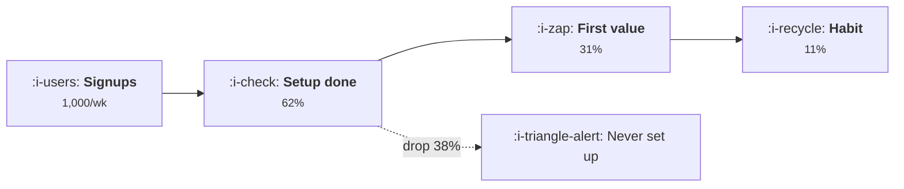

# Plan of Action — An Operator's Course Library
### Product · Growth · GTM · Operations · AI × Sectors
Built on the same shell as **Pidoku** (`riteshsonawane1372/Learning-materials`)

---

## 0. What I found in the reference repo (this changes the plan)

It is a **Hugo static site** where *content is plain markdown folders at the repo root* and
the site is generated from them by a content adapter (`content/_content.gotmpl`).

**The good news: you genuinely do not need to touch the codebase.** To add a course you:

1. Create a folder at the repo root with markdown in it.
2. Add ~10 lines to `config.yaml` (`params.courses` + one `module.mounts` line).
3. Optionally add SEO entries to `data/seo.yaml`.

`layouts/`, `assets/`, `static/fonts`, `tools/` are never edited. That's the whole integration.

**Two corrections to my first assumptions:**

- **Diagrams are Mermaid, not `.excalidraw` files.** The repo vendors `mermaid.min.js` and the
  **Excalifont** typeface, and `layouts/_markup/render-codeblock-mermaid.html` + `assets/js/main.js`
  render ```` ```mermaid ```` blocks in a hand-sketched, Excalidraw-*like* style with an **Expand**
  button. So diagrams are written as text inside the lesson file. This is strictly better for you:
  no binary assets, no export step, diffable in git, and they render on GitHub too.
- **There are no "modules".** The hierarchy is **course → topic → lesson**, and topics are assigned
  to one of five learning levels in `config.yaml`. The repo README says this explicitly:
  *"Nothing is numbered as a 'module'."*

**Conventions the site infers from the files themselves** (so lessons carry almost no frontmatter):

| Convention | Effect |
| --- | --- |
| `README.md` in a folder | that folder's landing page |
| folder inside a course | a **topic**; its order comes from the `levels:` list in `config.yaml` |
| `I-`, `II-` … folder prefix | topic ordering (Roman numerals, stripped from the title) |
| `01-`, `02-` … file prefix | lesson ordering |
| first `# Heading` in the file | the page title (and it's removed from the body) |
| ```` ```text ```` block with `Level: / Prerequisites: / Estimated difficulty: n/5 \| Estimated time: n min` | difficulty badge, prereqs, reading time |
| ```` ```mermaid ```` block | rendered hand-drawn diagram |
| `:kubernetes:` / `:i-users:` inside a diagram label | draws `static/logos/<name>.svg` inline |
| `projects/` folder (not listed in `levels`) | appears under **"Build"** on the course page |
| first paragraph after the metadata block | the card blurb / meta description |

Everything is relative-linked `.md`, so **every file must read well both on GitHub and on the
site.** That's a real constraint on how you write.

---

## 1. The structural decision: many courses, not one

The temptation is one course called "Product & Growth" with topics = Product, Growth, GTM, Ops, AI.
**Don't.** The shell forces every topic onto a *difficulty* ladder (Foundations → Expert). Five
functions are not five difficulty levels — you'd be declaring Ops "expert" and Product
"foundations", which is nonsense and makes the sidebar lie.

**One course per discipline, each with its own Foundations→Expert ladder.** This is exactly how
the reference repo handles the same problem (GPUs, inference, observability, Go, system design,
security are separate courses that cross-link), and it means you can ship one complete course and
have a real site, instead of seven half-courses.

### The library

| # | Course folder | What it covers | Phase |
| --- | --- | --- | --- |
| 1 | **`product-management`** ⭐ | **The flagship, 16 topics.** The function, strategy, technical and design literacy, archetypes, platform, ML products, trust & safety, **product by sector**, lifecycle, product ops | 1 |
| 2 | `metrics-and-models` | **The single source of truth for every metric and formula.** Every other course links here | 1 (partial) |
| 3 | `growth-engineering` | Growth as a system: loops, acquisition, activation, retention, monetisation, lifecycle | 2 |
| 4 | `gtm-engineering` | Market, buyer, positioning, motions, pipeline, launch | 3 |
| 5 | `revenue-operations` | Operating cadence, funnel architecture, systems of record, data ops, process, finance ops | 4 |
| 6 | `ai-engineering` | **Building AI products.** Model primitives, context and retrieval, workflows vs agents, **evals**, AI UX and trust, cost and margin, shipping | 5 |


### The two cross-cutting rules that keep this from exploding

**Rule 1 — Metrics are defined in exactly one place.** `metrics-and-models` owns every formula
(CAC, LTV, payback, NDR/GRR, magic number, activation rate, cohort retention, pipeline coverage,
cost-per-task, eval pass rate). Every other lesson *links*, never redefines. Without this rule
you will have four different definitions of CAC in six months.

**Rule 2 — Sectors live inside the course they modify, and `product-management` owns the canon.**
Function × sector is 25 combinations; writing all of them as full content is how this repo dies.
Instead:

- **`product-management/XIII-product-by-sector`** holds seven *full* lessons — one per sector — and
  its `README.md` carries the cross-sector comparison matrix (buyer, cycle, regulation, data,
  margin, abuse surface). This is the single definition of market shape.
- Every other course gets one Expert-level sector topic of **short deltas** (600–1,200 words per
  sector) — `growth-engineering/VIII-growth-by-sector`, `gtm-engineering/VIII-gtm-by-sector`,
  `revenue-operations/VIII-operations-by-sector`, `ai-engineering/IX-ai-by-sector` — which state
  only what changes for that function and link back to the matrix.
- **Archetype is read before sector.** `product-management/IX-product-archetypes` (marketplace,
  network, SaaS tool, consumer, vertical, embedded/open-core) is a prerequisite for every sector
  lesson, because a fintech marketplace behaves like a marketplace first. Skipping this is the
  most common way sector content turns into generic industry commentary.

There is no standalone sector course: a sector-only course has no spine of its own, reads as pure
delta, and becomes a duplication magnet.

---

## 2. Topic ladders (the sidebar, course by course)

These are the `levels:` maps that go into `config.yaml`. ~6 lessons per topic.

```yaml
- dir: product-management
  short: Product
  summary: The product function from first principles — how to find a problem worth solving,
    define it, ship it, measure it, price it, and how to build on top of it as a platform.
  levels:
    foundations:  [I-the-product-function]
    basic:        [II-discovery-and-problem-framing]
    intermediate: [III-definition-and-delivery, IV-analytics-and-experimentation]
    advanced:     [V-pricing-and-packaging, VI-platform-and-api-products]
    expert:       [VII-worked-product-decisions]

- dir: metrics-and-models
  short: Metrics
  summary: Every number an operator is judged on — what it measures, the formula, the
    denominator people get wrong, what good looks like by sector, and a program that computes it.
  levels:
    foundations:  [I-how-to-read-a-metric]
    basic:        [II-funnel-and-acquisition]
    intermediate: [III-retention-and-cohorts, IV-revenue-and-efficiency]
    advanced:     [V-sales-and-pipeline-math, VI-unit-economics-with-ai-costs]
    expert:       [VII-benchmarks-and-their-limits]

- dir: growth-engineering
  short: Growth
  summary: Growth as a system rather than a list of tactics — the loop, the model, the
    experiment machine, and the four places compounding actually comes from.
  levels:
    foundations:  [I-how-growth-works]
    basic:        [II-acquisition]
    intermediate: [III-activation-and-onboarding, IV-retention-and-engagement]
    advanced:     [V-monetisation-and-expansion, VI-lifecycle-and-automation]
    expert:       [VII-the-growth-operating-system]

- dir: gtm-engineering
  short: GTM
  summary: Taking a product to a market — sizing it, naming the buyer, positioning against
    the alternative, picking a motion, building pipeline arithmetic that holds, and launching.
  levels:
    foundations:  [I-market-and-buyer]
    basic:        [II-positioning-and-messaging]
    intermediate: [III-motions-and-channels, IV-pipeline-and-demand]
    advanced:     [V-launch-and-lifecycle, VI-ai-in-the-gtm-stack]
    expert:       [VII-worked-gtm-plans]

- dir: revenue-operations
  short: Operations
  summary: The machinery underneath — operating cadence, the funnel as a data model, systems
    of record, reporting you can trust, process design, and the economics of running it.
  levels:
    foundations:  [I-why-operations-exists]
    basic:        [II-operating-cadence-and-goals]
    intermediate: [III-funnel-and-systems-architecture, IV-data-and-reporting]
    advanced:     [V-process-design-and-automation, VI-finance-operations]
    expert:       [VII-trust-risk-and-compliance]

- dir: ai-engineering
  short: AI
  summary: Building products with a model inside them — what a model changes about a product,
    the primitives, context and retrieval, where a workflow beats an agent, how to know it
    works, how it should feel, and what it costs to run.
  levels:
    foundations:  [I-what-a-model-changes]
    basic:        [II-model-primitives]
    intermediate: [III-context-and-knowledge, IV-workflows-and-agents]
    advanced:     [V-evaluation-and-quality, VI-ai-ux-and-trust]
    expert:       [VII-shipping-and-economics, VIII-worked-ai-features]

- dir: sector-playbooks
  short: Sectors
  summary: The same playbooks, bent by the market they run in — enterprise software, fintech,
    ecommerce, marketplaces and developer tools, written as differences from the spine.
  levels:
    foundations:  [I-why-the-sector-changes-everything]
    basic:        [II-enterprise-b2b-saas]
    intermediate: [III-fintech, IV-ecommerce-and-d2c]
    advanced:     [V-marketplaces, VI-devtools-and-infra]
    expert:       [VII-worked-sector-entries]
```

Note the **`VII-worked-*` topic at expert level in every course** — that's the single best idea in
the reference repo (`ai-system-design/worked-designs/`). A worked lesson runs one real decision
end to end in a fixed order. For this domain that order is:

> **situation → numbers → options → decision → how it's measured → what would falsify it**

And **`projects/`** in each course (the "Build" shelf): *build a growth model*, *build a cohort
retention table*, *build a pricing calculator*, *build an eval harness for an AI support bot*,
*build a pipeline-coverage model*, *build an ICP scoring sheet*.

---

## 2b. The `ai-engineering` course in full

Scoped deliberately to **building AI products** — the product surface, not the infrastructure
under it. Hard boundary: **no model serving, no GPUs, no training, no cluster design.** If a
lesson starts explaining attention kernels, it's in the wrong repo.

The rest of the AI content stays distributed: `## The AI layer` appears in every lesson of every
course (what changes in *that* playbook when a model is involved), and
`gtm-engineering/VI-ai-in-the-gtm-stack` covers AI in the go-to-market stack. So `ai-engineering`
answers "how do I build and ship a feature with a model in it", and nothing else.

```
ai-engineering/
  README.md                       course landing page
  GLOSSARY.md

  I-what-a-model-changes/                                    [Foundations]
    01-the-five-facts.md            slow, costly, probabilistic, priced per token, persuadable
    02-ai-feature-vs-normal-feature.md   what breaks in your PRD, QA, support and pricing
    03-what-models-can-and-cannot-do.md  the capability map, dated
    04-when-not-to-use-a-model.md        the deterministic alternative, and how to argue for it

  II-model-primitives/                                       [Basic]
    01-tokens-and-the-context-window.md
    02-latency-that-users-feel.md        TTFT, tokens/sec, streaming, p95 vs average
    03-cost-per-request.md               the arithmetic every AI PRD needs and never has
    04-structured-output-and-schemas.md
    05-choosing-a-model.md               frontier vs small, hosted vs open, the real tradeoff
    06-the-non-determinism-problem.md    temperature, reproducibility, flaky QA

  III-context-and-knowledge/                                 [Intermediate]
    01-the-prompt-is-a-spec.md           prompting as product definition, not magic words
    02-context-engineering.md            what goes in the window, what it costs, what gets lost
    03-retrieval-and-grounding.md        RAG for a PM: what it fixes and what it doesn't
    04-citations-and-provenance.md
    05-when-finetuning-is-the-answer.md  (rarely — and what to do instead)
    06-knowledge-that-goes-stale.md      freshness, invalidation, the wrong-answer half-life

  IV-workflows-and-agents/                                   [Intermediate]
    01-the-autonomy-spectrum.md
    02-when-a-workflow-beats-an-agent.md   the most money-saving lesson in the course
    03-tools-and-actions.md
    04-human-in-the-loop-and-approval-gates.md
    05-containing-failure.md               blast radius, reversibility, what it may touch
    06-multi-step-reliability.md           why 95% per step is 60% over ten steps

  V-evaluation-and-quality/                                  [Advanced]  ← flagship topic
    01-why-you-cannot-unit-test-a-model.md
    02-building-the-dataset.md             30-50 real cases, not 5,000 synthetic ones
    03-graders-code-judge-and-human.md
    04-statistics-you-cannot-skip.md       confidence intervals, repeated runs, flipped cases
    05-the-release-gate.md                 what must pass before a prompt change ships
    06-online-signals-and-reading-traces.md

  VI-ai-ux-and-trust/                                        [Advanced]
    01-the-trust-budget.md                 you get a fixed number of wrong answers. spend them well
    02-showing-uncertainty.md
    03-designing-for-wrong-answers.md      undo, edit, escalate, cite
    04-latency-as-a-design-material.md     streaming, progress, optimistic UI
    05-permissions-and-consent.md
    06-feedback-loops-in-the-ui.md         how the UI feeds the eval dataset

  VII-shipping-and-economics/                                [Expert]
    01-unit-economics-of-an-ai-feature.md  cost per task vs the price you charge
    02-pricing-and-packaging-ai.md         seats, credits, usage, outcome-based
    03-margin-under-load.md                caching, routing, small models, batching
    04-rollout-and-canary.md
    05-monitoring-an-ai-feature.md
    06-safety-privacy-and-policy.md        in the product, not in a company policy doc

  VIII-worked-ai-features/                                   [Expert]
    01-an-in-product-copilot.md
    02-an-ai-support-assistant.md
    03-an-ai-analyst-feature.md
    04-the-ai-feature-review.md            the review ritual, as a checklist you can run

  projects/                                                  ["Build" shelf]
    01-eval-harness/                       a dataset + three graders + a pass rate with an interval
    02-cost-model/                         cost per task under three routing strategies
    03-retrieval-quality-bench/            recall@k and faithfulness, measured separately
    04-trust-budget-calculator/
```

~44 lessons. Every "worked" lesson runs one real feature end to end in the fixed order:
**situation → numbers → options → decision → how it's measured → what would falsify it.**

---

## 3. The lesson template (the UI/UX contract)

Copy this shape for every lesson. Page-shape consistency *is* the UX — it's what lets someone
skim 40 lessons the same way. The reference repo's shape, with two additions:

````markdown
# Activation: The First Ten Minutes

```text
Level: Intermediate
Prerequisites: How Growth Works
Estimated difficulty: 3/5 | Estimated time: 40 min
```

## The idea in one minute

The whole lesson in four or five sentences, making a claim. No preamble, no "in today's
fast-moving world". This paragraph also becomes the card blurb and the meta description, so it
must stand alone.

## A picture



One sentence under the diagram saying what to notice in it.

## How it really works

The precise version. `###` subsections. Tables for anything comparative. Real numbers
everywhere. End with a **### What fills the box in 2026** subsection naming the actual tools —
keeping the reference repo's convention, and its caveat that the mechanism outlives the tool.

## Run the numbers

*(This is the reference repo's `## Code` slot, repurposed.)* A small **Go program, standard
library only**, that computes the thing the lesson is about. `tools/gocheck` in the repo
compiles every Go block, so it has to actually build — which is the point: the arithmetic is
checkable, not asserted. This is the single biggest differentiator from every other
product/growth resource, where no number is ever runnable.

## The AI layer

*(New section — content only, no code change: the layouts render any H2.)* Short and specific:
where a model genuinely helps here, what it costs per unit of work, and the way it fails. If
there is no honest answer, write "nothing yet, and here's why" — that's more credible than a
paragraph of hedging.

## Sector lens

*(New section.)* A five-row table: Enterprise / Fintech / Ecommerce / Marketplace / Devtools,
one line each, linking to the matching `sector-playbooks` delta page.

## Remember this
Four or five bullets. The things that should survive a year.

## Try it
Three tasks. The third always applies it to the reader's own product.

## Check yourself
Three questions with non-obvious answers.
````

### Diagram conventions to reuse exactly

Six Mermaid classes exist in the stylesheet — **use these names, don't invent any** (new ones
would need a CSS change, which breaks the no-codebase-change rule):

| Class | Reference meaning | Your meaning |
| --- | --- | --- |
| `neutral` | generic | people, market, demand |
| `compute` | does work | the team/system doing the thing |
| `queue` | buffers, gates | decisions, stage gates, approvals |
| `io` | external edges | channels, buyers, partners, integrations |
| `memory` | stores state | CRM, warehouse, the habit, the installed base |
| `warn` | danger | churn, risk, failure, leakage |

Six grammars cover nearly everything here: **loop** (compounding), **funnel** (stage conversion),
**2×2** (strategy choice), **swimlane** (who owns what), **layer stack** (a stack diagram), and
**system map** (data + money flow). Pick the grammar before you draw. One diagram per section,
answering exactly one question.

Diagrams can name a tool by its logo: `:stripe:`, `:notion:`, `:i-funnel:`. That's `go run
./tools/logos`, which vendors marks from Simple Icons and glyphs from Lucide into `static/logos/`.
**You will need to add GTM-world slugs** to the `brands` list in `tools/logos/main.go` —
`salesforce hubspot segment amplitude mixpanel posthog shopify braze customerio outreach gong clay
zapier dbt looker metabase intercom zendesk linear klaviyo` — plus Lucide glyphs `trending-up
target handshake megaphone shopping-cart credit-card receipt landmark store ticket`. Be aware:
**this is the one file outside config and content that you'll edit.** It's an icon manifest, not
site logic, but it's an honest exception to "zero code changes".

---

## 4. Phase 0 — fork and lock the look (one session, do this first)

1. Fork or clone to a new repo. Suggested names: `operator-material`, `gtm-material`,
   `operator-handbook`.
2. **Delete the seven AI-infra course folders.** Keep `layouts/ assets/ static/ content/ data/
   tools/ config.yaml go.mod .gitignore`.
3. Rewrite `config.yaml`: `baseURL`, `title`, `params.hero.title`, `params.footer`,
   `params.seo.*`, `params.author`, `params.github`, then `courses: []` and matching
   `module.mounts`. Also reword `params.levels` blurbs — the current ones are
   inference-flavoured ("Learn the optimization techniques"). Suggested:

   ```yaml
   levels:
     - { key: foundations,  name: Foundations,  blurb: Build the mental model. }
     - { key: basic,        name: Basic,        blurb: Learn the core mechanisms. }
     - { key: intermediate, name: Intermediate, blurb: Run the playbooks. }
     - { key: advanced,     name: Advanced,     blurb: Operate at scale. }
     - { key: expert,       name: Expert,       blurb: Make the calls and defend them. }
   ```

4. Reduce `data/seo.yaml` to its header comment plus `pages: {}`.
5. Rewrite the root `README.md` as your own course table.
6. Check prerequisites: **Hugo extended, recent version** (the `_content.gotmpl` content adapter
   needs ≥ 0.126) and **Go** for `tools/`. Run `hugo server` and confirm an empty site builds.
7. Add the logos you need (step 3 above).
8. **Write exactly one golden lesson, completely**, plus its topic README and course README.
   Recommended: `metrics-and-models/IV-revenue-and-efficiency/01-cac-payback-and-ltv.md` — it
   exercises every element at once (a funnel diagram with logos, comparison tables, a real Go
   calculator, a genuine AI-cost angle, a strong sector lens).
9. Verify on the rendered page: diagram renders hand-drawn and **Expand** works · level badge and
   reading time parsed from the ```` ```text ```` block · TOC built from your H2/H3 · breadcrumbs ·
   prev/next pager · relative `.md` links resolve · search finds it · it still reads fine on GitHub.

**Do not write lesson two until lesson one is finished.** Every later lesson is a copy of it; a
flaw in the golden lesson gets copied 200 times.

---

## 5. Build phases after that

| Phase | Deliverable | Size |
| --- | --- | --- |
| **1a** | `product-management` spine: topics **I–VIII** + `metrics-and-models` Foundations/Basic/`IV-revenue-and-efficiency` | ~47 + ~18 |
| **1b** | `product-management` topics **IX–XII** (archetypes, platform, ML products, trust & safety) | ~25 |
| **1c** | `product-management` topics **XIII–XVI** (sector, lifecycle, product ops, worked) — course complete | ~25 |
| **2** | `growth-engineering` complete + rest of `metrics-and-models` | ~47 + ~20 |
| **3** | `gtm-engineering` complete | ~47 |
| **4** | `revenue-operations` complete | ~47 |
| **5** | `ai-engineering` complete | ~50 |
| **7** | `projects/` shelves, per-course `GLOSSARY.md`, `data/seo.yaml` entries, cross-course "How it connects" sections | — |

That's ~327 lessons at full build — the reference repo is ~800 files, so this is the same order of
magnitude and the same multi-month commitment. **A realistic v1 is Phases 0 and 1a–1c:** the whole of
`product-management` plus the metrics spine — ~160 lessons, a coherent and publishable site on its own.

**Cadence:** 2–4 lessons per working session; a topic is finished before the next one starts. Ship
a topic `README.md` with its lesson table the moment the topic folder exists, so the sidebar is
never a dead end.

---

## 6. Definition of done (per lesson)

- [ ] `# Heading` present; metadata ```` ```text ```` block complete and correctly formatted
- [ ] "Idea in one minute" stands alone and makes a claim (it becomes the blurb + meta description)
- [ ] ≥1 Mermaid diagram using only the six existing classes, with a caption line
- [ ] Every logo token resolves to a file in `static/logos/`
- [ ] Go block compiles with stdlib only (`go run ./tools/gocheck`)
- [ ] Every metric links to `metrics-and-models`, defined nowhere else
- [ ] `## The AI layer` is specific — names where a model fits, cost per unit, how it fails
- [ ] `## Sector lens` covers all five sectors, linked
- [ ] Every number sourced and dated inline
- [ ] "Remember this" / "Try it" / "Check yourself" all present
- [ ] All relative links resolve **on GitHub and on the site**
- [ ] Topic `README.md` lesson table updated

---

## 7. Risks

| Risk | Handling |
| --- | --- |
| Function × sector matrix explosion | Full treatment in `product-management/XIII` only; every other course carries short deltas |
| Sector lessons drifting into industry commentary | `IX-product-archetypes` is a prerequisite — shape before market |
| Generic MBA filler | Mandatory runnable numbers, a real tool landscape, and a worked decision per topic |
| Four definitions of CAC | `metrics-and-models` is the only definition site |
| AI bolted on as a chapter | `## The AI layer` in every lesson, *and* `ai-engineering` as a full course |
| 255 stubs in `main` | Definition of done; a topic ships complete or not at all |
| Benchmarks rotting | Date every number inline, like the reference repo's "checked on 3 October 2026" |
| `ai-engineering` drifting into infra | Hard scope boundary: it stops at the product surface. No serving, GPUs, or model training |
| Drifting into codebase edits | Only `config.yaml`, `data/seo.yaml`, course folders, and the `tools/logos` icon list |

---

## 8. Open decisions

1. **Repo name** + public or private.
2. **Course naming** — `ai-engineering` is settled. `growth-engineering` / `gtm-engineering` lean
   into the same suffix and the real emerging job titles; `growth` / `gtm` are plainer. Pick one
   style and apply it to all seven.
3. **Confirm the course order** — Product first, or Growth first?
4. **Is `## Run the numbers` in Go the right call?** It keeps `tools/gocheck` useful and the UI
   identical, and it's the strongest differentiator. The alternative is a markdown table of worked
   arithmetic, which is easier to write and less impressive.
5. **Audience** — your own learning artifact, or a public resource? It changes how much is cited
   versus asserted, and how much the sector benchmarks need sourcing.
