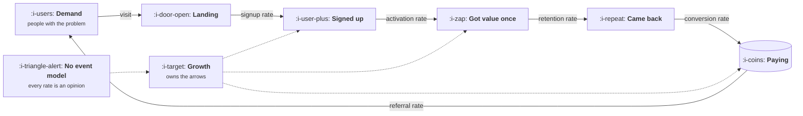

# Growth Engineering: Growth as a System

> Learn growth as a machine with inputs, rates and a reinvestment step, rather than as a list of
> tactics that worked once at a company whose conditions you do not share. The loops, the model
> that forecasts them, the channels that feed them, the product surfaces that move them, and the
> instrumentation without which none of it can be measured.

Most growth writing is a list. Fifty tactics, ranked by how well they worked for somebody else, at
a price point you do not charge, with a sales motion you do not run. It is readable and almost
useless, because a tactic is the visible end of a mechanism, and the mechanism is the part that
transfers between companies.

This course inverts that. Every lesson starts with the mechanism, shows the arithmetic where
arithmetic decides the answer, and names the tool last, with the caveat that the list will have
changed by the time you read it.

**The word engineering is doing real work in the title.** Growth that cannot be measured cannot be
claimed, so instrumentation, the event model and the experiment platform are treated as first class
subjects rather than as an appendix for the data team.

It assumes you have worked near software and can read a table of numbers. It does **not** assume
you have run a channel, owned a budget, written an event schema or shipped an experiment.

## What this course does not teach

Every number this course uses is defined in the product course, once, with its formula and the
denominator people get wrong. Growth links to those definitions and never restates them. This is
not tidiness: four definitions of acquisition cost inside one library is how a reader stops
trusting any of them.

| If you want | Read it there |
|---|---|
| Funnel mechanics, retention definitions, cohort tables, A/B power and peeking | [Funnel, Retention and Experiments](../product-management/funnel-retention-and-experiments/README.md) |
| Acquisition cost, payback, lifetime value, revenue retention, gross margin | [Revenue and Efficiency](../product-management/revenue-and-efficiency/README.md) |
| Denominators, vanity metrics, mix shift, the north star argument | [How to Read a Metric](../product-management/how-to-read-a-metric/README.md) |
| Value metric, tiers, price discovery, changing a price | [Pricing and Packaging](../product-management/pricing-and-packaging/README.md) |
| Market shape by sector: buyer, cycle, regulation | [Product by Sector](../product-management/product-by-sector/README.md) |

So this course owns four things instead: the loops, the channels, the product surfaces that move a
rate, and the machinery that makes a measured change possible.

## Where a growth team acts

The team's name is on the arrows and almost never on the boxes. Everything difficult about the job
follows from that, and the dotted red node is the state most companies are in when they hire for it.

## How this course works

Every lesson follows the same shape.

1. **The idea in one minute.** The argument, in a few sentences.
2. **A picture.** The mechanism. Press **Expand** on any diagram to open it full size.
3. **How it really works.** The precise version, with names and numbers.
4. **Run the numbers.** Where arithmetic decides, a small Go program using only the standard
   library, so you can put your own inputs in.
5. **The AI layer.** What a model changes about this specific piece of work, what it costs, and how
   it fails. Omitted in the two AI topics, where the whole lesson is that layer.
6. **Sector lens.** The same mechanism in enterprise software, fintech, ecommerce, marketplaces,
   devtools, healthtech and vertical software.
7. **Remember this**, **Try it**, **Check yourself.**

## The topics

| Topic | You will be able to | Level |
|---|---|---|
| [the Growth Function](the-growth-function/README.md) | Say what a growth team owns, where it sits, what it is allowed to touch, and how its work is judged | Foundations |
| [Loops and Compounding](loops-and-compounding/README.md) | Tell a loop from a funnel, compute your loop factor, and say why most loops stall and when | Foundations |
| [the Growth Model](the-growth-model/README.md) | Write your business as one equation, find the input worth a quarter, and refuse a target that is outside it | Foundations |
| [Acquisition Channels](acquisition-channels/README.md) | Work out which channels exist for you, test one honestly, know when it is finished, and survive one dying | Basic |
| [Content and Search](content-and-search/README.md) | Rank your queries by revenue rather than volume, know when generated pages help, and build a library that compounds | Basic |
| [Paid Acquisition](paid-acquisition/README.md) | Read the auction, put the work where the variance is, read a report without being misled, and test whether paid compounds | Basic |
| [Virality and Referral](virality-and-referral/README.md) | See the distribution behind your loop factor, price a referral programme honestly, and size a reward against fraud | Basic |
| [Activation and Onboarding](activation-and-onboarding/README.md) | Choose an activation definition that can be moved, tell an aha moment from a description of intent, and price every step of a flow | Intermediate |
| [Engagement and Resurrection](engagement-and-resurrection/README.md) | Find your frequency ceiling, measure whether your sends are the habit, and decide when to stay quiet | Intermediate |
| [Lifecycle Messaging](lifecycle-messaging/README.md) | Build a per user message map, protect deliverability, place a message where it does not cost a task, and hold the attention budget | Intermediate |
| [Monetisation and Conversion](monetisation-and-conversion/README.md) | Find where the paying decision actually happens, choose a packaging shape with the arithmetic, and build a cancel flow that is not a trap | Intermediate |
| [Instrumentation and the Event Model](instrumentation-and-the-event-model/README.md) | Design a taxonomy that stays small, stitch three identities honestly, make the tracking plan a gate, and catch the slow rot | Advanced |
| [the Experiment Machine](the-experiment-machine/README.md) | Build the six parts, find the silent assignment bugs, price peeking, and write a result the company believes | Advanced |
| [Growth Process and Cadence](growth-process-and-cadence/README.md) | Run a meeting that decides things, find where the pipeline jams, and stop the team rerunning its own results | Advanced |
| [Product Led Growth](product-led-growth/README.md) | Test whether your product can be sold without a salesperson, route signups by arithmetic, and price the enterprise ceiling | Expert |
| [Growth Economics](growth-economics/README.md) | Know which numbers are yours, allocate at the margin, defend a budget with a stopping rule, and answer a target honestly | Expert |
| [AI in Growth](ai-in-growth/README.md) | Say what a model changes about this job, where the quality floor is, what the loops cost, and how they fail quietly | Expert |
| [Growth for AI Products](growth-for-ai-products/README.md) | Compute a breakeven use count, bound a free tier, survive a model change, and fix a margin that falls in your best cohort | Expert |
| [Growth by Sector](growth-by-sector/README.md) | Work out which techniques invert in your market, and where the real constraint sits | Sectors |

**All five levels are written: 119 lessons across nineteen topics.** Foundations gives you the
function, the loops and the model. Basic gives you the four channels one at a time. Intermediate is
the product surfaces growth owns. Advanced is the machinery without which none of it is measurable.
Expert is motion, economics and what changes when there is a model in the loop or in the product.
Sectors is the delta per market. The full map is in [the course map](../COURSE-MAP.md).

## The Reference and Build shelves

Four reference pages and six build briefs, which are not lessons and are meant to be used rather
than read.

| Page | What it is for |
|---|---|
| [Roadmap](ROADMAP.md) | One path through all 119 lessons, plus four short routes for people who arrived with a specific problem |
| [Workflows](WORKFLOWS.md) | Six procedures you can run: build the model, test a channel, write a tracking plan, launch an experiment, run the meeting, diagnose a flat curve |
| [Glossary](GLOSSARY.md) | The seventy one terms specific to growth work. Metric terms point at the product course, which defines them once |
| [References](REFERENCES.md) | Where to go for more, every link checked live and dated |
| [Projects](projects/README.md) | Six build briefs on a real product, each producing an artefact you can show somebody |

## What you need

Go 1.22 or newer if you want to run the programs, and a terminal. Every program runs offline with
no account, no key and no network.

## A promise about names and numbers

Tool names and published figures in this course were checked on **26 October 2026**. Tool
landscapes rot within a year. Mechanisms do not, and every lesson separates the two so you know
which half to recheck.
