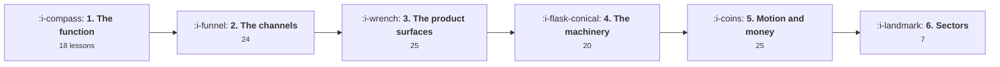
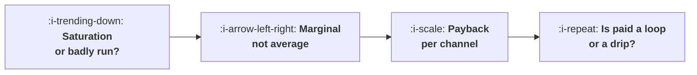

# Roadmap

One path through everything that is written, plus four shorter routes for people who arrived with a
specific problem. The full path is **119 lessons, about 70 hours of reading**, and it runs from what
a growth team is for to the markets it runs in.

The working method matters more than the order. Read a lesson, run its program with your own
numbers, and do the third exercise, which is always the one that applies the lesson to your own
product. Skipping the programs halves the value, because what most of these lessons actually teach
is that a number you assumed was right is wrong.

## The path

Each stage assumes the one before it. The two that are most often skipped are the first and the
fourth, and skipping either produces the same failure: a team that runs a great deal of activity and
cannot say what any of it was worth.

### 1. The function, the loops and the model

Start here even if you have been doing this for years, because the three topics in Foundations are
the ones that decide whether the rest is coherent.

[The Growth Function](the-growth-function/README.md) is what this team owns and what it is not.
[Loops and Compounding](loops-and-compounding/README.md) replaces the funnel picture, which is the
single most useful swap in the course. [The Growth Model](the-growth-model/README.md) turns your
business into one equation, which is the artefact every later decision is argued against.

### 2. The channels, one at a time

[Acquisition Channels](acquisition-channels/README.md) first, because the arithmetic of a fair
channel test applies to all the others. Then
[Content and Search](content-and-search/README.md),
[Paid Acquisition](paid-acquisition/README.md) and
[Virality and Referral](virality-and-referral/README.md) in whichever order matches what you
actually run.

### 3. The product surfaces growth owns

[Activation and Onboarding](activation-and-onboarding/README.md),
[Engagement and Resurrection](engagement-and-resurrection/README.md),
[Lifecycle Messaging](lifecycle-messaging/README.md) and
[Monetisation and Conversion](monetisation-and-conversion/README.md). In that order, because each
assumes the one before: there is no point messaging people into a product that does not activate
them.

### 4. The machinery

[Instrumentation and the Event Model](instrumentation-and-the-event-model/README.md) before
[The Experiment Machine](the-experiment-machine/README.md), because an experiment on bad events is
worse than no experiment. Then
[Growth Process and Cadence](growth-process-and-cadence/README.md), which is how the machinery gets
operated.

### 5. Motion, economics and the model in the product

[Product Led Growth](product-led-growth/README.md),
[Growth Economics](growth-economics/README.md),
[AI in Growth](ai-in-growth/README.md) and
[Growth for AI Products](growth-for-ai-products/README.md). The last two are different questions:
the first is what a model changes about doing this job, the second is what changes when the product
you are growing has a model inside it.

### 6. Sectors

[Growth by Sector](growth-by-sector/README.md), read for your own sector and then for the one
nearest it. Each lesson is a delta rather than a restatement, so read the matching
[Product by Sector](../product-management/product-by-sector/README.md) lesson first.

## Four routes for a specific problem

### "I run paid and it stopped working"

1. [Saturation and the Ceiling](acquisition-channels/04-saturation-and-the-ceiling.md) to find out
   whether the channel is finished or just mismanaged.
2. [The Marginal Pound](growth-economics/03-the-marginal-pound.md), because the average cost is
   almost certainly what you have been looking at.
3. [Payback by Channel](growth-economics/02-payback-by-channel.md) to check whether the channel ever
   paid back at all.
4. [When a Channel Dies](acquisition-channels/05-when-a-channel-dies.md) and
   [When Paid Is a Loop](paid-acquisition/06-when-paid-is-a-loop.md) for what to do next.

Seven lessons, about four hours, and it usually ends with a budget reallocation rather than a
creative brief.

### "We have no instrumentation"

1. [Why Growth Work Dies Without Instrumentation](instrumentation-and-the-event-model/01-why-growth-work-dies-without-instrumentation.md)
   for the business case, in hours rather than in principle.
2. [Designing an Event Taxonomy](instrumentation-and-the-event-model/02-designing-an-event-taxonomy.md)
   and [Identity](instrumentation-and-the-event-model/03-identity.md) before writing any code.
3. [The Tracking Plan as a Contract](instrumentation-and-the-event-model/04-the-tracking-plan-as-a-contract.md)
   and [Client, Server or Both](instrumentation-and-the-event-model/05-client-server-or-both.md).
4. [Data Quality and the Slow Rot](instrumentation-and-the-event-model/06-data-quality-and-the-slow-rot.md)
   on the first day, not later.

Then run [workflow 3](WORKFLOWS.md). Five lessons and a fortnight of work, and it is the highest
return project available to most teams.

### "We are pre fit and being asked to grow"

1. [What Growth Is Not](the-growth-function/05-what-growth-is-not.md), which is the lesson to send
   to whoever is asking.
2. [Why Most Loops Die](loops-and-compounding/05-why-most-loops-die.md), because a loop with no
   retention in it cannot be fixed by acquisition.
3. [What Activation Means Here](activation-and-onboarding/01-what-activation-means-here.md) and
   [Finding the Aha Moment](activation-and-onboarding/02-finding-the-aha-moment.md), which together
   tell you whether there is anything to grow yet.
4. [When PLG Is the Wrong Answer](product-led-growth/05-when-plg-is-the-wrong-answer.md) for the two
   minute arithmetic that settles the motion question.

Four lessons. If the activation table in lesson 01 has no candidate clearing both bars, the honest
answer is that growth work will not find one.

### "The experiments keep disagreeing with the business"

1. [Assignment and Exposure](the-experiment-machine/03-assignment-and-exposure.md) for the two
   silent bugs.
2. [Guardrails and Automatic Stops](the-experiment-machine/04-guardrails-and-automatic-stops.md) for
   what peeking costs.
3. [Writing the Result](the-experiment-machine/07-writing-the-result.md) for the share of your
   declared winners that are real.
4. [Measuring a Campaign Honestly](lifecycle-messaging/06-measuring-a-campaign-honestly.md) for the
   attributed against incremental gap.

Four lessons, and the usual finding is that the experiments are fine and the reporting is not.

## What to read if you only read three

[Loops Compound, Funnels Leak](loops-and-compounding/01-funnels-leak-loops-compound.md) for the
picture. [Finding the Aha Moment](activation-and-onboarding/02-finding-the-aha-moment.md) for the
single most common error in the field.
[Experiment Velocity](the-experiment-machine/05-experiment-velocity.md) for what actually predicts
output.
