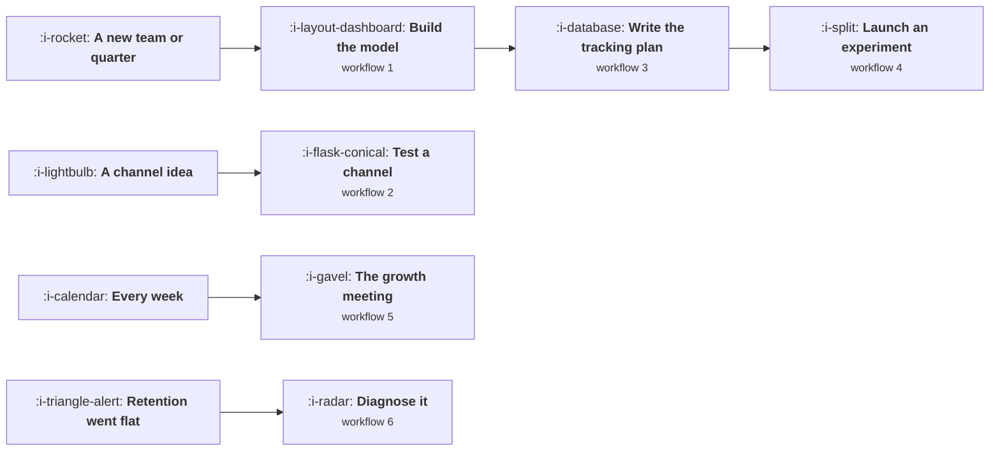

# Workflows

Six procedures you can run. Each names when it fires, the steps in order, what exists at the end,
and roughly how long it takes. They are deliberately short, because a workflow nobody can hold in
their head is a workflow nobody runs.

Every step links to the lesson that explains why it is there. If a step seems arbitrary, the lesson
is the argument for it.

## When each one fires

## 1. Build a growth model

**Fires when** you join a team, start a quarter, or realise nobody can state how the business grows
in one sentence. **Takes** two days, mostly waiting for numbers.

1. Write the output as one arithmetic statement.
   [Your Business as One Equation](the-growth-model/01-your-business-as-one-equation.md)
2. Find the handful of inputs that actually feed it, and reject the ones that only correlate.
   [Finding the Input Metrics](the-growth-model/02-finding-the-input-metrics.md)
3. Build it so somebody else can argue with it: every cell either a measurement with a date or an
   assumption marked as one.
   [Building the Model](the-growth-model/03-building-the-model.md)
4. Run sensitivity and rank the inputs by how much the output moves.
   [Sensitivity](the-growth-model/05-sensitivity.md)
5. Write down what the model cannot promise, in the model.
   [What a Forecast Can and Cannot Promise](the-growth-model/04-what-a-forecast-can-promise.md)
6. Use it once, immediately, to kill an idea somebody is attached to.
   [Using the Model to Say No](the-growth-model/06-using-the-model-to-say-no.md)

**At the end:** one spreadsheet, one page of assumptions with dates, and a ranked list of the three
inputs worth working on. If step 6 did not happen, the model is decoration.

## 2. Run a channel test

**Fires when** somebody proposes a channel. **Takes** a day to design and between two weeks and a
quarter to run.

1. Check the channel is available at all: price, frequency and purchase trigger.
   [Channel Fit](acquisition-channels/02-channel-fit.md)
2. Compute the test's cost against the gap between your bar and the channel's plausible cost. If the
   test costs more than the answer is worth, stop here and decide another way.
   [Testing a Channel Properly](acquisition-channels/03-testing-a-channel-properly.md)
3. Write the three part decision rule before any money moves, including what happens on an ambiguous
   result. The default is that ambiguity ends the test.
4. Hold the landing page, the cycle length, the launch calendar and the definition of a conversion
   constant for the whole test.
5. Read the result against the bar, not against the other channels.
6. If it passed, compute its marginal cost before scaling it.
   [The Marginal Pound](growth-economics/03-the-marginal-pound.md)

**At the end:** a decision, a number, and a dated note in the archive so nobody retests it in two
years.
[Writing Down What You Learned](growth-process-and-cadence/04-writing-down-what-you-learned.md)

## 3. Write a tracking plan

**Fires when** you cannot answer a question you should be able to answer, or before any new product
area ships. **Takes** a week for the grammar and twenty events, then ongoing.

1. Write the grammar on one page: object list, action list, property vocabulary, allowed values.
   [Designing an Event Taxonomy](instrumentation-and-the-event-model/02-designing-an-event-taxonomy.md)
2. Decide the three identities and put the account identifier on every event rather than relying on
   a join. [Identity](instrumentation-and-the-event-model/03-identity.md)
3. Pick the twenty events that answer your five most important questions. Each one gets the question
   it exists to answer written next to it.
4. Decide client or server per event, and deliberately overlap the ones that matter.
   [Client, Server or Both](instrumentation-and-the-event-model/05-client-server-or-both.md)
5. Put the plan in the repository, and make a plan change required in the same pull request as an
   event change.
   [The Tracking Plan as a Contract](instrumentation-and-the-event-model/04-the-tracking-plan-as-a-contract.md)
6. Build the volume alarm on all twenty events on day one, not later.
   [Data Quality and the Slow Rot](instrumentation-and-the-event-model/06-data-quality-and-the-slow-rot.md)
7. Check what you are allowed to collect and for how long, per purpose.
   [Consent and What You May Collect](instrumentation-and-the-event-model/07-consent-and-what-you-may-collect.md)

**At the end:** a file in the repository, twenty working events, one alarm per event, and a named
owner who can refuse a new event.

## 4. Launch an experiment

**Fires when** an idea reaches the top of the backlog. **Takes** an hour to specify and however long
the arithmetic says.

1. Confirm it is an experiment and not a rollout. If the split is not random, you are measuring your
   rollout order.
   [Flags, Rollouts and Experiments](the-experiment-machine/02-flags-rollouts-and-experiments.md)
2. Compute the enrolment time from your signup rate and the effect you expect, before design work.
   [Measuring an Onboarding Change](activation-and-onboarding/07-measuring-an-onboarding-change.md)
3. Decide the population: assigned or exposed, and log an exposure event at the point of divergence
   in both arms.
   [Assignment and Exposure](the-experiment-machine/03-assignment-and-exposure.md)
4. Fix the number of planned looks and the threshold that goes with it. Write both in the plan.
   [Guardrails and Automatic Stops](the-experiment-machine/04-guardrails-and-automatic-stops.md)
5. Set the guardrails: revenue per user, error rate per arm, high percentile latency. Make them stop
   the experiment rather than notify.
6. Write what you expect to happen, with a range, before it starts.
7. Check the sample ratio before reading the result. A mismatch means discard, not caveat.
8. Write the result in the eight part shape, including the prediction from step 6.
   [Writing the Result](the-experiment-machine/07-writing-the-result.md)

**At the end:** a decision recorded with an owner, an archive entry, and one more row in your
calibration record.

## 5. Run the weekly growth meeting

**Fires** weekly. **Takes** one hour, and the preparation is generated.

1. Circulate the pre read 24 hours before: metrics, concluded experiments, pipeline state. Nobody
   narrates it in the meeting.
2. Eight minutes: anything off plan, named, with an owner and a next action.
3. Twenty six minutes: every concluded experiment gets a decision. Ship, kill, iterate, or extend
   with a stated reason. Nothing leaves undecided.
4. Sixteen minutes: confirm or cut what starts this week, with each expected effect written down.
5. Ten minutes: one thing we got wrong, and why. Chosen in advance. This item is protected.
6. Record decisions and owners only. No minutes.

[The Weekly Growth Meeting](growth-process-and-cadence/01-the-weekly-growth-meeting.md)

**At the end:** a list of decisions with owners. If the list has fewer than four items, the agenda
has drifted back to status.

## 6. Diagnose a flat retention curve

**Fires when** retention stops improving, or when engagement rises and retention does not. **Takes**
three days.

1. Check the instrument before the product: event volumes, per platform, per version, and the
   client against server ratio.
   [Data Quality and the Slow Rot](instrumentation-and-the-event-model/06-data-quality-and-the-slow-rot.md)
2. Check the denominator: signup cohorts with a fixed window per user, not a calendar window.
   [Windows, Cohorts and Snapshots](../product-management/how-to-read-a-metric/04-windows-cohorts-and-snapshots.md)
3. Check the mix: retention by acquisition channel. A channel shift moves the aggregate while every
   channel is flat.
   [Simpson's Paradox and Mix Shift](../product-management/how-to-read-a-metric/05-simpsons-paradox-and-mix-shift.md)
4. Check the frequency ceiling. If the job arises every nine days, a flat curve may be the ceiling.
   [Natural Frequency](engagement-and-resurrection/01-natural-frequency.md)
5. Check the dependence ratio. If returns are externally led, the sends are the habit.
   [Triggers](engagement-and-resurrection/02-triggers.md)
6. Check the activation definition's separation. Under ten percentage points means you have a
   measurement problem rather than a retention one.
   [What Activation Means Here](activation-and-onboarding/01-what-activation-means-here.md)
7. For a product with a model in it, check gross profit per cohort as well as retention. They can
   point opposite ways.
   [Usage Growth That Destroys Margin](growth-for-ai-products/06-usage-growth-that-destroys-margin.md)

**At the end:** one named cause with evidence, or a written statement that the curve is at its
ceiling, which is a legitimate answer and stops a year of work.
