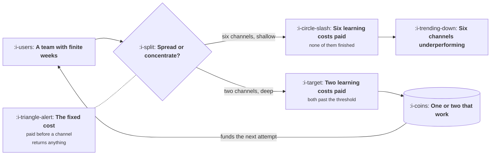

# Why Companies Have One or Two Channels

```text
Level: Basic
Prerequisites: Using the Model to Say No
Estimated difficulty: 2/5 | Estimated time: 30 min
```

## The idea in one minute

Almost every company that reaches real scale does so on one or two acquisition channels, and the
long list in the growth plan quietly becomes a short list within a year. This is treated as a
failure of ambition and it is mostly arithmetic. A channel has a large fixed cost to learn that
is paid before it returns anything, that cost does not shrink with the size of your team, and the
returns within a channel are concentrated enough that the second best thing you could do is
usually much worse than the best. Given a finite team, the strategy that wins is depth on two
rather than presence on six, and the companies that look diversified are usually the ones that
got large enough to afford a second serious attempt.

## A picture



The fixed cost is the whole mechanism. Every arrow out of the decision node pays it once per
channel, and a team that pays it six times has usually finished none of them.

## How it really works

### The fixed cost of learning a channel

Before a channel produces anything useful you have to pay for a set of things that do not scale
down. You need enough conversions to know what it actually costs, which is lesson 03 and is
expensive on its own. You need the creative or the content or the sequence to be good rather than
first draft, which takes several iterations. You need somebody to have developed judgement about
the channel, which is months rather than weeks. And you need the landing experience built for
that channel's traffic rather than for your homepage visitor.

That bundle costs something like one person for two quarters plus a test budget, and it is the
same for a company with eight growth people as for one with two. It does not get cheaper because
you are bigger; it gets more affordable.

So a team of four can seriously attempt about two channels a year. Attempting six means paying
six fixed costs with the budget for two, and the predictable result is six channels stuck just
short of the point where any of them would have worked.

### Returns within a channel are concentrated

The second half of the argument is that channels are not equally good for a given product, and
the differences are large rather than marginal.

Once you have found the one that fits your price, your margin and the way people look for what
you sell, the next best channel is frequently twice the cost per customer or worse. Lesson 02
makes this concrete: for a low priced product, four of six channels are not merely worse, they
are arithmetically unavailable at any level of execution.

Put the two together and the conclusion follows. If the best channel is much better than the
second, and attempting a channel has a large fixed cost, then depth on the best beats breadth
across the field until you are big enough that the best one saturates.

### What this does not mean

Three qualifications, because the argument is frequently overstated in both directions.

**It is not an argument against ever testing.** You cannot know which channel is the good one
without trying several, and the companies that found their channel found it by looking. The
argument is about what happens after you find it: concentrate, rather than keeping five
experiments alive out of a sense of balance.

**It is not an argument against the second channel.** One channel is a serious risk, which is
lesson 05. The honest position is that two is the target and six is a fantasy, and that the
second should be started deliberately once the first is working rather than kept perpetually
half attempted.

**It does not apply to channels with no fixed cost.** A few things are nearly free to run
alongside anything else: an affiliate programme somebody else operates, a marketplace listing, a
partner's directory. These do not compete for the same learning budget and should not be counted
in the two.

### The usual failure sequence

It repeats closely enough to be worth naming in advance.

The plan opens with six channels, one owner each, equal expectations. By the end of the second
quarter two are clearly ahead, mostly because of who happened to own them and how fast each
channel reports. Nothing is cut, because cutting is read as admitting a mistake and everything
still has a plausible story. By the fourth quarter the two leaders are still underfunded, the
other four are consuming attention, and the summary is that growth is hard.

The intervention is a stated rule at the start: at the end of the second quarter, two channels
continue and the rest stop, and the test for continuing is written down before anyone starts. The
rule is easy to agree in advance and nearly impossible to introduce afterwards.

### What fills the box in 2026

The question of which channels exist has changed less than the discourse suggests. Search, paid
social, partnerships, outbound, marketplaces, content and community are the same list they were
a decade ago; what has moved is their relative prices and their volatility, which is lesson 05.
The one genuine addition is distribution through model vendors and their app surfaces, which is
early, unstable, and currently has the fixed cost profile of a new channel with an uncertain
ceiling. Treat it as one of your two attempts, not as a free extra.

## Sector lens

| Sector | What the short list usually is |
|---|---|
| [Enterprise B2B SaaS](../../product-management/product-by-sector/01-enterprise-b2b-saas.md) | Outbound and partnerships, with content as a slow third. The fixed cost is higher because a channel test spans a sales cycle |
| [Fintech](../../product-management/product-by-sector/02-fintech.md) | Paid search and partnerships. Compliance review raises the fixed cost of every channel, which pushes concentration further |
| [Ecommerce and D2C](../../product-management/product-by-sector/03-ecommerce-and-d2c.md) | Paid social and search. Fast feedback lowers the fixed cost, which is why this sector can genuinely run more channels at once |
| [Marketplaces](../../product-management/product-by-sector/04-marketplaces.md) | Two short lists, because supply and demand are reached differently. Four channels total, which looks like breadth and is two |
| [Devtools and Infra](../../product-management/product-by-sector/05-devtools-and-infrastructure.md) | Content and community, almost always. The fixed cost is enormous and the ceiling is high, so concentration is extreme |
| [Healthtech](../../product-management/product-by-sector/06-healthtech-and-regulated-care.md) | Outbound and conference presence. Few channels are permitted, so the choice is made for you |
| [Vertical SaaS](../../product-management/product-by-sector/07-vertical-saas.md) | Trade associations, events and word of mouth. A countable market makes most scalable channels pointless |

## Remember this

* A channel has a large fixed cost to learn that does not shrink with team size. A team of four
  can seriously attempt about two a year.
* Returns across channels are concentrated, so the second best option is often much worse rather
  than slightly worse.
* Depth on two beats presence on six, until the best one saturates.
* This is not an argument against testing. It is an argument about what to do once you have found
  something.
* Channels with no fixed cost, such as a partner directory, do not count against the two.
* Write the cut rule before anybody starts. Deciding to stop four channels is easy in advance and
  nearly impossible in quarter four.
* Two is the target, because one is a risk. Start the second deliberately rather than keeping
  five half alive.

## Try it

1. List every channel your company currently has somebody working on, with the share of a person
   each receives. Count how many are above half a person. That is your real channel count.
2. Estimate your own fixed cost for one channel: weeks of a person, plus the test budget from
   lesson 03. Divide your available weeks by it and you have the number of channels you can
   genuinely attempt this year.
3. Write the cut rule for your current set, with the date and the test. Circulate it now, while
   nobody knows which channels it will cut.

## Check yourself

1. Why does the fixed cost of learning a channel not fall as a company grows, and what does fall?
2. A competitor runs seven channels visibly and successfully. What are the two most likely
   explanations that do not require them to be better at growth than you?
3. Your team is running six channels and the plan says to cut to two. Which evidence would you
   want before choosing, and what is wrong with choosing on cost per customer alone?
