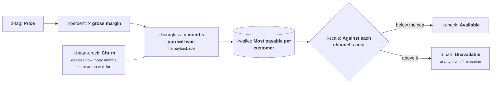

# Channel Fit

```text
Level: Basic
Prerequisites: Why Companies Have One or Two Channels
Estimated difficulty: 2/5 | Estimated time: 35 min
```

## The idea in one minute

Which channels are available to you is decided by three numbers you mostly cannot change this
quarter: your price, your gross margin and your churn. Together they set the most you can pay for
a customer, and any channel whose cost exceeds that number is unavailable at any level of
execution. This is the single most useful thing to work out before a channel strategy, because it
converts an open ended question about creativity into a short list, and it explains why a tactic
that transformed somebody else's company does nothing for yours. The tactic was not better. Their
maximum payable price was four times yours.

## A picture



Three inputs on the left that a growth team mostly inherits, and a verdict on the right that
feels like a strategy choice and is not.

## How it really works

### The cap, and which rule sets it

There are two common rules for the most you can pay to acquire a customer, and they give
different answers.

The **lifetime rule** says spend some fraction of the gross profit a customer will produce over
their life. The **payback rule** says spend no more than a stated number of months of gross
profit, because money spent today has to come back before you need it again.

For most companies the payback rule binds first and is the better one to plan with, because it
encodes a financing constraint that is real this year, while the lifetime rule encodes a
prediction about a customer who has not yet stayed. Both are defined properly in
[Revenue and Efficiency](../../product-management/revenue-and-efficiency/README.md); what matters
here is that you pick one, write down the number, and use it as the bar for every channel
conversation afterwards.

### Why churn is in the arithmetic twice

Churn sets how long a customer pays, which sets the lifetime figure. It also constrains how long
a payback period you can sensibly choose, because waiting eighteen months for a customer whose
average life is eleven is not a payback rule, it is a loss.

This is the mechanism behind a pattern that otherwise looks like a coincidence: companies with
high churn are forced into cheap channels, cheap channels are the crowded ones, crowded channels
have the least room, and so a retention problem presents itself as a channel problem one or two
quarters later. If your channel options feel unusually narrow, check churn before checking the
channels.

### Price decides who can reach you

Run the program below and the shape is immediate. The consumer product at ten pounds a month can
afford two of six channels. The prosumer product at forty five can afford four. The small
business product at two hundred and forty can afford all six, including outbound sales at two
and a half thousand per customer.

Nobody in those three companies chose their channel mix. The arithmetic chose it. And the third
company can do everything the first can do, plus four things the first cannot do at all, which
is the part worth sitting with: channel options are mostly a consequence of pricing decisions
taken much earlier, often by somebody who was not thinking about acquisition.

### The three ways to widen the list

If the available list is too short, there are exactly three moves, and all three are product or
pricing changes rather than growth changes.

**Raise the price,** or add a tier that some customers take. This widens the list immediately
and more than anything else available, which is why a growth team with narrow options should be
in the pricing conversation.

**Lower churn,** which lengthens the life and may permit a longer payback. Slower, and it
compounds, and it is the move with the best second order effects.

**Raise gross margin,** which for most software means reducing the cost of serving a customer.
Usually small, except where inference cost is a real line item, in which case it is not small at
all.

What does not widen the list is executing the unaffordable channel better. A channel costing
three times your cap is not a channel you are bad at.

### Frequency and trigger, not just price

The cap tells you which channels you can afford. Two more properties tell you which will actually
work, and they are about how people come to want the thing.

**Purchase frequency** decides whether you are buying a customer or a transaction. A product
bought once every three years cannot support a channel whose cost assumes repeat purchases, and
the arithmetic above has to run on the lifetime rather than on the month.

**The trigger** decides whether search is available to you at all. If people go looking when they
have the problem, search works, because there is demand to capture. If people do not know the
category exists, search has nothing in it and you need a channel that interrupts rather than one
that answers. This single distinction explains most failed content strategies: the content was
fine and nobody was searching.

### What fills the box in 2026

The channel costs in the program are illustrative and the real ones move, so measure your own
and date them. What is worth knowing structurally is that the cheapest channels have become
more crowded rather than less: the cost of producing content and creative has collapsed, which
has raised competition for the same attention and pushed costs up in exactly the channels a low
priced product depends on. The practical effect is that the cap matters more now than it did,
and the gap between what a high priced and a low priced product can do has widened.

## Run the numbers

Three products, the same six channels, and the arithmetic that decides which are available.

```go
// affordable.go: what you can pay for a customer decides which channels exist for you.
package main

import "fmt"

type product struct {
	name    string
	price   float64 // per month
	margin  float64 // gross margin on that price
	churn   float64 // monthly
	payback float64 // months of gross profit you are willing to spend up front
}

// lifetimeGross is the gross profit a customer produces before leaving.
// The definitions live in the product course; this uses them.
func (p product) lifetimeGross() float64 { return p.price * p.margin / p.churn }

// maxCAC under a payback rule, which is the constraint that usually binds.
func (p product) maxCAC() float64 { return p.price * p.margin * p.payback }

func main() {
	products := []product{
		{"consumer app", 9.99, 0.82, 0.090, 12},
		{"prosumer tool", 45.00, 0.78, 0.032, 12},
		{"small business SaaS", 240.00, 0.74, 0.015, 18},
	}

	channels := []struct {
		name string
		cac  float64
	}{
		{"paid social", 110},
		{"paid search, brand", 48},
		{"paid search, generic", 380},
		{"content and search", 65},
		{"partnerships", 900},
		{"outbound sales", 2_600},
	}

	for _, p := range products {
		fmt.Printf("%s: %.2f a month, %.0f%% margin, %.1f%% churn\n",
			p.name, p.price, 100*p.margin, 100*p.churn)
		fmt.Printf("  lifetime gross profit %8.0f\n", p.lifetimeGross())
		fmt.Printf("  most payable per customer %4.0f  (%.0f months of gross profit)\n\n",
			p.maxCAC(), p.payback)

		fmt.Printf("  %-22s %8s %10s\n", "channel", "cost", "verdict")
		open := 0
		for _, c := range channels {
			verdict := "closed"
			if c.cac <= p.maxCAC() {
				verdict = "open"
				open++
			}
			fmt.Printf("  %-22s %8.0f %10s\n", c.name, c.cac, verdict)
		}
		fmt.Printf("  %d of %d channels are available to this product\n\n",
			open, len(channels))
	}
	fmt.Println("Nobody chose these channel lists. Price, margin and churn chose them,")
	fmt.Println("which is why a tactic that worked elsewhere may be arithmetically")
	fmt.Println("unavailable to you however well you execute it.")
}
```

The consumer app can pay 98 per customer and has two channels. The prosumer tool can pay 421 and
has four. The small business product can pay 3,197 and has all six.

Look at the consumer app's lifetime gross profit: 91. That is below its own payback cap of 98,
which is the arithmetic signature of a product whose churn is too high for its payback rule.
Twelve months of gross profit exceeds everything the customer will ever produce, because at nine
percent monthly churn the average customer lasts about eleven months. The payback rule and the
lifetime rule have crossed, and when they cross the payback rule is the one that is wrong.

That single row is worth more than the rest of the table. A company in that position does not
have a channel problem. It has a retention problem that will present itself as a channel problem
for as long as nobody runs this arithmetic.

Change the consumer app's churn from 0.090 to 0.040 and rerun. The cap does not move, because
payback does not depend on churn, but the lifetime figure rises to 205 and the rule becomes
coherent. Then try raising its price to 14.99 and watch paid social open up.

## The AI layer

Two terms in this arithmetic behave differently when there is a model in the product, and they
push in opposite directions.

**Gross margin is no longer a constant.** Inference cost per customer sits inside the margin
term, which means the cap is a function of how much customers use the product. Heavy users lower
the margin, and if your acquisition is skewed towards heavy users, the real cap is below the one
computed from the average. The practical correction is to compute the cap using the margin of
the cohort a channel actually delivers rather than the company average, and the arithmetic for
that is in
[AI Cost and Margin](../../product-management/ai-cost-and-margin/README.md).

**Price has more room than it did,** for products where the model does work a person was
previously paid to do. The relevant comparison for the buyer is the cost of the labour rather
than the cost of the software it resembles, and products priced against the labour have caps
several times higher than products priced against the tool category. Since the cap decides the
channel list, this is one of the more consequential pricing decisions a growth team can
influence.

The thing that has not changed is the structure. The cap is still price times margin times
months, and a channel above it is still unavailable.

## Sector lens

| Sector | What sets the cap here |
|---|---|
| [Enterprise B2B SaaS](../../product-management/product-by-sector/01-enterprise-b2b-saas.md) | Contract value and term, not monthly price. Multi year contracts permit payback periods that look reckless in any other sector |
| [Fintech](../../product-management/product-by-sector/02-fintech.md) | Revenue per customer varies enormously by activity, so a cap computed on the average overpays for the median customer |
| [Ecommerce and D2C](../../product-management/product-by-sector/03-ecommerce-and-d2c.md) | Repeat purchase rate rather than churn, and the cap on a first order is often negative by design |
| [Marketplaces](../../product-management/product-by-sector/04-marketplaces.md) | Two caps, and the scarce side justifies a much higher one. Using a blended cap underbuys the side you need |
| [Devtools and Infra](../../product-management/product-by-sector/05-devtools-and-infrastructure.md) | Expansion within an account, since the first seat is often free. The cap on a signup is near zero and on an account is large |
| [Healthtech](../../product-management/product-by-sector/06-healthtech-and-regulated-care.md) | Contract length and renewal certainty, which are high, permitting long paybacks and expensive channels |
| [Vertical SaaS](../../product-management/product-by-sector/07-vertical-saas.md) | Very low churn and high price, so the cap is generous. The binding constraint is the number of firms, not the cost |

## Remember this

* Price, gross margin and churn set the most you can pay for a customer. That number decides
  which channels exist for you.
* The payback rule usually binds before the lifetime rule and is the better planning number,
  because it encodes a financing constraint rather than a prediction.
* If the payback cap exceeds lifetime gross profit, your payback rule is wrong and you have a
  retention problem presenting as a channel problem.
* Three ways to widen the list: raise price, lower churn, raise margin. All three are product or
  pricing changes.
* Executing an unaffordable channel better does not make it affordable.
* Frequency decides whether you are buying a customer or a transaction. The trigger decides
  whether search is available at all.
* When inference cost is real, the cap depends on which cohort a channel delivers, not on the
  company average.

## Try it

1. Run `affordable.go` with your own three numbers and your own measured channel costs. The count
   at the bottom of your block is your actual channel strategy.
2. Check whether your payback cap exceeds your lifetime gross profit. If it does, you have found
   the most important sentence in your growth plan and it is about retention.
3. Add a row for a price twenty percent higher and see which channels open. Take that to whoever
   owns pricing, framed as what it unlocks rather than as a pricing opinion.

## Check yourself

1. Why does the payback rule usually bind before the lifetime rule, and when is relying on the
   lifetime rule actually correct?
2. A competitor in your category runs outbound sales profitably and you cannot afford it. Name
   the two numbers most likely to differ, and say which you could realistically change.
3. Your product has a strong search channel and a competitor's identical product does not. What
   is the most likely explanation that has nothing to do with execution?
