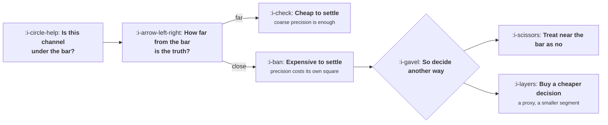

# Testing a Channel Properly

```text
Level: Basic
Prerequisites: Channel Fit
Estimated difficulty: 3/5 | Estimated time: 35 min
```

## The idea in one minute

Most channel tests are too small to conclude anything, and the budget they were given was chosen
by what felt reasonable rather than by what the question requires. The arithmetic is unforgiving:
knowing a cost per customer to within ten percent takes four times as many conversions as knowing
it to within twenty, because precision costs the square of itself. The consequence is the
opposite of how budgets are usually allocated. A channel that is obviously wonderful or obviously
hopeless is cheap to evaluate, and a channel sitting just either side of your bar, which is
exactly the interesting case, can cost more to resolve than it would ever earn. Knowing that in
advance changes which tests you agree to run.

## A picture



The question is never how much a test costs. It is how much a test costs given how close the
answer is to the line you are comparing it against.

## How it really works

### Why precision costs its square

A channel test produces a count of conversions, and the relative uncertainty on a count falls
with the square root of how many you have. Turn that around and the conversions you need rise
with the square of the precision you want.

Four conversions give you a rough idea, within about fifty percent. Twenty five gets you to
twenty percent. A hundred gets you to ten. Every halving of the error costs four times the
budget, and since the budget is conversions multiplied by the cost of a conversion, an expensive
channel compounds the problem.

This is the whole reason channel tests disappoint. A two thousand pound test of a channel whose
true cost per customer is two hundred buys ten conversions, which tells you the cost is
somewhere between roughly a hundred and three hundred and fifty. That range usually spans the
bar, so the test has cost real money and resolved nothing, and the team argues about it for a
month.

### Size the test against the gap, not against the channel

The useful reframing is that you are not measuring a channel's cost, you are deciding whether it
sits above or below a line. How precise you need to be depends entirely on how far from the line
the truth happens to be, which you do not know in advance but can bound.

The program below works through four cases against a bar of 421. A channel truly at 180 is 134
percent away from the bar and can be settled for about 400 of spend. A channel truly at 330 is
28 percent away and takes about 17,000. A channel at 400, a near miss, needs around 580,000 to
distinguish from the bar with confidence.

That last figure is not a reason to spend 580,000. It is a reason to stop treating the question
as empirical.

### What to do with a channel near your bar

Three honest options when the arithmetic says the test costs more than the answer is worth.

**Treat near the bar as a no.** A channel that needs a huge test to distinguish from your maximum
payable cost is, by construction, a channel with no margin of safety. Every estimate in your cap
has error in it too, so a channel sitting on the line is as likely to be above it as below. This
is the right default and it is unpopular because it feels like giving up on something that might
work.

**Buy a cheaper decision.** You rarely need the cost per customer; you need to know whether to
continue. A smaller, better defined segment inside the channel will often be clearly under the
bar even when the channel's average sits on it, and the test for that segment is cheap because
the gap is large. This is the move that most often rescues a near miss honestly.

**Change the bar instead.** If a channel is close to your cap, raising the cap by improving
price, churn or margin moves the channel clearly inside rather than leaving it ambiguous. Slower,
and it fixes more than one channel at once.

### The things a channel test must hold constant

Beyond sample size, four conditions, each of which has invalidated a real test.

* **The same landing experience throughout.** Changing the page halfway means you tested two
  things and can attribute neither.
* **A full purchase cycle of data.** A test shorter than the time between first visit and
  purchase measures the people who were already close to buying.
* **No overlapping launch.** A pricing change, a product launch or a second channel starting in
  the same window makes the result uninterpretable.
* **A fixed definition of a conversion.** Signups are not customers, and a channel that looks
  cheap per signup and expensive per customer is the normal case rather than the exception.

The last one is the most common corruption, and the arithmetic for it is in
[Growth, Marketing and Product](../the-growth-function/02-growth-marketing-and-product.md).

### Write the decision rule first

Before the money is spent: at what measured cost do you continue, at what cost do you stop, and
what happens if the result lands in between. The third clause is the one that matters, because
the arithmetic above guarantees that landing in between is likely, and a team without a rule
treats an ambiguous result as encouragement.

The default worth adopting: an ambiguous result ends the test. Not because ambiguity is evidence
of failure, but because the next increment of evidence costs four times the last one and you
have better uses for it.

### What fills the box in 2026

Nothing here is tooling. What has changed is the environment: channel costs move faster than they
used to, so a test result has a shorter shelf life, and a number measured a year ago is a
historical fact rather than a current one. Date every channel cost you record, and treat anything
older than two quarters as needing a fresh read before it is used in a plan.

## Run the numbers

What precision costs, and what deciding against your bar costs.

```go
// channeltest.go: what an honest channel test costs, before you run one.
package main

import "fmt"

// Counting conversions has a relative error of about 1/sqrt(n). To know a
// channel's cost per customer to within a given precision you therefore need
// a number of conversions that grows with the square of the precision.
func conversionsFor(precision float64) float64 { return 1 / (precision * precision) }

func main() {
	const maxCAC = 421.0 // what this product can pay, from affordable.go

	fmt.Printf("the bar: %.0f per customer\n\n", maxCAC)
	fmt.Printf("%-12s %14s %14s %14s\n",
		"precision", "conversions", "at 200 each", "at 400 each")
	for _, p := range []float64{0.50, 0.30, 0.20, 0.10} {
		n := conversionsFor(p)
		fmt.Printf("%11.0f%% %14.0f %14.0f %14.0f\n", 100*p, n, n*200, n*400)
	}

	fmt.Println("\nthe test you actually need is a comparison against the bar:")
	fmt.Printf("%-16s %12s %12s %14s %s\n",
		"true cost", "gap to bar", "precision", "budget", "verdict")
	for _, truth := range []float64{180.0, 330.0, 400.0, 460.0} {
		gap := (maxCAC - truth) / truth
		if gap < 0 {
			gap = -gap
		}
		// you need precision finer than the gap to tell them apart
		need := gap / 2
		n := conversionsFor(need)
		budget := n * truth
		verdict := "affordable"
		if budget > 60_000 {
			verdict = "costs more than it can tell you"
		}
		fmt.Printf("%16.0f %11.0f%% %11.0f%% %14.0f %s\n",
			truth, 100*gap, 100*need, budget, verdict)
	}

	fmt.Println("\nA channel close to your bar is the expensive one to evaluate, because")
	fmt.Println("precision costs the square of itself. Deciding a near miss costs more")
	fmt.Println("than deciding an obvious win, which is the opposite of how budgets")
	fmt.Println("are usually allocated to channel tests.")
}
```

The first table is the general shape. Going from twenty percent precision to ten percent takes
twenty five conversions to a hundred, and at four hundred pounds a conversion that is ten
thousand pounds becoming forty thousand.

The second table is the one to use. A channel truly at 180 against a bar of 421 is settled for
402 of spend, which is less than most teams would spend on a meeting about whether to test it. A
channel truly at 400 needs 580,499 to distinguish from the bar, and nobody is going to approve
that, nor should they.

The asymmetry between the last two rows is worth noticing: the channel at 460, which is above the
bar and should be rejected, costs 255,979 to establish, while the channel at 400, which should be
accepted, costs 580,499. Both are unaffordable, and the practical consequence is identical for
both: you will not find out by testing. Make the decision on the structure of the channel and
your margin of safety instead, and recognise that you have done so.

Change `maxCAC` to your own cap and put your own plausible channel costs in. The useful output is
which of your candidate channels are cheap to settle, because those are the tests to run first,
regardless of which ones look most promising.

## The AI layer

The production side of a channel test has become much cheaper and the measurement side has not
moved at all, and conflating the two is now the most common way a test goes wrong.

Generating fifty ad variants or forty landing pages costs very little, so the temptation is to
test the channel and the creative simultaneously. Splitting a test budget that was marginal for
one question across forty variants gives each variant a handful of conversions, which is the top
row of the first table repeated forty times. You will get a winner, it will be noise, and the
arithmetic for why is in
[What Good Looks Like](../the-growth-function/06-what-good-looks-like.md).

Sequence instead: establish the channel against the bar with everything else held still, then
optimise creative inside a channel you have already decided to keep. The second question is also
much cheaper to answer, because comparing two variants against each other needs far less data
than comparing a channel against an absolute threshold.

The one genuine saving is in preparation. The landing page, the tracking plan and the creative
set for a channel test used to be most of the fixed cost from lesson 01, and that part is
materially cheaper now. The measurement budget, which is what this lesson is about, is unchanged.

## Sector lens

| Sector | What makes testing hard here |
|---|---|
| [Enterprise B2B SaaS](../../product-management/product-by-sector/01-enterprise-b2b-saas.md) | Conversions are too few to reach any precision. Test against a leading indicator such as qualified meetings and accept the weaker evidence |
| [Fintech](../../product-management/product-by-sector/02-fintech.md) | A full cycle includes verification, which takes weeks, so short tests measure applicants rather than customers |
| [Ecommerce and D2C](../../product-management/product-by-sector/03-ecommerce-and-d2c.md) | Cheap and fast, so the precision table is affordable. Seasonality is the threat instead, and it requires a control period |
| [Marketplaces](../../product-management/product-by-sector/04-marketplaces.md) | A channel test on one side changes the experience on the other, so the test alters the thing it measures |
| [Devtools and Infra](../../product-management/product-by-sector/05-devtools-and-infrastructure.md) | Months between first contact and adoption, so a fair test spans two quarters and most are stopped early |
| [Healthtech](../../product-management/product-by-sector/06-healthtech-and-regulated-care.md) | Procurement timing dominates the result, so the test measures the calendar rather than the channel |
| [Vertical SaaS](../../product-management/product-by-sector/07-vertical-saas.md) | Too few possible customers for statistics at all. Judge channels by whether named firms responded, not by rates |

## Remember this

* Precision costs its own square. Halving the error quadruples the budget.
* Size the test against the gap between the truth and your bar, not against the channel.
* An obviously good or obviously bad channel is cheap to settle. A near miss can cost more to
  resolve than it would ever earn.
* When the test is unaffordable, treat near the bar as a no, buy a cheaper decision on a narrower
  segment, or raise the bar by fixing price, churn or margin.
* Hold the landing page, the cycle length, the launch calendar and the definition of a conversion
  constant, or you tested several things at once.
* Write the rule for an ambiguous result before spending. The default should be that ambiguity
  ends the test.
* Test the channel first and the creative second. Doing both at once gives every variant a
  handful of conversions.

## Try it

1. Run `channeltest.go` with your own cap, then add rows for the channels you are considering at
   your best guess of their true cost. Run the cheap ones first, whatever the enthusiasm says.
2. Take the last channel test your company ran. Count the conversions it produced and work out
   the precision that implies. Compare it with the confidence of the conclusion that was drawn.
3. Write the three part decision rule for your next test, including what happens on an ambiguous
   result, and get it agreed before any money moves.

## Check yourself

1. Why does a channel close to your bar cost more to evaluate than one far from it, when both are
   the same channel at the same price?
2. A test produced twelve conversions at an average of 310 against a bar of 421. What can you
   honestly conclude, and what would it cost to conclude more?
3. Your team proposes testing a new channel with forty creative variants to save time. What is
   wrong with this, and what is the right sequence?
