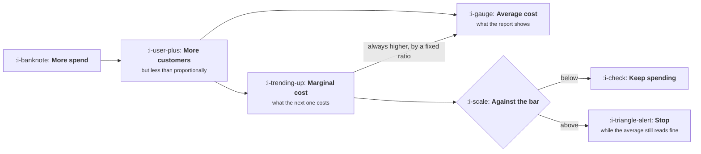

# Saturation and the Ceiling

```text
Level: Basic
Prerequisites: Testing a Channel Properly
Estimated difficulty: 3/5 | Estimated time: 35 min
```

## The idea in one minute

A channel does not have a cost per customer, it has a cost per customer at a level of spend, and
that cost rises as you spend more. The number on your report is the average across everything you
bought, and the number the decision needs is what the next customer will cost, which is always
higher. Under an ordinary diminishing returns curve the two differ by a fixed ratio at every
level of spend, so the gap is a permanent property rather than a warning sign that appears when
something goes wrong. The practical consequence is that there is a wide band of spending where
the report looks acceptable and every additional customer is being bought above what you can
afford, and most companies are somewhere inside it.

## A picture



Two costs come out of the same curve. One of them is on the dashboard and the other one is the
one the decision needs.

## How it really works

### Why the next customer costs more

Channels have an order to them. The first money you spend reaches the people most likely to want
what you sell: the ones already searching the exact term, the audience closest to your existing
customers, the placements with the best match. Spend more and you reach people slightly further
out, who convert slightly less often, and you also bid against yourself for the same inventory.

So conversions rise with spend, but less than proportionally. The relationship is well described
by a power curve with an exponent below one, and that exponent is the single number describing
how fast a channel tires.

### The fixed ratio

Here is the result that makes this lesson useful rather than merely cautionary. If conversions
follow spend raised to some exponent, then the marginal cost per customer is exactly the average
cost divided by that exponent.

At an exponent of 0.70, marginal cost is always 1.43 times the average. Not sometimes. Not when
the channel is in trouble. At every level of spend, from the first pound to the last.

This means two things. Your reported cost per customer has been understating the cost of your
next customer by a constant factor for as long as you have been running the channel. And you can
estimate that factor without any new instrumentation, by fitting the exponent to spend and
conversion data you already have.

### The band where the report lies

In the program below, with a bar of 421 per customer, the marginal cost reaches the bar at
173,035 a month of spend. The average cost does not reach it until 568,164.

Between those two numbers sits 395,129 a month of spending that looks entirely acceptable on a
report of average cost and buys every customer above what the business can afford to pay. A
company inside that band is not doing anything visibly wrong. Its dashboard is green.

This is the most common quiet mistake in paid acquisition and it has a simple fix: put the
marginal figure on the report next to the average, and set the stopping rule against the
marginal one.

### Two channels that look identical

The last table in the program is the part to take to a budget meeting. Four channels, each
spending 100,000 a month today, each buying 400 customers at 250 each. Identical by every number
anybody reports.

Their exponents differ, and so the room left in them differs enormously. At 0.50 the channel
should already be spending less than it does today. At 0.60 it is almost exactly at its limit. At
0.70 it can roughly double. At 0.85 it can take eleven times its current spend before the next
customer costs the bar.

Nothing visible today distinguishes those four channels. Everything about next year's budget
depends on which one you have, and the only way to know is to have varied the spend and watched
what happened.

### Estimating your own exponent

You need spend and conversions at several different levels, which you probably already have from
months when budgets differed. Plot the logarithm of conversions against the logarithm of spend
and the slope is your exponent.

Two cautions. Seasonality contaminates it badly, because high spend months are often high demand
months, which makes the channel look less tired than it is. And a channel's exponent changes when
the creative changes, which is the real mechanism behind the claim in the next lesson that
creative resets a channel.

If you have never deliberately varied spend, the honest answer is that you cannot estimate it,
and a planned variation over a couple of months is one of the highest value measurements
available to a growth team.

### What saturation is not

It is not the same as a channel dying, which is lesson 05. Saturation is smooth, predictable and
reversible: spend less and the cost per customer falls back. A dying channel is a step change and
spending less does not help.

It is also not a reason to stop. A saturated channel at its efficient level is a perfectly good
channel, and the mistake is not having one, it is continuing to pour money past the point where
the next customer stops paying for themselves.

### What fills the box in 2026

Every major paid platform optimises towards volume by default, which means their automated
bidding will happily take you well past your marginal limit while reporting a healthy average.
This is not deception; you asked for conversions and it delivered conversions. The defence is to
set the target cost in the platform at your marginal bar rather than your average one, which
means the number you give the platform should be noticeably lower than the number you are
willing to pay.

## Run the numbers

The average, the marginal, the band between them, and what the same performance today implies
for four differently tired channels.

```go
// saturate.go: the average cost per customer looks fine long after the next one stops paying.
package main

import (
	"fmt"
	"math"
)

// Channels show diminishing returns: conversions rise with spend, but less
// than proportionally. beta below 1 is how fast the channel tires. The scale
// is set so that today's spend buys today's customers, whatever beta is.
const (
	beta     = 0.70
	nowSpend = 100_000.0
	nowCust  = 400.0
	maxCAC   = 421.00 // the bar, from affordable.go
)

func scaleFor(b float64) float64 { return nowCust / math.Pow(nowSpend, b) }

func curve(b float64) (conv, avg, marg func(float64) float64) {
	s := scaleFor(b)
	conv = func(x float64) float64 { return s * math.Pow(x, b) }
	avg = func(x float64) float64 { return x / conv(x) }
	marg = func(x float64) float64 { return avg(x) / b }
	return
}

// solve finds the spend at which a cost measure reaches the bar.
func solve(f func(float64) float64, target float64) float64 {
	lo, hi := 1.0, 1e9
	for i := 0; i < 200; i++ {
		if mid := (lo + hi) / 2; f(mid) < target {
			lo = mid
		} else {
			hi = mid
		}
	}
	return lo
}

func main() {
	conv, avg, marg := curve(beta)
	fmt.Printf("today: %.0f a month buys %.0f customers at %.0f each\n",
		nowSpend, conv(nowSpend), avg(nowSpend))
	fmt.Printf("returns exponent %.2f, bar %.0f per customer\n\n", beta, maxCAC)

	fmt.Printf("%12s %11s %10s %11s  %s\n",
		"spend/month", "customers", "average", "marginal", "the next customer")
	for _, s := range []float64{50_000, 100_000, 171_000, 300_000, 563_000, 900_000} {
		note := "pays for itself"
		if marg(s) > maxCAC {
			note = "costs more than it is worth"
		}
		fmt.Printf("%12.0f %11.0f %10.0f %11.0f  %s\n",
			s, conv(s), avg(s), marg(s), note)
	}

	stop := solve(marg, maxCAC)
	looksFine := solve(avg, maxCAC)
	fmt.Printf("\nstop here, where the next customer costs the bar:  %10.0f a month\n", stop)
	fmt.Printf("the average only reaches the bar at:               %10.0f a month\n", looksFine)
	fmt.Printf("\nbetween them sits %.0f a month of spend that reads as\n", looksFine-stop)
	fmt.Println("acceptable on the report and loses money on every customer it buys.")

	fmt.Printf("\nmarginal is always average divided by %.2f, so it runs %.0f%% higher at\n",
		beta, 100*(1/beta-1))
	fmt.Println("every level of spend. The gap is a property of the curve, not a thing")
	fmt.Println("that shows up once a channel is in trouble.")

	fmt.Println("\nsame performance today, different rates of tiring:")
	fmt.Printf("  %-6s %18s %16s %14s\n",
		"beta", "stop spending at", "customers", "headroom")
	for _, b := range []float64{0.50, 0.60, 0.70, 0.85} {
		c, _, m := curve(b)
		st := solve(m, maxCAC)
		fmt.Printf("  %-6.2f %18.0f %16.0f %13.1fx\n", b, st, c(st), st/nowSpend)
	}
	fmt.Println("\nTwo channels spending the same today, buying the same customers at")
	fmt.Println("the same price, can have ten times different room left in them.")
}
```

At today's spend of 100,000 the average is 250 and the marginal is 357, both comfortably under
the bar of 421. At 300,000 the average has risen to 348, which still reads as fine against a bar
of 421, and the marginal is 497, which does not. Every customer bought at that level of spend
costs the business more than it can afford, and nothing on a standard report says so.

The stopping point is 173,035 a month. The point at which the average finally crosses the bar is
568,164. A team managing to the average has 395,129 a month of permission it should not have.

The headroom table at the end is the planning output. The channel at an exponent of 0.50 shows
headroom of 0.7 times, meaning it should be spending about thirty percent less than it is today
even though its reported cost is well under the bar. The channel at 0.85 can take nearly eleven
times its current budget. Same reported performance, opposite instructions.

Try setting `maxCAC` to your own cap and `nowSpend` and `nowCust` to your real figures. The
exponent is the one input you will have to estimate, and the spread of answers between 0.6 and
0.8 is large enough that estimating it properly is worth a couple of months of deliberate budget
variation.

## The AI layer

Two effects, and the first one changes the exponent rather than the cost.

**Creative volume flattens the curve, temporarily.** A large part of why a channel tires is
fatigue against the same audience with the same creative. Being able to produce many more
variants genuinely raises the exponent for a while, which is worth real money: the difference
between 0.60 and 0.70 in the table above is the difference between a channel at its limit and one
that can double. This is the strongest growth argument for generated creative, and it is about
the shape of the curve rather than the cost of production.

**It does not raise the ceiling of the audience.** The pool of people who want what you sell is
unchanged, and once the variety stops being novel the exponent falls back. Treat the improvement
as a lease rather than a purchase, and re estimate the exponent every couple of quarters rather
than assuming the better curve is now permanent.

There is also a cost side worth stating plainly. If your product has usage based cost, the bar
itself falls as you move down the demand curve, because the customers you reach with the
marginal pound tend to be lighter users with worse margins or heavier users with worse margins
depending on your product, and either way the cap you are measuring against is not constant
across the spend range. Computing the bar for the marginal cohort rather than the average one is
the correction, and it moves the stopping point inwards.

## Sector lens

| Sector | How saturation shows up |
|---|---|
| [Enterprise B2B SaaS](../../product-management/product-by-sector/01-enterprise-b2b-saas.md) | The pool of qualified accounts is countable, so the curve bends hard rather than smoothly. The exponent falls as you work down the list |
| [Fintech](../../product-management/product-by-sector/02-fintech.md) | Later spend reaches applicants who fail verification, so the marginal cost per approved customer rises faster than per applicant |
| [Ecommerce and D2C](../../product-management/product-by-sector/03-ecommerce-and-d2c.md) | The textbook case, measurable weekly. Also the sector most likely to be managing to average cost and automated bidding at once |
| [Marketplaces](../../product-management/product-by-sector/04-marketplaces.md) | Saturating one side raises the value of the other, so the bar moves while you spend. The curve and the cap interact |
| [Devtools and Infra](../../product-management/product-by-sector/05-devtools-and-infrastructure.md) | Long lags make the exponent nearly impossible to estimate from recent months. Use a year of data and expect it to be noisy |
| [Healthtech](../../product-management/product-by-sector/06-healthtech-and-regulated-care.md) | Spend does not reach more buyers past a point, because the buyers are a fixed institutional list. The exponent approaches zero |
| [Vertical SaaS](../../product-management/product-by-sector/07-vertical-saas.md) | Saturation is total rather than gradual: you run out of firms, and the curve goes flat rather than bending |

## Remember this

* A channel has a cost per customer at a level of spend, not a cost per customer.
* Marginal cost is always the average divided by the returns exponent, at every level of spend.
  At 0.70 that is 43 percent higher, permanently.
* Set the stopping rule against the marginal figure. Managing to the average permits a wide band
  of spending that reads as fine and loses money.
* Two channels with identical reported performance can have ten times different headroom. Only
  the exponent distinguishes them.
* Estimate the exponent by regressing log conversions on log spend across months with different
  budgets. Beware seasonality, which makes a channel look less tired than it is.
* Saturation is smooth and reversible. A dying channel is a step change. Do not treat them the
  same way.
* Give automated bidding your marginal bar, not your average one, which means a lower number than
  you are willing to pay.

## Try it

1. Run `saturate.go` at exponents of 0.6 and 0.8 with your own bar. The difference in the
   stopping point is what the measurement in the next exercise is worth.
2. Pull twelve months of spend and conversions for your largest channel and fit the slope of log
   conversions against log spend. If every month had the same budget, you cannot, and that is the
   finding.
3. Put the marginal cost next to the average on your paid report, computed as average divided by
   your estimated exponent. Note how the conversation changes in the first meeting where both are
   visible.

## Check yourself

1. Why is the marginal cost per customer a fixed multiple of the average, rather than something
   that drifts upwards as a channel ages?
2. Your average cost is 250, your bar is 421, and your exponent is 0.6. Should you spend more?
   Show the arithmetic.
3. Two channels both report 400 customers at 250 each on 100,000 of spend. What single
   measurement separates them, and what would you have to have done to have it?
