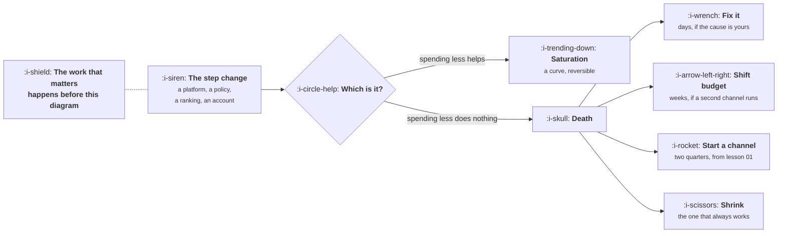

# When a Channel Dies

```text
Level: Basic
Prerequisites: Saturation and the Ceiling
Estimated difficulty: 2/5 | Estimated time: 30 min
```

## The idea in one minute

Channel death is a step change rather than a curve, and the thing that distinguishes it from
saturation is that spending less does not help. It happens to everybody eventually, because the
channels that work are owned by somebody else whose interests are not yours, and the previous
lesson's argument for concentration makes the exposure worse. The useful work is almost entirely
before the event: knowing what share of acquisition one channel carries, having a second channel
that is actually running rather than planned, and having written down in advance what the first
week looks like. Afterwards there are only four moves, and three of them take longer than the
cash you have.

## A picture



Four moves, ordered by how long each takes. Which ones are available to you was decided months
before the event.

## How it really works

### Telling death from saturation

The test is the one in the diagram and it takes a week. Cut spend by half. If the cost per
customer falls back towards where it used to be, you were saturated and you overspent. If the
cost stays where it is or the volume collapses disproportionately, something structural changed.

Three other signatures help. Saturation arrives gradually over months, death arrives between one
Tuesday and the next. Saturation affects the marginal customer, so your best segments still
perform, while death usually affects everything at once. And saturation has no external
correlate, while death usually does, which is why the first thing to do is check whether anybody
else is complaining about the same platform on the same date.

### The five causes, in rough order of frequency

**A platform changed its rules.** Ranking, feed distribution, ad policy, an API permission.
Entirely outside your control, usually announced somewhere nobody reads, and the most common
cause by a distance.

**Your account was actioned.** Suspension, a policy strike, a review. Distinguished from the
above because it affects you and not your competitors, which makes it the easiest to diagnose and
sometimes the fastest to fix.

**Competition arrived.** A well funded entrant bids up the auction you depended on. This looks
like a step change over two or three weeks rather than overnight, and it is the one case where
the channel is not dead but has become unaffordable, which lesson 02 treats as the same thing.

**The audience moved.** Slower, and often mistaken for saturation for a year before anybody
names it correctly.

**You broke it.** A tracking change, a redirect, a redesign, a consent banner. Embarrassing,
common, and worth checking first because it is the only cause you can reverse in a day.

Check your own changes before anything else. The time wasted investigating a platform that did
nothing, when the cause was a release on the same morning, is the single most avoidable cost in
this lesson.

### The first week

Written in advance, because nobody composes a good plan in the week itself.

* **Day one: establish which it is.** Run the halving test, check for an external correlate, and
  check your own release log for the preceding fortnight.
* **Day one: stop the bleeding, not the channel.** Cut spend to a level where you are learning
  rather than burning. Do not switch it off entirely; you need the signal to know when it
  returns.
* **Day two: quantify the hole.** What share of acquisition did this carry, and what does the
  growth model say about the quarter without it. The model from the previous topic exists for
  exactly this morning.
* **Week one: pick among the four moves** and say which, in writing, with the expected time to
  effect. The common failure is attempting all four, which means the second channel gets a third
  of a person and the fix gets rushed.
* **Week one: tell people before they ask.** The number is going to be visibly wrong for a
  quarter and the credibility cost of being asked about it is much higher than the cost of
  raising it.

### Why the fourth move is the honest one

Shrinking is the move nobody writes down and the one most companies eventually take. If a channel
carrying sixty percent of acquisition dies and the replacement takes two quarters to build, the
business is smaller for two quarters, and planning on that basis is more useful than planning on
a rescue that has never happened on that timeline.

The reason to name it in advance is that it changes what you do on day two. A company that
accepts it will be smaller for six months protects its cash and keeps its second channel properly
staffed. A company that refuses to accept it spends the reserve on an emergency attempt at a
third channel, which is the fixed cost from lesson 01 being paid in the worst possible
conditions.

### What to do before it happens

Four things, none of which are urgent, which is why they do not get done.

**Know the concentration number.** What share of new customers came from your largest channel
last quarter. Above about sixty percent you are exposed, and the number should be on the same
page as the growth model.

**Have a second channel that is running.** Not planned, not tested once, running at a real
budget with somebody responsible. Lesson 01 argues for two rather than six, and this is the
reason it is two rather than one.

**Own what you can own.** Email addresses, accounts, a community you host. The distinguishing
feature of a channel that can die is that somebody else controls the connection, so anything that
converts borrowed reach into a direct connection is insurance.

**Keep the account boring.** Most account level actions follow from edge case behaviour:
aggressive claims, unusual redirect chains, scraped content, a sudden spend increase. The cost of
staying conventional is low and the cost of not is a channel.

### What fills the box in 2026

The volatility has risen rather than fallen, and the specific change worth planning around is
that search distribution now has an additional party in it. Rankings that used to convert into
visits increasingly convert into an answer somewhere else, which is a channel death that arrives
gradually and does not show up as a ranking loss. The signature is impressions holding while
clicks fall, and it is lesson 06 of the content topic.

For paid channels, automated bidding and account level automation mean a policy change can alter
delivery without any visible change to your settings. Keep a weekly record of delivery by
placement, because the diagnosis after the fact depends on having a before.

## Sector lens

| Sector | What usually dies, and what it costs |
|---|---|
| [Enterprise B2B SaaS](../../product-management/product-by-sector/01-enterprise-b2b-saas.md) | Outbound, through deliverability changes or list exhaustion. Slow, so it is usually misread as a team performance problem for two quarters |
| [Fintech](../../product-management/product-by-sector/02-fintech.md) | Paid channels, through advertising policy for regulated categories. Account actions here are abrupt and appeals are slow |
| [Ecommerce and D2C](../../product-management/product-by-sector/03-ecommerce-and-d2c.md) | Paid social, through targeting and measurement changes. The sector most exposed and the one with the fastest replacement options |
| [Marketplaces](../../product-management/product-by-sector/04-marketplaces.md) | Search, because marketplace pages are the category most affected by ranking policy on thin content |
| [Devtools and Infra](../../product-management/product-by-sector/05-devtools-and-infrastructure.md) | A platform, a package registry or a community whose rules changed. Rarely paid, and recovery depends on goodwill you either have or do not |
| [Healthtech](../../product-management/product-by-sector/06-healthtech-and-regulated-care.md) | A referral relationship or a procurement framework, which is one relationship rather than an algorithm. Concentration risk is per institution |
| [Vertical SaaS](../../product-management/product-by-sector/07-vertical-saas.md) | An association partnership or a conference. Small numbers of large relationships, so the concentration number is about partners rather than channels |

## Remember this

* Death is a step change and saturation is a curve. The test is whether cutting spend in half
  brings the cost back down.
* Check your own releases before investigating the platform. You broke it more often than is
  comfortable.
* Five causes: platform rules, an account action, competition, audience movement, and yourself.
* Four moves: fix it in days, shift budget in weeks, start a channel in two quarters, or be
  smaller. Which are available was decided months ago.
* Being smaller for two quarters is the honest plan more often than it is chosen, and naming it
  early protects the cash and the second channel.
* Before it happens: know the concentration number, run a real second channel, convert borrowed
  reach into direct connections, and keep the account conventional.
* Cut spend rather than switching off, so you can tell when it returns.

## Try it

1. Compute what share of last quarter's new customers came from your largest channel. Put it on
   the same page as the growth model and update it quarterly.
2. Write the first week plan now, as five bullets with names against them. It takes twenty
   minutes and it will not be written in the week it is needed.
3. Run your growth model with your largest channel set to zero. The resulting quarter is the
   thing to have seen before, not during.

## Check yourself

1. A channel's cost per customer jumped forty percent in a week. What is the first thing you
   check, and what is the test that distinguishes the two main explanations?
2. Why does the move everybody avoids, being smaller for two quarters, make the other three moves
   more likely to succeed?
3. You have one channel at seventy percent of acquisition and a second that was tested once and
   paused. In what sense do you have one channel?
