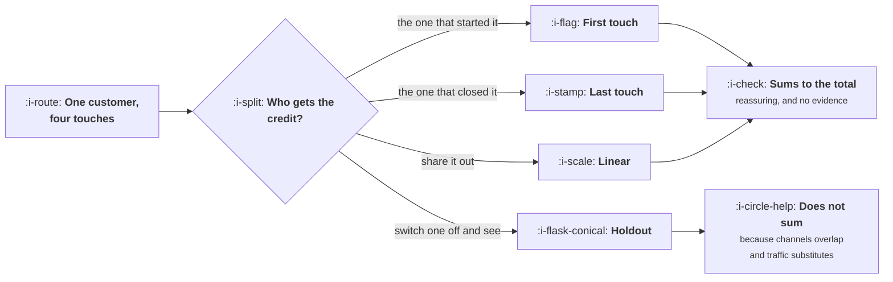

# Attribution

```text
Level: Basic
Prerequisites: When a Channel Dies
Estimated difficulty: 3/5 | Estimated time: 40 min
```

## The idea in one minute

Attribution asks which channel deserves credit for a customer who touched four of them, and there
is no correct answer, only several defensible conventions that produce different answers. This is
not a measurement problem waiting for better tooling; it is a question about a counterfactual
that the data cannot contain, because the data records what happened and the question is about
what would have happened otherwise. Four honest methods applied to one set of conversions produce
four different channel rankings, with the same channel appearing first under one and last under
another. The only method that answers the actual question is a holdout, and the thing that gives
it away as the honest one is that its numbers do not add up to your total.

## A picture



Three of the four divide a fixed pie and therefore always add up. The fourth measures something
real and therefore does not.

## How it really works

### Why there is no correct answer

A customer saw a social post in March, read two articles in April, searched your brand name in
May and bought. Which channel acquired them?

The question only has an answer relative to a counterfactual: what would have happened without
the social post. The data cannot tell you, because the data contains one world, the one where
all four touches happened. Every attribution model is a rule for assigning credit in the absence
of that information, and a rule is a convention rather than a measurement.

This matters practically because people treat attribution output as data. It has decimal places,
it comes from a system, and it sums neatly to the total number of conversions, which makes it
feel measured. It is a convention with arithmetic applied to it.

### What each convention is good for

| Method | Credits | Useful for | Systematically wrong about |
|---|---|---|---|
| First touch | The first channel seen | Finding what creates awareness, and how people discover the category | Anything late in the journey, which gets zero |
| Last touch | The last channel before converting | Operational decisions about closing demand that already exists | Everything upstream, and it flatters brand search enormously |
| Linear | All touches equally | Nothing much, honestly. It is a compromise that nobody's theory predicts | Being equally wrong about every channel rather than very wrong about some |
| Position based | Ends more than the middle | A reasonable default when you need one convention for operations | The weights are arbitrary and chosen because they look sensible |
| Holdout | What was actually lost when the channel stopped | The budget decision, which is the one that matters | Being slow, expensive, and only answerable one channel at a time |

The honest arrangement is to use one model based convention for operational reporting, chosen and
written down, and to make budget decisions from holdouts. Those are different questions and using
one number for both is the error.

### The brand search problem

Run the program below and watch brand search. It is first by last touch with 6,100 conversions,
first by linear with 3,017, and last by holdout with 900.

Brand search is where people go when they have already decided. It appears at the end of most
journeys, so last touch gives it nearly everything, and switching it off loses far less than that
because most of those people find you anyway. The gap between 6,100 and 900 is a factor of
roughly seven, and companies have shifted large budgets on the strength of the first number.

The same effect works in reverse for channels that appear early. Social is first by first touch
with 2,900, last by linear with 1,317, and second by holdout with 1,850. No single convention
places it correctly, and the two most commonly used conventions place it at opposite ends.

### Why the holdout does not add up

In the program the three model based methods each total 7,500, exactly the number of conversions,
and the holdout totals 6,150.

That shortfall is the most informative number in the table. Switching off social loses 1,850 and
switching off content loses 2,300, but switching off both loses less than 4,150, because some
people reached through one would have been reached through the other. Channels overlap, traffic
substitutes, and incremental contributions genuinely do not sum to the whole.

Any method that always sums exactly to your conversion count has achieved that by construction,
not by measurement. When somebody presents an attribution table that balances perfectly, the
balancing is the evidence that it is a convention.

### Running a holdout without stopping a channel

The objection to holdouts is that switching off a channel costs real revenue, and it does. Three
ways to make it affordable.

**Geographic splits.** Turn the channel off in a few regions and compare against matched regions.
This is the standard method, it works wherever a channel can be targeted geographically, and the
main cost is that you need enough regions for the comparison to mean anything.

**Time based switching.** Alternate the channel on and off in weekly or fortnightly blocks over a
quarter. Cheaper and more exposed to seasonality, so it needs more cycles than feels necessary.

**Partial holdouts.** Suppress the channel for a random share of the addressable audience where
the platform allows it. The cleanest statistically and the least widely supported.

In all three cases the measurement belongs to
[A/B Testing and When It Lies](../../product-management/funnel-retention-and-experiments/README.md)
for the statistics, and the thing to carry here is that a holdout is a planned quarterly exercise
on your largest channel rather than something you do once.

### What to do on Monday

Three practical rules that survive all of the above.

Pick one convention for operational reporting and write down which. Arguing about convention
weekly is worse than any particular convention.

Never compare numbers across conventions. Half the attribution arguments in a company are two
people quoting different models at each other without either saying which.

Hold out your largest channel once a year at minimum, and your second largest if it carries more
than a fifth. The budget decisions those two measurements inform are larger than the cost of the
measurements by a wide margin.

### What fills the box in 2026

Measurement has become harder rather than easier. Cross site tracking restrictions, consent
requirements and platform level reporting mean the touch data feeding any model is incomplete in
ways that vary by channel, which biases every model based method in the direction of channels
that happen to still be observable.

The response the industry has settled on is modelled attribution, where a platform estimates
conversions it cannot see. These estimates are reasonable and they are produced by the party
being evaluated, which is a conflict worth stating plainly. Use them for operations and never for
budget allocation between platforms. The holdout is not a traditionalist preference here; it is
the only method whose result does not depend on the cooperation of the thing being measured.

## Run the numbers

One set of journeys, four methods.

```go
// attribution.go: one set of conversions, four methods, four different answers.
package main

import (
	"fmt"
	"sort"
)

type journey struct {
	count   float64
	touches []string
}

func main() {
	journeys := []journey{
		{2000, []string{"social", "content", "brand search"}},
		{1500, []string{"content", "brand search"}},
		{1200, []string{"paid generic", "brand search"}},
		{900, []string{"social", "paid generic"}},
		{600, []string{"content", "social", "brand search"}},
		{800, []string{"brand search"}},
		{500, []string{"paid generic"}},
	}
	channels := []string{"social", "content", "brand search", "paid generic"}

	// What a holdout measured: conversions lost when each channel was
	// switched off for a random share of the audience, scaled back up.
	incremental := map[string]float64{
		"social": 1850, "content": 2300, "brand search": 900, "paid generic": 1100,
	}

	first := map[string]float64{}
	last := map[string]float64{}
	linear := map[string]float64{}
	total := 0.0
	for _, j := range journeys {
		total += j.count
		first[j.touches[0]] += j.count
		last[j.touches[len(j.touches)-1]] += j.count
		for _, t := range j.touches {
			linear[t] += j.count / float64(len(j.touches))
		}
	}

	methods := []struct {
		name string
		m    map[string]float64
	}{
		{"first touch", first}, {"last touch", last},
		{"linear", linear}, {"holdout", incremental},
	}

	fmt.Printf("%.0f conversions across %d channels\n\n", total, len(channels))
	fmt.Printf("%-14s", "channel")
	for _, m := range methods {
		fmt.Printf("%14s", m.name)
	}
	fmt.Println()
	for _, c := range channels {
		fmt.Printf("%-14s", c)
		for _, m := range methods {
			fmt.Printf("%14.0f", m.m[c])
		}
		fmt.Println()
	}

	fmt.Printf("%-14s", "total")
	for _, m := range methods {
		s := 0.0
		for _, c := range channels {
			s += m.m[c]
		}
		fmt.Printf("%14.0f", s)
	}
	fmt.Println()

	fmt.Println("\nthe ranking each method produces:")
	for _, m := range methods {
		cs := append([]string{}, channels...)
		sort.Slice(cs, func(i, j int) bool { return m.m[cs[i]] > m.m[cs[j]] })
		fmt.Printf("  %-13s", m.name)
		for i, c := range cs {
			if i > 0 {
				fmt.Print(", ")
			}
			fmt.Print(c)
		}
		fmt.Println()
	}

	fmt.Println("\nbrand search is first by last touch and last by holdout.")
	fmt.Println("social is first by first touch and last by linear.")
	fmt.Println("\nThe three model based methods all sum to the total, which looks")
	fmt.Println("reassuring and only means they divided the same pie differently.")
	fmt.Println("The holdout does not sum to it, because switching off two channels")
	fmt.Println("separately loses less than the sum of switching off each: the")
	fmt.Println("journeys overlap and the traffic substitutes. That failure to add up")
	fmt.Println("is the one honest thing in the table.")
}
```

Four rankings from one set of conversions:

* First touch: social, content, paid generic, brand search.
* Last touch: brand search, paid generic, social, content.
* Linear: brand search, content, paid generic, social.
* Holdout: content, social, paid generic, brand search.

The first and last of those are nearly reversed. A company managing budget on last touch would
fund brand search and cut social and content, which under the holdout are the two channels
actually producing customers.

Notice also that last touch assigns social and content exactly zero. Not a small number: zero.
Under that convention, two channels responsible for more than four thousand incremental
conversions between them do not appear in the report at all, and a team asked to justify their
budget has nothing to show.

Change the `incremental` map to see how the conclusion moves. The map is the only part of the
program that represents a measurement rather than a convention, and the fact that you have to
supply it by hand is the point: it does not come from the journey data, it comes from having
switched something off.

## The AI layer

Attribution is one of the few places in growth where the honest answer is that a model helps less
than it appears to, and it is worth being precise about why.

Fitting a model to journey data to predict conversions can be done well, and the resulting
attribution is still a convention rather than a measurement, because the training data contains
no counterfactual. A model can learn which patterns of touches precede conversion with
considerable accuracy and still be unable to say what would have happened without a touch, since
it has never seen that world. Accuracy at prediction is not evidence about causation, and a well
fitted attribution model produces confident, precise, decimal pointed conventions.

This is genuinely worse than a simple convention, for an organisational reason. Nobody believes
last touch is the truth, so it gets argued with. An opaque fitted model gets believed, because it
is sophisticated and nobody can see inside it, and the arguing stops.

Where a model does help: cleaning and stitching the touch data itself, classifying unlabelled
traffic, and reading holdout results. Those are observation tasks on data you have.

The rule worth carrying: a model may tell you what happened. Only a holdout tells you what would
have happened otherwise, and the budget question is always the second kind.

## Sector lens

| Sector | What breaks attribution here |
|---|---|
| [Enterprise B2B SaaS](../../product-management/product-by-sector/01-enterprise-b2b-saas.md) | Several people in one account touch different channels. User level attribution is meaningless; roll up to the account before anything else |
| [Fintech](../../product-management/product-by-sector/02-fintech.md) | Long verification gaps between touch and conversion exceed most attribution windows, so late touches are overcredited |
| [Ecommerce and D2C](../../product-management/product-by-sector/03-ecommerce-and-d2c.md) | Short journeys make last touch look adequate, and geographic holdouts are cheap, so there is no excuse for not running them |
| [Marketplaces](../../product-management/product-by-sector/04-marketplaces.md) | Acquiring supply changes demand conversion, so a channel on one side gets no credit for its effect on the other |
| [Devtools and Infra](../../product-management/product-by-sector/05-devtools-and-infrastructure.md) | Most touches are invisible: a conversation, a README, somebody else's post. Attribution data covers a minority of the journey |
| [Healthtech](../../product-management/product-by-sector/06-healthtech-and-regulated-care.md) | Tracking restrictions mean touch data may not be collectable at all. Holdouts by region are often the only available method |
| [Vertical SaaS](../../product-management/product-by-sector/07-vertical-saas.md) | Few enough customers to ask them. A short conversation with twenty buyers beats any model you could fit |

## Remember this

* Attribution asks about a counterfactual the data does not contain. Every model based method is
  a convention, not a measurement.
* Four honest methods give four different rankings, and the two most common ones are nearly
  reversed.
* Last touch flatters brand search enormously and assigns upstream channels exactly zero.
* A method that always sums to your conversion total does so by construction. A holdout does not
  sum, because channels overlap and traffic substitutes.
* Use one convention for operational reporting and holdouts for budget decisions. They are
  different questions.
* Never compare numbers produced by different conventions, which is half the attribution
  arguments in any company.
* Hold out your largest channel at least annually, by geography, by time blocks, or by audience.
* Platform modelled conversions are produced by the party being evaluated. Operations yes, budget
  allocation no.

## Try it

1. Run `attribution.go`, then change the holdout map to make brand search genuinely incremental
   at 4,000. Note that the three model based columns do not move at all, which shows how little
   they are telling you about reality.
2. Find out which convention your company's reporting uses. Ask three people. If you get more
   than one answer, you have found an argument that is being had without anyone noticing.
3. Design the geographic holdout for your largest channel: which regions, for how long, and what
   difference you would need to see. Then cost it against the budget that channel receives in a
   year.

## Check yourself

1. Why can no amount of journey data settle which channel deserves credit, however complete the
   tracking?
2. The three model based methods each sum to 7,500 and the holdout sums to 6,150. What does the
   shortfall tell you, and why is it a point in the holdout's favour?
3. A platform reports that it drove 4,000 conversions, of which 1,200 are modelled rather than
   observed. For which decisions is that figure usable, and for which is it not?
