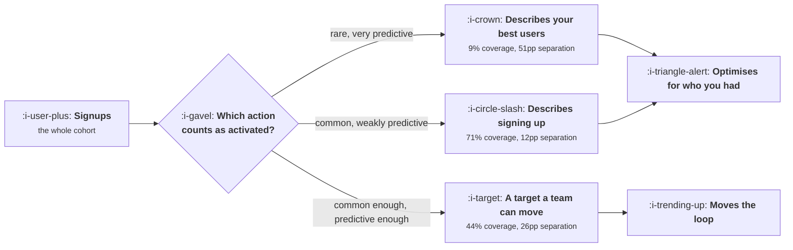

# What Activation Means Here

```text
Level: Intermediate
Prerequisites: Drawing Your Own Loop
Estimated difficulty: 3/5 | Estimated time: 35 min
```

## The idea in one minute

Activation is not a stage that exists in your product waiting to be discovered. It is a
definition you choose, and choosing it is the single highest leverage act in this topic, because
every onboarding decision for the next two years will be judged against it. The temptation is to
pick the action that separates your retained users most sharply from everyone else. That is the
wrong choice, and it is wrong in a specific way: the most separating action is usually the rarest,
so a team that targets it optimises for the users it already had. A definition worth adopting
needs separation and coverage together, and the arithmetic for trading them off is short enough
to do in a meeting.

## A picture



The two failure modes sit on either side of the useful definition, and both feel defensible in
the meeting where they are chosen.

## How it really works

### Activation is a claim about causation, stated as a metric

When a team says activation is "created one document", it is making a claim: that getting more
signups to create a document will produce more retained users. That claim can be false in two
different ways, and they need separating.

It is false if document creation does not cause retention, which is the subject of
[Finding the Aha Moment](02-finding-the-aha-moment.md) and the most common error in the field.

It is false in a quieter way if the action is real but the population who can be moved is tiny.
An action that only your most committed users ever perform is a fine description of commitment and
a useless target, because the people who were going to do it already have, and the people who were
not are not reachable by a nudge.

Both failures produce the same symptom a year later: onboarding work that lifts the activation
number without lifting retention, revenue or anything else. The metric rises because the team
learned to produce the event.

### Separation and coverage

Score every candidate definition on two numbers.

**Separation** is the gap between retention among users who took the action and retention among
users who did not, in percentage points. It is how much the action appears to matter.

**Coverage** is the share of a signup cohort who take the action inside the window you care
about. It is how much room there is to move.

The product of coverage and retention given the action tells you what share of the whole cohort a
definition actually accounts for, and that is the number worth ranking on. The program below runs
five candidates through it. "Invited a teammate" has the strongest separation at 51 percentage
points and accounts for 6 percent of the cohort. "Created one document" has half the separation
at 26 points and accounts for 14 percent, more than twice as much.

### Pick the window before you pick the action

A definition is an action and a window together, and a definition without a window is not
measurable. "Created one document" is a different metric on day one, day seven and day thirty, and
the difference is not academic: a long window makes the number look better, makes it respond more
slowly to changes, and quietly includes people who came back weeks later for reasons unrelated to
onboarding.

The default worth adopting is the shortest window in which a reasonable new user could plausibly
reach the action, which for most software is between one session and seven days. If your window
has to be thirty days for the number to look respectable, you have found something out about the
product rather than about the window.

### What activation is not

Three things get labelled activation and are not.

* **Completing your onboarding flow.** The fifth row of the table below is "finished the tour",
  with three percentage points of separation. Measuring whether people finished the thing you
  built tells you about the thing you built.
* **Any form of signup completion.** Verifying an email address is a measurement of your email
  provider.
* **A score made of several actions with weights.** A composite cannot be acted on, because no
  single team change moves a weighted sum in a predictable direction, and the weights become a
  standing argument.

One action, one window, written down. Change it rarely and announce it loudly when you do, because
every historical chart breaks on the day it changes.

### What fills the box in 2026

Product analytics tools will all compute conditional retention for an arbitrary event in a few
clicks, which means the table below takes an afternoon rather than a sprint. The constraint has
moved entirely to the quality of the events underneath, which is why
[Instrumentation and the Event Model](../instrumentation-and-the-event-model/README.md) sits in
the level above this one. A definition built on a badly named event inherits every ambiguity in
that event, and the usual symptom is a number that steps on the day of a release with no
corresponding change in behaviour.

## Run the numbers

Score the candidates on both axes before arguing about which is right.

```go
// activation.go: which candidate definition of activation is worth adopting.
package main

import "fmt"

// A candidate definition is scored on two axes that pull against each other:
// separation, how much better the people who do it retain, and coverage, how
// many people do it at all. A definition with huge separation and tiny
// coverage describes your best users; it does not give the team a target.
type candidate struct {
	name     string
	coverage float64 // share of signups who do it in week one
	retDid   float64 // week eight retention among those who did
	retNot   float64 // week eight retention among those who did not
}

func main() {
	cohort := 10_000.0
	cands := []candidate{
		{"opened the app twice", 0.71, 0.18, 0.06},
		{"created one document", 0.44, 0.31, 0.05},
		{"invited a teammate", 0.09, 0.62, 0.11},
		{"connected a data source", 0.21, 0.54, 0.08},
		{"finished the tour", 0.38, 0.17, 0.14},
	}

	fmt.Printf("cohort: %.0f signups, retention measured at week eight\n\n", cohort)
	fmt.Printf("%-24s %9s %8s %8s %10s %12s\n",
		"candidate", "coverage", "ret|did", "ret|not", "separation", "retained")
	for _, c := range cands {
		sep := c.retDid - c.retNot
		// retained users this definition accounts for: the people who did it
		// and stayed, as a share of the whole cohort
		share := c.coverage * c.retDid
		fmt.Printf("%-24s %8.0f%% %7.0f%% %7.0f%% %9.0fpp %11.0f%%\n",
			c.name, 100*c.coverage, 100*c.retDid, 100*c.retNot, 100*sep, 100*share)
	}

	fmt.Println("\nthe same table, ranked two ways:")
	best, bestSep := "", 0.0
	useful, bestShare := "", 0.0
	for _, c := range cands {
		if s := c.retDid - c.retNot; s > bestSep {
			best, bestSep = c.name, s
		}
		if s := c.coverage * c.retDid; s > bestShare {
			useful, bestShare = c.name, s
		}
	}
	fmt.Printf("  strongest separation: %s (%.0fpp)\n", best, 100*bestSep)
	fmt.Printf("  most retained users:  %s (%.0f%% of the cohort)\n", useful, 100*bestShare)

	fmt.Println("\nTotal retained in the cohort, for reference:")
	// the whole cohort's retention, under the first definition's split
	for _, c := range cands[:1] {
		total := c.coverage*c.retDid + (1-c.coverage)*c.retNot
		fmt.Printf("  %.0f%% overall, so %.0f users\n", 100*total, cohort*total)
	}
}
```

The two rankings disagree, which is the point of running it. Ranked on separation, inviting a
teammate wins by a distance: 51 percentage points against 26 for document creation. Ranked on
share of the cohort accounted for, document creation wins at 14 percent against 6 percent, and the
reason is visible in the coverage column, where 9 percent meets 44 percent.

Notice the fifth row. Finishing the tour has 38 percent coverage, which looks healthy, and three
percentage points of separation, which means it carries almost no information about whether
somebody stays. Any team that adopted it as a definition would spend a year improving tour
completion and see nothing downstream. This row is in the table because it is the single most
commonly adopted definition of activation in products that have never checked.

The overall cohort retention of 15 percent is printed as a reminder of what the whole exercise is
bounded by. No definition can account for more retained users than exist.

Put your own candidates in. The useful output is not the winner, it is whether any candidate
clears both bars at once, because a table where every row is either rare or uninformative is
telling you the product does not yet have an activation moment to find.

## The AI layer

A model changes the coverage column rather than the separation column, and that is the specific
thing to watch for.

Where activation requires the user to produce something, a model can produce a first draft of it,
and coverage rises immediately. A product whose activation is "connected a data source" at 21
percent coverage can often reach 40 or 50 by inferring the connection or seeding a plausible
default. This is real improvement when the user then keeps and edits the result, and it is a
corrupted metric when they do not, because the event now fires without the understanding it used
to represent. The distinction is testable: split activated users by whether they modified the
generated artefact, and compare retention. If the unmodified group retains like the never
activated group, your definition has been hollowed out and needs the modification step folded into
it.

The cost side is small but not nil. Generating a first artefact for every signup, at roughly a
cent to a few cents of inference for a short document, puts a floor under your cost per signup
that scales with the top of the funnel rather than with revenue, and the economics of that are in
[AI Cost and Margin](../../product-management/ai-cost-and-margin/README.md). At a hundred thousand
signups a month it is a line item somebody will ask about.

The failure mode to name in advance: a seeded artefact raises activation by a visible amount in
week one and lowers week eight retention, because users who were handed a result they did not
understand have nothing to come back to. It shows up as activation and retention moving in
opposite directions, which is the only dashboard pattern that should stop an onboarding rollout on
its own.

## Sector lens

| Sector | What activation has to mean here |
|---|---|
| [Enterprise B2B SaaS](../../product-management/product-by-sector/01-enterprise-b2b-saas.md) | The account activates, not the user. A single enthusiast with no second seat is a signal of nothing, so the definition needs a second human in it |
| [Fintech](../../product-management/product-by-sector/02-fintech.md) | Verification sits between signup and any real action, so the window must be long enough to clear it and the drop inside it reported separately |
| [Ecommerce and D2C](../../product-management/product-by-sector/03-ecommerce-and-d2c.md) | The first purchase is the obvious candidate and usually the wrong one. The second purchase separates far better and needs a longer window |
| [Marketplaces](../../product-management/product-by-sector/04-marketplaces.md) | Two definitions, one per side, and the supply side one is upstream of the demand side one. Reporting a blended figure hides which side is broken |
| [Devtools and Infra](../../product-management/product-by-sector/05-devtools-and-infrastructure.md) | A successful call in a local environment is not activation. Running in something that resembles production is, and it happens weeks later |
| [Healthtech](../../product-management/product-by-sector/06-healthtech-and-regulated-care.md) | Access is granted by an administrator rather than chosen, so coverage is set by rollout schedules and the definition has to be about depth of use |
| [Vertical SaaS](../../product-management/product-by-sector/07-vertical-saas.md) | Cohorts are too small for the table to be stable. Define activation from the workflow the product replaces and verify it on named accounts |

## Remember this

* Activation is a definition you choose, not a stage you find, and the choice commits every
  onboarding decision that follows.
* Score candidates on separation and coverage together. Rank on coverage multiplied by retention
  given the action, which is the share of the cohort the definition accounts for.
* The most separating action is usually the rarest, and targeting it optimises for the users you
  already had.
* A definition is an action plus a window. The window should be the shortest in which a reasonable
  new user could get there.
* Completing your own onboarding flow is not activation, and weighted composite scores cannot be
  acted on.
* If no candidate clears both bars, the product does not yet have an activation moment and
  onboarding work will not find one.
* When a model seeds the activating artefact, check retention among users who never edited it
  before believing the lift.

## Try it

1. Run `activation.go` with five candidate definitions from your own product and both columns
   filled from your warehouse. Write down which candidate wins on each ranking and why they
   differ.
2. Find the definition of activation your company currently uses and the date it was set. Compute
   its separation. If it is under ten percentage points, you have a measurement problem rather
   than an onboarding problem.
3. Write your definition as one action and one window in a single sentence, then ask two people in
   other teams to state it back to you from memory a week later. A definition nobody can recite is
   not operating.

## Check yourself

1. A candidate definition has 68 percentage points of separation and 4 percent coverage. What is
   wrong with adopting it, and what would you look for instead?
2. Your activation rate rose from 31 to 44 percent after a change, and week eight retention did
   not move. Name the two distinct explanations and the query that separates them.
3. Why does lengthening the activation window from seven days to thirty make the metric less
   useful for judging an onboarding change, even though it makes the number larger?
