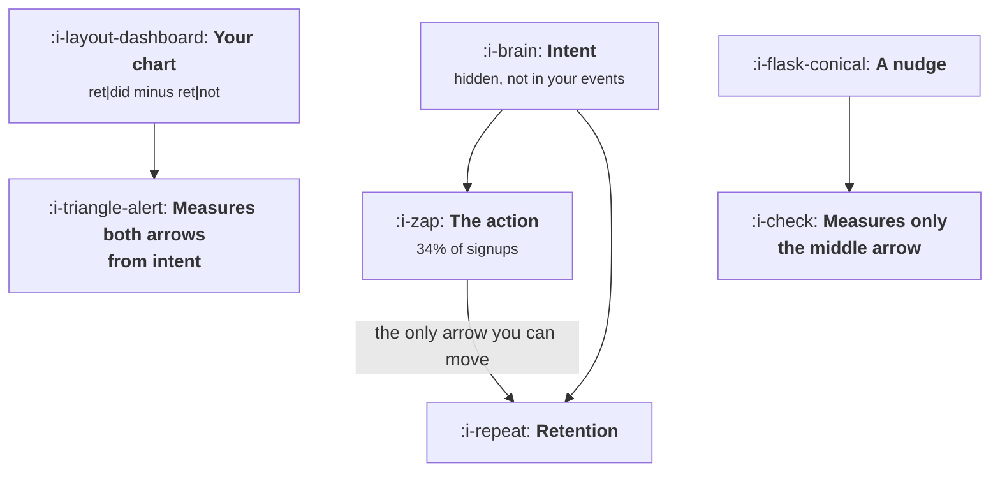

# Finding the Aha Moment

```text
Level: Intermediate
Prerequisites: What Activation Means Here
Estimated difficulty: 4/5 | Estimated time: 40 min
```

## The idea in one minute

The standard method for finding an aha moment is to compare retention among users who took an
action with retention among users who did not, and adopt the action with the biggest gap. That
method cannot distinguish between an action that causes retention and an action that merely
reveals which users were always going to stay, and the two worlds produce the same chart to within
a percentage point. This is not a subtle statistical caveat, it is the main event: most reported
aha moments are descriptions of intent wearing the clothes of a lever. The fix is cheap and
almost nobody does it, which is to write down what a nudge would be worth before building one.

## A picture



Intent feeds the action and retention separately, so a chart comparing takers with non takers adds
up two arrows and reports the total as if it were the middle one.

## How it really works

### Why the correlation is almost always real and almost always useless

Consider a cohort split into two hidden groups. Three in ten arrive with a real problem they
intend to solve; seven in ten are browsing. The committed group takes your candidate action 80
percent of the time, the browsers 15 percent. The committed group also stays far more often, for
reasons that have nothing to do with the action: they had the problem.

Run the standard comparison on that cohort and you get a 35 point retention gap between takers and
non takers, in a world where the action is causally inert. Run the same comparison on a second
cohort where the action genuinely adds 8 points of retention to whoever takes it, and you get 36
points. One point of difference in the chart, between a world where onboarding work is worth
nothing and a world where it is worth something. The program below constructs both.

The gap is not noise and it is not a measurement error. It is a real fact about your users, which
is that people who were going to stay do more things. Selection is doing the work.

### Three tests that separate the two worlds

**Intervene on a sample.** The only clean answer is a change that moves non takers into the action
and measures retention against a holdout. This is the whole reason
[The Experiment Machine](../the-experiment-machine/README.md) exists, and a team without one
cannot answer this question, which is worth saying out loud rather than papering over.

**Compare users who took the action at different times.** If the action causes retention, users
who were pushed into it early by a product change should retain better than otherwise similar
users who reached it late. If it is selection, the ordering carries no signal. This is weaker than
an experiment and much better than nothing, and it works on data you already have.

**Look for the action among users with no intent.** Find the segment that signed up for a reason
unrelated to the action, a free tool, a shared link, a conference giveaway. Among those users the
correlation between intent and the action is broken by construction. If retention still tracks the
action there, you have evidence; if it does not, you have an explanation.

### Size the prize before building anything

Even in the world where the action genuinely works, the chart overstates what is available by a
factor of roughly seven, and the reason is arithmetic rather than scepticism.

The chart's 36 points is the difference between two groups. What a change can buy is the causal
effect, 8 points, multiplied by the share of the cohort you can actually move, which excludes
everyone who already takes the action unprompted. In the worked example that ceiling is 5.2
percentage points on the cohort, achieved only by converting every single non taker, which nothing
does. A realistic reach of 25 percent buys 1.3 points.

That number, not the 36, is what the onboarding project is worth. Writing it down before the work
starts is the difference between a team that ships a 1.3 point win and reports it honestly, and a
team that ships the same win and spends a quarter explaining why it was not 36.

### Reading a reversed result

Sometimes the intervention lands and retention goes down. The usual cause is that the nudge
changed who took the action rather than how many: users pushed into a step they did not want
reached it without the context that made it meaningful, and the event now fires for two different
populations. Check it by splitting the treated group by whether they repeated the action without
prompting. A nudge that produces one compliant action and no second one has moved the metric and
nothing else, which is the same hollowing out described in
[What Activation Means Here](01-what-activation-means-here.md).

### What fills the box in 2026

Every analytics product will offer to find your aha moment automatically, usually by ranking
events by correlation with retention, sometimes with a label suggesting causality. Those rankings
are the first table in the program below, computed faster. They are a reasonable way to generate
candidates and they cannot be used as evidence, because the tool has access to the same events you
do and intent is in none of them.

The useful development is cheaper experimentation rather than cleverer analysis. A feature flag on
an onboarding step and a holdout costs a fraction of what it did five years ago, which moves the
honest method inside the budget of a much smaller team.

## Run the numbers

Build the two worlds and look at what distinguishes them, which is not the chart.

```go
// ahamoment.go: the gap between what a correlation says and what a nudge buys.
package main

import "fmt"

// Two hidden groups, high and low intent, differ in both how often they take
// the action and how often they stay. The action's own causal effect is a
// separate number, and a conditional retention chart cannot see it.
type world struct {
	name     string
	share    [2]float64 // share of the cohort: high intent, low intent
	actGiven [2]float64 // probability of taking the action unprompted
	retBase  [2]float64 // probability of staying, having not taken it
	causal   float64    // points of retention the action itself adds
}

// what a conditional retention chart would show in this world
func (w world) chart() (retAct, retNot, cover float64) {
	var act, actRet, not, notRet float64
	for i := range w.share {
		n := w.share[i]
		a := n * w.actGiven[i]
		act += a
		actRet += a * (w.retBase[i] + w.causal)
		not += n - a
		notRet += (n - a) * w.retBase[i]
	}
	return actRet / act, notRet / not, act
}

// share of the whole cohort an onboarding change can move, given how many of
// the users who would not have acted on their own it manages to reach
func (w world) movable(reach float64) float64 {
	var moved float64
	for i := range w.share {
		moved += w.share[i] * (1 - w.actGiven[i]) * reach
	}
	return moved
}

func main() {
	worlds := []world{
		{"action does nothing", [2]float64{0.30, 0.70},
			[2]float64{0.80, 0.15}, [2]float64{0.62, 0.04}, 0.00},
		{"action adds 8 points", [2]float64{0.30, 0.70},
			[2]float64{0.80, 0.15}, [2]float64{0.50, 0.04}, 0.08},
	}

	fmt.Printf("%-22s %9s %9s %9s %12s %13s\n",
		"world", "coverage", "ret|did", "ret|not", "chart says", "a nudge buys")
	for _, w := range worlds {
		did, not, cover := w.chart()
		fmt.Printf("%-22s %8.0f%% %8.0f%% %8.0f%% %9.0fpp %10.0fpp\n",
			w.name, 100*cover, 100*did, 100*not, 100*(did-not), 100*w.causal)
	}

	fmt.Println("\nTwo worlds that differ by everything that matters. The chart is the")
	fmt.Println("same in both. What an onboarding change is worth is zero in one and")
	fmt.Println("eight points per moved user in the other.")

	w := worlds[1]
	_, _, base := w.chart()
	fmt.Println("\nnow the honest ceiling in the world where the action does work:")
	fmt.Printf("%-14s %14s %14s %14s\n",
		"reach", "cohort moved", "new coverage", "cohort lift")
	for _, r := range []float64{0.10, 0.25, 0.50, 1.00} {
		moved := w.movable(r)
		fmt.Printf("%13.0f%% %13.0f%% %13.0f%% %12.1fpp\n",
			100*r, 100*moved, 100*(base+moved), 100*moved*w.causal)
	}

	did, not, _ := w.chart()
	fmt.Printf("\nThe chart promised %.0f points of retention difference. Moving every\n",
		100*(did-not))
	fmt.Printf("single user who would not have acted on their own, which no onboarding\n")
	fmt.Printf("change has ever managed, buys %.1f points on the cohort.\n",
		100*w.movable(1.0)*w.causal)
}
```

The first table is the lesson. Both worlds show 34 percent coverage and 44 percent retention among
takers. One shows 9 points for non takers and the other 8. A chart that differs by a single
percentage point is distinguishing a project worth nothing from a project worth something, and no
amount of staring at it will tell you which you are in.

The second table is what to put in the project brief. New coverage and cohort lift move together,
and the fourth row is the physical ceiling: convert every non taker and the cohort gains 5.2
points. Teams routinely promise more than this row, which is a promise that cannot be kept in any
world, including the optimistic one.

Change `causal` to zero and run it again to see the first table barely move. Then change `share`
to make your cohort more homogeneous, 0.5 and 0.5 rather than 0.3 and 0.7, and watch the chart's
overstatement shrink: selection bias scales with how different your users are from each other,
which is why this problem is worst in products with a broad free signup and mildest in narrow
ones.

## The AI layer

Two specific uses, one of which is sound.

The sound one is segment discovery. Finding the subpopulation where the action does nothing, which
is the third test above, is a search problem over many candidate cuts of the cohort, and a model is
good at proposing cuts a human would not try. The output is a hypothesis to test, and it costs
nothing because it runs over aggregates.

The unsound one is asking a model to infer the causal effect from your event data. The data does
not contain intent, so nothing that reads the data can recover it. A model will produce a
confident effect size with a plausible justification, because that is what it is for, and the
number will be the correlation with extra steps. This is the clearest case in the course where the
limit is the information available rather than the inference engine, and no model release changes
it.

What a model does change is the cost of the honest path. Instrumenting a new onboarding variant,
writing the holdout analysis and drafting the result memo are each much cheaper than they were,
which means the number of causal questions a small team can afford to answer properly has gone up
by a factor of several. Spend that on more experiments rather than on better inference from the
same data.

## Sector lens

| Sector | What makes the causal question harder here |
|---|---|
| [Enterprise B2B SaaS](../../product-management/product-by-sector/01-enterprise-b2b-saas.md) | Intent is set by whoever bought the contract, so selection is total. Experiment inside accounts rather than across them |
| [Fintech](../../product-management/product-by-sector/02-fintech.md) | Verification filters for intent before any action, so takers and non takers differ by a compliance process as well as by motivation |
| [Ecommerce and D2C](../../product-management/product-by-sector/03-ecommerce-and-d2c.md) | Cheap and fast experiments, so the honest method is affordable. The threat is seasonality rather than selection |
| [Marketplaces](../../product-management/product-by-sector/04-marketplaces.md) | A nudge on one side changes liquidity for the other, so a holdout is contaminated by the treatment group's activity |
| [Devtools and Infra](../../product-management/product-by-sector/05-devtools-and-infrastructure.md) | The action often happens in a terminal you cannot instrument, so coverage is measured with a systematic undercount |
| [Healthtech](../../product-management/product-by-sector/06-healthtech-and-regulated-care.md) | Randomising onboarding can be a clinical or contractual question rather than a product one. Use staged rollout by site instead |
| [Vertical SaaS](../../product-management/product-by-sector/07-vertical-saas.md) | Too few accounts to randomise. The time ordering test and interviews are the available evidence, and should be labelled as weaker |

## Remember this

* A conditional retention chart adds together the action's effect and the selection of who takes
  it, and reports the sum.
* Two worlds, one where the action is inert and one where it adds 8 points, produce charts one
  percentage point apart.
* Only an intervention with a holdout separates them. Time ordering and no intent segments are the
  usable second best.
* The chart's gap overstates what a project can buy by roughly the factor between the gap and the
  causal effect, because you can only move users who were not going to act anyway.
* Compute the ceiling, causal effect multiplied by movable share, and put it in the brief before
  the work starts.
* A nudge that produces one action and no repeat has moved the metric without moving the user.
* Selection bias scales with how heterogeneous your signups are, so broad free funnels suffer
  worst.

## Try it

1. Run `ahamoment.go`, then set `causal` to 0.02 and 0.15 in turn and record how much the first
   table changes. Decide whether your own analytics could tell those cases apart.
2. Take your company's current stated aha moment. Compute the movable share, that is one minus
   unprompted coverage, and multiply it by the most pessimistic causal effect you would defend.
   That is the honest size of the prize.
3. Design the cheapest intervention that would move non takers into your candidate action, with a
   holdout, and write down what result would make you abandon the candidate.

## Check yourself

1. Users who connect a data source retain at 54 percent against 8 percent for those who do not.
   Why can you not conclude that connecting a data source retains users, and what would you run?
2. Unprompted coverage of an action is 80 percent and its true causal effect is 10 points. What is
   the maximum cohort retention lift available from onboarding work, and why is the real figure
   lower?
3. Your nudge raised the action's rate from 34 to 51 percent and retention fell. Give the most
   likely mechanism and the query that would confirm it.
