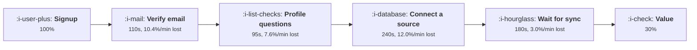

# Time to Value

```text
Level: Intermediate
Prerequisites: Finding the Aha Moment
Estimated difficulty: 3/5 | Estimated time: 35 min
```

## The idea in one minute

Time to value is the right thing to measure and the wrong thing to optimise, because minutes are
not interchangeable. A user will wait three minutes for a sync they understand and abandon a
ninety second form they do not, so the correct unit is not seconds but drop out per second: what
each step's time actually costs you. Measured that way the ranking inverts. The longest step in a
typical onboarding flow is usually among the cheapest minutes you own, and the expensive minutes
are short steps where the user cannot see why they are being asked. Ranking by duration is the
reason teams spend a quarter shaving a progress bar and move nothing.

## A picture



The two longest boxes cost wildly different amounts per minute, which is the fact that a
time to value number averages away.

## How it really works

### Measure the flow as a product, not a total

Onboarding completion is the product of every step's pass rate, so the end to end number falls
fast and tells you nothing about where. Seven steps at 90 percent each is 48 percent completion,
and no single step looks like a problem. Write the flow down as a table of steps, each with a
median duration and a pass rate, and the structure appears immediately.

The worked flow in the program below is a real shape: seven steps, twelve minutes of elapsed time,
30 percent completion. Three steps are over 90 percent and irrelevant. One step, connecting a data
source, takes 52 percent of whoever reaches it, and the flow's whole problem is in that row.

### Drop out per minute is the number to rank on

For each step, divide the share who abandon by the minutes it takes. That gives what the step's
time costs, and it separates slow and tolerated from short and fatal.

In the worked flow the first sync takes three minutes and loses 3 percent per minute, the cheapest
time in the whole flow because the user has already committed and can see progress. Email
verification takes two thirds as long and costs nearly four times as much per minute, because the
user has to leave your product, which is where attention goes to die.

The practical rule that falls out: time the user spends watching your product do visible work is
cheap, and time the user spends doing work whose purpose is unclear is expensive. The same thirty
seconds is worth a tenth as much in one place as the other.

### Deleting a step is worth exactly what the arithmetic says

The second table in the program removes each step in turn and recomputes completion. Deleting the
data source step takes completion from 30 to 59 percent, which is the entire available win in this
flow. Deleting the sync wait, the obvious target if you rank by duration, takes it from 30 to 33.

Before deleting anything, ask what the step was for. The data source step is not an arbitrary
obstruction; it is probably what makes the product work, and a flow that skips it will trade
onboarding completion for a worse week two. That tension is the subject of
[Friction Worth Keeping](04-friction-worth-keeping.md), and the honest framing is that this
table tells you the price of each step, not whether to pay it.

### The four moves, in order of how often they are right

* **Defer it.** Move the step after the first moment of value rather than before it. This is almost
  always available and almost always the best option, because it changes when the cost is paid
  rather than whether.
* **Do it for them.** Infer the answer, pick a sensible default, or seed an example. Removes the
  step's time and its drop at once.
* **Make the work visible.** A step that cannot be removed gets cheaper per minute when the user
  can see what it is achieving. This is how a three minute wait ends up costing 3 percent rather
  than 12.
* **Delete it.** Right when the step exists because somebody wanted the data, which describes most
  profile questions.

### What fills the box in 2026

Session replay and funnel tools will produce the first table for you, with one caveat that matters:
median duration per step is usually computed over users who completed the step, so it
systematically understates the time of the steps people abandon. Ask for the duration distribution
of abandoners separately. A step whose completers take 40 seconds and whose abandoners spend 200
before giving up is a comprehension failure, not a length failure, and the fix is wording rather
than speed.

## Run the numbers

Write the flow down, then rank it twice and notice that the rankings disagree.

```go
// timetovalue.go: which minute to delete, which is not the longest one.
package main

import "fmt"

type step struct {
	name string
	secs float64 // median seconds this step takes
	pass float64 // share who get through it
}

func completion(steps []step) float64 {
	c := 1.0
	for _, s := range steps {
		c *= s.pass
	}
	return c
}

func elapsed(steps []step) float64 {
	t := 0.0
	for _, s := range steps {
		t += s.secs
	}
	return t
}

// drop out per second of the step: how expensive this step's time is
func (s step) costPerSecond() float64 { return (1 - s.pass) / s.secs }

func main() {
	flow := []step{
		{"email and password", 40, 0.94},
		{"verify the email", 110, 0.81},
		{"answer four profile questions", 95, 0.88},
		{"pick a plan", 35, 0.97},
		{"connect a data source", 240, 0.52},
		{"name the workspace", 20, 0.99},
		{"wait for the first sync", 180, 0.91},
	}

	base := completion(flow)
	fmt.Printf("%-32s %8s %8s %12s %14s\n",
		"step", "seconds", "pass", "cumulative", "drop/minute")
	run := 1.0
	for _, s := range flow {
		run *= s.pass
		fmt.Printf("%-32s %8.0f %7.0f%% %11.0f%% %13.1f%%\n",
			s.name, s.secs, 100*s.pass, 100*run, 100*60*s.costPerSecond())
	}
	fmt.Printf("\n%-32s %8.0f %7s %11.0f%%\n", "whole flow", elapsed(flow), "", 100*base)

	fmt.Println("\nwhat deleting one step is worth:")
	fmt.Printf("%-32s %12s %12s %14s\n",
		"delete this step", "new time", "completion", "gain per minute")
	for i := range flow {
		cut := append(append([]step{}, flow[:i]...), flow[i+1:]...)
		gain := completion(cut) - base
		saved := flow[i].secs / 60
		fmt.Printf("%-32s %10.0fs %11.0f%% %12.1fpp\n",
			flow[i].name, elapsed(cut), 100*completion(cut), gain/saved*100)
	}

	fmt.Println("\nRanked by time, the list says cut the sync. Ranked by what a minute")
	fmt.Println("of it costs, the sync is the cheapest minute in the flow: almost")
	fmt.Println("everybody waits through it. Verification is two thirds as long and")
	fmt.Println("buys nearly four times as much per minute saved. The data source step")
	fmt.Println("is both the longest and the deadliest, and is the only one worth")
	fmt.Println("rebuilding rather than trimming.")
}
```

Read the cumulative column first. It goes 94, 76, 67, 65, 34, 33, 30, and the only cliff is
between 65 and 34. Four of the seven steps are rounding errors on the result, which is normal and
is why flow wide initiatives underdeliver: most of the flow is not the problem.

The drop per minute column is where the ranking inverts. Verification at 10.4 percent per minute
and the profile questions at 7.6 are both more expensive per minute than the sync at 3.0, despite
being shorter. The data source step leads at 12.0 and is also the longest, which is the one case
where both rankings agree and the step should be rebuilt rather than trimmed.

The deletion table gives the prices. Note that deleting the two cheapest steps, naming the
workspace and picking a plan, buys 1 point between them while removing 55 seconds, which is 8
percent of the elapsed time. A project that cut the flow from twelve minutes to eleven and
reported a faster onboarding would be telling the truth and would have achieved nothing.

Put your own flow in, and use durations measured on abandoners rather than completers wherever you
have them. The output to act on is the single largest cliff in the cumulative column, and the
question to take into the next lesson is whether that step is load bearing.

## The AI layer

The "do it for them" move is the one a model genuinely changes, and it changes it most at exactly
the step that matters most in the worked flow.

Connecting a data source, mapping fields, writing a first query, filling a profile from a company
domain and producing a starting document are all steps a model can complete from a small input.
Where that works, the step's duration falls and its pass rate rises together, which is the only
kind of change that moves both columns in the table. A realistic version of the worked flow with
inferred field mapping takes the data source step from 52 to perhaps 75 percent, which is worth
more than every other row combined.

Two costs to hold. The inference is a real per signup charge, cents rather than fractions of a
cent once a model is reading a schema or a document, and it is incurred for users who will never
pay, which is the pattern described in
[Free Tiers When Every Use Costs Money](../growth-for-ai-products/README.md). Separately, a step
that now takes four seconds of model time instead of four minutes of user time has moved the
latency into your infrastructure, where a slow or failed call is a dead end rather than a slow
step, and needs an explicit fallback to the manual path.

The failure mode: a model completes the step wrongly and confidently, the user accepts it because
they have no basis to judge, and the product is now configured incorrectly in a way that surfaces
in week three as poor retention with healthy activation. Instrument the correction rate, meaning
how often users change what was inferred, and treat a correction rate near zero as suspicious
rather than good.

## Sector lens

| Sector | What dominates the clock here |
|---|---|
| [Enterprise B2B SaaS](../../product-management/product-by-sector/01-enterprise-b2b-saas.md) | The clock is measured in weeks and the slow steps belong to the customer's IT. Measure time to value from contract rather than from signup |
| [Fintech](../../product-management/product-by-sector/02-fintech.md) | Identity checks set a floor nobody can trim. Make the wait visible and transactional, and give the user something to do while it clears |
| [Ecommerce and D2C](../../product-management/product-by-sector/03-ecommerce-and-d2c.md) | Minutes are seconds. Checkout fields are the whole flow, and each additional field is measurable within a day |
| [Marketplaces](../../product-management/product-by-sector/04-marketplaces.md) | Supply side onboarding is long and load bearing; demand side must be near zero. Two flows with opposite tolerances |
| [Devtools and Infra](../../product-management/product-by-sector/05-devtools-and-infrastructure.md) | The expensive minutes are in the user's environment where you cannot see them. A first successful call is the only reliable clock |
| [Healthtech](../../product-management/product-by-sector/06-healthtech-and-regulated-care.md) | Training and credentialing precede use, so the product's own flow is a small part of the real time to value |
| [Vertical SaaS](../../product-management/product-by-sector/07-vertical-saas.md) | Data migration is the step, it takes weeks, and doing it for the customer is usually the right answer even unassisted by a model |

## Remember this

* Completion is the product of step pass rates, so a flow with no bad looking step can still lose
  seventy percent of it.
* Rank steps by drop out per minute, not by duration. The rankings disagree and the duration one
  is wrong.
* Visible work the product is doing is cheap time. Invisible work the user is doing, whose purpose
  is unclear, is expensive time.
* Leaving your product, as email verification requires, is among the most expensive things you can
  ask per second.
* Defer before you delete. Deferring moves when a cost is paid; deleting may remove something the
  product needs.
* Median step duration measured on completers understates the abandoners. A step whose abandoners
  take four times longer is a wording problem.
* Where a model can complete a step, duration falls and pass rate rises together, which no other
  intervention does. Watch the correction rate to know whether it worked.

## Try it

1. Write your own onboarding flow into `timetovalue.go` with real medians and pass rates, then
   find the single largest cliff in the cumulative column. That is the only row worth a project.
2. For your two longest steps, pull the duration distribution of users who abandoned them. Decide
   for each whether you have a length problem or a comprehension problem.
3. Pick the most expensive step by drop per minute and write the deferred version of it, meaning
   where it would sit if it happened after the first moment of value, and what would break.

## Check yourself

1. A step takes 20 seconds and loses 4 percent of users; another takes 200 seconds and loses 9
   percent. Which is more expensive, and what would you do about each?
2. Your flow is twelve minutes and you cut it to nine with no change in completion. What is the
   most likely explanation, and was the work worthwhile?
3. Why is deferring a step usually a better first move than deleting it, and what evidence would
   make deletion the right call instead?
