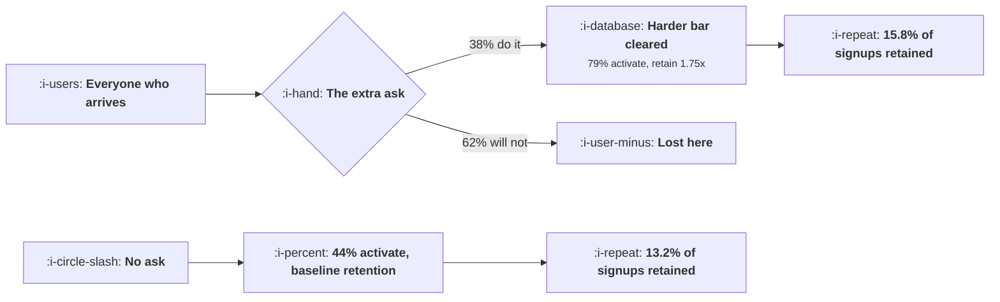

# Friction Worth Keeping

```text
Level: Intermediate
Prerequisites: Time to Value
Estimated difficulty: 4/5 | Estimated time: 40 min
```

## The idea in one minute

The received wisdom is that friction is bad and every removable step should go, and it is wrong
often enough to be dangerous. Asking for more does two things at once: it loses everybody who will
not do it, and it raises the chance of success for everybody who will. Whether that trade pays is
arithmetic with two measurable inputs, and the answer changes depending on which metric you judge
it by. In the worked example two asks lower activation by double digits and raise retained users,
which means a team that optimised activation would have deleted the two best steps in its own
onboarding. The breakeven pass rate is one division and should be computed before any step is cut.

## A picture



The ask loses 62 percent of the cohort and still ends with more retained users, which is the
pattern an activation dashboard cannot show you.

## How it really works

### The two numbers the decision needs

For any step you are considering adding or removing, you need the pass rate, meaning the share of
users who complete it, and the conditional activation rate, meaning how often people activate
having done it compared with not having done it.

Activation with the step is the pass rate multiplied by the conditional rate. Without it, the
baseline. Set them equal and rearrange: the step pays for itself on activation as long as its pass
rate is above the baseline divided by the conditional rate. That quotient is the breakeven pass
rate, and it is the number to put on the wall.

An ask that takes activation from 44 percent to 79 percent among those who complete it has a
breakeven of 56 percent. If fewer than 56 in a hundred will do it, the step costs more activation
than it buys. This is the arithmetic that justifies removing friction, and it is correct as far as
it goes.

### Why the activation version of the question is the wrong one

Activation is a proxy. The loop runs on retained users, and the people an ask filters out are not
a random sample of the cohort: they are the least committed part of it. So the users who clear a
harder bar typically retain better than activated users who were never asked, and that multiplier
belongs in the arithmetic.

Put it in and the breakeven drops. The same import step with a 56 percent breakeven on activation
has a 32 percent breakeven on retained users, and its actual pass rate of 38 percent sits between
the two. On activation it fails. On retained users it adds 2.6 percentage points, which is a 20
percent improvement on the baseline.

This is the single most useful result in the topic, because the direction of the error is
consistent. Optimising activation systematically over removes friction, and the steps it removes
are exactly the ones that were selecting for committed users.

### The multiplier has to be measured

The retention multiplier is where this argument gets abused, because it is the input that lets you
justify any step you were already attached to. Measure it by comparing retention among users who
completed the step with retention among activated users in a period before the step existed, or
better, against a holdout that never saw it. Do not assume it.

Three sanity checks. A multiplier above about two usually means the step is a proxy for intent
rather than a cause, which puts you back in
[Finding the Aha Moment](02-finding-the-aha-moment.md). A multiplier below 1.1 means the step is
not selecting for anything and should be judged on activation alone, which it will fail. And a
multiplier that shrinks as pass rate rises is the normal and expected pattern, because broadening
who completes a step dilutes the group it used to select.

### Which asks tend to be worth keeping

The pattern across the worked rows is not about the step's difficulty, it is about whether the
step makes the product better for that user.

* **Asks that put the user's own material into the product.** Importing data, connecting a source,
  uploading a file. The product is genuinely more useful afterwards, so both the conditional rate
  and the multiplier are high.
* **Asks that add another human.** Inviting a teammate changes the product from a tool to a shared
  place, which is the loop in
  [Collaboration Loops](../virality-and-referral/03-collaboration-loops.md).
* **Asks that state an intention.** Naming the job you came to do is cheap, has a high pass rate,
  and lets the product configure itself. Highest activation of the five rows below.

And the ones that are not: asks that collect information for your sales team, asks that exist to
qualify leads, and asks for commitment before any value has been delivered. The payment card row
is the clean example. It nearly doubles each completer's chance of activating, has the highest
retention multiplier in the table, and still loses on both measures, because a 21 percent pass rate
cannot be rescued by anything that happens afterwards.

### What fills the box in 2026

Nothing structural. The one environmental change worth noting is that the pass rate on any ask
involving a third party login or data connection has fallen as users have become more careful
about access scopes, which moves some asks that used to clear their breakeven below it. If your
import step's pass rate was measured before 2024, remeasure it rather than reusing the figure.

## Run the numbers

Compute both breakevens for every ask in your flow, then notice which rows disagree.

```go
// friction.go: when asking for more raises activation, and when it only looks
// like it lowers it.
package main

import "fmt"

// Adding a step costs you everyone who will not do it and buys you a better
// chance for everyone who will. Both effects are measurable, so the question
// is arithmetic rather than philosophy.
type ask struct {
	name    string
	pass    float64 // share of users who complete the extra step
	before  float64 // chance of activating without the step
	after   float64 // chance of activating having done the step
	retMult float64 // how much better these users retain, measured not assumed
}

const retBase = 0.30 // retention among activated users with no extra ask

func (a ask) activation() float64 { return a.pass * a.after }
func (a ask) retained() float64   { return a.activation() * retBase * a.retMult }

// the pass rate below which the step stops paying, on each of the two measures
func (a ask) breakevenAct() float64 { return a.before / a.after }
func (a ask) breakevenRet() float64 { return a.before / (a.after * a.retMult) }

func main() {
	asks := []ask{
		{"pick your role", 0.91, 0.44, 0.47, 1.02},
		{"import your existing data", 0.38, 0.44, 0.79, 1.75},
		{"invite one teammate", 0.46, 0.44, 0.72, 1.60},
		{"state the job you came to do", 0.83, 0.44, 0.58, 1.15},
		{"add a payment card", 0.21, 0.44, 0.88, 1.90},
	}
	base := asks[0].before

	fmt.Printf("baseline: %.0f%% activate, %.0f%% of those retain, %.1f%% of signups retained\n\n",
		100*base, 100*retBase, 100*base*retBase)

	fmt.Printf("%-30s %7s %9s %12s %11s %s\n",
		"the extra ask", "pass", "act|did", "activation", "breakeven", "on activation")
	for _, a := range asks {
		verdict := "costs more than it buys"
		if a.activation() > base {
			verdict = "worth keeping"
		}
		fmt.Printf("%-30s %6.0f%% %8.0f%% %11.0f%% %10.0f%% %s\n",
			a.name, 100*a.pass, 100*a.after, 100*a.activation(),
			100*a.breakevenAct(), verdict)
	}

	fmt.Println("\nnow judged on retained users, which is what the loop runs on:")
	fmt.Printf("%-30s %12s %11s %11s %s\n",
		"the extra ask", "retained", "vs base", "breakeven", "on retention")
	for _, a := range asks {
		verdict := "costs more than it buys"
		if a.retained() > base*retBase {
			verdict = "worth keeping"
		}
		fmt.Printf("%-30s %11.1f%% %+10.1fpp %10.0f%% %s\n",
			a.name, 100*a.retained(), 100*(a.retained()-base*retBase),
			100*a.breakevenRet(), verdict)
	}

	fmt.Println("\nTwo rows flip. Importing data and inviting a teammate both lower")
	fmt.Println("activation, by 14 and 11 points, and both raise retained users,")
	fmt.Println("because the people who clear the harder bar are worth more than the")
	fmt.Println("people it turned away. Judging friction on activation alone deletes")
	fmt.Println("the two best asks in the list.")
	fmt.Println("\nThe payment card loses on both and is the honest example of friction")
	fmt.Println("that is simply too expensive: it nearly doubles each user's chance")
	fmt.Println("of activating and still cannot survive a 21% pass rate.")
}
```

The first table is the conventional analysis and it rejects four of the five asks. Only stating the
job clears its breakeven, because an 83 percent pass rate is high enough that even a modest lift
in the conditional rate survives it.

The second table reverses two of those rejections. Importing data costs 14 points of activation and
returns 2.6 points of retained users. Inviting a teammate costs 11 points of activation and returns
2.7. Both are good trades and both would be deleted by a team with an activation target, which is
a reasonable argument against having an activation target without a retention guardrail beside it.

Look at the breakeven columns together. On activation they run 94, 56, 61, 76 and 50 percent. On
retained users they run 92, 32, 38, 66 and 26. The gap between the two columns is the retention
multiplier doing its work, and it is largest exactly where the ask is most demanding, which is why
the error is systematic rather than random.

Change the `retMult` on the import row to 1.2, a plausible figure if your import is shallow, and
the row stops paying. That sensitivity is the honest caveat: this analysis is only as good as the
multiplier, and the multiplier is the input teams are most tempted to guess.

## The AI layer

A model changes the pass rate column without touching the conditional rate, and that is precisely
the lever this arithmetic says is most valuable.

An ask that is expensive because it is laborious, mapping fields during an import, writing a first
configuration, describing your use case in a paragraph, can often be reduced to confirming
something the model proposed. Pass rates on confirmation steps run far higher than on creation
steps. If inferred field mapping takes the import ask from a 38 percent pass rate to 60, the row
clears its breakeven on both measures and the trade stops being a trade.

The thing to protect is the conditional rate and the multiplier, which existed because the step
was demanding. An ask reduced to a single click may keep its pass rate and lose its selectivity,
and the measurable symptom is the multiplier falling towards one. Recompute it after any change
that raises a pass rate sharply, because the breakeven you were comparing against has moved too.

Cost is modest and real: inference on an import or a configuration draft is cents per signup, paid
on the whole top of the funnel. The failure mode is a confident wrong inference accepted by a user
with no way to judge it, which produces an activated, badly configured account that churns in week
four, and that shows up as a falling multiplier rather than as an error rate.

## Sector lens

| Sector | What friction is load bearing here |
|---|---|
| [Enterprise B2B SaaS](../../product-management/product-by-sector/01-enterprise-b2b-saas.md) | Security review and single sign on cannot be deferred and select strongly. Measure the multiplier by account, not by user |
| [Fintech](../../product-management/product-by-sector/02-fintech.md) | Identity verification is friction you may not remove. The only available moves are ordering and making the wait legible |
| [Ecommerce and D2C](../../product-management/product-by-sector/03-ecommerce-and-d2c.md) | Almost no friction survives its breakeven, because the retention multiplier on a first purchase is small. Guest checkout is usually right |
| [Marketplaces](../../product-management/product-by-sector/04-marketplaces.md) | Heavy friction on supply, near zero on demand. Supply side vetting raises the multiplier for the whole other side |
| [Devtools and Infra](../../product-management/product-by-sector/05-devtools-and-infrastructure.md) | An API key step has a high pass rate among the right audience and filters out nobody who matters. Keep it, remove the signup form around it |
| [Healthtech](../../product-management/product-by-sector/06-healthtech-and-regulated-care.md) | Consent and credentialing are statutory. Treat them as fixed cost and optimise everything either side |
| [Vertical SaaS](../../product-management/product-by-sector/07-vertical-saas.md) | Data migration is the ask, the pass rate is low, and the multiplier is enormous. Do it for the customer rather than removing it |

## Remember this

* Adding a step loses everyone who will not do it and raises the odds for everyone who will.
  Activation is the product of the two.
* The breakeven pass rate is the baseline divided by the conditional rate. Compute it before
  cutting a step.
* Judge friction on retained users, not activation. The retention multiplier lowers the breakeven,
  often by half.
* Optimising activation alone systematically removes the steps that were selecting for committed
  users.
* Measure the multiplier against a holdout or a pre step period. A figure above two means you have
  found intent, not causation.
* Asks that put the user's own material in, add another human, or state an intention tend to pay.
  Asks that serve your sales team do not.
* When a model raises a pass rate sharply, recompute the multiplier: the step may have kept its
  completion and lost its selectivity.

## Try it

1. Put your own onboarding asks into `friction.go` with measured pass rates and conditional rates,
   and both breakevens computed. Mark every row where the two verdicts disagree.
2. For the ask with the largest disagreement, design the holdout that would measure its retention
   multiplier honestly, and estimate how long it would need to run.
3. Find one ask in your flow that exists to collect information for another team. Compute what it
   costs in retained users per month, and take that number to the team that wants it.

## Check yourself

1. Baseline activation is 40 percent, an ask raises it to 70 percent among completers, and 48
   percent of users complete it. Does the ask pay on activation, and what else do you need to know?
2. Why does judging onboarding friction on activation alone produce a predictable direction of
   error rather than random noise?
3. Your import pass rate rose from 35 to 65 percent after the mapping was automated, and the
   retention multiplier fell from 1.8 to 1.15. Did the change help? Show the arithmetic.
