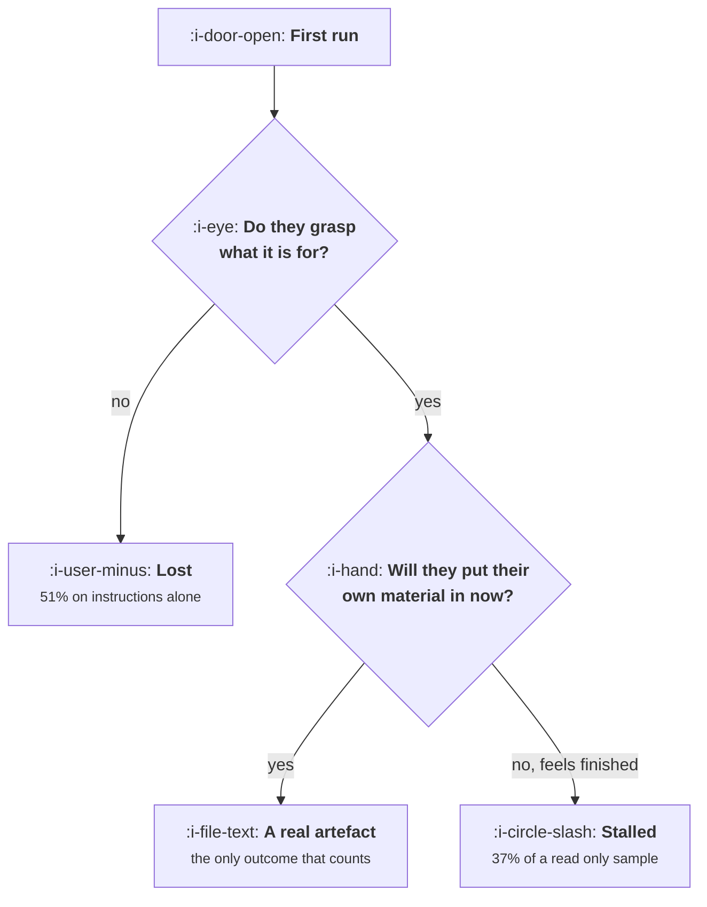

# Empty States and First Run

```text
Level: Intermediate
Prerequisites: Friction Worth Keeping
Estimated difficulty: 3/5 | Estimated time: 35 min
```

## The idea in one minute

The empty state is the only screen in your product that has to teach, and the only one whose job
is to be replaced. Its measure is not whether the user understands the product, it is whether the
user puts something of their own into it, and those two come apart in a specific and expensive
way. A polished read only sample workspace is the clearest demonstration you can build and
produces fewer real first artefacts than a paragraph of written instructions, because a third of
the people who understood it felt they had already seen the product and left. Comprehension that
satisfies is worse than confusion that provokes.

## A picture



Two gates, not one. Most empty state work improves the first gate and is measured as if it
improved the second.

## How it really works

### The outcome to instrument

Instrument one thing on the empty state: the rate at which a new user creates a first artefact
containing their own material, inside the first session. Not tour completion, not time on screen,
not clicks on the sample. The artefact is what the rest of the product has to act on, and the
definition is the one from
[What Activation Means Here](01-what-activation-means-here.md) narrowed to the first session.

Then split failures into two buckets, because they need opposite fixes. Users who did not
understand what the product was for need demonstration. Users who understood and did nothing need
provocation. A team that reports a single empty state conversion number cannot tell which problem
it has, and will usually build more demonstration, because demonstration is the fun part.

### The five strategies, and the one that backfires

**A blank screen with no guidance.** Grasp rate around 22 percent in the worked table, because the
only people who work it out are the ones who arrived knowing. Costs nothing, which is its single
virtue, and it is the right answer for a product whose users arrive with a specific task in mind
and no tolerance for being taught.

**A blank screen with written instructions.** Roughly doubles grasp and is the honest baseline
every fancier idea should be compared against. Cheap, fast, and it is the row the other rows have
to beat.

**A read only sample workspace.** The highest comprehension per pound you can buy and the worst
outcome in the table relative to its cost. It produces fewer real artefacts than plain
instructions because it closes the loop in the user's head: they have seen what the product does,
the curiosity that brought them is satisfied, and nothing in the screen makes their absence from
it uncomfortable. If you build one thing from this lesson, do not build this.

**An editable sample, clearly marked as fake.** The best return per unit of work. Comprehension
nearly as high as the read only version, and willingness far higher, because editing somebody
else's example is a much smaller step than starting from nothing and the marking as fake creates
the discomfort that read only samples remove. The marking matters: a sample the user cannot tell
from real data produces a workspace they do not trust and will not build on.

**Seeded from the user's own data.** The best absolute outcome and the most expensive, and it has a
sequencing problem: you need the user's data before they have given you any, so it depends on an
import, a domain lookup or a connected account, which is the ask priced in
[Friction Worth Keeping](04-friction-worth-keeping.md).

### Write the empty state as a sentence, not a layout

The empty state that works says three things in this order: what this space is for, the one action
to take now, and what will happen when you do. Most empty states say the first and skip the third,
which is why they read as decoration.

The one action should be singular. An empty state offering four ways to begin has a lower first
artefact rate than one offering one, because choosing is work and the user has no basis for
choosing yet. Put the other three behind the first one.

### What fills the box in 2026

The practice has consolidated on editable seeded workspaces, and the component libraries most teams
use ship an empty state primitive that assumes one. The useful consequence is that the cheap row in
the table is now cheaper than it was. The unhelpful consequence is that empty states have become
visually uniform enough that users skim them, which has slowly lowered grasp rates for everybody
and is not something your copy can fix on its own.

## Run the numbers

Score the strategies on both gates, then divide by what each costs to build.

```go
// firstrun.go: what each empty state strategy actually produces.
package main

import "fmt"

// The empty state's only job is to get a user to put something of their own
// into the product. A strategy is scored on whether the user understands what
// to do, whether they are willing to do it now, and whether the screen
// accidentally satisfies them so they never do it at all.
type strategy struct {
	name      string
	grasp     float64 // works out what the product is for
	willing   float64 // of those, does something with their own material now
	satisfied float64 // of those who grasp it, feels finished and leaves
}

func (s strategy) real() float64 { return s.grasp * s.willing }
func (s strategy) stalled() float64 {
	return s.grasp * s.satisfied
}
func (s strategy) lost() float64 { return 1 - s.grasp }

func main() {
	strats := []strategy{
		{"blank screen, no guidance", 0.22, 0.74, 0.01},
		{"blank screen with instructions", 0.49, 0.61, 0.03},
		{"read only sample workspace", 0.81, 0.34, 0.37},
		{"editable sample, clearly fake", 0.78, 0.66, 0.11},
		{"seeded from the user's own data", 0.84, 0.71, 0.08},
	}

	fmt.Printf("%-34s %8s %9s %12s %10s %9s\n",
		"first run strategy", "grasp", "willing", "own artefact", "stalled", "lost")
	for _, s := range strats {
		fmt.Printf("%-34s %7.0f%% %8.0f%% %11.0f%% %9.0f%% %8.0f%%\n",
			s.name, 100*s.grasp, 100*s.willing, 100*s.real(),
			100*s.stalled(), 100*s.lost())
	}

	fmt.Println("\nThe read only sample is the trap. It has the second best grasp rate")
	fmt.Println("in the table and produces fewer real artefacts than plain written")
	fmt.Println("instructions, because 37% of the people who understood it felt they")
	fmt.Println("had seen the product and left.")

	fmt.Println("\nwhat each strategy costs to build, against what it returns:")
	fmt.Printf("%-34s %12s %14s %16s\n",
		"first run strategy", "build weeks", "own artefact", "points per week")
	weeks := []float64{0.2, 1, 3, 5, 8}
	base := strats[1].real() // instructions are the honest baseline to beat
	for i, s := range strats {
		gain := s.real() - base
		fmt.Printf("%-34s %11.1f %13.0f%% %14.1f\n",
			s.name, weeks[i], 100*s.real(), 100*gain/weeks[i])
	}

	fmt.Println("\nThe editable fake sample returns 4.3 points of first artefacts per")
	fmt.Println("week of work. Seeding from their own data produces more artefacts")
	fmt.Println("in absolute terms and returns 3.7 per week, takes 60% longer to build,")
	fmt.Println("and needs data the user has not given you yet. Build the fake one")
	fmt.Println("first and keep the seeded one on the list.")
}
```

The first table separates the two gates. Read the grasp and willing columns as a pair: the read
only sample scores 81 and 34, instructions score 49 and 61, and they end up at 28 and 30 percent
first artefacts respectively. Three weeks of design work bought a worse outcome than a paragraph,
and every stakeholder who reviewed the sample workspace would have preferred it.

The stalled column is the mechanism. Thirty percent of everybody who sees the read only sample
understands the product and leaves, which no other row comes close to. That is not a drop out, it
is a satisfied exit, and it will look like healthy engagement in a session length report.

The second table divides by build cost against written instructions as the baseline. The editable
fake sample returns 4.3 points of first artefacts per week of work and is the clear first thing to
build. Seeding from the user's own data is better in absolute terms, 60 percent against 51, and
returns less per week while also requiring the import ask to exist first. Build the cheap one,
measure it, then decide whether the last 9 points justify the sequencing problem.

Put your own numbers in, and get the grasp and willing split from a handful of recorded first
sessions rather than guessing it. Five sessions is enough to tell satisfied exits from confused
ones, which is the distinction the whole table turns on.

## The AI layer

A model collapses the gap between the fourth and fifth rows, which is the main practical change.

Seeding a workspace from the user's own material used to require an import, a schema mapping and a
transformation, which is why it cost eight weeks in the table. A model can produce a plausible
personalised starting workspace from very little: a company domain, a job title, a single sentence
about what the user came to do. That moves the fifth row's build cost towards the fourth row's
while keeping its outcome, and it removes the sequencing problem, because a domain name is not an
ask in the sense that an import is.

Two things to hold on to. First, a generated workspace must still be marked as a starting point
rather than presented as the user's real data, for exactly the reason the fake sample beats the
read only one: material the user cannot tell from their own is material they will not correct.
Second, generation at first run is paid on every signup including the ones that bounce in nine
seconds, at roughly a cent or two for a short workspace, so a hundred thousand monthly signups is
a small but visible line item and the generation should be triggered by the second screen rather
than the first.

The failure mode is specific and recurrent: the generated workspace is wrong in a way
that is plausible to the product and obvious to the user, usually by inferring the wrong industry
from a domain, and it reads as incompetence rather than as a helpful guess. Instrument the rate at
which users discard the seeded workspace entirely. Above about one in five, the guess is doing more
harm than a blank screen with a good sentence on it.

## Sector lens

| Sector | What the first screen has to do here |
|---|---|
| [Enterprise B2B SaaS](../../product-management/product-by-sector/01-enterprise-b2b-saas.md) | The first user is often an evaluator, not an operator. The empty state has to produce something they can show somebody else |
| [Fintech](../../product-management/product-by-sector/02-fintech.md) | Fake sample balances and transactions are a trust problem, not a teaching device. Mark them unmistakably or use an empty state with a sentence |
| [Ecommerce and D2C](../../product-management/product-by-sector/03-ecommerce-and-d2c.md) | There is no empty state for the buyer. The equivalent is a first visit with no browsing history, and the job is the same: one action, not four |
| [Marketplaces](../../product-management/product-by-sector/04-marketplaces.md) | The real empty state is an empty market. Seed one side with your own supply before showing the other side anything |
| [Devtools and Infra](../../product-management/product-by-sector/05-devtools-and-infrastructure.md) | The empty state is a terminal and a copyable command. One command that returns something true beats any dashboard |
| [Healthtech](../../product-management/product-by-sector/06-healthtech-and-regulated-care.md) | Synthetic patient data must be flagged in the interface and the audit log. A read only demo environment is often the compliant option despite the cost |
| [Vertical SaaS](../../product-management/product-by-sector/07-vertical-saas.md) | Seed from the customer's existing spreadsheets during implementation. The empty state should rarely be seen at all |

## Remember this

* The empty state's measure is first artefacts containing the user's own material, in the first
  session. Nothing else.
* There are two gates, grasp and willingness, and they need opposite fixes. A single conversion
  number cannot tell them apart.
* A read only sample is the highest comprehension and a satisfied exit for about a third of the
  people who understand it. It loses to a paragraph of instructions.
* An editable sample, clearly marked as fake, is the best return per week of work. The marking is
  load bearing.
* Seeding from the user's own data wins on outcome and has a sequencing problem, because you need
  data before they have given you any.
* Say three things: what the space is for, the one action now, and what happens when they take it.
  Offer one action, not four.
* A model makes personalised seeding cheap. Mark it as a guess, trigger it off the second screen,
  and watch the discard rate.

## Try it

1. Watch five recorded first sessions from users who did not create anything. Classify each as
   confused or satisfied. The ratio tells you which gate to work on, and it usually surprises
   people.
2. Run `firstrun.go` with your own build estimates and measured rates. Compare the points per week
   of your planned empty state project against written instructions done properly.
3. Rewrite your current empty state as three sentences in the order given above, with exactly one
   action. Ship it as the control for whatever you build next.

## Check yourself

1. Your beautiful sample workspace raised time on the first screen by 40 percent and lowered first
   artefacts. Explain the mechanism and what you would change.
2. Why does marking a sample as fake raise the rate at which users create their own material,
   when a more realistic sample demonstrates the product better?
3. You can build one of two things: an editable fake workspace in five weeks, or a model generated
   personalised one in six. What would make the second worth the extra week, and what would you
   instrument to find out?
