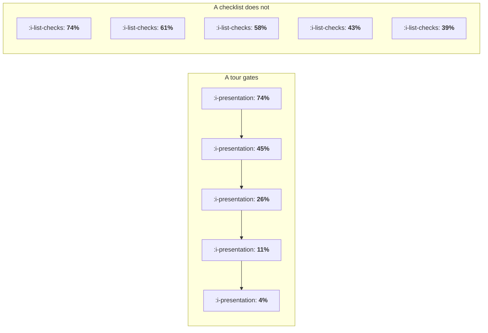

# Checklists and Tours

```text
Level: Intermediate
Prerequisites: Empty States and First Run
Estimated difficulty: 3/5 | Estimated time: 35 min
```

## The idea in one minute

A tour and a checklist look like two presentations of the same content and they are structurally
different objects. A tour gates: the user reaches step five only by having done steps one to four,
so reach multiplies down the chain and the back half of any tour is delivered to almost nobody. A
checklist does not gate: every item is offered to every user, so each is taken at its own rate and
a user who does three items has configured three things. On the same seven jobs, the ungated
version delivers nearly twice as many of them. If you keep a tour, the arithmetic says it should
be three steps, because steps four through seven of a seven step tour return a tenth of its value
between them.

## A picture



The same five jobs, offered two ways. The tour's figures are a running product; the checklist's are
each job's own appeal.

## How it really works

### A tour is a chain and a chain multiplies

Every gated step multiplies the share of users still present by that step's continuation rate.
Seven steps at 85 percent each, which is a continuation rate most tours never achieve, reaches 32
percent of users. The same seven at 70 percent reaches 8 percent. There is no content good enough
to survive that, and the arithmetic is the first table in the program below.

This is the most common quiet failure in onboarding. The tour is reviewed as a sequence of screens,
each of which is defensible, and nobody computes the product. A team that would never ship a
feature usable by 8 percent of users will happily ship a seven step tour.

### A checklist is a set and a set adds

Put the same jobs on a checklist and each one is offered to everybody, so each is taken at its own
rate. Importing data has a 43 percent appeal in the worked example, and on a checklist 43 percent
of users do it. As the fourth step of a tour it reaches 11 percent, because three gates stand in
front of it.

Summed across seven jobs: 1.62 jobs per new user through the tour, 3.14 through the checklist.
Nearly twice the configuration from the same content and less engineering, because a checklist is
a list and a tour is a state machine.

The structural advantage is that partial completion is still useful. A user who does three
checklist items has named their workspace, created an item and set their preferences, all of which
persist. A user who abandons a tour at step three has watched three screens.

### When a tour is still right

Two cases, both narrow.

**When the steps genuinely depend on each other.** You cannot configure a destination before
connecting a source. Where the dependency is real, gating is honest and a checklist would present
items the user cannot do, which is worse than a tour.

**When there is exactly one thing to do.** A single step tour is a well targeted prompt and it
reaches 74 percent of users in the worked table, which is the highest reach of any row. The thing
that fails is not the tour, it is the chain.

So the rule: one step is a prompt and good, three steps is a defensible tour, and seven steps is
a decision not to reach anybody. The last table in the program prices this. Three steps deliver 90
percent of the full tour's value; the other four steps return the remaining tenth.

### Why checklists read as an insult, and how to avoid it

A checklist can still be wrong, and it is wrong in a social register rather than an arithmetic
one. Three specific failures.

* **Items that serve you rather than the user.** "Follow us on social" on an onboarding checklist
  tells the user what the list is for, and they stop reading all of it.
* **A progress ring that cannot be finished or dismissed.** A permanent 60 percent ring is a
  standing reproach. Let it be dismissed, and remember the dismissal.
* **Items for things the user has already done elsewhere.** An unticked box for work the user
  completed last week is the product failing to notice, and it costs more trust than the item
  could ever return.

The fix for all three is the same: every item is a job the user would want done, the list can be
dismissed permanently, and ticking is driven by the real underlying event rather than by having
used the checklist to do it.

### What fills the box in 2026

Both patterns are commodity components now, which has made the length problem worse rather than
better, because adding a step to a tour costs nothing and so nobody argues about it. The
discipline has to come from the arithmetic rather than from the cost of building.

The one genuinely newer pattern worth knowing is the contextual prompt: no list and no chain, just
the single most valuable undone job surfaced at the moment the user is in the right place for it.
Measured per prompt it beats both mechanisms, and it depends entirely on knowing what the user has
already done, which is an instrumentation question rather than a design one and belongs to
[The Tracking Plan as a Contract](../instrumentation-and-the-event-model/README.md).

## Run the numbers

Price the gates, then price each step of the tour you already have.

```go
// checklists.go: why a tour dies with its length and a checklist does not.
package main

import "fmt"

// Seven onboarding jobs, each with its own appeal: the share of new users who
// would do that job if asked for it on its own. Ordered most appealing first,
// which is the kindest possible ordering for a tour.
var appeal = []struct {
	job string
	p   float64
}{
	{"name your workspace", 0.74},
	{"create your first item", 0.61},
	{"set your notification preference", 0.58},
	{"import existing data", 0.43},
	{"install the browser extension", 0.39},
	{"invite a teammate", 0.22},
	{"connect your calendar", 0.17},
}

// A tour gates: the user only sees step k having done every step before it.
// Reach therefore multiplies down the chain.
func tourReach() []float64 {
	r := make([]float64, len(appeal))
	run := 1.0
	for i, a := range appeal {
		run *= a.p
		r[i] = run
	}
	return r
}

// A checklist does not gate: every item is offered to every user, so each one
// is taken at its own rate regardless of the others.
func listReach() []float64 {
	r := make([]float64, len(appeal))
	for i, a := range appeal {
		r[i] = a.p
	}
	return r
}

func sum(xs []float64) float64 {
	t := 0.0
	for _, x := range xs {
		t += x
	}
	return t
}

func main() {
	fmt.Println("the cost of a step, before any content: a tour is a chain")
	fmt.Printf("%-8s %14s %14s %14s\n", "steps", "cont 95%", "cont 85%", "cont 70%")
	for _, n := range []int{1, 3, 5, 7, 10} {
		row := func(c float64) float64 {
			v := 1.0
			for i := 0; i < n; i++ {
				v *= c
			}
			return v
		}
		fmt.Printf("%8d %13.0f%% %13.0f%% %13.0f%%\n",
			n, 100*row(0.95), 100*row(0.85), 100*row(0.70))
	}
	fmt.Println("\nA seven step tour at a generous 85% per step reaches 32% of users.")
	fmt.Println("At 70%, which is what an unwanted tour gets, it reaches 8%.")

	tr, lr := tourReach(), listReach()
	fmt.Println("\nthe same seven jobs, gated and ungated:")
	fmt.Printf("%-34s %9s %12s %12s\n", "job", "appeal", "in a tour", "on a list")
	for i, a := range appeal {
		fmt.Printf("%-34s %8.0f%% %11.0f%% %11.0f%%\n",
			a.job, 100*a.p, 100*tr[i], 100*lr[i])
	}

	fmt.Printf("\n%-34s %9s %11.2f %11.2f\n", "jobs done per new user", "", sum(tr), sum(lr))
	fmt.Printf("%-34s %9s %11s %10.1fx\n", "ratio", "", "baseline", sum(lr)/sum(tr))

	fmt.Println("\nTwo thirds of the tour's content is delivered to almost nobody. The")
	fmt.Println("last three steps reach 4%, 1% and 0% of new users, so the jobs in")
	fmt.Println("them are decoration with an engineering cost.")

	fmt.Println("\nwhere to cut the tour:")
	fmt.Printf("%-18s %16s %16s\n", "tour length", "jobs per user", "of the full tour")
	full := sum(tr)
	for _, n := range []int{1, 2, 3, 5, 7} {
		fmt.Printf("%18d %15.2f %15.0f%%\n", n, sum(tr[:n]), 100*sum(tr[:n])/full)
	}
	fmt.Println("\nThree steps deliver 90% of what seven deliver. Steps four to seven")
	fmt.Println("cost four screens of build and four chances to be dismissed, and")
	fmt.Println("return a tenth of the value between them.")
}
```

The first table is the structural fact, before any content exists. Note the 95 percent column: even
at a continuation rate nobody achieves, ten steps reaches 60 percent of users.

The second table is the one to show a stakeholder who wants a step added. The jobs are ordered most
appealing first, which is the most generous possible ordering for the tour, and still the fifth
step reaches 4 percent and the seventh reaches under 1. Those steps were built, reviewed, localised
and maintained.

The jobs per user line is the summary: 1.62 against 3.14, so the ungated version delivers 1.9 times
as much configuration from identical content. That ratio is not a design opinion, it is what
happens when you stop multiplying and start adding.

The last table says where to cut. One step gets 46 percent of the tour's total value, three steps
gets 90 percent, and the last four steps are worth 0.17 jobs per user between them. Reorder your
own jobs by appeal, run it, and cut at the row where the cumulative column stops moving.

## The AI layer

The contextual prompt is where a model is genuinely useful here, and the use is selection rather
than generation.

Choosing which undone job to surface to a particular user at a particular moment is a ranking
problem over a small number of candidates, with features you already have: what they have done,
what users like them did next, where they are in the product. That is a modest model doing modest
work, and it converts a static list into something closer to the per item appeal figures in the
table rather than the gated ones. The cost is negligible because the inference is tiny and cached,
fractions of a penny per user per session.

What a model should not do is write the tour copy at volume. Generated onboarding copy is
grammatical, plausible and generic, and the per step continuation rate is driven almost entirely
by whether the step is worth doing, which copy cannot fix. A tour with better sentences and the
same seven gates still reaches 32 percent.

The failure mode for contextual prompts is specific: the model surfaces a job the user has already
done because the event for it is missing or late, and the prompt reads as the product not paying
attention. That is the trust cost named above, arriving through a different door, and it is why
prompt selection should be gated on event freshness rather than on model confidence.

## Sector lens

| Sector | What works here |
|---|---|
| [Enterprise B2B SaaS](../../product-management/product-by-sector/01-enterprise-b2b-saas.md) | A checklist per role, and an admin view of which seats have done what. The admin's list is the one that gets completed |
| [Fintech](../../product-management/product-by-sector/02-fintech.md) | Genuine dependencies, so a short gated flow is honest. Keep the verification step's state visible rather than hiding it in a chain |
| [Ecommerce and D2C](../../product-management/product-by-sector/03-ecommerce-and-d2c.md) | Neither. The buyer has one job and a tour between them and it is a cost |
| [Marketplaces](../../product-management/product-by-sector/04-marketplaces.md) | Supply side checklists work and correlate with earnings, which makes them self motivating. Say what each item is worth in money |
| [Devtools and Infra](../../product-management/product-by-sector/05-devtools-and-infrastructure.md) | A documented quickstart outperforms both. The checklist equivalent is a command that reports which steps are already satisfied |
| [Healthtech](../../product-management/product-by-sector/06-healthtech-and-regulated-care.md) | Training completion is often mandated and audited, so the chain is a requirement rather than a choice. Keep it separate from product onboarding |
| [Vertical SaaS](../../product-management/product-by-sector/07-vertical-saas.md) | The implementation consultant is the checklist. Give them the list rather than the customer |

## Remember this

* A tour gates, so its reach is a running product. Seven steps at 85 percent reaches 32 percent of
  users; at 70 percent, 8 percent.
* A checklist does not gate, so each item is taken at its own rate and partial completion still
  configures the product.
* On the same seven jobs, ungated delivers 1.9 times as much configuration as gated.
* A one step tour is a prompt and is fine. Three steps is defensible. Seven is a decision not to
  reach anybody.
* Three steps of a seven step tour deliver 90 percent of its value. Cut where the cumulative column
  stops moving.
* Gating is honest only where the steps genuinely depend on each other.
* Checklists fail socially: items that serve you, undismissable progress rings, and boxes unticked
  for work already done.
* A model is useful for choosing which undone job to surface, and not for writing better tour copy.

## Try it

1. Put your own onboarding jobs into `checklists.go`, ordered by measured appeal, and find the row
   where the cumulative value stops moving. That is your tour length.
2. Take your current tour and compute its reach per step from real event data rather than from the
   continuation rate you assume. Compare the last step's reach with the effort it took to build.
3. Audit your checklist for the three social failures. For each item, write who benefits, and
   delete the ones where the answer is your own team.

## Check yourself

1. A six step tour has a measured 88 percent continuation rate per step. What share of users see
   the last step, and what would you do with steps four to six?
2. Why does a checklist deliver more configuration than a tour containing identical content, when
   the tour's first step has the higher reach?
3. Your onboarding checklist shows an unticked item for data import, and the user imported data
   through the API last Tuesday. Name the underlying cause and where it has to be fixed.
