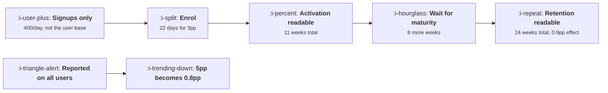

# Measuring an Onboarding Change

```text
Level: Intermediate
Prerequisites: Checklists and Tours
Estimated difficulty: 4/5 | Estimated time: 40 min
```

## The idea in one minute

Onboarding is the hardest thing in the product to test honestly, and the reason is structural
rather than methodological. Only new users are eligible, so your enrolment rate is the signup rate
rather than the user base. The metric that matters matures eight weeks after enrolment ends. And
the effect shrinks as it travels: a three point activation lift is a 0.9 point lift in retained
users, which takes six months to confirm. That is why almost every team judges onboarding on
activation, and the honest version of that choice is to say out loud that activation is a proxy
adopted for affordability, with a retention guardrail read later and believed less.

## A picture



The top row is the honest path and its cost in calendar time. The bottom row is the usual
accident.

## How it really works

### Your sample rate is the signup rate

An onboarding change cannot be shown to existing users, so the arm sizes fill at the rate new
users arrive. At 400 signups a day, detecting a three point lift in a 44 percent activation rate
needs about 4,300 per arm, which is 22 days of enrolment. A two point lift needs 49 days and a one
point lift needs 194.

This is the first thing to compute, before design work starts, and it reframes the project. A team
with 40 signups a day rather than 400 cannot detect a three point activation lift inside a
quarter, which does not mean they should not improve onboarding. It means they should stop
pretending the improvement will be measured, make the change on judgement, and spend the
measurement budget somewhere it can buy an answer. Saying that in the planning meeting is more
useful than discovering it in week nine.

### The effect shrinks as it travels downstream

Activation is not the goal, retained users are, and the lift gets smaller at every hop. An extra
three percent of signups activating, where activated users retain at 30 percent, is an extra 0.9
percent of signups retained. The sample size needed scales roughly with the square of the inverse
effect, so a third of the effect is nine times the users.

The second table in the program prices this. The three point activation lift that took 11 weeks to
confirm on activation takes 24 weeks to confirm on retained users. A two point lift takes 44.

That arithmetic is the real argument for proxy metrics, and it is a respectable argument. What is
not respectable is using the proxy and claiming the downstream effect. The honest formulation: the
experiment measured activation, the change was predicted to carry through to retention at the
historical rate, and that prediction is a model assumption rather than a result. Write it that way
in the result memo and the team's credibility survives the quarter where it does not carry through.

### Three ways the denominator ruins the result

**Reporting against all active users.** An onboarding change touches new users only. Reported
against everybody, a genuine five point lift reads as 2.0 points when new users are 40 percent of
the base, and 0.8 points at 15 percent. This dilution is the most common way a real onboarding win
is dismissed, and it gets worse as the product matures, which means the same work looks less
valuable every year.

**Measuring activation on a calendar window.** "Activation rate in October" mixes signups from
September who activated in October with October signups who have not finished yet. Use signup
cohorts with a fixed window per user, which is the discipline in
[Windows, Cohorts and Snapshots](../../product-management/how-to-read-a-metric/04-windows-cohorts-and-snapshots.md).

**Mix shift in signup sources.** Activation rate by source varies by a factor of two or three, so
a paid campaign launching mid test changes the composition of both arms and the control's
activation rate moves on its own. Randomisation protects the comparison and does not protect the
baseline, so always report activation by source alongside the headline, and watch for
[Simpson's Paradox](../../product-management/how-to-read-a-metric/05-simpsons-paradox-and-mix-shift.md).

### What to do when the honest test is unaffordable

Four options, roughly in order of preference.

* **Test a bigger change.** The budget is set by the effect size, so bundling four onboarding
  improvements into one variant is measurable where each separately is not. You lose the
  attribution between them, which is a real cost and usually worth paying.
* **Use a leading surrogate with a known relationship.** First session artefact creation reads in
  days rather than weeks. It is only useful if you have previously established how it maps to
  retention, which is a one off piece of work worth doing.
* **Run a holdout rather than a test.** Ship the change to everyone, hold back five percent, and
  read the difference whenever it becomes readable. Slower to conclude, far cheaper to operate,
  and it does not block the rollout.
* **Decide without measuring and say so.** Legitimate for changes that are obviously correct, such
  as deleting a step that collects data nobody uses. Record the decision and the reasoning rather
  than inventing a number for it.

### What fills the box in 2026

Experimentation platforms will compute the first table for you and most will warn you when a test
is underpowered. Two caveats worth knowing. Sequential testing, which lets you look at results as
they accumulate without inflating the error rate, is now standard and genuinely useful here,
because it shortens the expected duration for large effects without breaking the statistics. And
the default metric lists in these tools usually include activation and exclude the downstream
retention guardrail, which is a configuration decision presented as a default.

## Run the numbers

Compute the calendar cost before the design work, not after.

```go
// onboardingtest.go: what it costs in calendar time to know whether an
// onboarding change worked.
package main

import "fmt"

// Users per arm needed to detect an absolute lift, at 80% power and 95%
// two sided confidence. The constant is 2*(1.96+0.84)^2, rounded to 15.7.
func perArm(base, lift float64) float64 {
	p := base + lift/2
	return 15.7 * p * (1 - p) / (lift * lift)
}

func main() {
	const (
		signupsPerDay = 400.0
		activation    = 0.44 // baseline activation rate
		retention     = 0.30 // retention among activated users
		maturity      = 56.0 // days before the retention metric is readable
	)

	fmt.Printf("%.0f signups a day, activation %.0f%%, retention read at day %.0f\n\n",
		signupsPerDay, 100*activation, maturity)

	fmt.Printf("%-12s %14s %14s %14s %14s\n",
		"lift", "per arm", "enrol days", "plus maturity", "total weeks")
	for _, lift := range []float64{0.10, 0.05, 0.03, 0.02, 0.01} {
		n := perArm(activation, lift)
		enrol := 2 * n / signupsPerDay
		fmt.Printf("%11.0fpp %14.0f %14.0f %14.0f %13.0f\n",
			100*lift, n, enrol, enrol+maturity, (enrol+maturity)/7)
	}

	fmt.Println("\nActivation is the cheap metric and it is not the one that matters.")
	fmt.Println("Reading retention instead means the same enrolment plus eight weeks")
	fmt.Println("of waiting, and the effect being measured is smaller.")

	fmt.Println("\nthe same change judged on retained users, where the effect shrinks:")
	fmt.Printf("%-18s %12s %14s %14s %14s\n",
		"activation lift", "retained lift", "per arm", "enrol days", "total weeks")
	for _, lift := range []float64{0.10, 0.05, 0.03, 0.02} {
		// a lift in activation only shows up in retained users multiplied by
		// the retention rate of the users it added
		rlift := lift * retention
		n := perArm(activation*retention, rlift)
		enrol := 2 * n / signupsPerDay
		fmt.Printf("%17.0fpp %11.1fpp %14.0f %14.0f %13.0f\n",
			100*lift, 100*rlift, n, enrol, (enrol+maturity)/7)
	}

	fmt.Println("\nA 3 point activation lift is a 0.9 point retained user lift.")
	fmt.Println("Confirming it takes 24 weeks; a 2 point lift takes 44. Few teams")
	fmt.Println("will run either, which is the real reason onboarding is judged on")
	fmt.Println("activation: not because it is the right metric, but because the right")
	fmt.Println("one is unaffordable.")

	fmt.Println("\nwhat measuring the wrong denominator does to the same change:")
	fmt.Printf("%-34s %14s %16s\n", "denominator", "true lift", "observed lift")
	trueLift := 0.05
	for _, newShare := range []float64{1.00, 0.40, 0.15, 0.05} {
		fmt.Printf("%-34s %13.0fpp %15.1fpp\n",
			fmt.Sprintf("new users are %.0f%% of the base", 100*newShare),
			100*trueLift, 100*trueLift*newShare)
	}
	fmt.Println("\nAn onboarding change only touches new users. Reported against all")
	fmt.Println("active users it is diluted by whatever share of them are new, and")
	fmt.Println("a 5 point win on a mature product reads as a fifth of a point.")
}
```

The first table is the one to bring to the planning meeting. A ten point activation lift is
detectable in eight weeks and nobody ships ten point lifts. Three points, which is a good
onboarding quarter, takes 11 weeks including maturity, and that is at 400 signups a day with a
clean test and no mid flight interruptions.

The second table is the honest version. The same three point change read on retained users takes
24 weeks, because 0.9 points needs 22,846 users per arm against 4,326. The jump from 11 weeks to
24 is the entire reason this field runs on proxies.

The third table is the dilution. Set `newShare` to your own ratio of new to active users: a real
five point onboarding win reads as 0.8 points on a product where new users are 15 percent of the
base, and somebody will describe that as noise. It is not noise, it is the same win measured
against the wrong denominator.

Change `signupsPerDay` to your own figure first. If the enrolment column exceeds a quarter for
every lift you would plausibly ship, you have learned that your onboarding work is not going to be
measured by experiment, and the four options above are what you have.

## The AI layer

A model changes the cost of running the analysis and changes nothing about the arithmetic above,
which is worth stating plainly because the opposite is frequently implied.

The useful applications are real but modest. Drafting the test plan, generating the cohort queries,
and producing the first version of the result memo are each hours of work that become minutes, and
over a year that is several additional experiments a small team can afford to run properly. A
model is also good at the pre flight check: reading a proposed test design and listing the ways the
denominator could be wrong is pattern matching against a known catalogue, which is what it is for.

The thing to refuse is variance reduction by model inference. Techniques that use a model to
predict each user's counterfactual outcome and thereby shrink the required sample are legitimate in
principle and dangerous here, because the predictions are trained on the pre change world and the
onboarding change has altered the relationship they encode. The symptom is a confident small effect
that does not replicate, and the cost is a team that stops believing its own experiments.

What a model cannot do is make a 0.9 point effect detectable in 4,000 users. That number comes from
the variance of a binomial, and no amount of inference adds information that the sample does not
contain.

## Sector lens

| Sector | What makes measurement hard here |
|---|---|
| [Enterprise B2B SaaS](../../product-management/product-by-sector/01-enterprise-b2b-saas.md) | Signups per day are in the tens and the unit is the account. Experiments are not available; use holdouts by cohort and accept weaker evidence |
| [Fintech](../../product-management/product-by-sector/02-fintech.md) | Verification delay sits inside the measurement window, so the maturity wait is longer and varies by applicant type |
| [Ecommerce and D2C](../../product-management/product-by-sector/03-ecommerce-and-d2c.md) | Volume makes the first table affordable. Seasonality is the threat, so compare like weeks and never span a promotional period |
| [Marketplaces](../../product-management/product-by-sector/04-marketplaces.md) | Treating one side changes the other, so arms are not independent. Randomise by geography or market rather than by user |
| [Devtools and Infra](../../product-management/product-by-sector/05-devtools-and-infrastructure.md) | Adoption matures over months, so the maturity wait dominates everything. Use the first successful call as the surrogate and establish its mapping once |
| [Healthtech](../../product-management/product-by-sector/06-healthtech-and-regulated-care.md) | Randomising the onboarding of clinical users may require review. Staged rollout by site, read as a difference in differences |
| [Vertical SaaS](../../product-management/product-by-sector/07-vertical-saas.md) | No statistical route exists at this volume. Judge onboarding changes by implementation time and named account feedback, and label the evidence honestly |

## Remember this

* Onboarding enrols at the signup rate, not the user base rate. Compute the enrolment days before
  the design work.
* The effect shrinks downstream. A three point activation lift is a 0.9 point retained user lift,
  and needs five times the sample.
* The same change costs 11 weeks to confirm on activation and 24 on retention. That gap is the
  real reason proxies are used.
* Using a proxy is defensible; claiming the downstream effect from it is not. Write the carry
  through as an assumption.
* Reported against all active users, a five point onboarding win reads as 0.8 points on a mature
  product.
* Use signup cohorts with a fixed per user window, never a calendar window, and always report
  activation by source.
* When the honest test is unaffordable: test a bigger bundle, use an established surrogate, run a
  holdout, or decide on judgement and record that you did.
* No model makes a small effect detectable in a small sample. Variance reduction trained on the
  pre change world is the trap.

## Try it

1. Run `onboardingtest.go` with your own signups per day, activation rate and retention rate. Find
   the smallest lift you could confirm inside one quarter, and compare it with the lift your last
   onboarding project claimed.
2. Take the last onboarding result your company reported. Identify the denominator it used and
   recompute it on signup cohorts of new users only. Note the difference.
3. Establish the mapping between your fastest surrogate, such as first session artefact creation,
   and week eight retention, using three historical cohorts. That one piece of work makes every
   future onboarding test shorter.

## Check yourself

1. You have 120 signups a day, activation is 38 percent, and you want to detect a two point lift.
   How long is enrolment, and what would you do instead?
2. An onboarding change showed a 4 point activation lift and no detectable retention effect after
   twelve weeks. Give two readings of that result and say which you would act on.
3. Why does reporting an onboarding win against all active users make the same work look less
   valuable every year, and what denominator fixes it?
