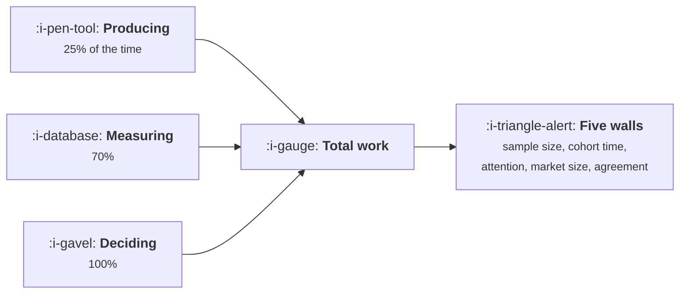

# What a Model Changes About Growth Work

```text
Level: Expert
Prerequisites: Experiment Velocity
Estimated difficulty: 3/5 | Estimated time: 35 min
```

## The idea in one minute

Growth work divides into producing things, measuring things and deciding things, and a model
shortens the first a great deal, the second a little and the third not at all. Writing a landing
page takes 38 percent as long and producing a month of content 33 percent; choosing what to work on
takes 90 percent and setting a budget the same. Across a representative set of activities the
saving is 41 percent, and even if production became free it would be 52 percent, because the
remaining 48 percent is measurement and judgement. That ratio is the ceiling, and it matters because
the work does not disappear, it piles up at five constraints that no amount of generation touches.

## A picture



The three inputs change by different amounts, so an activity's speedup is decided by its mix.

## How it really works

### Split the work three ways before estimating anything

**Producing** is making the artefact: the page, the variant, the copy, the campaign, the plan
document. This is where the saving is, and it is large.

**Measuring** is instrumenting, querying, checking and reconciling. Some of this gets faster,
because writing a query and checking a result against a catalogue are both tasks a model does well,
and much of it does not, because the work is waiting for data to exist.

**Deciding** is judgement, agreement and waiting for a meeting. None of this gets faster. It is a
function of how many people have to agree and how often they meet.

### The mix decides the speedup, and the mix varies enormously

Content production is 96 hours of producing against 14 of everything else, so it gets most of the
saving. Setting a budget is 1 hour of producing against 30 of measuring and deciding, so it gets
almost none.

The worked table runs from 67 percent faster to 10 percent faster across ten ordinary activities.
Any plan that applies a single productivity multiplier to a growth team will be wrong in both
directions at once.

### The ceiling is 52 percent, which is the useful number

Set the production factor to zero and the whole list still takes 48 percent as long. That is not a
pessimistic estimate, it is arithmetic: measuring and deciding are 42 percent of the hours in the
worked mix, and the measuring part only compresses to 70 percent.

So the honest planning statement is that production cost is no longer the constraint on growth
work, and the constraint has moved to five things that were always there.

### The five walls

Each one is a lesson in this course, and each is where the work accumulates once production is
cheap.

* **The users needed to detect an effect.** Sample size is set by the variance of a binomial, which
  is indifferent to how the variant was built.
  [Assignment and Exposure](../the-experiment-machine/03-assignment-and-exposure.md).
* **The time a cohort takes to mature.** Week eight retention is readable in week eight.
  [Measuring an Onboarding Change](../activation-and-onboarding/07-measuring-an-onboarding-change.md).
* **The attention a person will give you in a week.** Fixed, rivalrous, and now contested by cheaper
  senders. [The Shared Attention Budget](../lifecycle-messaging/05-the-shared-attention-budget.md).
* **The number of companies that could buy from you.** Unchanged by any product improvement.
  [When PLG Is the Wrong Answer](../product-led-growth/05-when-plg-is-the-wrong-answer.md).
* **Agreement between people.** The decision column, which does not move.
  [The Weekly Growth Meeting](../growth-process-and-cadence/01-the-weekly-growth-meeting.md).

### What to do with the saving

The saving is real and the question is where to put it, which is a strategy decision rather than an
efficiency one. Four options, and they are not equally good.

**More of the same work.** More variants, more pages, more campaigns. This runs straight into the
walls: more variants need more users to measure, more pages dilute quality, more campaigns consume a
fixed attention budget. Some of it is worth doing and it saturates faster than it looks.

**The work that was previously unaffordable.** Measuring things properly, running holdouts,
maintaining a results archive, writing honest result memos. These were skipped because they cost
time and produced no artefact, and they are exactly what the walls require.

**Removing a constraint rather than feeding it.** Decision capacity, for instance, is the constraint
in [From Idea to Ship](../growth-process-and-cadence/02-from-idea-to-ship.md), and it is addressed
by changing a meeting rather than by generating anything.

**Fewer people.** Legitimate, and it halves your decision capacity along with your production
capacity, which the arithmetic above says is the wrong half to cut.

### The honest summary to give a leadership team

Production is 41 to 52 percent cheaper, nothing else is, and the bottleneck has moved from making
things to measuring and deciding them. The investment that follows is in measurement and in
decision throughput, which is an unglamorous answer and the one the table supports.

### What fills the box in 2026

The production factor keeps falling and the measurement factor does not, so the ratio moves further
in the direction the table already shows. The thing worth watching is the measurement column, where
there is genuine room: writing the query, finding the right event, checking a result against
previous ones and drafting the memo are real hours and they do compress. A team that invests in the
measurement half will see a larger total saving than the table suggests, and a team that invests
only in generation will see less.

## Run the numbers

Split your own activities three ways and compute the mix.

```go
// whatchanges.go: which parts of growth work a model actually shortens.
package main

import "fmt"

// Growth work divides into producing things, measuring things and deciding
// things. A model shortens the first a great deal, the second a little and
// the third not at all, so the speedup an activity gets depends entirely on
// its mix.
type activity struct {
	name    string
	produce float64 // hours making the artefact
	measure float64 // hours instrumenting, querying and checking
	decide  float64 // hours of judgement, agreement and waiting
}

const (
	produceFactor = 0.25 // a quarter of the time it used to take
	measureFactor = 0.70
	decideFactor  = 1.00
)

func (a activity) before() float64 { return a.produce + a.measure + a.decide }
func (a activity) after() float64 {
	return a.produce*produceFactor + a.measure*measureFactor + a.decide*decideFactor
}

func main() {
	acts := []activity{
		{"write a landing page", 14, 2, 2},
		{"build an experiment variant", 22, 7, 6},
		{"produce a month of content", 96, 6, 8},
		{"draft a lifecycle campaign", 11, 4, 5},
		{"write a tracking plan", 9, 12, 14},
		{"read an experiment result", 1, 9, 12},
		{"diagnose a metric drop", 2, 21, 11},
		{"run a channel test", 18, 26, 19},
		{"set a budget", 1, 8, 22},
		{"choose what to work on", 2, 6, 24},
	}

	fmt.Printf("production takes %.0f%% as long, measurement %.0f%%, decisions unchanged\n\n",
		100*produceFactor, 100*measureFactor)
	fmt.Printf("%-32s %9s %9s %8s %9s %9s %10s\n",
		"activity", "produce", "measure", "decide", "before", "after", "faster by")
	var tb, ta float64
	for _, a := range acts {
		tb += a.before()
		ta += a.after()
		fmt.Printf("%-32s %9.0f %9.0f %8.0f %9.0f %9.1f %9.0f%%\n",
			a.name, a.produce, a.measure, a.decide,
			a.before(), a.after(), 100*(1-a.after()/a.before()))
	}
	fmt.Printf("%-32s %9s %9s %8s %9.0f %9.1f %9.0f%%\n",
		"all of it", "", "", "", tb, ta, 100*(1-ta/tb))

	fmt.Println("\nWriting a landing page takes 38% as long and producing a month of")
	fmt.Println("content takes 33%. Choosing what to work on takes 90%, and setting a")
	fmt.Println("budget the same. Across the whole list the saving is 41%, and almost")
	fmt.Println("all of it is concentrated in four activities.")

	fmt.Println("\nwhat the saving does to the thing each activity feeds:")
	fmt.Printf("%-34s %-26s %s\n", "the saving", "goes into", "and the constraint becomes")
	for _, r := range []struct{ saving, into, then string }{
		{"variants built per week", "more experiments", "deciding them, see the cadence topic"},
		{"content produced per month", "more pages", "the quality floor, see lesson two"},
		{"campaigns drafted", "more sends", "the attention budget, which is fixed"},
		{"landing pages", "more channel tests", "the measurement budget, which is not cheaper"},
	} {
		fmt.Printf("%-34s %-26s %s\n", r.saving, r.into, r.then)
	}

	fmt.Println("\nwhat does not get cheaper at all:")
	for i, s := range []string{
		"the users needed to detect an effect",
		"the time a cohort takes to mature",
		"the attention a person will give you in a week",
		"the number of companies that could buy from you",
		"agreement between people about what to do",
	} {
		fmt.Printf("  %d. %s\n", i+1, s)
	}
	fmt.Println("\nEvery one of those is a constraint from a different lesson in this")
	fmt.Println("course, and every one of them is where the work piles up once")
	fmt.Println("production stops being the bottleneck. The whole of the rest of")
	fmt.Println("this topic is about what happens at those five walls.")

	fmt.Println("\nthe same table if production were free:")
	fmt.Printf("%-32s %12s %12s %10s\n", "activity", "before", "free", "faster by")
	var tf float64
	for _, a := range acts {
		f := a.measure*measureFactor + a.decide*decideFactor
		tf += f
		fmt.Printf("%-32s %12.0f %12.1f %9.0f%%\n",
			a.name, a.before(), f, 100*(1-f/a.before()))
	}
	fmt.Printf("%-32s %12.0f %12.1f %9.0f%%\n", "all of it", tb, tf, 100*(1-tf/tb))
	fmt.Println("\nProduction at zero cost saves 52% rather than 41%. The remaining")
	fmt.Println("48% is measurement and judgement, and that is the ceiling on what")
	fmt.Println("any amount of generation can ever do to this job.")
}
```

The activity table is the exercise. Speedups of 67, 62, 53, 47, 34, 30, 23, 16, 10 and 10 percent,
and the ordering is purely the production share. Fill it in for your own team's activities from a
fortnight of honest time tracking, which is unpleasant and is the only way to get the mix right.

The second table traces each saving to the wall it hits. This is the part worth discussing in
planning: the saving is real and its destination determines whether it becomes output.

The production at zero cost table is the ceiling: 52 percent. Quote it when somebody projects a
threefold productivity gain for a growth function, because the arithmetic says the maximum is
slightly over twice and only if production becomes entirely free.

Change `measureFactor` to see the sensitivity. Taking measurement from 0.70 to 0.45 is worth more
total saving than taking production from 0.25 to zero, which is the planning insight hidden in this
model.

## Sector lens

| Sector | Where the mix sits here |
|---|---|
| [Enterprise B2B SaaS](../../product-management/product-by-sector/01-enterprise-b2b-saas.md) | Decision heavy, because every change involves sales and customers. The saving is small and the walls arrive immediately |
| [Fintech](../../product-management/product-by-sector/02-fintech.md) | Decision heavy for a different reason: compliance review is a decision stage that does not compress at all |
| [Ecommerce and D2C](../../product-management/product-by-sector/03-ecommerce-and-d2c.md) | Production heavy, with fast measurement thanks to volume. The largest saving of any sector and the fastest to hit the attention wall |
| [Marketplaces](../../product-management/product-by-sector/04-marketplaces.md) | Measurement heavy, because experiments need geographic assignment and long windows |
| [Devtools and Infra](../../product-management/product-by-sector/05-devtools-and-infrastructure.md) | Production heavy on documentation and content; measurement is slow because adoption lags |
| [Healthtech](../../product-management/product-by-sector/06-healthtech-and-regulated-care.md) | Almost entirely decision, with governance approval dominating. The production saving changes very little |
| [Vertical SaaS](../../product-management/product-by-sector/07-vertical-saas.md) | Small volumes make measurement impossible rather than slow, so judgement is most of the job and stays that way |

## Remember this

* Growth work is producing, measuring and deciding. Production compresses to about a quarter,
  measurement to about 70 percent, decisions not at all.
* An activity's speedup is decided by its mix, and the mix varies from 67 percent faster to 10
  percent faster across ordinary work.
* Never apply a single productivity multiplier to a growth team. It will be wrong in both
  directions.
* The ceiling with production entirely free is 52 percent, because measuring and deciding are the
  rest.
* So the constraint has moved from making things to measuring and deciding them.
* Five walls absorb the saving: sample size, cohort maturation, the attention budget, market size,
  and agreement between people.
* More of the same work runs into those walls. The previously unaffordable work, which is
  measurement, is what the walls require.
* Cutting people removes decision capacity along with production capacity, which is the wrong half.
* Improving the measurement factor is worth more total saving than taking production to zero.
* The honest summary: production is cheaper, nothing else is, invest in measurement and decision
  throughput.

## Try it

1. Track a fortnight of your team's hours split three ways: producing, measuring, deciding. Run
   `whatchanges.go` with the real mix.
2. For each of your four largest savings, write down which wall the extra output will hit and whether
   anything is being done about that wall.
3. Compute what a measurement factor of 0.45 would be worth to you, and compare it against your
   current investment in instrumentation and analysis tooling.

## Check yourself

1. Two activities both take 30 hours. One is 25 hours of production and one is 25 hours of
   decisions. What does each become, and what does that imply about where to aim tooling?
2. Why is the maximum saving slightly over twice rather than unbounded, even if production becomes
   free?
3. Your team's output doubles in variants produced and your experiment throughput does not move.
   Which wall did you hit, and what would address it?
