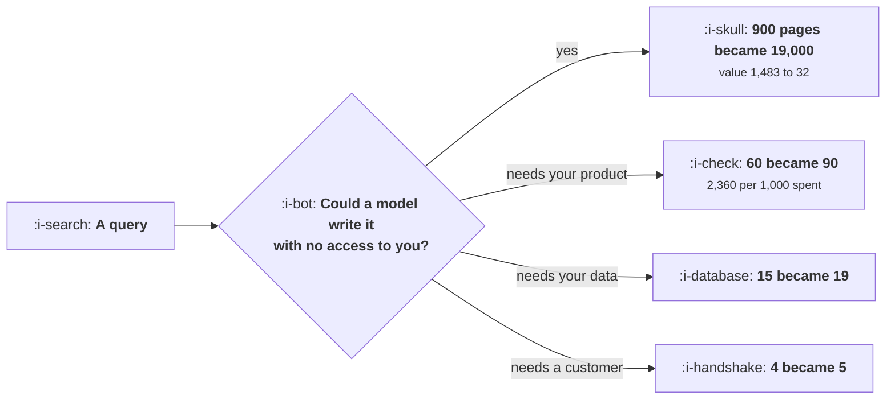

# Content at Scale and the Quality Floor

```text
Level: Expert
Prerequisites: Content That Compounds
Estimated difficulty: 4/5 | Estimated time: 40 min
```

## The idea in one minute

Cheap production does not add search demand, it adds competitors, and only to the queries a model
can answer without access to anything you own. The pages competing for "what is a growth loop" went
from 900 to 19,000 and its value fell from 1,483 of profit to 32. The pages competing for
"benchmarks we measured" went from 15 to 19 and the value barely moved. The surprise in the
portfolio arithmetic is which strategy wins: not the most original content and not the cheapest,
but the pages that require somebody to have used your product, at 2,360 of profit per 1,000 spent
against 249 for original measurement and 804 for commodity pages.

## A picture



One test, applied per query. It predicts which of your pages lost their value and which did not.

## How it really works

### Pages compete inside a query, not across a topic

The unit of competition is the query. A page about one thing does not take traffic from a page about
another, so the relevant count is how many pages genuinely compete for the query you are writing
for, and that number varies by three orders of magnitude across a content plan.

This is why the aggregate observation that the web has more pages is useless for planning. What you
need is the count per query, and the count rose enormously for some queries and barely at all for
others.

### The one test that predicts it

Could a model write a competitive page for this query with no access to anything you own?

If yes, the page count exploded, because everybody's model can do it and the production cost is
near zero. If no, the count barely moved, because the constraint on those pages was never writing
them.

Four reasons a model cannot write it: it needs data you collected, it needs a customer's permission,
it needs somebody to have used your product, or it goes out of date fast enough that freshness is
itself the barrier.

### What that does to the economics

The worked queries run from 19,000 competing pages down to 5. Value per page over two years falls
from 1,523 to 72 for the commodity query and from 7,711 to 6,169 for the customer story.

Profit per page: the commodity query went from 1,483 to 32 and the comparison query from 1,251 to a
loss. The product specific, data specific and customer specific queries all remain clearly
profitable.

Note that the commodity page still just about pays at a production cost of 40. That is not a flaw
in the model, it is the mechanism: a page that costs almost nothing and earns almost nothing is
worth producing, which is precisely why there are now 19,000 of them.

### The portfolio result, which is the useful one

Spend the same 60,000 five ways and the returns per 1,000 spent are 804 for commodity pages, minus
184 for comparisons, 2,360 for pages requiring your product, 582 for customer stories and 249 for
original measurement.

The winner is not the most defensible content. Original measurement is the hardest to replicate and
returns 249, because it is expensive and serves a small query. The winner is the query that needs
your product, because it combines a real barrier with a cost you can afford at volume.

The practical reading: build the content that only your customers could have written, at the
highest volume your product's surface supports. Original research is for authority and for links
rather than for traffic economics, which is a legitimate reason to do it and a different one.

### What to do with the queries that died

Three options and the first is usually right.

**Stop maintaining them.** A page earning 32 of profit over two years does not justify a review
cycle. Let it age.

**Consolidate.** Ten thin pages that each earn nothing can occasionally become one page that reaches
the top of its query, which is the compounding argument in
[Content That Compounds](../content-and-search/04-content-that-compounds.md).

**Delete.** Where thin pages are actively dragging on how the rest of the site is assessed, which is
a real effect and hard to measure.

### Where the floor is actually enforced

Worth being precise: the mechanism is not a quality judgement by a search engine about generated
text. It is competition. Nineteen thousand pages share a query's traffic and the concentration
means almost all of them get nothing. A generated page is not penalised, it is crowded out, and the
crowd is made of other generated pages.

That also means the effect is permanent rather than a policy that might change.

### What fills the box in 2026

Answer engines change the demand side of this arithmetic as well as the supply side, by answering
the commodity query without sending a visit at all, which is
[Search Inside Answer Engines](../content-and-search/06-search-inside-answer-engines.md). The two
effects compound on exactly the same queries: the ones a model can answer are the ones a model
already answered. For the queries that need your product or your data, the answer engine has to
cite somebody, and that somebody can be you, which is the same conclusion arriving from the other
direction.

## Run the numbers

Count competing pages per query, then price each strategy.

```go
// qualityfloor.go: which content survives when pages cost nothing to make.
package main

import "fmt"

// Pages compete inside a query, not across a whole topic. Cheap production
// floods the queries a generated page can answer and barely touches the ones
// it cannot, so the value of content divides by what a model can produce
// without access to anything you own.
const (
	lifeMonths = 24.0
	revPerVis  = 0.42
)

type query struct {
	name   string
	demand float64 // visits a month for this query, across all pages
	before float64 // pages genuinely competing, in 2021
	after  float64 // pages genuinely competing now
	cost   float64 // what it costs you to produce a page that can rank
}

// a page that ranks well takes this share of the query's traffic
const topShare = 0.34

func (q query) value(pages float64) float64 {
	visits := topShare * q.demand / (pages * 0.1)
	return visits * lifeMonths * revPerVis
}

func main() {
	qs := []query{
		{"what is a growth loop", 40_000, 900, 19_000, 40},
		{"best tool for growth loops", 12_000, 300, 4_200, 120},
		{"how to build a loop in our product", 3_000, 60, 90, 340},
		{"growth loop benchmarks we measured", 1_800, 15, 19, 2_600},
		{"our customer's loop, in their words", 900, 4, 5, 3_900},
	}

	fmt.Printf("a page earns traffic for %.0f months at %.2f a visit\n\n", lifeMonths, revPerVis)
	fmt.Printf("%-38s %9s %9s %12s %12s %10s\n",
		"the query", "pages then", "pages now", "value then", "value now", "cost")
	for _, q := range qs {
		fmt.Printf("%-38s %9.0f %9.0f %12.0f %12.0f %10.0f\n",
			q.name, q.before, q.after, q.value(q.before), q.value(q.after), q.cost)
	}

	fmt.Println("\nwhether each one is still worth writing:")
	fmt.Printf("%-38s %14s %14s %s\n", "the query", "profit then", "profit now", "verdict")
	for _, q := range qs {
		then := q.value(q.before) - q.cost
		now := q.value(q.after) - q.cost
		v := "still worth it"
		switch {
		case now <= 0 && then > 0:
			v = "was worth it, is not"
		case now <= 0:
			v = "never was"
		}
		fmt.Printf("%-38s %14.0f %14.0f %s\n", q.name, then, now, v)
	}

	fmt.Println("\nThe commodity page fell from 1,483 of profit to 32, and the")
	fmt.Println("comparison page from 1,251 to a loss. The bottom three barely moved,")
	fmt.Println("because the number of people who can write them did not change:")
	fmt.Println("they need your product, your data, or a customer who will talk.")

	fmt.Println("\nwhat separates the rows that moved from the rows that did not:")
	for _, r := range []struct{ test, why string }{
		{"could a model write it with no access to you?", "if yes, the page count exploded"},
		{"does it require data you collected?", "if yes, the page count barely moved"},
		{"does it require a customer's permission?", "if yes, it cannot be replicated"},
		{"does it require using your product?", "if yes, only you can write it"},
		{"would it be wrong next quarter?", "if yes, freshness is a moat with upkeep"},
	} {
		fmt.Printf("  %-46s %s\n", r.test, r.why)
	}

	fmt.Println("\nthe portfolio decision, at today's page counts:")
	fmt.Printf("%-38s %12s %14s %14s\n", "spend 60,000 on", "pages", "profit", "per 1,000 spent")
	const budget = 60_000.0
	for _, q := range qs {
		n := budget / q.cost
		profit := n * (q.value(q.after) - q.cost)
		fmt.Printf("%-38s %12.0f %14.0f %14.0f\n",
			q.name, n, profit, profit/(budget/1000))
	}
	fmt.Println("\nThe best use of the budget is not the most original content and")
	fmt.Println("not the cheapest. It is the pages that require somebody to have used")
	fmt.Println("your product: 2,360 of profit per 1,000 spent against 804 for")
	fmt.Println("commodity pages, 582 for customer stories and 249 for original")
	fmt.Println("measurement. Commodity pages still pay, barely, which is exactly")
	fmt.Println("why the internet is full of them.")
}
```

The first table is the exercise worth doing with your own queries. Page counts then and now are
estimable: search the query and count the results that are genuinely about it, and compare against
an archive snapshot if you have one. The ratio per query is the number that matters.

The verdict table is the decision. One row went from the best investment on the list to a loss, one
fell by 98 percent and stayed marginally positive, and three barely moved.

The portfolio table is the one to take to a content plan. Per 1,000 spent: 804, minus 184, 2,360,
582 and 249. Put your own costs in, and be honest about the cost of the rows that need a customer,
because the real cost there is relationship and permission rather than writing.

## Sector lens

| Sector | Which content kept its value here |
|---|---|
| [Enterprise B2B SaaS](../../product-management/product-by-sector/01-enterprise-b2b-saas.md) | Customer stories with named outcomes, and benchmarks from your own base. Both need permission, which is the barrier |
| [Fintech](../../product-management/product-by-sector/02-fintech.md) | Rate and fee comparisons from live data, and regulatory interpretation that carries your name. Generated explainers are worthless |
| [Ecommerce and D2C](../../product-management/product-by-sector/03-ecommerce-and-d2c.md) | Product specific detail, real photography and reviews. Category explainers have collapsed entirely |
| [Marketplaces](../../product-management/product-by-sector/04-marketplaces.md) | Listings and prices, which are your data by construction. This is the strongest position in the table |
| [Devtools and Infra](../../product-management/product-by-sector/05-devtools-and-infrastructure.md) | Documentation that matches the current version, and problems only reproducible with your product |
| [Healthtech](../../product-management/product-by-sector/06-healthtech-and-regulated-care.md) | Clinically reviewed content with named authors, which is a compliance requirement and now also a moat |
| [Vertical SaaS](../../product-management/product-by-sector/07-vertical-saas.md) | Trade specific operational detail that requires having done the job. Barely affected and rarely invested in |

## Remember this

* Cheap production adds competitors, not demand, and only to the queries a model can answer without
  access to you.
* The unit of competition is the query. Count competing pages per query, not pages on the web.
* The test: could a model write a competitive page with no access to anything you own. If yes, the
  count exploded.
* Four barriers: your data, a customer's permission, having used your product, and freshness.
* The commodity query went from 1,483 of profit per page to 32; the data query barely moved.
* A near zero cost page earning almost nothing is still worth producing, which is why there are
  19,000 of them.
* The best return is not the most original content. It is the pages requiring your product, at 2,360
  per 1,000 spent against 249 for original measurement.
* Original research is for authority and links rather than traffic economics, which is a good reason
  and a different one.
* Stop maintaining the dead queries, consolidate where ten thin pages could become one strong one.
* The floor is enforced by crowding rather than by judgement, which makes it permanent rather than
  a policy that might change.

## Try it

1. Take your twenty highest traffic pages and count the pages genuinely competing for each query
   now. Mark each as a yes or no on the could a model write this test.
2. Run `qualityfloor.go` with your own costs and page counts, and compute profit per 1,000 spent for
   each content type you produce.
3. Find the content that requires somebody to have used your product. If you produce little of it,
   that is this year's plan.

## Check yourself

1. Two pages cost the same to make. One explains a concept, one documents a workflow in your product.
   What happened to each one's value, and why?
2. Why does a commodity page that earns almost nothing still get produced, and what does that imply
   about whether the crowding will ease?
3. Your original research returns less per pound than your product documentation. Should you stop
   doing it?
