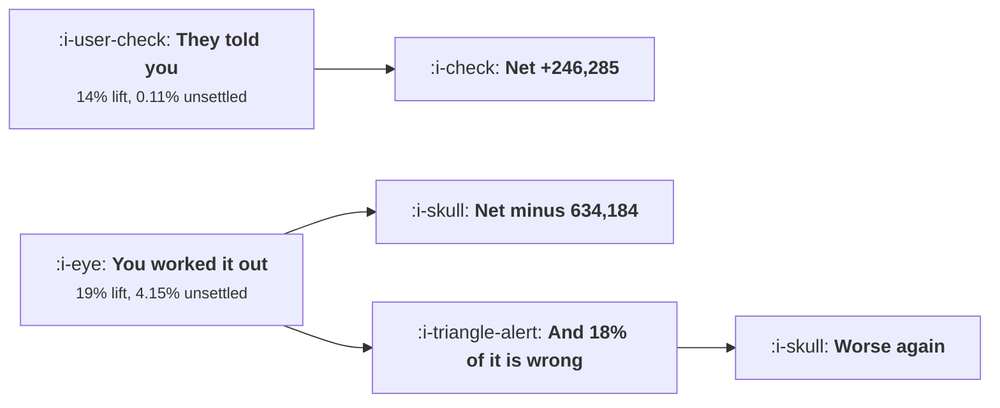

# Personalisation That Is Not Creepy

```text
Level: Expert
Prerequisites: Content at Scale and the Quality Floor
Estimated difficulty: 3/5 | Estimated time: 35 min
```

## The idea in one minute

The line between service and surveillance can be drawn with arithmetic rather than taste, because
both sides are measurable. Signals the user gave you or produced in your product average a 14
percent conversion lift and unsettle 0.11 percent of people. Signals you worked out about them
average 19 percent and unsettle 4.15 percent, nearly forty times as many. So invasiveness buys five
points of extra lift and costs the trust of one user in twenty four, which is a large loss at any
plausible value of trust. And that is before the inference is wrong, which at an 18 percent error
rate makes every inferred signal a heavy loss.

## A picture



Almost the same lift on the left and the right. The difference is entirely in the second column.

## How it really works

### Two numbers per signal

**The lift**, which every team measures. How much more often somebody converts when the experience
uses this signal.

**The share who find it unsettling**, which almost nobody measures and which is measurable: ask a
sample of users, in plain words, whether they would be comfortable with you using this, and count
the no answers. A survey of a few hundred people is adequate and it takes a week.

Then the comparison is a subtraction, with the cost of unsettling one user set from your own churn
and complaint data.

### The split is between told and worked out

In the worked table the signals divide cleanly. Their name, their plan, what they said they wanted,
what they did in your product: lifts of 4, 11, 19, 23 percent and unsettle rates of 0.02 to 0.31
percent. Their company from the email domain, pages viewed before signing up, an inferred job title,
activity on another company's site, inferred income: lifts of 14 to 26 percent and unsettle rates of
0.74 to 9.1 percent.

The highest lift in the whole table, 26 percent, is activity on another company's site, and it has
the second worst net. The best net, 367,660, is what they did in your own product at a 23 percent
lift.

So the strongest usable signal is also the most acceptable one, which is a convenient result and
the reason this does not have to be a trade off.

### The one test that is nearly sufficient

Would you say, in the message itself, how you know this?

"Because you connected your calendar" is a sentence you can write. "Because we bought your job
title from a data vendor" is not. A message that can state its own mechanism is service; one that
has to conceal it is the other thing, and the need to conceal is a reliable predictor that the
arithmetic will be negative.

The practical version: require every personalised element to carry a one line explanation of its
source, visible or available. Teams that adopt this rule stop using the inferred signals without
anybody having to argue about ethics, because writing the sentence settles it.

### A wrong inference is worse than a correct intrusion

The lift column assumes the inference is right. At an 18 percent error rate, which is optimistic for
inferred firmographics and demographics, every inferred signal in the table becomes a large loss,
because a wrong inference is not merely unhelpful. Being told you work at a company you left, or
being shown pricing for an income bracket you are not in, is insulting in a way that a generic
experience is not.

That asymmetry is the input nobody measures. Measure your inference accuracy before using a signal,
on a sample you can verify, and treat anything under about 90 percent as unusable regardless of its
lift.

### What to build instead

Ask. The third row of the table, what they told you they wanted to do, has a 19 percent lift and
unsettles nine users in ten thousand. A single question during onboarding produces a better signal
than any amount of inference, and it is the one signal that is unambiguously yours to use because it
was given for this purpose.

This is the same result as
[Empty States and First Run](../activation-and-onboarding/05-empty-states-and-first-run.md) reaching
from the other direction: stating an intention is cheap, high signal and welcome.

### What fills the box in 2026

Two developments pull in opposite directions. Inference has got much better and much cheaper, which
raises the temptation and lowers the error rate somewhat, though not to the 90 percent threshold for
most demographic attributes. And regulation has tightened around profiling and automated decision
making in several jurisdictions, with specific rules about inferring sensitive characteristics, so a
signal that is merely unsettling in one market may be unlawful in another. The practical position is
unchanged and better supported: ask rather than infer, and state the source.

## Run the numbers

Price both sides of each signal, then add the error rate.

```go
// personalisation.go: which signals raise conversion and which cost more
// trust than they buy.
package main

import "fmt"

// Using something a user told you is service. Using something a user did not
// realise you knew is surveillance, and it costs you the ones who notice.
// Both effects are measurable, so the line can be drawn with arithmetic
// rather than with taste.
type signal struct {
	name     string
	lift     float64 // relative lift in conversion when used
	unsettle float64 // share of users who find it unsettling
	told     bool    // did the user knowingly give you this
}

const (
	users     = 100_000.0
	baseConv  = 0.062
	value     = 310.0 // gross profit per conversion
	trustCost = 240.0 // cost of unsettling one user: churn, complaint, word of mouth
)

func (s signal) gained() float64 { return users * baseConv * s.lift * value }
func (s signal) lost() float64   { return users * s.unsettle * trustCost }
func (s signal) net() float64    { return s.gained() - s.lost() }

func main() {
	sigs := []signal{
		{"their name, which they gave you", 0.04, 0.0002, true},
		{"the plan they are on", 0.11, 0.0004, true},
		{"what they told you they wanted to do", 0.19, 0.0009, true},
		{"what they did in your product", 0.23, 0.0031, true},
		{"their company, from their email domain", 0.16, 0.0074, false},
		{"pages they viewed before signing up", 0.21, 0.0190, false},
		{"their job title, inferred from a data vendor", 0.14, 0.0280, false},
		{"their activity on another company's site", 0.26, 0.0620, false},
		{"their likely income, inferred", 0.17, 0.0910, false},
	}

	fmt.Printf("%.0f users, %.1f%% convert, %.0f per conversion\n", users, 100*baseConv, value)
	fmt.Printf("unsettling one user costs %.0f\n\n", trustCost)
	fmt.Printf("%-44s %8s %10s %12s %12s %12s\n",
		"signal", "lift", "unsettled", "gained", "lost", "net")
	for _, s := range sigs {
		fmt.Printf("%-44s %7.0f%% %9.2f%% %12.0f %12.0f %12.0f\n",
			s.name, 100*s.lift, 100*s.unsettle, s.gained(), s.lost(), s.net())
	}

	fmt.Println("\nThe strongest signal in the table, somebody's activity on another")
	fmt.Println("company's site, has the highest lift and the worst net by a wide")
	fmt.Println("margin. The best net comes from what the user did in your own")
	fmt.Println("product, which is also the one they would expect you to know.")

	fmt.Println("\nthe pattern, grouped by whether they told you:")
	fmt.Printf("%-34s %14s %14s %14s\n", "kind of signal", "average lift", "unsettled", "net")
	for _, g := range []struct {
		name string
		told bool
	}{{"things they told or did here", true}, {"things you worked out", false}} {
		var l, u, n, c float64
		for _, s := range sigs {
			if s.told == g.told {
				l += s.lift
				u += s.unsettle
				n += s.net()
				c++
			}
		}
		fmt.Printf("%-34s %13.0f%% %13.2f%% %14.0f\n", g.name, 100*l/c, 100*u/c, n/c)
	}
	fmt.Println("\nThe two groups have almost the same average lift, 14% against 19%,")
	fmt.Println("and differ by a factor of nearly forty on how many people they")
	fmt.Println("unsettle. Personalisation does not have to be invasive to work:")
	fmt.Println("invasiveness buys five points of extra lift and costs the trust of")
	fmt.Println("one user in twenty four.")

	fmt.Println("\nthe test to apply before using a signal:")
	for i, t := range []string{
		"would you say out loud how you know this, in the message itself?",
		"if the user asked where it came from, is the answer comfortable?",
		"did they give it to you for this purpose, or for another one?",
		"could a wrong inference here be insulting rather than merely wrong?",
		"would you be happy for a journalist to describe the mechanism?",
	} {
		fmt.Printf("  %d. %s\n", i+1, t)
	}
	fmt.Println("\nThe first test is the operational one and it is nearly sufficient.")
	fmt.Println("A message that can say how it knows, in its own text, is service.")
	fmt.Println("One that has to hide the mechanism is the other thing, and the")
	fmt.Println("hiding is the signal that the arithmetic above will be negative.")

	fmt.Println("\nwhat a wrong inference costs, which the lift column ignores:")
	fmt.Printf("%-46s %10s %12s %14s\n", "signal", "wrong rate", "insult cost", "net with error")
	for _, s := range sigs[4:] {
		wrong := 0.18
		insult := 1.9 * trustCost
		n := s.gained()*(1-wrong) - s.lost() - users*wrong*0.11*insult
		fmt.Printf("%-46s %9.0f%% %12.0f %14.0f\n", s.name, 100*wrong, insult, n)
	}
	fmt.Println("\nAt an 18% rate of being wrong, and a wrong inference costing")
	fmt.Println("nearly twice as much as an unsettling correct one, every inferred")
	fmt.Println("signal is a large loss. The inference accuracy is the input nobody")
	fmt.Println("measures and the one that decides the answer.")
}
```

The signal table is the main result. Nets of 72,080 up to 367,660 for the four signals users gave
you, and minus 52,380 down to minus 1,857,260 for the five you worked out. One row, company from an
email domain, is positive at 129,920 and is the genuinely borderline case worth discussing.

The grouped comparison is the sentence to remember: 14 percent against 19 percent average lift,
0.11 percent against 4.15 percent unsettled.

The error table is the part that usually settles an argument. At an 18 percent wrong rate every
inferred signal loses heavily, and the wrong rate is a number you can measure on a sample of a
hundred users in an afternoon.

Replace `trustCost` with something defensible from your own data: the churn rate among users who
complained, times their value, plus the support cost. It is usually larger than people guess.

## Sector lens

| Sector | Where the line sits here |
|---|---|
| [Enterprise B2B SaaS](../../product-management/product-by-sector/01-enterprise-b2b-saas.md) | Firmographic inference is normal and accepted, because the buyer is a company. Individual behavioural inference is not |
| [Fintech](../../product-management/product-by-sector/02-fintech.md) | Inferring income or financial distress is a regulated activity, not a personalisation choice. Ask, and document why you asked |
| [Ecommerce and D2C](../../product-management/product-by-sector/03-ecommerce-and-d2c.md) | Browsing history on your own site is expected; cross site behaviour is the most complained about personalisation in any sector |
| [Marketplaces](../../product-management/product-by-sector/04-marketplaces.md) | Using one side's behaviour to personalise for the other is the specific thing to avoid, because it reveals the other party |
| [Devtools and Infra](../../product-management/product-by-sector/05-devtools-and-infrastructure.md) | Your users inspect the network requests. Any inference you would not document publicly will be discovered and published |
| [Healthtech](../../product-management/product-by-sector/06-healthtech-and-regulated-care.md) | Inferring a health condition for marketing purposes is the clearest prohibition in this course. Use nothing clinical |
| [Vertical SaaS](../../product-management/product-by-sector/07-vertical-saas.md) | Small connected markets, so an uncomfortable personalisation is discussed at the trade association within weeks |

## Remember this

* Two numbers per signal: the conversion lift, and the share of users who find it unsettling. Measure
  the second with a survey.
* Signals users gave you average a 14 percent lift and unsettle 0.11 percent. Inferred signals
  average 19 percent and unsettle 4.15 percent.
* So invasiveness buys five points of lift and costs the trust of one user in twenty four.
* The best net in the table is what they did in your own product, which is also the most acceptable.
* The test: would you state in the message how you know this. If the mechanism has to be hidden, the
  arithmetic will be negative.
* Require every personalised element to carry a one line source explanation. It settles the
  question without an ethics argument.
* A wrong inference is worse than a correct intrusion, and at an 18 percent error rate every
  inferred signal is a heavy loss.
* Measure inference accuracy on a verifiable sample and treat anything under 90 percent as unusable.
* Ask instead. A single onboarding question gives a 19 percent lift and unsettles nine users in ten
  thousand.
* Regulation on profiling and inferred sensitive characteristics varies by market, so an unsettling
  signal in one place may be unlawful in another.

## Try it

1. Survey two hundred users with one plain question per signal you currently use: would you be
   comfortable with us using this. The no rate is the input you are missing.
2. Measure the accuracy of one inferred signal against a verifiable sample of a hundred users. If
   it is under 90 percent, stop using it.
3. Write the one line source explanation for every personalised element in your product. Delete the
   ones you cannot write.

## Check yourself

1. A signal gives a 24 percent conversion lift and 5 percent of surveyed users say they would be
   uncomfortable with it. What else do you need to decide, and what is the likely answer?
2. Why is a wrong inference more costly than a correct but unsettling one?
3. Your best performing personalisation uses pages viewed before signup. How would you replace it
   with something that gives a similar lift?
