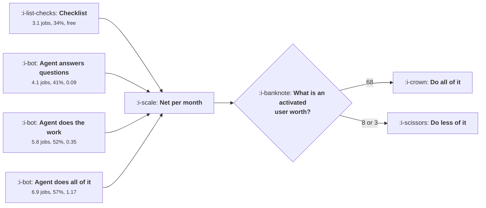

# Onboarding by Agent

```text
Level: Expert
Prerequisites: Checklists and Tours
Estimated difficulty: 4/5 | Estimated time: 40 min
```

## The idea in one minute

An agent can do the onboarding work rather than instruct somebody to do it, which raises activation
from 34 percent on a checklist to 57 percent, and it costs money every time anybody engages with
it. At an activated user worth 68 the richest agent wins easily at 1.17 per activated user. At 8 it
loses to an agent that does less, and at 3 it is barely ahead of a free checklist. So the question
is not whether to use an agent, it is how much of the work to let it do, and the answer comes
entirely from what an activated user is worth. A quarter of the spend goes on long conversations
that end in nothing, which is where a cap belongs.

## A picture



Four mechanisms, one input. The input is the activated user's value and nothing else decides it.

## How it really works

### An agent changes the kind of intervention, not its strength

A checklist tells somebody to connect a data source. An agent connects it. That is the whole
difference and it is larger than any amount of copy or placement work, because it removes the step
rather than motivating it.

In the worked numbers, jobs completed per new user runs 0.4 for nothing, 3.1 for a checklist, 3.6
for contextual prompts, 4.1 for an agent that answers questions, 5.8 for one that does the work and
6.9 for one that does everything. The jump that matters is between answering and doing, which is
1.7 jobs, and it is the only mechanism in this course that does that.

### The cost is per engagement, not per signup

This is the structural difference from every other onboarding mechanism. A checklist costs nothing
to show to a million people. An agent costs something every time somebody talks to it, and the
engagement rate is high precisely when the agent is good.

So cost scales with the top of the funnel and with the quality of the agent, while revenue scales
with activation. The ratio between the two is the cost per activated user, which is the figure to
report: 0.00, 0.00, 0.09, 0.35 and 1.17 across the mechanisms.

### Everything depends on the activated user's value

At 68 the richest agent wins by 145,620 a month over the next best. At 22 it still wins. At 8 the
agent that does the work but not all of it wins instead, and at 3 the margin over a free checklist
is almost nothing.

The practical threshold: when the cost per activated user exceeds about a fifth of what an activated
user is worth, the richest configuration stops being correct. That is a simple rule and it is
computable before anything is built.

Note which direction this runs. A product with a high value activated user, which usually means a
business product with a real contract, can afford a thorough agent. A free consumer product with
advertising revenue cannot, and the cheerful assumption that agents are the future of onboarding is
a statement about the first kind of product.

### Where the cost actually goes

The breakdown is the operational lever. Across signups: 29 percent never engage and cost nothing,
24 percent ask one question and leave at 0.07 each, 28 percent have a short conversation at 0.31,
14 percent have a long conversation and activate at 1.60, and 5 percent have a long conversation
and do not at 2.10.

A quarter of the total spend is in that last group, from a twentieth of signups. They are the worst
tail and they are identifiable while it is happening, which makes a cap on turns per session the
highest value configuration change available: it costs very little activation and removes most of
the tail.

### What the agent must not do

Three constraints, each learned expensively.

**Do not let it do the thing wrongly and confidently.** An agent that configures the product
incorrectly produces an activated account that churns in week four, which is the correction rate
problem from [Time to Value](../activation-and-onboarding/03-time-to-value.md). Instrument how often
users undo what the agent did.

**Do not let it interrupt.** A proactive agent carries the full disruption cost of a modal with a
lower act rate, which is
[In Product Messaging](../lifecycle-messaging/04-in-product-messaging.md).

**Do not let it be the only route.** The agent fails, is slow, or cannot do the task, and there has
to be a manual path. An onboarding flow with no fallback converts an inference failure into a lost
signup.

### What fills the box in 2026

Inference costs have fallen enough that the 0.35 row has become affordable for products that could
not consider it two years ago, and the fall is continuing. The thing that has not changed is the
engagement rate structure: the tail of long unproductive conversations is a property of how people
behave, not of the model, so the cap remains necessary at any price. And the correction rate
discipline matters more as agents become able to do more, because the blast radius of a confident
wrong configuration grows with what the agent is permitted to touch.

## Run the numbers

Compare the mechanisms, then vary the activated user's value.

```go
// agentonboarding.go: when an agent beats a checklist, and what it costs.
package main

import "fmt"

// A checklist is free to run and cannot do anything for the user. An agent
// can do the work and costs money every time somebody engages with it, so
// the comparison is jobs completed per user against cost per user, and the
// answer depends on what an activated user is worth.
type mechanism struct {
	name     string
	jobs     float64 // onboarding jobs completed per new user
	activate float64 // share who reach activation
	perUser  float64 // cost to run it for one new user
	engaged  float64 // share who engage with it at all
}

const (
	signups     = 50_000.0 // a month
	activeWorth = 68.0     // gross profit from one activated user
)

func (m mechanism) activated() float64 { return signups * m.activate }
func (m mechanism) cost() float64      { return signups * m.engaged * m.perUser }
func (m mechanism) net() float64       { return m.activated()*activeWorth - m.cost() }
func (m mechanism) perActivated() float64 {
	if m.activated() == 0 {
		return 0
	}
	return m.cost() / m.activated()
}

func main() {
	ms := []mechanism{
		{"nothing", 0.4, 0.21, 0.000, 0.00},
		{"a seven item checklist", 3.1, 0.34, 0.000, 0.52},
		{"contextual prompts", 3.6, 0.37, 0.002, 0.61},
		{"an agent that answers questions", 4.1, 0.41, 0.085, 0.44},
		{"an agent that does the work", 5.8, 0.52, 0.310, 0.58},
		{"an agent that does all of it", 6.9, 0.57, 0.940, 0.71},
	}

	fmt.Printf("%.0f signups a month, an activated user is worth %.0f\n\n", signups, activeWorth)
	fmt.Printf("%-36s %8s %10s %12s %14s %14s\n",
		"mechanism", "jobs", "activated", "cost/month", "cost/activated", "net/month")
	for _, m := range ms {
		fmt.Printf("%-36s %8.1f %9.0f%% %12.0f %14.2f %14.0f\n",
			m.name, m.jobs, 100*m.activate, m.cost(), m.perActivated(), m.net())
	}

	fmt.Println("\nEvery row beats doing nothing and the richest agent wins, because")
	fmt.Println("an activated user is worth 68 and the agent costs 1.17 per activated")
	fmt.Println("one. That comfort is entirely a function of the 68, which is the")
	fmt.Println("number the whole decision turns on.")

	fmt.Println("\nthe same comparison at four values of an activated user:")
	fmt.Printf("%-36s %12s %12s %12s %12s\n",
		"mechanism", "worth 68", "worth 22", "worth 8", "worth 3")
	for _, m := range ms {
		fmt.Printf("%-36s", m.name)
		for _, w := range []float64{68, 22, 8, 3} {
			fmt.Printf(" %12.0f", m.activated()*w-m.cost())
		}
		fmt.Println()
	}
	fmt.Println("\nAt 68 and 22 the richest agent wins. At 8 and 3 the agent that")
	fmt.Println("does the work but not all of it wins instead, because 1.17 per")
	fmt.Println("activated user stops being small. The honest question is therefore")
	fmt.Println("not whether to use an agent, it is how much of the work to let it do,")
	fmt.Println("and the answer comes from what an activated user is worth.")

	fmt.Println("\nwhere the agent's cost actually goes:")
	fmt.Printf("%-34s %12s %12s %14s\n", "what happens", "share", "cost each", "cost/signup")
	var tot float64
	for _, r := range []struct {
		name  string
		share float64
		each  float64
	}{
		{"never engages", 0.29, 0.00},
		{"asks one question, leaves", 0.24, 0.07},
		{"a short conversation", 0.28, 0.31},
		{"a long conversation, activates", 0.14, 1.60},
		{"a long conversation, does not", 0.05, 2.10},
	} {
		c := r.share * r.each
		tot += c
		fmt.Printf("%-34s %11.0f%% %12.2f %14.3f\n", r.name, 100*r.share, r.each, c)
	}
	fmt.Printf("%-34s %11s %12s %14.3f\n", "total", "", "", tot)
	fmt.Println("\nA quarter of the spend goes on long conversations that did not end")
	fmt.Println("in activation, from 5% of signups. That group is the worst tail of")
	fmt.Println("the cost distribution and it is where a cap belongs: a")
	fmt.Println("limit on turns per user per session costs almost no activation and")
	fmt.Println("removes the worst tail of the cost distribution.")
}
```

The first table is the comparison. Activation of 21, 34, 37, 41, 52 and 57 percent against cost per
activated user of 0.00, 0.00, 0.00, 0.09, 0.35 and 1.17.

The value sensitivity is the decision. Read down the "worth 8" column: 84,000, 136,000, 147,939,
162,130, 199,010 and 194,630. The richest agent has fallen to second. At "worth 3" the ordering is
the same and the gaps are small enough that a free checklist is a defensible choice.

The cost breakdown is where to act. Put your own engagement distribution in, which you can measure
from conversation logs: share who engage, turns per conversation, and whether they activated. The
unproductive long tail is usually larger than teams expect.

## Sector lens

| Sector | Whether the arithmetic supports an agent here |
|---|---|
| [Enterprise B2B SaaS](../../product-management/product-by-sector/01-enterprise-b2b-saas.md) | Comfortably, because an activated account is worth hundreds. The constraint is correctness, not cost |
| [Fintech](../../product-management/product-by-sector/02-fintech.md) | For guidance, yes. For completing a regulated action on the user's behalf, that is a compliance decision rather than a cost one |
| [Ecommerce and D2C](../../product-management/product-by-sector/03-ecommerce-and-d2c.md) | Rarely. An activated buyer is worth a few pounds, which is the column where free mechanisms win |
| [Marketplaces](../../product-management/product-by-sector/04-marketplaces.md) | On the supply side, where onboarding is long and a listing is worth a lot. Not on the demand side |
| [Devtools and Infra](../../product-management/product-by-sector/05-devtools-and-infrastructure.md) | Yes, and the agent should operate on code and configuration rather than conversation, which is cheaper and more useful |
| [Healthtech](../../product-management/product-by-sector/06-healthtech-and-regulated-care.md) | For administrative setup only. An agent must not configure anything clinical without review |
| [Vertical SaaS](../../product-management/product-by-sector/07-vertical-saas.md) | Yes, on the data migration, which is the whole onboarding and is worth more than the agent costs by a wide margin |

## Remember this

* An agent does the work rather than instructing it, which is a larger change than any copy or
  placement improvement.
* Jobs completed per user runs 3.1 on a checklist and 6.9 with a full agent; activation 34 to 57
  percent.
* Cost is per engagement rather than per signup, so it scales with the top of the funnel and with
  how good the agent is.
* Report cost per activated user: 0.09, 0.35 and 1.17 for the three agent configurations.
* When cost per activated user exceeds about a fifth of the activated user's value, the richest
  configuration stops being correct.
* So the question is how much of the work to let it do, not whether to use one.
* High value activated users can afford thorough agents; free consumer products cannot.
* A quarter of the spend is long conversations that end in nothing, from a twentieth of signups. Cap
  turns per session.
* Instrument the correction rate, because a confident wrong configuration produces an activated
  account that churns later.
* Always keep a manual path. An agent with no fallback turns a failure into a lost signup.

## Try it

1. Measure your engagement distribution from conversation logs: share engaging, turns, and whether
   they activated. Run `agentonboarding.go` with it.
2. Compute your cost per activated user and compare it against a fifth of what an activated user is
   worth. That comparison decides the configuration.
3. Instrument the rate at which users undo what the agent did, by cohort. Treat a rate near zero as
   suspicious rather than good.

## Check yourself

1. Your agent costs 0.90 per activated user and an activated user is worth 11. What do you change?
2. Why does an agent's cost scale with the quality of the agent, and what does that do to the
   planning?
3. Your agent raised activation by 14 points and week six retention is flat. What do you check
   first?
