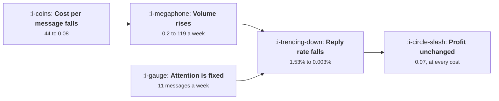

# AI Outbound and the Spam Equilibrium

```text
Level: Expert
Prerequisites: What Not to Send
Estimated difficulty: 4/5 | Estimated time: 40 min
```

## The idea in one minute

A recipient considers a bounded number of messages a week, so once a channel is saturated the
replies available are fixed and senders divide them in proportion to volume. Solve for the
equilibrium and the result is stark: as the cost of a message falls from 44 to 8 pence, each
sender's volume rises from 0.2 to 119 a week, the reply rate falls from 1.53 percent to 0.003
percent, and every sender's profit stays at exactly the same 0.07 per recipient. Cheaper sending
bought nobody anything. It raised the noise, and the only approaches that still work depend on an
input that did not get cheaper: a real event, a relationship, a request, or being found.

## A picture



Three columns move and the one that matters does not, because the resource being competed for never
got larger.

## How it really works

### The replies available are fixed once the channel saturates

A recipient will genuinely consider some number of messages a week, call it eleven. Beyond that,
additional messages do not produce additional consideration, they compete for the same slots. So the
total replies the channel can produce is the attention bound times the base reply rate, and in the
worked case that is 0.46 replies per recipient per week no matter how many messages arrive.

That one assumption produces everything else. It is also the assumption to argue with, and the
honest version of the argument is that the bound is not exactly eleven and it is certainly not
unbounded.

### Senders divide a fixed pool in proportion to volume

If the pool is fixed and allocation is proportional, a sender's replies are their share of total
volume times the pool. Then their profit is that minus the cost of what they sent, and the
equilibrium is where no sender can improve by sending more or less.

Solving it gives a volume inversely proportional to the cost per message, which is the familiar
result: halve the cost and everybody doubles their volume.

### The profit does not move, which is the point

Substitute the equilibrium volume back into the profit expression and the cost cancels. Every sender
earns the same 0.07 per recipient per week at 44 a message and at 8 pence a message.

This is the cleanest statement of what happened to outbound. The cost of sending fell by a factor of
550 and the profit available to a sender did not change at all, because every sender spent the
saving on volume and the volume competed with itself.

So the question a team should ask is not how to use cheap sending to get more replies. It is whether
to be in this channel at all.

### Nobody can unilaterally stop

The defection table shows why the equilibrium holds. A sender who sends a quarter as much earns 0.03
rather than 0.07. A sender who sends three times as much earns minus 0.20. Nobody can improve by
moving, and everybody would be better off if all of them sent a fortieth as much.

There is no move available to an individual that gets anybody there, which is the same commons
structure as [The Shared Attention Budget](../lifecycle-messaging/05-the-shared-attention-budget.md)
with no owner able to impose a cap, because the senders are different companies.

### What changes an equilibrium like this

Not persuasion. Three things, historically.

**The recipient gets a better filter.** The attention bound does not change but the allocation stops
being proportional to volume and starts being proportional to something else, which is what mail
filtering did to bulk email. Expect the same for other channels.

**A platform charges for access or caps it.** Which converts the commons into a market and is what
every successful messaging platform has eventually done.

**The channel is abandoned by the senders worth replying to**, which lowers the quality of what
remains and accelerates the first two.

All three are external to any sender's decision. Planning on one of them is planning on somebody
else's action.

### What works instead, and why

Four approaches with reply rates of 1.4, 22, 31 percent and not applicable, against the 0.003
percent equilibrium. Each depends on an input that did not get cheaper.

A message about something that actually happened in the recipient's world is scarce because the
events are scarce. An introduction depends on a relationship. A message somebody asked for depends
on their request. And being found rather than sending competes for attention the recipient has
already decided to give you, which is the content and search half of this course.

The growth conclusion follows: move budget from sending to being findable, and keep the sending for
the cases where a real event justifies it.

### What fills the box in 2026

The filtering response is well underway. Recipient side tooling that summarises, triages and
auto declines unsolicited messages is now common in business inboxes, and the effect is to change
the allocation rule in the model from proportional to volume to proportional to relevance, which
inverts the whole equilibrium: volume stops helping and specificity starts. That is the development
to watch, because it is the only one that makes outbound work again, and it rewards exactly the
approaches in the last table.

## Run the numbers

Solve the equilibrium and watch the profit column refuse to move.

```go
// spamequilibrium.go: what happens to a channel when sending becomes free.
package main

import "fmt"

// A recipient considers a bounded number of messages a week, so once senders
// exceed that bound the replies available are fixed and the senders divide
// them in proportion to volume. Each sender's private optimum is to send
// more, and the arithmetic of where that settles is short enough to solve.
const (
	attention = 11.0  // messages a week a recipient will actually consider
	baseResp  = 0.042 // reply rate when a recipient gets one message a week
	value     = 2_900.0
	senders   = 140.0
)

// reply rate per message when this many arrive in a week
func respond(messages float64) float64 {
	if messages <= attention {
		return baseResp
	}
	return baseResp * attention / messages
}

// Total replies available once the channel is saturated. Beyond the
// attention bound this is fixed, however much anybody sends.
var pool = baseResp * attention

// Symmetric equilibrium volume per sender at a given cost per message.
// One sender's profit is pool*value*v/(v+others) - cost*v. Differentiate,
// set to zero, substitute others = (senders-1)*v and solve for v.
func equilibrium(cost float64) float64 {
	return pool * value * (senders - 1) / (senders * senders * cost)
}

func main() {
	fmt.Printf("%.0f senders; a recipient considers %.0f messages a week\n", senders, attention)
	fmt.Printf("a reply is worth %.0f, so %.2f replies a week exist to be won\n\n",
		value, pool)

	fmt.Printf("%-18s %12s %14s %13s %18s %16s\n",
		"cost per message", "each sends", "total/week", "reply rate",
		"replies per 1,000", "profit/recipient")
	for _, c := range []float64{44.0, 12.0, 3.0, 0.60, 0.08} {
		v := equilibrium(c)
		total := v * senders
		r := respond(total)
		fmt.Printf("%18.2f %12.1f %14.1f %12.3f%% %18.3f %16.2f\n",
			c, v, total, 100*r, 1000*r, v*r*value-v*c)
	}

	fmt.Println("\nThe last column does not move. At 44 a message and at 8 pence a")
	fmt.Println("message, a sender in equilibrium earns the same 0.07 per recipient")
	fmt.Println("per week. Cheaper sending bought nobody anything; it raised volume")
	fmt.Println("from 0.2 messages a week to 119 and took the reply rate from 1.53%")
	fmt.Println("to 0.003%, which is one reply per 36,000 messages.")

	fmt.Println("\nwhy no sender can stop, at 8 pence a message:")
	const cheap = 0.08
	eq := equilibrium(cheap)
	others := eq * (senders - 1)
	fmt.Printf("%-24s %16s %16s %s\n",
		"this sender sends", "replies/recipient", "profit/recipient", "verdict")
	for _, f := range []float64{0.25, 0.5, 1.0, 1.5, 3.0} {
		v := eq * f
		r := respond(others + v)
		p := v*r*value - v*cheap
		tag := "the equilibrium"
		switch {
		case f < 1:
			tag = "worse for this sender"
		case f > 1:
			tag = "worse for this sender too"
		}
		fmt.Printf("%24.0f %16.4f %16.2f %s\n", v, v*r, p, tag)
	}
	fmt.Println("\nNobody can improve their position by moving, which is what makes")
	fmt.Println("it an equilibrium, and everybody would be better off if all of them")
	fmt.Println("sent a fortieth as much. There is no move available to an")
	fmt.Println("individual sender that gets anybody there.")

	fmt.Println("\nwhat actually survives in this channel:")
	fmt.Printf("%-40s %14s %s\n", "approach", "reply rate", "the input that stayed scarce")
	for _, r := range []struct{ name, rate, why string }{
		{"generated messages at volume", "0.003%", "nothing; this is the equilibrium"},
		{"a message about something that happened", "1.4%", "a real event in the recipient's world"},
		{"an introduction from somebody they know", "22%", "a relationship"},
		{"a message they asked for", "31%", "a request the recipient made"},
		{"being found rather than sending", "n/a", "the recipient looking for you"},
	} {
		fmt.Printf("%-40s %14s %s\n", r.name, r.rate, r.why)
	}
	fmt.Println("\nEvery surviving row depends on an input that did not get cheaper.")
	fmt.Println("The channel where sending became free became the channel where")
	fmt.Println("sending is worthless, and the growth conclusion is to stop")
	fmt.Println("competing in it rather than to compete harder.")
}
```

The first table is the result. Volume per sender of 0.2, 0.8, 3.2, 15.8 and 118.8 a week; reply
rates of 1.528, 0.417, 0.104, 0.021 and 0.003 percent; replies per thousand messages of 15.3 down to
0.028. And profit per recipient of 0.07 in every row.

The defection table shows the trap. Below the equilibrium you earn less, above it you earn less, and
the equilibrium itself is worth almost nothing.

Change `attention` to test the assumption the model rests on. Doubling it to 22 doubles the pool and
doubles everybody's profit, and does nothing to the shape: the profit is still independent of the
cost of sending. The conclusion is robust to the one number you might reasonably dispute.

## Sector lens

| Sector | What the channel looks like here |
|---|---|
| [Enterprise B2B SaaS](../../product-management/product-by-sector/01-enterprise-b2b-saas.md) | Fully saturated. The buyers receive hundreds a week and reply rates on generated outbound are indistinguishable from zero |
| [Fintech](../../product-management/product-by-sector/02-fintech.md) | Unsolicited financial approaches are regulated in most markets, which caps the commons by law rather than by filtering |
| [Ecommerce and D2C](../../product-management/product-by-sector/03-ecommerce-and-d2c.md) | Consumer inboxes are filtered aggressively already, so the equilibrium arrived a decade earlier here |
| [Marketplaces](../../product-management/product-by-sector/04-marketplaces.md) | Within platform messaging is the channel, and the platform can impose the cap. Those that have, have better channels |
| [Devtools and Infra](../../product-management/product-by-sector/05-devtools-and-infrastructure.md) | Developers filter hardest of any audience and discuss senders publicly. The channel is effectively closed |
| [Healthtech](../../product-management/product-by-sector/06-healthtech-and-regulated-care.md) | Clinician outreach is governed by professional rules, and misjudged outbound has consequences beyond a low reply rate |
| [Vertical SaaS](../../product-management/product-by-sector/07-vertical-saas.md) | Small markets where a bad outbound campaign is discussed at the trade association. Relationships are the only route |

## Remember this

* A recipient's attention is bounded, so the replies a saturated channel can produce are fixed.
* Senders divide that fixed pool in proportion to volume, which makes volume a race with no prize.
* Equilibrium volume is inversely proportional to the cost of a message: halve the cost and everybody
  doubles.
* The profit is independent of the cost. The same 0.07 at 44 a message and at 8 pence.
* So cheaper sending raised the noise and changed nobody's return, which is the clearest statement
  of what happened to outbound.
* Nobody can unilaterally stop: sending less and sending more both earn less than the equilibrium.
* Only three things change an equilibrium like this, and all are external: better filters, platform
  caps, or the good senders leaving.
* What works depends on an input that stayed scarce: a real event, a relationship, a request, or
  being found.
* Reply rates of 1.4, 22 and 31 percent for those, against 0.003 for generated volume.
* Recipient side triage changes the allocation rule from volume to relevance, which is the one
  development that would make the channel work again.

## Try it

1. Compute your own equilibrium with your reply value and your estimate of the attention bound.
   Check whether your current volume is near it.
2. Measure your reply rate on generated outbound and on messages triggered by a real event in the
   recipient's world. The ratio is the argument for reallocating the budget.
3. Take the budget currently spent on volume and compute what it would buy in content aimed at being
   found, using the arithmetic from
   [Content at Scale and the Quality Floor](02-content-at-scale-and-the-quality-floor.md).

## Check yourself

1. Your cost per outbound message falls by 80 percent. What happens to your volume, your reply rate
   and your profit, and why?
2. Why can no individual sender improve the channel by sending less, and what would have to happen
   instead?
3. Which of the four surviving approaches is available to you this quarter, and what is the scarce
   input it depends on?
