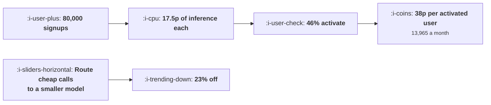

# What These Loops Cost to Run

```text
Level: Expert
Prerequisites: Onboarding by Agent
Estimated difficulty: 3/5 | Estimated time: 35 min
```

## The idea in one minute

Inference is charged per attempt and a funnel is a sequence of attempts, most of which do not reach
the end, so the cost per activated user is the cost per signup divided by the activation rate. In
the worked funnel no single step costs more than four pence a signup, the whole thing costs 17.5
pence, and that is 38 pence per activated user and 13,965 a month. The steps that dominate the bill
are not the ones with the expensive call: onboarding questions cost nine tenths of a penny each and
are the second largest line because they happen seven times for nearly half the funnel. Four
configuration changes take 23, 10, 6 and 3 percent off, and none of them is a product decision.

## A picture



The division by activation rate is the step teams forget, and it more than doubles the number.

## How it really works

### Cost per signup is the wrong number to quote

It is the easy number and it understates the cost of the thing you care about by a factor of one
over your activation rate. At 46 percent activation, 17.5 pence a signup is 38 pence an activated
user.

Quote the per activated figure, because that is the one to compare against what an activated user
is worth, which is the comparison in
[Onboarding by Agent](04-onboarding-by-agent.md) and the one that decides whether the loop is worth
running.

### Build the table as reach times calls times cost

Three inputs per step and all three are measurable. Reach is the share of signups who get that far,
calls is how many model calls happen for a user who does get there, and cost per call comes from
your provider's billing.

The product of the three is the step's cost per signup, and the ranking of that product is what
decides where to work. In the worked funnel the top four steps are 68 percent of the bill.

### The expensive step is rarely the expensive call

Generating the first real output costs 3.8 pence a call and reaches half the funnel twice, which is
the largest line. Answering onboarding questions costs nine tenths of a penny a call and happens
seven times for 44 percent of signups, which is the second largest.

Teams look at the per call column and optimise the expensive model. The reach and calls columns are
where the volume is, and reach times calls is a number nobody has written down.

### Four configuration levers, in order of return

**Route the cheap calls to a smaller model.** Twenty three percent of the bill in the worked case.
Classification, triage, short summaries and field mapping do not need your best model, and users
cannot tell. This is the largest single saving available and it is a routing rule.

**Cap retries and regeneration.** Ten percent. Regeneration is three calls for a quarter of users
and the third attempt almost never helps. One retry, then offer the manual path.

**Cache anything derived from something stable.** Six percent. A workspace seeded from a company
domain is the same for every user at that company, forever.

**Trigger expensive calls later in the funnel.** Three percent. Seeding on the first screen pays for
everybody who leaves in nine seconds; seeding after the second screen pays for 58 percent of them.

All four are configuration rather than product changes, they total about 40 percent of the bill if
applied together, and none of them requires a decision from anybody outside engineering.

### What the figure is for

Two decisions. Whether the loop is worth running, which is the comparison against the activated
user's value. And whether your gross margin is what you think it is, which is the margin term in
[Reading Unit Economics as a Growth Lead](../growth-economics/01-reading-unit-economics-as-a-growth-lead.md)
and moves with usage rather than staying put.

Put the per activated user cost on the growth dashboard next to activation rate. Those two numbers
move together when a loop gets better, and a team that watches only the first will raise activation
by spending money it has not noticed.

### What to watch monthly

Three things. Calls per activated user, which rises quietly as features are added. Cost per call,
which falls as providers cut prices and rises when somebody upgrades a model. And the share of
spend on users who never activate, which in the worked funnel is 54 percent of the bill and is the
honest cost of the free part of the funnel.

### What fills the box in 2026

Prices per call have fallen substantially and will probably keep falling, which makes the absolute
figures here optimistic for older architectures and pessimistic as a forecast. The structural point
does not move: the cost is reach times calls times price, and the first two are yours. Teams that
treated falling prices as the plan have found calls per user rising faster than prices fell,
because cheaper calls get used more freely, and the bill went up.

## Run the numbers

Build the table and rank the lines.

```go
// loopcost.go: what a model powered growth loop costs per activated user.
package main

import "fmt"

// Inference is charged per attempt, and a funnel is a sequence of attempts
// most of which do not reach the end. So the cost per activated user is the
// cost per signup divided by the activation rate, and it is much larger than
// any single step suggests.
type step struct {
	name    string
	reach   float64 // share of signups who get this far
	calls   float64 // model calls per user who gets here
	perCall float64 // cost of one call
}

const (
	signups  = 80_000.0 // a month
	activate = 0.46
)

func (s step) costPerSignup() float64 { return s.reach * s.calls * s.perCall }

func main() {
	steps := []step{
		{"seed the workspace from their domain", 1.00, 1, 0.014},
		{"map the fields of their import", 0.42, 3, 0.021},
		{"answer onboarding questions", 0.44, 7, 0.009},
		{"generate the first real output", 0.51, 2, 0.038},
		{"regenerate it when they are unhappy", 0.23, 3, 0.038},
		{"write their first automation", 0.17, 5, 0.026},
		{"personalise four lifecycle messages", 0.78, 4, 0.004},
		{"triage their support question", 0.31, 2, 0.011},
	}

	fmt.Printf("%.0f signups a month, %.0f%% activate\n\n", signups, 100*activate)
	fmt.Printf("%-40s %9s %8s %10s %14s\n",
		"step", "reach", "calls", "per call", "cost/signup")
	var per float64
	for _, s := range steps {
		per += s.costPerSignup()
		fmt.Printf("%-40s %8.0f%% %8.0f %10.3f %14.4f\n",
			s.name, 100*s.reach, s.calls, s.perCall, s.costPerSignup())
	}
	fmt.Printf("%-40s %9s %8s %10s %14.4f\n", "total", "", "", "", per)

	fmt.Printf("\ncost per signup: %.3f\n", per)
	fmt.Printf("cost per activated user: %.3f\n", per/activate)
	fmt.Printf("monthly inference bill: %.0f\n\n", per*signups)

	fmt.Println("No single step costs more than four pence a signup and the whole")
	fmt.Println("funnel costs 17.5 pence, which is 38 pence an activated user and")
	fmt.Println("13,965 a month. The steps that cost most are not the ones with the")
	fmt.Println("most expensive call, they are the ones almost everybody reaches.")

	fmt.Println("\nwhere the bill goes, ranked:")
	for i := 0; i < len(steps); i++ {
		for j := i + 1; j < len(steps); j++ {
			if steps[j].costPerSignup() > steps[i].costPerSignup() {
				steps[i], steps[j] = steps[j], steps[i]
			}
		}
	}
	fmt.Printf("%-40s %14s %12s %14s\n", "step", "cost/signup", "share", "monthly")
	run := 0.0
	for _, s := range steps {
		run += s.costPerSignup()
		fmt.Printf("%-40s %14.4f %11.0f%% %14.0f\n",
			s.name, s.costPerSignup(), 100*s.costPerSignup()/per, s.costPerSignup()*signups)
	}

	fmt.Println("\nThe top three steps are 53% of the bill and the top four are 68%.")
	fmt.Println("Onboarding questions cost nine tenths of a penny a call and are the")
	fmt.Println("second largest line, because they happen seven times for nearly half")
	fmt.Println("the funnel. The expensive thing is rarely the expensive call.")

	fmt.Println("\nwhat each lever does to the cost per activated user:")
	fmt.Printf("%-44s %18s %14s\n", "change", "cost/activated", "saving")
	base := per / activate
	type lever struct {
		name string
		f    func([]step) float64
	}
	levers := []lever{
		{"nothing", func(ss []step) float64 { return per }},
		{"route the cheapest half to a smaller model", func(ss []step) float64 {
			t := 0.0
			for _, s := range ss {
				c := s.perCall
				if c < 0.02 {
					c *= 0.35
				}
				t += s.reach * s.calls * c
			}
			return t
		}},
		{"cache the domain seeding", func(ss []step) float64 {
			t := 0.0
			for _, s := range ss {
				c := s.reach * s.calls * s.perCall
				if s.name == "seed the workspace from their domain" {
					c *= 0.22
				}
				t += c
			}
			return t
		}},
		{"cap regeneration at one attempt", func(ss []step) float64 {
			t := 0.0
			for _, s := range ss {
				c := s.reach * s.calls * s.perCall
				if s.name == "regenerate it when they are unhappy" {
					c /= 3
				}
				t += c
			}
			return t
		}},
		{"seed only after the second screen", func(ss []step) float64 {
			t := 0.0
			for _, s := range ss {
				r := s.reach
				if s.name == "seed the workspace from their domain" {
					r = 0.58
				}
				t += r * s.calls * s.perCall
			}
			return t
		}},
	}
	for _, l := range levers {
		c := l.f(steps) / activate
		fmt.Printf("%-44s %18.3f %13.0f%%\n", l.name, c, 100*(1-c/base))
	}
	fmt.Println("\nRouting the cheap calls to a smaller model saves 23% and nobody")
	fmt.Println("notices. Capping regeneration at one attempt saves 10%. Seeding only")
	fmt.Println("after the second screen saves 3% by not paying for people who leave")
	fmt.Println("in nine seconds. None of these is a product decision; all four are")
	fmt.Println("configuration, which is why they come before anything harder.")
}
```

The first table is the exercise. Reach, calls, cost per call and the product. Build it from your own
billing and event data; the calls column is usually the one nobody knows and it is available from
provider logs.

The ranked table is where to work: 22, 16, 15, 15, 13, 8, 7 and 4 percent of the bill. Anything
under five percent is not worth a project.

The levers table prices four configuration changes: 23, 10, 6 and 3 percent off the cost per
activated user. Apply your own versions and note that they compose, so the combination is worth
roughly 40 percent.

Change `activate` to see how much the activation rate matters to this number. Raising activation
from 46 to 60 percent lowers the cost per activated user by 23 percent without touching any model
configuration, which is the quiet argument for onboarding work paying twice.

## Sector lens

| Sector | What dominates the bill here |
|---|---|
| [Enterprise B2B SaaS](../../product-management/product-by-sector/01-enterprise-b2b-saas.md) | Document and data processing during onboarding, which is large per account and small in number. Cache aggressively |
| [Fintech](../../product-management/product-by-sector/02-fintech.md) | Document verification and transaction classification, both high volume and both regulated, so model choice is constrained |
| [Ecommerce and D2C](../../product-management/product-by-sector/03-ecommerce-and-d2c.md) | Product description and image generation at catalogue scale, paid once per item rather than per user |
| [Marketplaces](../../product-management/product-by-sector/04-marketplaces.md) | Matching and moderation on every listing and message, so cost scales with activity rather than with signups |
| [Devtools and Infra](../../product-management/product-by-sector/05-devtools-and-infrastructure.md) | Code generation, which has the highest cost per call in this category and the clearest value when it works |
| [Healthtech](../../product-management/product-by-sector/06-healthtech-and-regulated-care.md) | Clinical documentation, where the cheapest acceptable model is set by governance rather than by cost |
| [Vertical SaaS](../../product-management/product-by-sector/07-vertical-saas.md) | One off migration of each customer's data, which is a large per account cost and a small total |

## Remember this

* Cost per activated user is cost per signup divided by the activation rate, which more than doubles
  it at 46 percent activation.
* Build the table as reach times calls times cost per call, per step. All three are measurable.
* The expensive step is rarely the expensive call: a nine tenths of a penny call happening seven
  times for half the funnel was the second largest line.
* Four configuration levers: route cheap calls to a smaller model (23 percent), cap regeneration (10),
  cache stable derivations (6), trigger expensive calls later (3).
* Together those are about 40 percent of the bill and none of them is a product decision.
* Put cost per activated user on the growth dashboard next to the activation rate.
* Watch calls per activated user, cost per call, and the share of spend on users who never activate,
  which was 54 percent here.
* Raising activation lowers the cost per activated user proportionally, so onboarding work pays
  twice.
* Falling prices are not a plan: calls per user tend to rise faster than prices fall, because cheap
  calls get used freely.

## Try it

1. Build the reach, calls and cost table for your own funnel from provider logs and event data. The
   calls column is usually the missing one.
2. Compute cost per activated user and put it on the dashboard next to activation rate this week.
3. Apply the routing lever: list every call that could be served by your cheapest acceptable model
   and measure whether anybody notices.

## Check yourself

1. Your inference costs 9 pence a signup and 31 percent of signups activate. What is the number to
   quote, and what do you compare it against?
2. Why is a cheap call often a larger line in the bill than an expensive one?
3. Model prices halve and your monthly bill rises. What happened?
