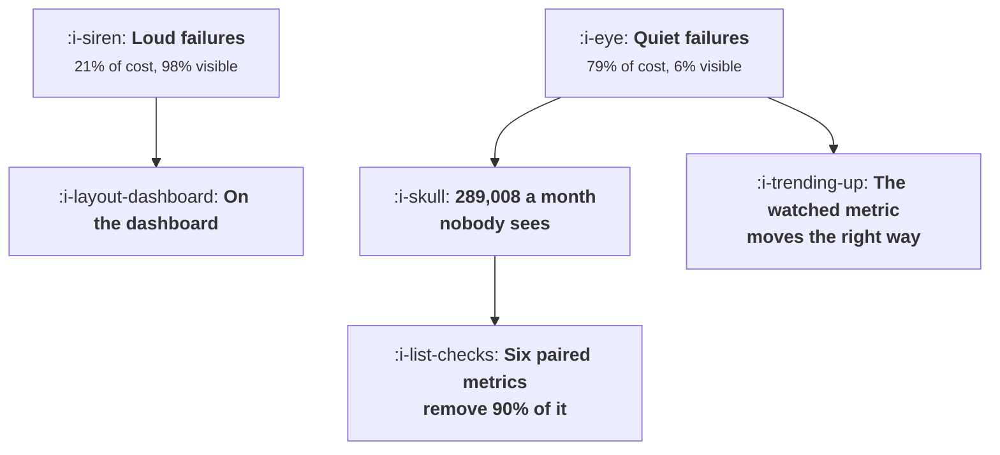

# How They Fail

```text
Level: Expert
Prerequisites: What These Loops Cost to Run
Estimated difficulty: 4/5 | Estimated time: 40 min
```

## The idea in one minute

Model powered growth loops fail in ways that mostly do not look like failures. The three loudest
modes, the model being down, latency rising and cost per call jumping after an upgrade, are 21
percent of the total cost and 75 percent of everything a standard dashboard shows. The other 80
percent of the cost is invisible, and it is invisible for the same reason every time: the metric
the team watches moves in the direction they wanted while a later one moves the other way. Six
queries, each against data you already have, remove 90 percent of the invisible cost.

## A picture



The loud box is cheap because it is loud. Everything expensive is in the quiet box.

## How it really works

### Score every failure mode on three numbers

How often it happens, what it costs each time, and the probability that an ordinary dashboard shows
it. Multiply the first two for the total and apply the third to get the part nobody sees, which is
the number that should decide what you instrument.

In the worked set the total is 361,300 a month and 289,008 of it is invisible, which is 80 percent.

### The loud failures and why they are cheap

The model being down is visible 98 percent of the time, costs 14,000 twice a month, and leaves 560
of undetected cost. Latency rising is 71 percent visible. Cost per call jumping after a model
upgrade is 34 percent visible, which is lower than it should be and is fixed by the dashboard line
in [What These Loops Cost to Run](06-what-these-loops-cost-to-run.md).

These are the failures teams prepare for, because they look like failures. They are the cheap ones
precisely because somebody notices.

### The six quiet failures, and the thing they share

Every one of them moves a watched metric in the right direction.

* **Confidently wrong output accepted.** Activation rises because the user took the output;
  retention falls two months later. Undetected cost 55,296.
* **Seeded accounts never edited.** Activation rises; the cohort is hollow. 56,252.
* **Generated sends rise and opens stay flat.** Both numbers go up in absolute terms, so the report
  looks fine while the rate collapses. 38,016.
* **Personalisation reveals too much.** Conversion rises and the complaints land in a support system
  nobody correlates with it. 32,054.
* **The loop optimises for the wrong metric.** The chosen metric improves by construction. 49,140.
* **Quality drifts after a model change.** Nothing moves at all until churn does. 35,340.

The pattern: a model powered loop is an optimiser, and an optimiser pointed at a proxy will improve
the proxy. If the proxy and the goal come apart, the loop is working perfectly and the business is
getting worse, and nothing in the loop's own reporting can tell you.

### Paired metrics are the answer

For every metric a loop optimises, instrument a later metric that would move the other way if the
loop were cheating, and put them on the same chart.

* Activation with week six retention.
* Sends with opt outs per thousand.
* Conversion with complaints per thousand.
* Output volume with sampled output quality.
* Attributed conversions with incremental lift against a holdout.
* Seeded artefacts with the share subsequently edited.

Six queries. None of them is a new system and each is one query against data you already hold, run
weekly with a threshold agreed in advance. Together they remove 266,098 of the 289,008 that is
currently invisible.

### The two that need more than a query

**Sampled output quality.** Somebody has to look at output, regularly, with a rubric. Twenty samples
a week is adequate and it is the only defence against a silent change in a model you do not control.
Teams skip it because it is not automatable and it is the instrument that catches the failure with
no other symptom.

**Incremental lift against a holdout.** A permanent holdout from the loop entirely, which is the
argument in
[Measuring a Campaign Honestly](../lifecycle-messaging/06-measuring-a-campaign-honestly.md) applied
to an optimiser rather than a campaign. It is the only thing that catches a loop optimising the
wrong objective, and it is the most expensive single failure in the table at 54,000 a month.

### Write the failure modes down before launching

The practical mechanism: before a model powered loop goes live, write the list of ways it could
fail, the metric that would move for each, and the threshold. That document takes an hour, it is
the specification for the paired metrics, and it is much harder to write after launch because by
then the loop is somebody's achievement.

### What fills the box in 2026

Two modes have become more important. Silent model changes, where a provider updates a model behind
an endpoint and behaviour shifts without a version change, which is why sampled quality cannot be
skipped and why pinning versions where possible is worth the operational cost. And loops that
optimise an objective across several steps, where the proxy problem compounds because each step's
proxy is the next step's input. For those, the holdout is not optional: it is the only measurement
that sees the whole loop.

## Run the numbers

Score the modes, then rank the instruments by what they would catch.

```go
// howtheyfail.go: which failure modes a dashboard shows and which it hides.
package main

import "fmt"

// A model powered growth loop fails in ways that mostly do not look like
// failures. Each mode has a frequency, a cost, and a probability that an
// ordinary dashboard surfaces it, and the expected undetected cost is what
// decides which instrument to build.
type mode struct {
	name     string
	perMonth float64 // times a month it happens
	cost     float64 // cost each time it happens
	visible  float64 // chance a standard dashboard shows it
	signal   string  // what would actually catch it
}

func (m mode) total() float64      { return m.perMonth * m.cost }
func (m mode) undetected() float64 { return m.total() * (1 - m.visible) }

func main() {
	modes := []mode{
		{"the model is down or rate limited", 2, 14_000, 0.98, "error rate per arm"},
		{"latency rises past the user's patience", 3, 9_000, 0.71, "p95 latency by step"},
		{"cost per call rises after a model upgrade", 1, 22_000, 0.34, "cost per activated user"},
		{"output is confidently wrong and accepted", 90, 640, 0.04, "correction rate by cohort"},
		{"seeded accounts never get edited", 140, 410, 0.02, "retention split by edited or not"},
		{"generated sends rise and opens stay flat", 6, 7_200, 0.12, "opens and opt outs together"},
		{"personalisation reveals too much", 11, 3_100, 0.06, "complaints per thousand sends"},
		{"the loop optimises for the wrong metric", 1, 54_000, 0.09, "incremental lift against a holdout"},
		{"quality drifts after a silent model change", 2, 19_000, 0.07, "output quality sampled weekly"},
	}

	fmt.Printf("%-46s %10s %10s %10s %14s\n",
		"failure mode", "a month", "cost each", "visible", "undetected")
	var tot, und float64
	for _, m := range modes {
		tot += m.total()
		und += m.undetected()
		fmt.Printf("%-46s %10.0f %10.0f %9.0f%% %14.0f\n",
			m.name, m.perMonth, m.cost, 100*m.visible, m.undetected())
	}
	fmt.Printf("%-46s %10s %10s %10s %14.0f\n", "total", "", "", "", und)
	fmt.Printf("\ntotal cost of failures: %.0f a month\n", tot)
	fmt.Printf("of which a standard dashboard shows: %.0f\n", tot-und)
	fmt.Printf("and of which it does not: %.0f, or %.0f%%\n\n", und, 100*und/tot)

	fmt.Println("The three loudest failures are 21% of the cost and 75% of what any")
	fmt.Println("dashboard shows. The quiet ones are the rest, and they are quiet")
	fmt.Println("for the same reason in every case: the metric moves in the")
	fmt.Println("direction the team wanted.")

	fmt.Println("\nthe quiet failures, and why each one looks like success:")
	for _, r := range []struct{ mode, looks string }{
		{"confidently wrong output accepted", "activation rises; retention falls later"},
		{"seeded accounts never edited", "activation rises; the cohort is hollow"},
		{"sends rise and opens stay flat", "sends and opens both up in absolute terms"},
		{"personalisation reveals too much", "conversion up, complaints in a different system"},
		{"optimised for the wrong metric", "the chosen metric improves, by construction"},
		{"quality drift after a model change", "nothing moves until churn does, two months on"},
	} {
		fmt.Printf("  %-36s %s\n", r.mode, r.looks)
	}

	fmt.Println("\nwhat to instrument, ranked by undetected cost removed:")
	for i := 0; i < len(modes); i++ {
		for j := i + 1; j < len(modes); j++ {
			if modes[j].undetected() > modes[i].undetected() {
				modes[i], modes[j] = modes[j], modes[i]
			}
		}
	}
	fmt.Printf("%-40s %16s %s\n", "instrument", "removes/month", "catches")
	run := 0.0
	for _, m := range modes[:6] {
		run += m.undetected()
		fmt.Printf("%-40s %16.0f %s\n", m.signal, m.undetected(), m.name)
	}
	fmt.Printf("\nthose six instruments remove %.0f a month of the %.0f that is\n", run, und)
	fmt.Println("currently invisible, which is 90% of it. None of them is a new")
	fmt.Println("system: each is one query against data you already have, run")
	fmt.Println("weekly, with a threshold agreed in advance.")

	fmt.Println("\nthe pattern worth memorising:")
	fmt.Println("  loud failures are cheap, because they are loud")
	fmt.Println("  quiet failures move a metric the right way and a later one wrong")
	fmt.Println("  so every model powered loop needs a paired metric, measured later")
	fmt.Println("  activation with retention, sends with opt outs, conversion with")
	fmt.Println("  complaints, output volume with sampled quality")
}
```

The first table is the exercise to do for your own loops. The visibility column is the one to argue
about honestly: ask whether your dashboard would have shown the last instance of each mode, and the
answer is often no for things everybody assumed were covered.

The undetected column is the ranking. Seeded accounts never edited at 56,252, confidently wrong
output at 55,296, wrong objective at 49,140. Those three are the quiet, expensive middle of the
distribution and none of them has a natural alarm.

The instrument table converts that into a work list of six queries removing 90 percent of the
invisible cost. Put your own frequencies and costs in; the frequencies are estimable from support
tickets and the costs from churn among affected cohorts.

## Sector lens

| Sector | The failure mode that matters most here |
|---|---|
| [Enterprise B2B SaaS](../../product-management/product-by-sector/01-enterprise-b2b-saas.md) | Confidently wrong configuration in a large account, where one instance costs a renewal rather than a user |
| [Fintech](../../product-management/product-by-sector/02-fintech.md) | Wrong output accepted, because the consequence can be a regulatory breach rather than a churned user |
| [Ecommerce and D2C](../../product-management/product-by-sector/03-ecommerce-and-d2c.md) | Generated content and personalisation at volume, where complaints arrive publicly and quickly |
| [Marketplaces](../../product-management/product-by-sector/04-marketplaces.md) | A loop optimising one side's metric at the other side's expense, which no single sided dashboard shows |
| [Devtools and Infra](../../product-management/product-by-sector/05-devtools-and-infrastructure.md) | Quality drift after a silent model change, because your users will notice and publish before you do |
| [Healthtech](../../product-management/product-by-sector/06-healthtech-and-regulated-care.md) | Any wrong output, where the cost is not commercial. Sampled review is a governance requirement, not an option |
| [Vertical SaaS](../../product-management/product-by-sector/07-vertical-saas.md) | Hollow seeded accounts, because with few customers a single hollow cohort is a visible share of the base |

## Remember this

* Score each mode on frequency, cost and the chance a dashboard shows it. Rank by the undetected
  product.
* The three loud modes are 21 percent of cost and 75 percent of what the dashboard shows. Loud is
  cheap.
* Eighty percent of the cost is invisible, and every quiet mode moves a watched metric the right
  way.
* A loop is an optimiser, so it will improve the proxy. If proxy and goal diverge, the loop works
  and the business worsens.
* Pair every optimised metric with a later one that would move the other way, on the same chart.
* The six pairs: activation with retention, sends with opt outs, conversion with complaints, volume
  with sampled quality, attributed with incremental, seeded with edited.
* Those six remove 90 percent of the invisible cost and are one query each.
* Sampled output quality needs a person and a rubric, twenty a week, and is the only defence against
  a silent model change.
* A permanent holdout is the only instrument that catches a loop optimising the wrong objective,
  which was the single most expensive mode.
* Write the failure list and thresholds before launch. It is much harder to write once the loop is
  somebody's achievement.

## Try it

1. Score your own failure modes on the three numbers and rank by undetected cost. Be honest about
   the visibility column by checking whether the last instance was actually caught.
2. Build the six paired metric charts this month. Each is one query and they go on the same chart as
   the metric they pair with, not on a separate page.
3. Start sampling twenty outputs a week against a written rubric, and keep the record. It is the
   only instrument for the failure with no other symptom.

## Check yourself

1. Your activation rate rose nine points after a seeding feature launched and week six retention is
   unchanged. Which failure mode is most likely, and what single query settles it?
2. Why are the loudest failure modes the cheapest ones?
3. Your loop optimises a conversion metric and the metric has improved every month for a year. What
   would you need to believe that, and what does it cost to find out?
