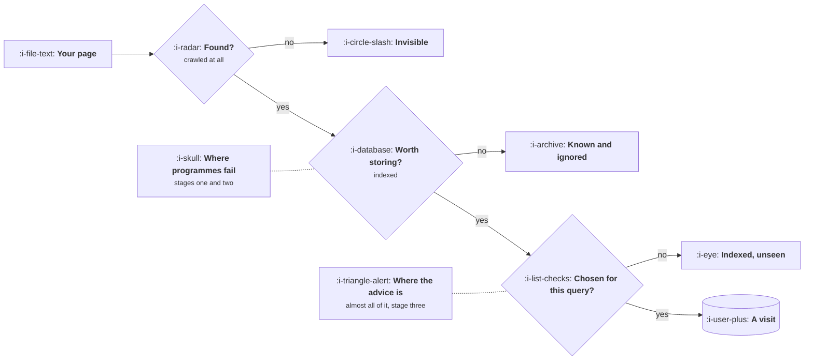

# How Search Works Now

```text
Level: Basic
Prerequisites: Attribution
Estimated difficulty: 2/5 | Estimated time: 30 min
```

## The idea in one minute

Search has three stages and almost every piece of advice you will read is about the third one.
A page has to be found, then judged worth storing, then chosen for a particular query, and the
large failures in a content programme happen at the first two stages while the discussion is
entirely about the third. The underlying mechanism has been stable for years even though the
tactics turn over constantly: a search engine is trying to work out, cheaply and at enormous
scale, which page will satisfy a person who typed six words. Everything that works is a proxy
for that, and everything that stops working stopped being a proxy for it.

## A picture



Three gates, and the two that quietly fail are the two nobody writes about.

## How it really works

### Stage one: being found

A crawler has a budget for your site. It is finite, it is allocated according to how useful your
site has been historically, and it is spent on whatever it encounters. A site with fifty thousand
pages and the crawl budget for five thousand will have forty five thousand pages that do not
exist as far as search is concerned.

Three things waste it reliably: pages reachable only through many clicks, large numbers of
near identical pages produced by filters and parameters, and chains of redirects left from old
migrations. None of these are content problems and all of them are more consequential than any
amount of writing.

The diagnostic is simple and most teams have never run it: compare the number of pages you have
with the number a search engine says it has crawled, and then with the number it has indexed. The
two gaps are stages one and two, quantified.

### Stage two: being judged worth storing

Finding a page is not agreeing to keep it. Indexing is a judgement about whether the page is
worth the storage and the retrieval cost, and it is made partly at the page level and partly at
the site level.

The site level part is the one that surprises people. A site where most pages are thin is treated
as a site whose pages are probably thin, and that judgement is applied to pages that are not. It
is the mechanism behind the central risk in lesson 03: publishing twenty thousand weak pages does
not merely add twenty thousand weak pages, it changes how the engine treats the four hundred good
ones you already had.

What makes a page worth storing is unglamorous: it says something that is not already said
identically on fifty other pages, it is complete enough to answer the question it is about, and
somebody other than you has indicated it exists.

### Stage three: being chosen

This is the part everybody writes about, and the honest summary is shorter than the literature
suggests. For a given query, the engine is predicting which result will satisfy the person. The
signals it uses as proxies are, roughly in order: whether the page is about the thing, whether
other people reference it, whether people who chose it seemed satisfied, and whether it loads and
works.

The reason specific tactics keep expiring is that each one is a proxy, and a proxy that can be
manufactured cheaply stops predicting satisfaction and is downweighted. Keyword density, exact
match domains, link volume and content length have each gone through this cycle. The mechanism
underneath has not moved at all.

So the durable strategy is to be the thing the proxy is trying to detect, which is slower and
does not expire.

### What has actually changed

Three things, over roughly the last five years, that are mechanism rather than tactics.

**Intent matching got much better.** The engine understands that two differently worded queries
want the same thing, which collapsed a whole generation of tactics based on making a page per
phrasing. One good page now covers a family of queries that used to need twenty.

**The result page gives away more.** More queries are answered directly, which is lesson 06 and
changes which content is worth making rather than whether content is worth making.

**The volume of adequate content exploded.** Being adequate no longer distinguishes a page,
because adequate is now free. What distinguishes a page is something that cannot be generated:
original data, a tool, a position, specific experience.

### What this means for a content plan

Four consequences, and the first is the one that saves the most money.

Check stages one and two before writing anything. If half your pages are not indexed, writing
more is the wrong intervention and an expensive one.

Write for a question rather than a keyword, because intent matching means one thorough page
outperforms six thin ones targeting phrasings of the same question.

Prefer whatever you have that cannot be produced by someone else in an afternoon. Your own data,
your own numbers, a working tool, a genuine position.

And expect the schedule to be long. Lesson 04 puts numbers on it; the summary is that a content
programme is a two year commitment and should not be started by anyone who needs a result in two
quarters.

### What fills the box in 2026

The index coverage report in whichever search console applies to you is the only tool in this
lesson that matters, and it is free. It tells you stages one and two directly, and the gap it
reveals is routinely the largest available improvement in a content programme.

Beyond that, rank tracking is worth a little and is over bought, keyword research tools are worth
having and interchangeable, and crawling tools are worth running once a quarter. None of it
substitutes for the three numbers in the coverage report.

## Sector lens

| Sector | What dominates here |
|---|---|
| [Enterprise B2B SaaS](../../product-management/product-by-sector/01-enterprise-b2b-saas.md) | Tiny query volumes with very high value, so stage three on twenty queries matters more than anything at scale |
| [Fintech](../../product-management/product-by-sector/02-fintech.md) | Trust signals weigh unusually heavily for financial topics, so authority is a gate rather than an advantage |
| [Ecommerce and D2C](../../product-management/product-by-sector/03-ecommerce-and-d2c.md) | Stage one, overwhelmingly. Filter and parameter pages consume crawl budget and the fix is technical |
| [Marketplaces](../../product-management/product-by-sector/04-marketplaces.md) | Stage two, because listing pages are the archetype of thin content and the site level judgement is the whole game |
| [Devtools and Infra](../../product-management/product-by-sector/05-devtools-and-infrastructure.md) | Documentation outranks marketing pages, and the search channel is mostly your docs whether or not anyone planned that |
| [Healthtech](../../product-management/product-by-sector/06-healthtech-and-regulated-care.md) | Health topics are held to a higher evidential standard, so authorship and sourcing are ranking factors rather than niceties |
| [Vertical SaaS](../../product-management/product-by-sector/07-vertical-saas.md) | Query volume is so low that search is rarely a channel. Check the volumes before committing a year |

## Remember this

* Three stages: found, stored, chosen. Almost all advice is about the third and most failures are
  in the first two.
* Crawl budget is finite and wasted by deep pages, parameter duplicates and redirect chains.
* Indexing is partly a site level judgement, so thin pages change how your good pages are treated.
* Compare pages you have, pages crawled and pages indexed. The two gaps are the diagnosis.
* Every ranking tactic is a proxy for predicted satisfaction, and a proxy that becomes cheap to
  fake gets downweighted. Be the thing the proxy detects.
* Intent matching means one thorough page now beats six thin ones on phrasings of one question.
* Adequate content is free and therefore no longer distinguishes anything. Original data, tools
  and positions do.

## Try it

1. Pull three numbers: pages on your site, pages crawled, pages indexed. If the gaps are large,
   you have found your content project and it does not involve writing.
2. Take the ten pages you consider most important and check each is indexed. The failure rate
   surprises most teams.
3. List your last ten published pages and mark which could have been produced by somebody with no
   access to your company. That proportion is the honest state of your content programme.

## Check yourself

1. Why does publishing twenty thousand thin pages affect the performance of pages that are not
   thin?
2. A tactic that worked for three years stopped working. Describe the general mechanism, without
   referring to any specific tactic.
3. Your site has 12,000 pages, 7,000 crawled and 2,100 indexed. What is the first thing you work
   on, and what would be a waste of a quarter?
