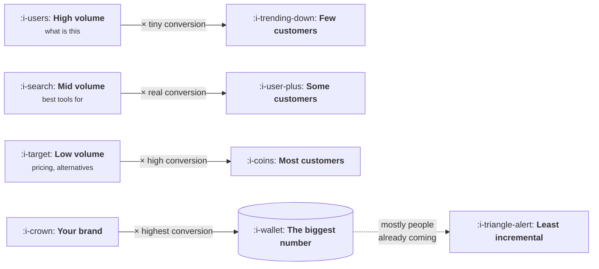

# Intent and the Money Pages

```text
Level: Basic
Prerequisites: How Search Works Now
Estimated difficulty: 2/5 | Estimated time: 35 min
```

## The idea in one minute

Search volume ranks your keywords in very nearly the opposite order to revenue, and a content
plan built from a volume sorted spreadsheet will spend most of its effort on the queries that
produce the fewest customers. The reason is that volume and intent are inversely related: lots of
people ask what something is, almost nobody is buying, and the few who search for a price are
most of your revenue. There is a second twist that catches teams who have fixed the first one.
The highest converting term is usually your own brand name, and most of those customers were
coming anyway, so the term that looks best by customers is the one with the least incremental
value in the table.

## A picture



Volume falls from left to right and customers rise. The fourth column wins on every measure
except the one that matters.

## How it really works

### The intent ladder

Queries sit on a rough ladder from knowing nothing to buying, and each rung has perhaps a fifth
of the volume and several times the conversion rate of the one below it.

| Rung | Example shape | Volume | Converts | What the person wants |
|---|---|---|---|---|
| Informational | what is a <category> | Enormous | Almost never | To understand a word |
| Comparative | best <category> tools | Large | Occasionally | A shortlist |
| Alternative | <competitor> alternative | Small | Often | To leave something |
| Transactional | <category> pricing | Tiny | Frequently | To buy |
| Navigational | <brand> | Varies | Most | You, specifically |

The arithmetic in the program multiplies these out. The informational term has forty thousand
searches a month and produces 3.2 customers. The pricing term has nine hundred and produces 12.9.
A plan that sorted by volume would have written twenty five pages for the first and three for the
second, and got it exactly backwards.

### Why the ladder is shaped like this

It is not a quirk of search, it is the shape of any market. At any moment most people in a
category are not buying, some are considering, and few are deciding. Search just lets you see the
distribution, and the lower rungs are small because deciding is rare, not because the queries are
obscure.

This has a planning consequence. The transactional terms are a finite, countable set. You can
list them in an afternoon, there are perhaps thirty of them, and once you rank for all thirty you
have taken everything that rung has. Growth beyond that has to come from a rung with worse
economics or from a different channel entirely, and knowing this in advance prevents a second
year of content spending that was never going to work.

### Brand search, and the trap in it

In the program, the brand term produces 145.2 customers a month, five times the rest of the table
combined. A team ranking by customers would conclude that brand search is the content programme.

The incremental column adjusts for the fact that most of those people were already coming: they
know your name, they are using search as a navigation bar, and if the result were not there they
would type the address or click a bookmark. At fifteen percent incrementality the real
contribution is 21.8, which is still the largest single entry and is a seventh of what the
unadjusted number claimed.

This is the attribution lesson arriving in a different channel, and it is the specific reason
brand search makes paid budgets look efficient. The measurement that settles it is the holdout
from
[Attribution](../acquisition-channels/06-attribution.md), and the honest position until you run
one is that your brand term's contribution is unknown and smaller than it appears.

### Rank by work, not by customers

The last table in the program divides incremental customers by the number of pages you have to
write and keep current. This is the ranking to plan from, and it is brutal about informational
content: 0.12 incremental customers per page, against 3.00 for the pricing page.

That is a factor of twenty five in the return on a unit of writing, and it is before considering
that informational pages are the ones most affected by lesson 06. A content team that moved its
effort from the top rung to the bottom two would produce more customers with a quarter of the
output.

### When informational content is worth it anyway

Three cases, because the argument above is too strong as stated.

When the category is genuinely new and nobody is searching for the transactional terms yet,
informational content is how the category gets created, and there is nothing lower on the ladder
to capture.

When informational pages are what earns the references that make the rest of the site rank, which
is lesson 05. Their value is then indirect and should be counted there rather than in conversions.

And when the informational page is the product, as with a calculator or a dataset, in which case
it is not informational content, it is a tool with a loop attached.

What is not a good reason is that the volume is large.

### What fills the box in 2026

Keyword tools give volume accurately and conversion rate not at all, which is why plans built
from them inherit the volume ordering. The conversion column has to come from your own analytics,
joined from landing page to customer, and if that join does not exist then building it is worth
more than any amount of keyword research.

The cheap approximation while you wait: your paid search data already contains conversion rates
by query intent, and it is the best available proxy for what the equivalent organic terms will do.

## Run the numbers

Five terms, three rankings, and the cost of each in pages of work.

```go
// intent.go: search volume ranks your keywords in almost the opposite order to revenue.
package main

import (
	"fmt"
	"sort"
)

type term struct {
	name      string
	volume    float64 // searches a month
	ctr       float64 // clicks you get at the position you can realistically hold
	conv      float64 // visitors who become customers
	pages     float64 // pages you must write and maintain to cover it
	increment float64 // share of those customers you would not have got anyway
}

func (t term) visits() float64    { return t.volume * t.ctr }
func (t term) customers() float64 { return t.visits() * t.conv }
func (t term) real() float64      { return t.customers() * t.increment }

func main() {
	terms := []term{
		{"what is <category>", 40_000, 0.080, 0.0010, 25, 0.95},
		{"best <category> tools", 6_000, 0.120, 0.0150, 8, 0.90},
		{"<competitor> alternative", 1_800, 0.180, 0.0450, 12, 0.85},
		{"<category> pricing", 900, 0.220, 0.0650, 3, 0.70},
		{"<brand>", 2_400, 0.550, 0.1100, 1, 0.15},
	}

	fmt.Printf("%-26s %9s %9s %10s %7s %10s\n",
		"term", "volume", "visits", "customers", "pages", "incremental")
	for _, t := range terms {
		fmt.Printf("%-26s %9.0f %9.0f %10.1f %7.0f %10.1f\n",
			t.name, t.volume, t.visits(), t.customers(), t.pages, t.real())
	}

	show := func(label string, less func(a, b term) bool) {
		s := append([]term{}, terms...)
		sort.Slice(s, func(i, j int) bool { return less(s[i], s[j]) })
		fmt.Printf("  %-22s", label)
		for i, t := range s {
			if i > 0 {
				fmt.Print(" > ")
			}
			fmt.Print(t.name)
		}
		fmt.Println()
	}

	fmt.Println("\nranked three ways:")
	show("by volume", func(a, b term) bool { return a.volume > b.volume })
	show("by customers", func(a, b term) bool { return a.customers() > b.customers() })
	show("by incremental", func(a, b term) bool { return a.real() > b.real() })

	fmt.Println("\nper page of work you have to write and keep current:")
	fmt.Printf("  %-26s %14s\n", "term", "incremental/page")
	s := append([]term{}, terms...)
	sort.Slice(s, func(i, j int) bool { return s[i].real()/s[i].pages > s[j].real()/s[j].pages })
	for _, t := range s {
		fmt.Printf("  %-26s %14.2f\n", t.name, t.real()/t.pages)
	}

	fmt.Println("\nThe biggest term by volume is the smallest by customers. The biggest")
	fmt.Println("by customers is almost entirely people who were coming anyway.")
}
```

The three rankings are the lesson. By volume the informational term is first and the pricing term
is last. By customers that order is precisely inverted. The spreadsheet most content plans are
built from sorts by the first column.

The per page table is the one to act on. Writing for the pricing term returns 3.00 incremental
customers per page of work; writing for the informational term returns 0.12. The informational
programme also happens to be the largest line in most content plans, because twenty five pages of
work looks like a programme and three pages looks like an afternoon.

Put your own numbers in, particularly the incrementality column, which is the one you will be
guessing at. Try setting the brand term's incrementality to 0.40 and note that the conclusion
about where to spend writing effort does not change at all. The ranking of the other four terms
is insensitive to it, which means you can act on this table before you have run the holdout that
would settle the brand number.

## The AI layer

Two changes, in opposite directions, and the second is larger than most teams have priced in.

**The cost of covering a rung has collapsed.** Twenty five informational pages used to be a
quarter of a writer's year, which made the low return in the table above a genuine constraint.
Producing them is now cheap enough that the return per page matters less than it did, and the
constraint has moved from writing to the index coverage question in lesson 01: whether the engine
will store twenty five more pages from you, which is lesson 03.

**The top rung is losing its clicks fastest.** Informational queries are the ones most often
answered on the results page, which lesson 06 quantifies. So the rung that got cheap to produce
is the rung that is losing the ability to deliver a visit, and these two changes land on the same
row of the table. The combined effect is that the top rung has moved from poor value to close to
no value, while the bottom two rungs are nearly unaffected.

The useful conclusion is narrower than a general pessimism about content. Transactional and
comparative pages are worth as much as they ever were, there are not many of them, and they
should be excellent rather than numerous. The thing that has changed is that the large volume
play at the top of the ladder, which was always the weakest part of the plan, has stopped working
almost entirely.

## Sector lens

| Sector | What the ladder looks like |
|---|---|
| [Enterprise B2B SaaS](../../product-management/product-by-sector/01-enterprise-b2b-saas.md) | Alternative and comparison terms carry nearly everything. Informational volume exists and converts at close to zero |
| [Fintech](../../product-management/product-by-sector/02-fintech.md) | Transactional terms are heavily contested and expensive in paid, which makes ranking organically for them disproportionately valuable |
| [Ecommerce and D2C](../../product-management/product-by-sector/03-ecommerce-and-d2c.md) | Product and category terms are the whole ladder, and the informational rung belongs to publishers rather than to you |
| [Marketplaces](../../product-management/product-by-sector/04-marketplaces.md) | The listings are the transactional pages, so the ladder is mostly generated rather than written. This is lesson 03 |
| [Devtools and Infra](../../product-management/product-by-sector/05-devtools-and-infrastructure.md) | Error messages and task queries are the money terms, and they look informational. The ladder does not apply cleanly |
| [Healthtech](../../product-management/product-by-sector/06-healthtech-and-regulated-care.md) | Informational volume is huge and converts at nearly zero, and the buyer does not search. The ladder is mostly irrelevant |
| [Vertical SaaS](../../product-management/product-by-sector/07-vertical-saas.md) | Perhaps forty searches a month across the whole ladder. Check this before planning anything |

## Remember this

* Volume and intent are inversely related, so a volume sorted plan is close to a reverse ranking
  by revenue.
* The transactional rung is a finite list of maybe thirty terms. Once you hold them, that rung is
  finished.
* Brand search produces the biggest number and the least incremental value. Treat it as unknown
  until a holdout settles it.
* Rank candidate terms by incremental customers per page of work, which is the only column that
  accounts for the effort.
* Informational content is worth it when the category is new, when it earns references, or when
  the page is actually a tool. Not when the volume is large.
* Keyword tools give you volume and not conversion. The conversion column has to come from your
  own data, and paid search is the best available proxy meanwhile.
* The top rung has become cheap to produce and has lost most of its ability to deliver a visit.
  Those two changes compound.

## Try it

1. Run `intent.go` with your own five terms and your own conversion rates. If you cannot fill the
   conversion column from your own data, build that join before planning the next quarter.
2. List every transactional query in your category. If the list is shorter than forty, you can
   see the whole rung, and a plan to own it is a quarter rather than a year.
3. Check what share of your organic customers arrive on your brand term. If it is over half, your
   content channel is smaller than your dashboard says and the difference is navigation.

## Check yourself

1. Why are high volume queries systematically the worst converting, in a way that is about
   markets rather than about search?
2. Your brand term produces 60 percent of organic conversions. What is the one measurement that
   tells you what that is worth, and what should you assume until you have it?
3. Two terms produce the same number of customers. One needs twenty pages and one needs two. In
   what circumstance would you still choose the twenty?
