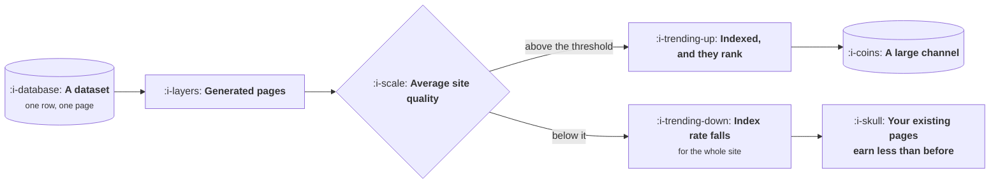

# Programmatic Pages

```text
Level: Basic
Prerequisites: Intent and the Money Pages
Estimated difficulty: 3/5 | Estimated time: 40 min
```

## The idea in one minute

Generating pages from a dataset is a legitimate and sometimes enormous channel, and it has a
failure mode that distinguishes it from every other content decision: it can leave you with less
traffic than you started with. Thin pages are not merely pages that do not work. Published at
scale they change how a search engine judges your whole site, so the four hundred good pages you
already had get indexed less and earn less. The decision therefore has a threshold rather than a
gradient, and below the threshold the correct number of pages to publish is zero. Above it, the
same programme is one of the highest returning things a growth team can build.

## A picture



The arrow from the penalty to your existing pages is the one that makes this different from an
ordinary bet. Most content decisions can only waste the effort you put in.

## How it really works

### What makes a generated page worth storing

A page is worth indexing if it answers a question that someone asks and that is not already
answered identically elsewhere. For generated pages this reduces to a question about your data:
does each row contain something that is genuinely specific to it, and is that something what a
searcher wants.

The test that works: strip the page down to the parts that differ between rows. If what remains
would satisfy somebody who searched for that row, you have a programme. If what remains is a
name and two numbers wrapped in the same four paragraphs, you have twenty thousand copies of one
page, and the engine will treat them accordingly.

This is why the successful programmes are nearly always built on data somebody actually
collected. Prices, availability, specifications, local records, your own aggregated usage. What
fails is a template with a variable in it.

### The threshold, and why it is a threshold

Indexing is partly a site level judgement, from lesson 01. Publish enough weak pages and your
average quality falls, the engine becomes less willing to index pages from you, and that applies
to everything you have.

Run the program and the shape is stark. At a quality of 0.35, every page count tested is worse
than publishing nothing: 500 pages costs you 49 percent of your traffic, 2,000 costs 77 percent,
and even 50,000 leaves you 59 percent below where you started. There is no number of thin pages
that wins, because the thing failing is not the new pages.

At 0.55 there is a valley. Five hundred and two thousand pages both leave you slightly worse off,
and only at around ten thousand does the programme turn positive. A team that launches a mid
quality programme, publishes two thousand pages, sees traffic fall and cancels the project has
made a defensible decision on the evidence and stopped halfway across a valley it could have
crossed.

At 0.75 the index rate stays at 100 percent and every page added returns the same amount. The
programme simply works, and the return per page does not degrade at all across the range tested.

### How to cross the valley safely

Four rules that follow directly from the shape above.

**Publish a sample first and measure indexation.** Two hundred pages, then check what share get
indexed after six weeks. That number is your quality estimate, measured rather than assumed, and
it costs almost nothing to obtain.

**Gate on data completeness, not on page count.** Only generate the rows that have enough
underlying data to be worth reading. A dataset of fifty thousand rows where twelve thousand are
rich is a twelve thousand page programme, and the other thirty eight thousand are the thing that
would have sunk it.

**Keep them separable.** Generated pages should live under a path you can exclude from indexing
in one change. If the programme fails you want to withdraw it in an afternoon rather than argue
about it for a quarter.

**Watch your existing pages, not the new ones.** The leading indicator of a failing programme is
the indexation and traffic of the pages that existed before it. They move first and they are the
thing actually at risk.

### When the dataset is other people's

Aggregating public data into pages is the most common version of this and the most likely to
fail, because by construction the content is not unique. It works when the aggregation itself is
the value: combining sources nobody has combined, keeping it current when others do not, or
presenting it in a form that answers a question the raw data does not.

It fails when the aggregation is a copy with navigation around it, which is also the version that
is cheapest to build, which is why so many of these programmes exist and so few work.

### What fills the box in 2026

Nothing in the tooling matters much; this is a data problem and a judgement problem. The one
genuine change is that the cost of filling a template with plausible prose has gone to nearly
zero, which has produced far more of these programmes and made search engines correspondingly
more suspicious of them. The threshold has moved up, not down.

The practical implication is that the sample test is now mandatory rather than prudent. A
programme that would have been indexed three years ago on the strength of being complete and
well formed will not be, because complete and well formed is no longer evidence of anything.

## Run the numbers

Three quality levels, five page counts, and what each does to the site you already have.

```go
// programmatic.go: thin pages do not merely underperform. They take the good ones with them.
package main

import (
	"fmt"
	"math"
)

const (
	existing     = 400.0 // pages you already have
	existingQual = 0.90
	visitsAtOne  = 50.0 // monthly visits a perfect page earns
)

// Indexing is granted to a site, not to a page: a search engine that finds
// most of your pages thin becomes less willing to index any of them.
func indexRate(avgQuality float64) float64 {
	return math.Min(1, math.Pow(avgQuality/0.75, 3))
}

// A page's own traffic rises steeply with its quality: a thin page does not
// rank a little worse than a good one, it mostly does not rank.
func visits(q float64) float64 { return visitsAtOne * math.Pow(q, 4) }

func traffic(n, q float64) (total, idx float64) {
	avg := (existing*existingQual + n*q) / (existing + n)
	idx = indexRate(avg)
	return idx * (existing*visits(existingQual) + n*visits(q)), idx
}

func main() {
	base, _ := traffic(0, 0)
	fmt.Printf("%.0f existing pages at quality %.2f earn %.0f visits a month\n\n",
		existing, existingQual, base)

	for _, q := range []float64{0.35, 0.55, 0.75} {
		fmt.Printf("adding pages at quality %.2f\n", q)
		fmt.Printf("  %10s %12s %12s %14s %12s\n",
			"new pages", "index rate", "total visits", "vs today", "per new page")
		best, bestN := base, 0.0
		for _, n := range []float64{0, 500, 2_000, 10_000, 50_000} {
			t, idx := traffic(n, q)
			per := 0.0
			if n > 0 {
				per = (t - base) / n
			}
			fmt.Printf("  %10.0f %11.0f%% %12.0f %13.0f%% %12.3f\n",
				n, 100*idx, t, 100*(t/base-1), per)
			if t > best {
				best, bestN = t, n
			}
		}
		fmt.Printf("  best at %.0f new pages, %.0f visits\n\n", bestN, best)
	}

	fmt.Println("At quality 0.35 the programme is worse than doing nothing well before")
	fmt.Println("it is worse than doing nothing by a lot, and the loss is not confined")
	fmt.Println("to the new pages: the 400 you already had are being indexed less.")
	fmt.Println("\nThe quality threshold is not a style preference. It is the level at")
	fmt.Println("which adding a page stops costing you the pages you already have.")
}
```

The 0.35 block is the warning. Note the per new page column: it is negative at every count, which
means each page published actively destroys value rather than merely failing to add any. The best
outcome available in that block is publishing nothing.

The 0.55 block is the one worth studying, because it is the realistic case and it is not
intuitive. Five hundred pages leaves you two percent down. Two thousand leaves you nine percent
down. Ten thousand is ninety percent up. The programme is genuinely good and it looks like a
failure for as long as it is small, which means the decision rule "publish some and see" gives
exactly the wrong answer at exactly the scale most teams test at.

The resolution is the sample test described above, which measures index rate rather than traffic.
Index rate at five hundred pages in the 0.55 block is 83 percent, which is informative and
survivable, while the traffic figure at the same point is mildly negative and misleading.

The 0.75 block shows what a working programme looks like: index rate pinned at 100 percent and a
constant 32.5 visits per page added, with no degradation at fifty thousand pages. When the
quality is above the threshold, scale is simply free.

## The AI layer

This is the lesson where generated content has changed the arithmetic most, and the change is
not the one people expect.

The obvious effect is that producing the prose around each data row costs almost nothing now.
That is real and it is the smaller half, because prose was never what made these pages work.

The larger effect is on the threshold itself. When every competitor can also generate twenty
thousand well formed pages from a public dataset, well formed stops being a quality signal, and
the bar for what counts as worth indexing rises for everybody. The programmes that still work are
the ones whose underlying data is proprietary or genuinely expensive to assemble, and the gap
between those and template programmes has widened rather than narrowed.

There is a tempting middle path worth warning about: using a model to add depth to rows that have
no depth, by generating analysis or commentary per row. This raises the word count, raises the
apparent quality, and does not raise the thing the engine is estimating, which is whether a
person who lands there is satisfied. It moves you up the quality axis in your own judgement and
not in the measured index rate, which is why the sample test matters more than any internal
review.

The honest check: if the generated commentary could be written without the row's data, it is
padding.

## Sector lens

| Sector | What the dataset usually is |
|---|---|
| [Enterprise B2B SaaS](../../product-management/product-by-sector/01-enterprise-b2b-saas.md) | Integrations, use cases by role or industry. Small datasets, so this is dozens of pages rather than thousands |
| [Fintech](../../product-management/product-by-sector/02-fintech.md) | Rates, fees and comparisons, which are genuinely specific and change often. Strong fit, and regulated claims apply per page |
| [Ecommerce and D2C](../../product-management/product-by-sector/03-ecommerce-and-d2c.md) | The catalogue itself. The whole category is a programmatic page problem, and variants are the usual thin page source |
| [Marketplaces](../../product-management/product-by-sector/04-marketplaces.md) | Listings, locations, categories. The archetype of this lesson, and the sector where the site level penalty bites hardest |
| [Devtools and Infra](../../product-management/product-by-sector/05-devtools-and-infrastructure.md) | API references, error codes, package pages. Unusually strong, because each row genuinely answers one specific query |
| [Healthtech](../../product-management/product-by-sector/06-healthtech-and-regulated-care.md) | Conditions and treatments, which are the most scrutinised pages on the internet. The quality bar is far higher than elsewhere |
| [Vertical SaaS](../../product-management/product-by-sector/07-vertical-saas.md) | A directory of firms or regulations in the trade. Small, specific, and often the best search asset available |

## Remember this

* Thin pages at scale lower the index rate for your whole site, so the downside includes the
  pages you already had.
* The decision has a threshold, not a gradient. Below it, the right number of pages is zero.
* Strip a generated page to what differs between rows. If that would not satisfy a searcher, you
  have one page copied many times.
* There is a valley: a mid quality programme looks like a failure at a thousand pages and works
  at ten thousand. Testing small gives the wrong answer.
* Measure index rate on a sample of a couple of hundred pages. That is the quality estimate, and
  it is informative when the traffic number is not.
* Gate on data completeness rather than page count, keep generated pages under one excludable
  path, and watch your existing pages as the leading indicator.
* Generated prose does not raise the quality the engine is estimating. If the commentary could be
  written without the row, it is padding.

## Try it

1. Run `programmatic.go` and find the page count at which the 0.55 block turns positive. That
   number is why "publish a few and see" is the wrong test.
2. Take your candidate dataset and count the rows that have enough data to stand alone. That
   count, not the row count, is the size of your programme.
3. Publish two hundred pages under one path and measure index rate after six weeks. Decide on
   that number rather than on traffic.

## Check yourself

1. Why can a programmatic content programme leave a site with less traffic than it had before,
   when the same effort spent on a bad blog post could only waste the effort?
2. You publish 1,500 pages, traffic drops four percent, and the team wants to cancel. What do you
   measure before deciding, and what are the two different situations you might be in?
3. A colleague proposes using a model to add three paragraphs of analysis to each thin row. What
   will this improve, what will it not improve, and how would you tell the difference?
