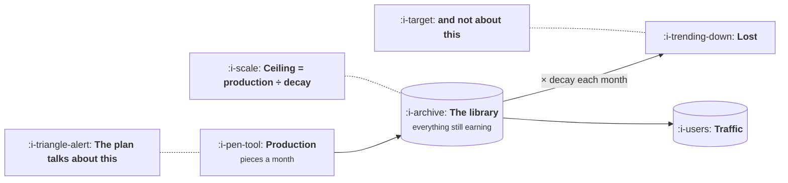

# Content That Compounds

```text
Level: Basic
Prerequisites: Programmatic Pages
Estimated difficulty: 2/5 | Estimated time: 35 min
```

## The idea in one minute

Two pieces of content can cost the same to make and be worth ten times different amounts, and
the difference is not quality in any general sense, it is the rate at which each one decays. A
library of published work settles at a size equal to your production rate divided by your decay
rate, which means halving the decay is worth exactly as much as doubling the output and is
usually far cheaper to achieve. Most content plans are written entirely in terms of the
numerator. The decay rate is rarely measured, almost never targeted, and is the term with the
most room in it.

## A picture



A tank with a tap and a leak. Every content plan is a proposal about the tap.

## How it really works

### The ceiling is production over decay

Publish a steady number of pieces a month, each starting at some level of traffic and losing a
share of it each month, and the total settles. The arithmetic is the same as a bath filling
against an open drain: the level stops rising when what you add each month equals what you lose.

That level is your production rate multiplied by what a new piece earns, divided by the decay
rate. Four pieces a month at fifty visits each decays to a steady 571 monthly visits at a 35
percent decay rate, and to 10,000 at a two percent rate. Same output, same starting traffic,
seventeen times the library.

This single formula explains why two content teams of identical size produce wildly different
channels, and it is the same shape as the email list arithmetic in
[What Growth Is Not](../the-growth-function/05-what-growth-is-not.md) and the loop ceiling in
[Funnels Leak, Loops Compound](../loops-and-compounding/01-funnels-leak-loops-compound.md).
Anything that accumulates against a loss rate behaves this way.

### What actually drives decay

Four things, roughly in order of how much they matter.

**Whether the question expires.** A piece about how something works in general is still correct
in four years. A piece about this year's version of a tool is wrong in eighteen months. This is
the largest single factor and it is chosen at the moment you pick the topic, which makes it the
cheapest to influence and the one most often decided by accident.

**Whether anybody updates it.** A reference page that is revised twice a year has a far lower
decay rate than the same page abandoned, and updating is much cheaper than writing. Most teams
have no update budget at all, which means every piece they publish is on its fastest possible
decay curve.

**Competitive displacement.** Somebody writes a better version. Unavoidable in general, and
heavily dependent on whether the piece contains anything they cannot easily reproduce, which is
the argument in lesson 01 about original data and tools.

**Format.** Tools, calculators and datasets decay slowest, because they are used rather than
read. The program puts a calculator at two percent a month against news at thirty five.

### Half life is the number to quote

Decay rates are hard to feel. Half life is not: the months until a piece is worth half what it
was. In the program, news has a two month half life, a decent blog post three months, a reference
page twelve, and a tool thirty five.

Those four numbers are the argument. A blog post published today is worth half as much by
spring, and most of it is gone within a year of publication. Whatever else your content plan
claims, it is making that claim about the thing it is producing, and comparing the half life
with the time horizon in the plan is a five minute exercise that reframes most content
strategies.

### The output trap

Content teams are measured on output, because output is countable and immediate while the
library takes two years to show up. The predictable consequence is pressure towards formats that
can be produced quickly, which are almost exactly the formats that decay fastest.

The arithmetic refutes this cleanly. In the program, four posts a month over three years produce
32,001 visit months, and four reference pages produce 73,407, which is 2.3 times as much.
Halving the output to two reference pages a month still produces 36,704, which beats four posts
a month.

Half the output, more result. That is the sentence to take to whoever is counting pieces
published, and it is worth noting that it is not a claim about quality, effort or craft. It is
one term in a division.

### What to do about it

Three moves, in order of return.

**Choose topics that do not expire.** Free, and it is the biggest term. Ask of each candidate:
will this still be true in three years, and if not, how long.

**Fund updating.** Allocate perhaps a quarter of the content budget to revising what exists.
This is the most reliably underfunded activity in content and the cheapest reduction in decay
available.

**Prefer formats that are used rather than read.** A calculator covering the same ground as an
article will outlive it several times over, costs more to build once, and never needs rewriting
for a new year.

### What fills the box in 2026

Measuring your own decay rate takes one query and almost nobody runs it: group pages by
publication month, pull monthly traffic by cohort, and read how each cohort falls. You get decay
by format, by topic and by author, and the spread is usually much larger than anybody expected.

This is the content equivalent of a cohort table, and it is the single most useful chart a
content team can build. Once it exists the planning conversation changes from how much to
publish to what kind, which is the conversation with the money in it.

## Run the numbers

Four formats, the same production rate, and what the library settles at.

```go
// compound.go: an asset and a post cost the same to make and are not the same thing.
package main

import "fmt"

type kind struct {
	name  string
	decay float64 // share of a piece's traffic lost each month
}

// A piece published this month earns `start` visits and decays from there.
// With steady production the library settles at production / decay.
func run(k kind, perMonth, start float64, months int) (now, cumulative float64) {
	live := []float64{}
	for m := 0; m < months; m++ {
		for i := range live {
			live[i] *= 1 - k.decay
		}
		live = append(live, perMonth*start)
		now = 0
		for _, v := range live {
			now += v
		}
		cumulative += now
	}
	return
}

func main() {
	const (
		perMonth = 4.0
		start    = 50.0
	)
	kinds := []kind{
		{"news and commentary", 0.35},
		{"a decent blog post", 0.20},
		{"a reference page", 0.06},
		{"a tool or calculator", 0.02},
	}

	fmt.Printf("%.0f pieces a month, each starting at %.0f visits\n\n", perMonth, start)
	fmt.Printf("%-22s %8s %12s %12s %14s %12s\n",
		"kind", "decay", "month 12", "month 36", "ceiling", "half life")
	for _, k := range kinds {
		m12, _ := run(k, perMonth, start, 12)
		m36, _ := run(k, perMonth, start, 36)
		ceiling := perMonth * start / k.decay
		half := 0.693 / k.decay
		fmt.Printf("%-22s %7.0f%% %12.0f %12.0f %14.0f %10.0f mo\n",
			k.name, 100*k.decay, m12, m36, ceiling, half)
	}

	fmt.Println("\nThe ceiling is production divided by decay, so halving the decay")
	fmt.Println("doubles the library for the same output. Nothing about writing")
	fmt.Println("more pieces achieves that.")

	fmt.Println("\nthe same budget spent two ways over three years:")
	post := kind{"posts", 0.20}
	ref := kind{"references", 0.06}
	_, cp := run(post, perMonth, start, 36)
	_, cr := run(ref, perMonth, start, 36)
	fmt.Printf("  %.0f posts a month      %10.0f visit months\n", perMonth, cp)
	fmt.Printf("  %.0f references a month %10.0f visit months\n", perMonth, cr)
	fmt.Printf("  the slower decaying library is worth %.1fx the faster one\n", cr/cp)

	fmt.Println("\nhalf the output, if it decays a third as fast:")
	_, ch := run(ref, perMonth/2, start, 36)
	fmt.Printf("  %.0f references a month %10.0f visit months, still %.1fx the posts\n",
		perMonth/2, ch, ch/cp)
}
```

The ceiling column spans 571 to 10,000 for identical production. Nothing in that range is
explained by how good the writing is.

Look at the month 12 and month 36 columns together. News reaches 568 in a year and 571 in three,
which is to say it is finished: everything it will ever be worth, it is worth within a year,
because nothing survives long enough to accumulate. The tool reaches 2,153 in a year and 5,168
in three, and is still only halfway to its ceiling at the end.

That difference is the thing that makes content planning hard. The fast decaying format looks
better for the first several months and is beaten permanently afterwards, and most content
programmes are reviewed on a timescale where the wrong one is ahead.

The last block is the one to argue with. Two reference pages a month beats four posts a month
over three years. If your content team is being pushed to double its output, the arithmetic says
that halving it and changing the format is the better move, and it is available without hiring
anybody.

## The AI layer

The production term has fallen dramatically in cost and the decay term has not moved, which
changes which half of the formula deserves attention.

When four pieces a month was a constraint, arguing about format was a luxury. Now that the
numerator is cheap, the ceiling is set almost entirely by decay, and a team that responds to
cheap production by publishing forty pieces a month of fast decaying content has multiplied the
term that matters least. It also runs directly into the site level quality problem from lesson
03, which is the mechanism by which that strategy becomes actively negative rather than merely
inefficient.

Two things genuinely help.

**Updating at scale is now affordable.** The second lever in the list above, funding revision,
was limited by the tedium of auditing a large library. Identifying which pages have gone stale,
what changed and what needs rewriting is a reading task across your own content, cheap enough to
run monthly. This lowers decay directly, which is the term with the leverage.

**Tools are cheaper to build.** The slowest decaying format used to require engineering time that
content teams could not get. That barrier is much lower, and a calculator remains the most
durable asset in the table.

One caution worth stating. Competitive displacement, the third driver of decay, has accelerated
for anything that can be generated. A well written general explainer now has a shorter half life
than the table suggests, because somebody will produce an equally adequate version within months.
The formats whose decay rates are holding are the ones resting on something that is not writing:
your data, your tool, your measurements.

## Sector lens

| Sector | What decays slowly here |
|---|---|
| [Enterprise B2B SaaS](../../product-management/product-by-sector/01-enterprise-b2b-saas.md) | Benchmark reports and templates. Vendor comparisons decay fast because the vendors keep changing |
| [Fintech](../../product-management/product-by-sector/02-fintech.md) | Calculators, which are the archetypal durable asset. Rate tables decay in weeks and need automated updating |
| [Ecommerce and D2C](../../product-management/product-by-sector/03-ecommerce-and-d2c.md) | Buying guides tied to a durable need. Anything seasonal decays to zero and returns, which the simple model does not capture |
| [Marketplaces](../../product-management/product-by-sector/04-marketplaces.md) | Nothing, inherently. The library is listings, which expire by design, and the decay rate is a property of your inventory |
| [Devtools and Infra](../../product-management/product-by-sector/05-devtools-and-infrastructure.md) | Conceptual explanations and error references. Version specific documentation has a half life equal to your release cycle |
| [Healthtech](../../product-management/product-by-sector/06-healthtech-and-regulated-care.md) | Clinical references, which decay slowly and must be reviewed on a schedule for correctness rather than for traffic |
| [Vertical SaaS](../../product-management/product-by-sector/07-vertical-saas.md) | Regulatory and compliance guides for the trade. Extremely durable, and updating them is the whole moat |

## Remember this

* A library settles at production divided by decay. Halving the decay is worth exactly as much as
  doubling the output.
* Decay is driven by whether the question expires, whether anybody updates the piece, competitive
  displacement, and format.
* Quote half lives rather than decay rates. Two months for news, three for a blog post, twelve
  for a reference, thirty five for a tool.
* Fast decaying content leads for the first several months and loses permanently afterwards,
  which is why review cycles favour the wrong format.
* Two reference pages a month beats four posts a month over three years. Half the output, more
  result.
* Three moves in order: choose topics that do not expire, fund updating, build things that are
  used rather than read.
* Measure your own decay by grouping pages into publication cohorts. It is one query and almost
  nobody runs it.

## Try it

1. Run `compound.go` with your own production rate and starting traffic, then find the decay rate
   at which your current plan reaches the target in your plan. Is that decay rate plausible for
   what you publish?
2. Build the cohort chart: pages grouped by publication month, traffic by month since. Read your
   actual half life off it, by format.
3. Work out what share of your content budget goes to updating existing pieces. If it is under
   ten percent, propose a quarter and use the ceiling formula as the argument.

## Check yourself

1. Why is halving the decay rate worth exactly the same as doubling production, and which is
   usually cheaper?
2. A format reaches 568 visits at month 12 and 571 at month 36. What does that tell you, and what
   does it imply about when to review a content programme?
3. Your team is told to double its publishing rate. Using the arithmetic in this lesson, what is
   the counterproposal, and what evidence would you bring?
