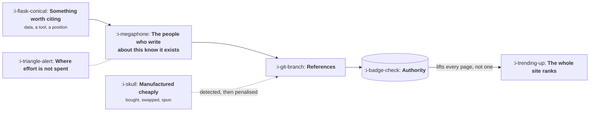

# Authority and Honest Ways to Earn It

```text
Level: Basic
Prerequisites: Content That Compounds
Estimated difficulty: 2/5 | Estimated time: 30 min
```

## The idea in one minute

Being referenced by other people is the one ranking signal that has survived thirty years, for
the straightforward reason that it is expensive to manufacture and therefore keeps predicting
what it is supposed to predict. Everything that has been penalised was an attempt to make it
cheap. The honest versions all have the same shape: make something that a person writing about
your subject would be worse off not mentioning, then make sure the people writing about your
subject know it exists. That second half is where most of the effort goes and where almost
nobody spends it, because it is unglamorous and feels like asking for a favour.

## A picture



Two boxes on the left and almost all the failures are in the second one. Making the thing is the
part teams do.

## How it really works

### Why references work as a signal

A reference costs the person giving it something: a judgement, a small endorsement, the risk of
sending their reader elsewhere. That cost is what makes it informative, and it is the whole
mechanism.

Every penalised practice is an attempt to get the signal without the cost. Buying links, trading
them reciprocally, placing them in directories nobody reads, publishing articles on sites that
exist only to publish them. Each worked briefly and each stopped, not because of a moral
judgement but because a signal that becomes cheap stops predicting anything and is downweighted.

This gives a reliable test for any tactic you are offered. **Does it cost the person giving the
reference anything?** If the answer is no, the tactic has either already stopped working or is
about to.

### What is actually worth citing

Four things, and the list is shorter than the content marketing literature implies.

**Original numbers.** A survey, an analysis of your own aggregated data, a benchmark you ran.
This is the most reliable citation earner in existence because a writer needs a number and you
are the only source of it. It is also the most underused, since most companies hold data that
nobody has ever thought to publish.

**A tool that does something.** A calculator, a checker, a converter. Referenced because it is
useful to the reader rather than because it is interesting, which means it keeps being
referenced for years.

**A position somebody can agree or disagree with.** Writing that commits to something gets cited
by both sides. Writing that surveys a topic neutrally gets cited by nobody, which is the quiet
fate of most well researched content.

**A definitive reference on a narrow thing.** The page that documents something completely, when
everything else covers it partially. Narrow enough that you can genuinely be the best, which is
the part teams skip when they aim at a broad topic instead.

Notice what is absent: the thorough overview of a popular subject. It is the most commonly
produced content asset and it earns almost no references, because there are already forty of
them and a writer has no reason to prefer yours.

### The half nobody does

Making the thing earns nothing on its own. The people who write about your subject have to learn
it exists, and the methods for that are unglamorous and effective.

Tell the people who are already writing about the topic, individually, with a reason that is
about their piece rather than about yours. A short, specific note to somebody who published
something adjacent last month works at a rate that surprises anyone who has only sent generic
outreach.

Be where the subject is discussed, as a participant rather than a promoter. This is slow and it
is how most references to devtools and infrastructure products are earned.

Give it to people who need it. Journalists and analysts need numbers, and a company that
reliably supplies good ones becomes a standing source rather than a one time mention.

Respond when something is wrong. If an article about your subject contains an error you can
correct with evidence, that is both a service and a citation.

The ratio worth aiming at is roughly one unit of effort making the thing to one unit making sure
the right people see it. Most teams run at ten to one and conclude that content does not earn
links.

### What is wasted effort

Directory submissions, comment links, guest posts on sites that accept everything, link exchange
schemes, and paid placements dressed as editorial. These range from worthless to actively
harmful, and the time they consume is the real cost even when the penalty risk is low.

One more that is worth naming because it feels productive: building a large quantity of
mediocre content in the hope that some of it earns references. References concentrate heavily on
a small number of pages, so quantity is close to irrelevant here. One thing worth citing beats
fifty things that are fine.

### Internal links, which are free and ignored

Authority arrives at a few pages and has to reach the rest of the site, and it does so through
your own links. A page with references that links nowhere useful is a reservoir with no outlet.

The practical version: your pages that earn references should link to the pages that need to
rank, which are the money pages from lesson 02. This is entirely within your control, costs
nothing, and is routinely left undone because internal linking is nobody's job.

### What fills the box in 2026

Tools that show who links to whom are useful for finding who writes about your subject, and
nearly useless for anything else. Buy one, use it for research, and ignore the scores it invents.

The structural change worth knowing: being cited by something an answer engine reads is becoming
its own form of distribution, separate from ranking. A number of yours quoted in a generated
answer reaches somebody who will never see your page, which is lesson 06. This raises the value
of being the original source of a fact and lowers the value of being the forty first page about
a topic, which happens to point in exactly the same direction as everything above.

## Sector lens

| Sector | What earns references here |
|---|---|
| [Enterprise B2B SaaS](../../product-management/product-by-sector/01-enterprise-b2b-saas.md) | Benchmark data from your own customer base. Analysts need numbers and there are few credible sources |
| [Fintech](../../product-management/product-by-sector/02-fintech.md) | Rate comparisons and calculators, plus regulatory explainers. Journalists cover this constantly and need sources |
| [Ecommerce and D2C](../../product-management/product-by-sector/03-ecommerce-and-d2c.md) | Hardest sector for this. Few people write about products, so references come from press and partnerships rather than content |
| [Marketplaces](../../product-management/product-by-sector/04-marketplaces.md) | Aggregate data about your own market, which you uniquely hold. Price indices and supply reports are reliably cited |
| [Devtools and Infra](../../product-management/product-by-sector/05-devtools-and-infrastructure.md) | Documentation, benchmarks and genuine participation. References come from code and discussion rather than from articles |
| [Healthtech](../../product-management/product-by-sector/06-healthtech-and-regulated-care.md) | Peer reviewed work and clinical evidence. The bar is formal and the resulting authority is correspondingly durable |
| [Vertical SaaS](../../product-management/product-by-sector/07-vertical-saas.md) | Trade press and association publications. A handful of outlets cover the whole trade, and knowing them personally is the strategy |

## Remember this

* A reference works as a signal because it costs the giver something. Every penalised tactic was
  an attempt to remove that cost.
* The test for any tactic: does the person giving the reference incur anything? If not, it has
  stopped working or is about to.
* Four things get cited: original numbers, a working tool, a position, and a definitive reference
  on something narrow.
* The thorough overview of a popular subject is the most produced and least cited asset in
  content marketing.
* Half the work is making sure the people who write about your subject know it exists. Most teams
  spend a tenth of their effort there.
* References concentrate on a few pages, so quantity does not help. One citable thing beats fifty
  adequate ones.
* Internal links move authority from the pages that earn it to the pages that need it, cost
  nothing, and are nobody's job.

## Try it

1. List everything your company could publish that nobody else could, because it rests on data
   you hold. Most companies find two or three and have published none of them.
2. Find the ten people who wrote about your subject in the last quarter. That list is your
   distribution, and it probably does not exist anywhere yet.
3. Take your most referenced page and check what it links to. If it does not link to your money
   pages, that is a free improvement available this afternoon.

## Check yourself

1. Why has being referenced survived as a ranking signal when keyword density, link volume and
   content length have not?
2. Your team publishes a thorough, accurate, well researched overview of a popular topic and it
   earns no references. Explain why, without saying it was not good enough.
3. You have one page that earns most of your references. What should it link to, and why is this
   usually left undone?
