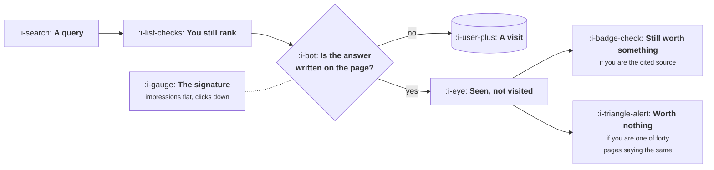

# Search Inside Answer Engines

```text
Level: Basic
Prerequisites: Authority and Honest Ways to Earn It
Estimated difficulty: 3/5 | Estimated time: 35 min
```

## The idea in one minute

When a search result page answers the question itself, your ranking is intact, your reach is
intact, and your visit does not happen. This is a loop breaking at the reinvestment step rather
than a channel dying, and it has a specific signature: impressions holding steady while clicks
fall. The important and widely missed part is that the effect is concentrated on exactly the
content that converted worst. In the scenario below, 44 percent of visits disappear and 10
percent of customers do, because the pages losing clicks are the informational ones that were
producing almost no customers in the first place. The traffic chart says catastrophe and the
customer chart says inconvenience, and the second one is the one to manage by.

## A picture



The ranking did not move. The gate that changed is the one between being shown and being visited.

## How it really works

### This is the third death, not the second

[Why Most Loops Die](../loops-and-compounding/05-why-most-loops-die.md) lists the ways a loop
ends. This one is specifically the reinvestment step breaking: the output still exists, the reach
still happens, and the step that turned reach into users stopped working.

The distinction matters because the responses differ. A ranking loss is fixed by ranking work. A
reinvestment failure is not fixed by ranking better, because you already rank, and teams who
diagnose it wrong spend a year on the wrong project.

The diagnostic is one comparison, available in any search console: impressions against clicks
over the same period. Impressions flat or rising with clicks falling is this. Both falling is a
ranking problem. It takes two minutes and it determines everything about what you do next.

### The effect is concentrated, not general

A question gets answered on the results page when it has a short, factual, uncontested answer.
That describes informational queries almost exactly, and describes transactional queries almost
not at all. Nobody gets their pricing comparison, their migration decision or their vendor
shortlist resolved in a summary box.

So the loss falls hardest on the rung of the intent ladder that was already converting worst.
Run the program and the per term column shows it: the informational term loses 65 percent of its
visits and the pricing term loses 15 percent.

The aggregate effect of that concentration is the finding worth internalising. Total visits fall
44 percent. Total customers fall 10 percent. Those are the same scenario, and which of those
numbers you look at determines whether you believe your content channel has collapsed or taken
a manageable knock.

### What it changes about what to make

Very little, which is the honest answer and not the one usually given.

The ranking of what is worth writing, by customers produced, is almost unchanged before and
after. Informational content was the worst use of a page before this effect and is now worse.
Transactional and comparison pages were the best use and have lost between 15 and 35 percent.
The plan that was correct under lesson 02 is still correct, and the case for it has strengthened.

What does change is anything whose whole model was informational volume. A content operation
built on capturing large numbers of top of ladder searches and converting a tiny fraction of
them has lost most of its traffic and a meaningful share of its customers, and no amount of
better writing recovers it, because the mechanism is that the visit does not happen.

### Being the source rather than a result

There is a second effect that is not a loss and is harder to measure. When a generated answer
cites a source, being that source is a form of distribution: somebody learns the fact and learns
where it came from, without visiting.

This is worth much more if the fact is yours. Original numbers, a benchmark you ran, a dataset
you maintain, which is the same list from lesson 05. A page summarising what everybody knows
contributes nothing identifiable to an answer and gets nothing back. A page containing a figure
that exists nowhere else gets named.

Nobody has good measurement for this yet and it would be dishonest to pretend otherwise. The
reasonable position is that it points the same direction as every other argument in this topic,
towards original material and away from volume, so you can act on it without being able to
measure it.

### What to actually do

Four things, in order.

**Check the signature** before concluding anything. Impressions against clicks, by query type.

**Re cut your reporting by intent** rather than in aggregate, so the fall in informational
traffic does not read as a fall in the channel. Most content dashboards cannot do this and it is
one query to fix.

**Stop producing top of ladder volume,** if you still are. The arithmetic was weak before and is
now clear.

**Shift the budget towards what cannot be summarised:** tools, original data, and the
transactional pages that were always carrying the channel.

### What fills the box in 2026

Search console impression and click data remains the measurement, and the one thing to set up is
a saved comparison segmented by query intent rather than in total. The tooling industry has
produced a quantity of products claiming to measure visibility inside generated answers, and
their methods are mostly sampling queries and recording what comes back, which is a legitimate
approach with a large error bar and no connection to your revenue. Treat them as directional at
best, and prefer your own impression and click data, which is actual.

## Run the numbers

The same five terms from lesson 02, with a share of each answered without a visit.

```go
// answerengine.go: the ranking held, the reach held, and the visits did not.
package main

import "fmt"

type tier struct {
	name    string
	visits  float64 // monthly visits today
	conv    float64 // visitors who become customers
	noClick float64 // share of these searches answered without a visit
}

func main() {
	// Scenario inputs, not measurements: set noClick to whatever your own
	// impressions and clicks say, by intent, and rerun.
	tiers := []tier{
		{"what is <category>", 3_200, 0.0010, 0.65},
		{"best <category> tools", 720, 0.0150, 0.35},
		{"<competitor> alternative", 324, 0.0450, 0.30},
		{"<category> pricing", 198, 0.0650, 0.15},
		{"<brand>", 1_320, 0.1100, 0.05},
	}

	fmt.Printf("%-26s %9s %10s %9s %11s %11s\n",
		"term", "visits", "no click", "after", "customers", "lost")
	var vBefore, vAfter, cBefore, cAfter float64
	for _, t := range tiers {
		after := t.visits * (1 - t.noClick)
		vBefore += t.visits
		vAfter += after
		cBefore += t.visits * t.conv
		cAfter += after * t.conv
		fmt.Printf("%-26s %9.0f %9.0f%% %9.0f %11.1f %10.1f%%\n",
			t.name, t.visits, 100*t.noClick, after,
			after*t.conv, -100*t.noClick)
	}

	fmt.Printf("\nvisits    %8.0f to %8.0f   %.0f%% lost\n",
		vBefore, vAfter, 100*(1-vAfter/vBefore))
	fmt.Printf("customers %8.1f to %8.1f   %.0f%% lost\n",
		cBefore, cAfter, 100*(1-cAfter/cBefore))

	fmt.Println("\nThe traffic chart falls further than the customer chart, because")
	fmt.Println("the pages losing clicks are the ones that converted worst. A team")
	fmt.Println("watching sessions panics; a team watching customers has a smaller")
	fmt.Println("problem than the dashboard suggests.")

	fmt.Println("\nwhat a page is worth to write, before and after:")
	fmt.Printf("  %-26s %14s %14s %10s\n", "term", "customers now", "after", "change")
	for _, t := range tiers {
		before := t.visits * t.conv
		after := before * (1 - t.noClick)
		fmt.Printf("  %-26s %14.1f %14.1f %9.0f%%\n",
			t.name, before, after, 100*(after/before-1))
	}
	fmt.Println("\nThe ranking of what to write barely moves. Informational content was")
	fmt.Println("already the worst use of a page, and it is now worse. This is a")
	fmt.Println("reason to stop making it, not a reason to panic about search.")
}
```

Visits go from 5,762 to 3,237, a fall of 44 percent. Customers go from 186.7 to 167.2, a fall of
10 percent. Both are correct descriptions of the same scenario.

A team watching sessions sees nearly half its content channel disappear and will reasonably
propose something dramatic. A team watching customers sees a ten percent knock concentrated in
material it should not have been producing anyway. The second team will make better decisions,
and the only difference between them is which chart is on the wall.

The per term table at the end is the planning output. Every term loses something and none of
them change places. The pricing page still produces more customers per page of work than
anything except brand, the informational page is still last, and the gap between them has
widened rather than narrowed.

Put your own no click shares in, taken from your own impressions and clicks by query type rather
than from anybody's published average. The numbers vary enormously by category, and the ones in
this program are a scenario rather than a measurement.

## The AI layer

This lesson is the AI layer, so the useful addition is about what the effect does to the rest of
the topic rather than restating it.

**It raises the value of the slowest formats.** A calculator cannot be answered away, because the
answer depends on inputs the user has. Neither can a dataset people query. The format that lesson
04 already identified as having the longest half life is also the one immune to this effect, and
those two properties compound.

**It raises the value of being the source,** which is lesson 05, and lowers the value of being
comprehensive, which was already the weakest content strategy.

**It makes the quality threshold in lesson 03 harsher.** Generated pages in a programmatic
programme are, almost by definition, the kind of content that gets summarised rather than
visited. A programme that was marginal on index rate and is now also marginal on click through
has two independent reasons to fail.

The thing it does not change is the lower rungs of the ladder. People deciding what to buy still
click, because they want to see the thing, check the price, read the terms and form a view of
whoever they are about to pay. Anything downstream of a decision is intact.

## Sector lens

| Sector | What this costs here |
|---|---|
| [Enterprise B2B SaaS](../../product-management/product-by-sector/01-enterprise-b2b-saas.md) | Little. Buyers research deeply and click through to verify, and the queries that matter are not summarisable |
| [Fintech](../../product-management/product-by-sector/02-fintech.md) | Rate and definition queries are summarised heavily. Calculators are the defence and they work well |
| [Ecommerce and D2C](../../product-management/product-by-sector/03-ecommerce-and-d2c.md) | Moderate on guides, little on product queries. People buying a thing want to look at the thing |
| [Marketplaces](../../product-management/product-by-sector/04-marketplaces.md) | Potentially severe, since listings data is exactly what gets summarised and your pages are the source |
| [Devtools and Infra](../../product-management/product-by-sector/05-devtools-and-infrastructure.md) | Severe on documentation traffic, since answering a code question is the ideal case. Adoption may be unaffected while traffic halves |
| [Healthtech](../../product-management/product-by-sector/06-healthtech-and-regulated-care.md) | Heavy on informational health queries, which were never your buyers. The commercial impact is close to nil |
| [Vertical SaaS](../../product-management/product-by-sector/07-vertical-saas.md) | Minimal. Specialist trade queries have too little volume and too much nuance to be answered generically |

## Remember this

* This is a loop breaking at the reinvestment step, not a channel dying. You still rank, you are
  still seen, the visit does not happen.
* The signature is impressions flat with clicks falling. Both falling is an ordinary ranking
  problem and a different project.
* The effect concentrates on short factual queries, which are the ones that converted worst.
* In the scenario, 44 percent of visits and 10 percent of customers. Which number is on your wall
  decides how well your team reacts.
* The ranking of what is worth writing barely changes. The case for the existing plan gets
  stronger.
* What breaks is any operation whose model was informational volume converted at a tiny rate.
* Being the cited source is worth something and nobody can measure it yet. It points the same way
  as everything else, so act on it anyway.
* Tools and datasets cannot be summarised away, and they already had the longest half life.

## Try it

1. Pull impressions and clicks for the last eighteen months, split by query intent. The shape of
   those two lines tells you which problem you have, and most teams have never separated them.
2. Run `answerengine.go` with your own no click shares. Compare the visits loss with the
   customers loss and put the second number in front of whoever is worried about the first.
3. Identify the one page on your site that could become a tool rather than an article. That
   conversion is the highest returning defensive move available in this lesson.

## Check yourself

1. How do you distinguish this from a ranking loss, using data you already have, and why does it
   matter which one it is?
2. Why does a 44 percent fall in visits produce only a 10 percent fall in customers, and what
   would have to be true for the two numbers to be closer together?
3. Your content programme is built on high volume informational pages and the traffic has halved.
   What is the honest assessment, and what is the thing that will not fix it?
