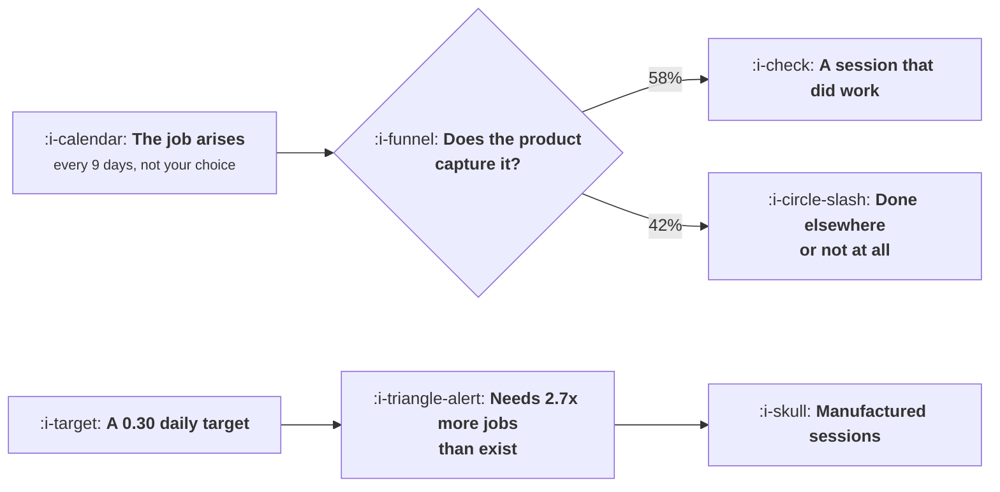

# Natural Frequency

```text
Level: Intermediate
Prerequisites: What Activation Means Here
Estimated difficulty: 3/5 | Estimated time: 35 min
```

## The idea in one minute

How often a product is used is decided by how often the job it does arises, and that is a fact
about the user's life rather than a variable your team controls. A product whose job comes up every
nine days has a ceiling on daily over monthly actives of about 0.11 even if it captures every
single occurrence, so a 0.30 target set for it is not ambitious, it is arithmetically impossible,
and the predictable result is a year spent manufacturing sessions that do no work. The honest
measure at any frequency is the share of occasions the product captures. That number is actionable
for a daily messenger and an annual tax filing alike, and it is the one to put on the wall.

## A picture



Two different questions. The left one has an answer you can improve; the right one has an answer
set before your team existed.

## How it really works

### Find the job's interval before setting any target

For a typical user, how many days pass between occasions on which your product's job genuinely
comes up? Not how often you would like them to visit. How often the thing happens.

Invoicing happens when the month ends. Team analytics gets looked at when somebody asks a
question, which for most teams is roughly weekly. A design tool at work comes up whenever there is
a design task, a few times a week. Messaging comes up constantly because the job is other people.

That interval sets everything downstream, and the ceiling is simple arithmetic: the most sessions
available in a 28 day window is 28 divided by the interval, and the highest daily over monthly
ratio is that figure over 28, capped at one. The program below runs six products through it. The
numbers are not close to each other: 1.00 for messaging, 0.40 for the design tool, 0.11 for team
analytics, 0.03 for invoicing.

### What happens when the target exceeds the ceiling

A team given a daily engagement target above its ceiling will hit it, and the mechanism is always
the same. They add jobs that are not the job: a feed, a daily digest, streaks, a social surface, a
notification worth opening. Sessions rise, the metric moves, and the sessions do no work, because
the underlying problem has not arisen more often. Then two things follow.

The first is that engagement and retention decouple. Users visit more and leave at the same rate,
which is visible if anybody checks and is usually not checked, because the engagement metric was
adopted as the proxy for retention in the first place.

The second is the permission cost. Manufactured sessions are produced by sends, and sends spend a
finite resource, which is the subject of
[The Shared Attention Budget](../lifecycle-messaging/05-the-shared-attention-budget.md). The team
burns reachability on sessions that were not worth having, and that reachability is gone when
something real needs to be said.

### Share of occasions captured

The measure that works at every frequency: of the occasions when the job arose, on how many did
the user use your product?

The denominator is the hard part and it is estimable. Three honest routes. Ask a sample of users
directly, which works better than it sounds for jobs with clear boundaries. Infer it from an
observable external cycle, such as month ends for invoicing or sprint boundaries for a developer
tool. Or take your most engaged decile as the estimate of the full rate, on the assumption that
they capture nearly all of their own occasions, which gives a lower bound on the interval and is
usually the fastest to compute.

Then the number means something. Team analytics in the worked table captures 58 percent of the
occasions it is wanted and invoicing captures 64. Both are improvable, both point at specific
work, and neither can be improved by a notification that arrives when nothing has happened.

### Where the interval genuinely moves

Two legitimate ways to change the frequency, as opposed to faking it.

**Serve a job that arises more often.** This is a product strategy decision, not an engagement
tactic. A tool that reports on last month's numbers and a tool that answers questions as they come
up are different products with different intervals, and moving between them is a roadmap
commitment rather than a lifecycle campaign.

**Be the place the job gets done rather than the place it gets reviewed.** Many products sit
downstream of where the work happens and so inherit a slower cadence than the work itself. Moving
upstream into the moment of the work raises the interval honestly, and it is usually the single
largest engagement opportunity a mature product has.

### What fills the box in 2026

Every analytics product reports daily, weekly and monthly active users and the ratios between
them, and none of them know your interval, so all of them will present a low ratio as a problem.
That default framing is the thing to disarm explicitly, by writing your ceiling into the dashboard
description next to the number. It takes ten minutes and saves a recurring argument.

## Run the numbers

Compute the ceiling first, then check whether the target you have been given sits under it.

```go
// frequency.go: the engagement ceiling your product's job already set.
package main

import "fmt"

// A product is used when the underlying job arises. If that job arises every
// nine days, no amount of notification gets a user to a daily habit, and the
// highest ratio of daily to monthly actives the product can reach is fixed by
// arithmetic rather than by craft.
type product struct {
	name     string
	interval float64 // days between occurrences of the job, for a typical user
}

const window = 28.0 // days in the monthly active window

// sessions a typical user has in the window, if the product captures every job
func (p product) sessions() float64 { return window / p.interval }

// the highest daily over monthly ratio available: one session per job, spread
// evenly, so the share of days with a session
func (p product) ceiling() float64 {
	s := p.sessions()
	if s > window {
		s = window
	}
	return s / window
}

func main() {
	prods := []product{
		{"messaging", 0.4},
		{"a to do list", 1.0},
		{"a design tool at work", 2.5},
		{"team analytics", 9.0},
		{"invoicing", 30.0},
		{"tax filing", 365.0},
	}

	fmt.Printf("%-24s %12s %14s %16s\n",
		"product", "job every", "sessions/28d", "best DAU/MAU")
	for _, p := range prods {
		fmt.Printf("%-24s %9.1fd %13.1f %15.2f\n",
			p.name, p.interval, p.sessions(), p.ceiling())
	}

	fmt.Println("\nThese are ceilings, not forecasts. They assume the product captures")
	fmt.Println("every single occurrence of the job, which nothing does.")

	fmt.Println("\nwhat a 0.30 DAU/MAU target implies for each product:")
	fmt.Printf("%-24s %14s %18s %s\n",
		"product", "best DAU/MAU", "jobs needed/28d", "verdict")
	const target = 0.30
	for _, p := range prods {
		need := target * window
		verdict := "reachable with better capture"
		if p.ceiling() < target {
			verdict = fmt.Sprintf("needs %.1fx more jobs than exist", need/p.sessions())
		}
		fmt.Printf("%-24s %13.2f %17.1f %s\n", p.name, p.ceiling(), need, verdict)
	}

	fmt.Println("\nthe metric that works at any frequency: share of jobs captured")
	fmt.Printf("%-24s %14s %14s %14s\n",
		"product", "jobs/28d", "sessions/28d", "captured")
	obs := []float64{14.0, 9.0, 5.0, 1.8, 0.6, 0.05}
	for i, p := range prods {
		fmt.Printf("%-24s %13.1f %13.1f %13.0f%%\n",
			p.name, p.sessions(), obs[i], 100*obs[i]/p.sessions())
	}

	fmt.Println("\nFor tax filing the 28 day window is the wrong ruler entirely: the")
	fmt.Println("denominator has to be the cycle, which is a year.")
	fmt.Println("\nTeam analytics captures 58% of the occasions it is wanted and would")
	fmt.Println("be reported as a failure on any daily engagement target. Invoicing")
	fmt.Println("captures 64%. Both numbers are actionable; neither DAU/MAU figure is.")
}
```

The first table is the ceiling, and the thing to notice is how fast it falls. An interval of 2.5
days gives a ceiling of 0.40 and an interval of 9 days gives 0.11, so a product only three and a
half times slower has a quarter of the available engagement. Most intuitions about what a healthy
ratio looks like come from products in the top two rows.

The second table converts a 0.30 target into a demand for jobs. Team analytics would need 2.7
times as many occasions as exist, invoicing 9 times, tax filing 109. Those are not stretch goals.
They are instructions to invent sessions, and a team that accepts one has agreed to spend a year
doing that.

The third table is the replacement. Capture rates of 20, 32, 45, 58, 64 and 65 percent across six
wildly different intervals are all on the same scale and all mean the same thing, which is what
makes the metric usable across a portfolio. Note that capture is highest where frequency is lowest:
rare jobs are easier to capture because the user remembers they have to be done.

Put your own interval in. If you cannot estimate it to within a factor of two, that is the first
piece of research to commission, because every engagement decision for the next year depends on it.

## The AI layer

A model can change the interval honestly, which is rare and worth distinguishing from the usual
engagement theatre.

The mechanism is lowering the cost of a small job. Many jobs arise frequently and are not brought
to the product because the effort exceeds the value at that size: a question not worth building a
report for, a document not worth starting, a change not worth configuring. Where a model lets a
thirty second version of the job happen, occasions that were previously invisible become sessions,
and they are real sessions because the job was real. This is the one case where engagement rises
and the work rises with it.

The cost is that these are the least valuable sessions you have, by construction, and they are the
most expensive to serve, because each one carries inference cost while the small job it does may
not be worth much. That is the margin pattern in
[Usage Growth That Destroys Margin](../growth-for-ai-products/README.md), and at a few cents per
small job with a frequency measured in days per user it is a real number rather than a rounding
error.

The failure mode: a model powered surface that invents occasions rather than capturing them, such
as a daily generated summary nobody asked for. It produces exactly the manufactured sessions
described above, at a per session cost, which is strictly worse than the notification version.
The test is whether the session would have been wanted had it not been offered, and the proxy for
that is whether the user acts on the output rather than merely receiving it.

## Sector lens

| Sector | What sets the interval here |
|---|---|
| [Enterprise B2B SaaS](../../product-management/product-by-sector/01-enterprise-b2b-saas.md) | The customer's own operating cadence: weekly meetings, monthly closes, quarterly reviews. Match the product to it rather than fighting it |
| [Fintech](../../product-management/product-by-sector/02-fintech.md) | Pay cycles and bill dates, which are externally fixed and highly predictable. Capture rate is measurable against a known calendar |
| [Ecommerce and D2C](../../product-management/product-by-sector/03-ecommerce-and-d2c.md) | Consumption rate of the product itself. Replenishment timing is the interval, and it is knowable per SKU |
| [Marketplaces](../../product-management/product-by-sector/04-marketplaces.md) | Demand side frequency is set by need, supply side by earning opportunity. The two intervals differ by an order of magnitude |
| [Devtools and Infra](../../product-management/product-by-sector/05-devtools-and-infrastructure.md) | The deploy or incident cadence. A tool used per incident has an interval it should not try to shorten |
| [Healthtech](../../product-management/product-by-sector/06-healthtech-and-regulated-care.md) | Clinical schedules and appointment intervals. Manufacturing sessions here has patient safety implications, not just metric ones |
| [Vertical SaaS](../../product-management/product-by-sector/07-vertical-saas.md) | The trade's working rhythm, which is often seasonal. An annual peak with a quiet winter is health, not churn |

## Remember this

* Frequency is set by how often the job arises, which is a fact about the user's life and not a
  variable you own.
* The ceiling on daily over monthly actives is 28 divided by the interval, over 28. Compute it
  before accepting any engagement target.
* A target above the ceiling is an instruction to manufacture sessions, and the team will comply.
* Manufactured sessions decouple engagement from retention and spend reachability you will need
  later.
* Measure the share of occasions captured. It is comparable across any frequency and it points at
  real work.
* Estimate the denominator by asking users, by an external cycle, or from your most engaged decile.
* The interval moves honestly in two ways: serve a job that arises more often, or move upstream to
  where the work happens.
* A model raises frequency honestly by making small jobs viable, and dishonestly by generating
  output nobody asked for.

## Try it

1. Estimate your product's job interval three ways, by survey, by external cycle, and from your top
   decile. Run `frequency.go` with each and note how much the ceiling moves.
2. Compare your current engagement target against your ceiling. If it is above, take the second
   table to whoever set the target before the quarter starts.
3. Compute your capture rate for one month and list the three largest reasons an occasion was
   missed. Those reasons are the engagement roadmap.

## Check yourself

1. Your product's job arises every six days and you have been given a 0.25 daily over monthly
   target. Is it reachable, and what will the team do if you accept it?
2. Engagement rose 30 percent after a daily digest launched and retention did not move. What
   happened, and what did it cost?
3. Why is capture rate usually higher for low frequency products than for high frequency ones, and
   what does that imply about where to look for engagement wins?
