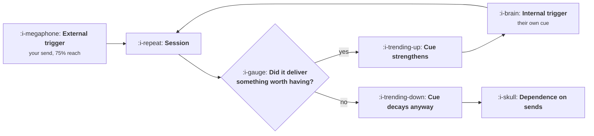

# Triggers

```text
Level: Intermediate
Prerequisites: Natural Frequency
Estimated difficulty: 4/5 | Estimated time: 40 min
```

## The idea in one minute

A user comes back either because you prompted them or because something in their own week reminded
them, and only the second one is a habit. The distinction matters because a product carried
entirely by sends and a product with a real habit look nearly identical on a retention chart: in
the worked model they return 80 and 92 percent of users a week respectively, which no dashboard
would flag. The difference appears the moment the sends stop, when one holds at 70 percent and the
other falls to 4. You do not have to stop sending to find out which you have. The share of returns
that were externally led tells you in week two, and it is the single most under reported number in
lifecycle work.

## A picture



The loop on the right is the only part that compounds. The send is an input that has to be bought
again every week.

## How it really works

### The handover is a threshold, not a gradient

Internal cue strength grows when a session delivers something worth having and decays every week
on its own. Put those two rates against each other and a threshold appears: when a valuable
session adds more cue than a week of forgetting removes, the habit sustains itself. Below that
rate it does not, no matter how long you run the sends.

In the worked model the threshold is a 75 percent rate of delivered value. At 85 percent, the cue
rises to the product's frequency ceiling and stays there after the sends stop. At 50 percent, it
reaches 57 percent while sends are running and then decays 10 percent a week once they stop, which
takes two years to reach zero and is a slow leak nobody will attribute correctly. At 20 percent it
collapses in a month.

The practical reading: sends buy you time for the product to become worth remembering. They cannot
substitute for it, and the rate of delivered value is the variable that decides which case you are
in.

### What delivered value actually means

Not satisfaction and not engagement. A session delivered value if the user got the thing they came
for, which for most products is measurable: the query returned a result they acted on, the document
got written, the number they came to check had changed since last time.

That last one is worth dwelling on, because it is the most common silent failure in triggered
engagement. A weekly digest that says nothing has changed delivers no value, and sending it
weekly for a year trains the user that opening it is pointless. The measurable version is the share
of your triggered sessions where the user took any action beyond arriving. If that number is below
about a third, your sends are generating sessions and eroding the cue at the same time.

### Measure external dependence without stopping anything

For each return, ask whether a send arrived in the preceding window, and attribute accordingly.
The share of returns that had a send in front of them is your dependence ratio.

Three ways to read it. Falling over the user's lifetime is the healthy shape: the handover is
happening. Flat and high after two months means the sends are the habit. And a dependence ratio
that is high only for a specific cohort or channel tells you where the product is failing to
become worth remembering, which is more useful than the aggregate.

In the worked model the week 12 dependence ratios are 74, 36 and 24 percent for the three value
rates, which is the entire answer three months before anybody considers turning the sends off.

### The holdout that confirms it

The dependence ratio is a correlation, so confirm it occasionally with a small permanent send
holdout: one or two percent of users who receive no lifecycle messaging at all. It costs almost
nothing, answers the question definitively, and is the only instrument that measures what your
messaging programme is worth in total rather than per campaign. Most teams do not have one, and
the reason they give is that it would be unfair to the holdout, which is an argument that the sends
are valuable and therefore an argument for measuring them.

### Designing for the internal cue

The internal trigger is a moment in the user's life, not a feature. So the design question is
which recurring moment your product should attach to, and the answer is specific and local: the
Monday morning review, the end of a call, the point where a build fails, the moment the invoice
arrives. Attach to one and the cue has something to fire on.

Two corollaries. A product attached to a moment that occurs rarely has a slow habit by
construction, which is the frequency ceiling from
[Natural Frequency](01-natural-frequency.md) arriving from the other direction. And a send timed to
coincide with the natural moment builds the cue instead of replacing it, which is the one case
where heavy sending is defensible: you are teaching the user when, and they already had the
reason.

### What fills the box in 2026

Push permission on mobile is the constraint that has tightened most. On iOS the user grants it
explicitly and the grant rate for a product with no established value is low, so the external
trigger channel many lifecycle programmes were designed around is simply unavailable for a large
share of new users. Email remains reachable and is less immediate. The practical consequence is
that products reaching new users today build the internal cue earlier or not at all, and
dependence ratios have become more honest by force.

## Run the numbers

Three products, identical sends, different rates of delivered value.

```go
// triggers.go: whether your sends are building a habit or standing in for one.
package main

import "fmt"

// Each week a user may return because you prompted them (an external trigger)
// or because their own week reminded them (an internal one). Internal cue
// strength grows only when a session delivered something worth having, decays
// on its own, and cannot exceed the product's natural frequency ceiling.
type model struct {
	reach   float64 // share of users a week's sends actually reach
	value   float64 // share of sessions that deliver something worth having
	learn   float64 // how much a valuable session strengthens the internal cue
	decay   float64 // weekly forgetting
	ceiling float64 // the most a weekly internal cue can ever be worth
	cutWeek int     // the week the sends stop
}

// Above this rate of delivered value, a valuable session adds more cue than a
// week of forgetting removes, and the habit holds without you.
func (m model) threshold() float64 { return m.decay / m.learn }

func (m model) run(weeks int) {
	s := 0.0
	fmt.Printf("%-7s %10s %12s %12s %15s\n",
		"week", "sends", "returned", "unprompted", "externally led")
	for w := 1; w <= weeks; w++ {
		reach := m.reach
		if w > m.cutWeek {
			reach = 0
		}
		unprompted := s
		returned := 1 - (1-reach)*(1-s)
		s += m.learn*returned*m.value - m.decay*s
		if s > m.ceiling {
			s = m.ceiling
		}
		if w <= 3 || w == m.cutWeek || w == m.cutWeek+1 || w == m.cutWeek+4 || w == weeks {
			label := "on"
			if reach == 0 {
				label = "stopped"
			}
			led := 100 * (returned - unprompted) / returned
			if led < 0.05 {
				led = 0
			}
			fmt.Printf("%-7d %10s %11.0f%% %11.0f%% %14.0f%%\n",
				w, label, 100*returned, 100*unprompted, led)
		}
	}
}

func main() {
	cases := []model{
		{0.75, 0.20, 0.40, 0.30, 0.70, 12},
		{0.75, 0.50, 0.40, 0.30, 0.70, 12},
		{0.75, 0.85, 0.40, 0.30, 0.70, 12},
	}
	fmt.Printf("self sustaining above %.0f%% delivered value\n", 100*cases[0].threshold())
	for _, m := range cases {
		fmt.Printf("\nsessions deliver value %.0f%% of the time, sends stop at week %d\n",
			100*m.value, m.cutWeek)
		m.run(20)
	}

	fmt.Println("\nWith the sends running, the three cases return 80%, 89% and 92% of")
	fmt.Println("users a week: a 12 point spread that any dashboard would read as")
	fmt.Println("three healthy products. Eight weeks after the sends stop they are at")
	fmt.Println("4%, 28% and 70%.")
	fmt.Println("\nThe externally led column is the early warning and it needs no")
	fmt.Println("experiment: at week 12 it reads 74%, 36% and 24%, which is the whole")
	fmt.Println("answer three months before anybody turns the sends off.")
}
```

Look at the three week 12 rows together: 80, 89 and 92 percent weekly return. A twelve point
spread, all three plausible, all three the sort of number a team would be pleased with. Nothing in
that column says one of these products has no habit at all.

Then look at the three week 20 rows: 4, 28 and 70 percent. The sends stopped at week 12 and eight
weeks later the first product has nothing left, the second is halfway through a slow decline, and
the third has not moved.

The externally led column is the instrument. At week 12 it reads 74, 36 and 24 percent, which
ranks the three correctly while all of them still look healthy. It is computable from data you
already have and requires nothing to be turned off.

Change `value` to the rate at which your own triggered sessions result in the user doing something,
and compare it with the printed threshold. If you are below it, the honest plan is to fix what the
session delivers, because more sending cannot reach the threshold from below.

## The AI layer

The useful application is raising the rate of delivered value on a triggered session, which is the
variable the threshold is made of.

A send that says something changed, specifically, and why it might matter to this user, converts a
digest that delivered nothing into a session that delivers something. That is a selection and
summarisation job over data you hold, and it is one of the better uses of a model in growth work
because the quality bar is low: the alternative is a generic digest. Cost is small, a fraction of a
penny to a penny per send for a short summary over a modest amount of context, and it scales with
sends rather than with signups.

Two cautions. First, a model will always find something to say, which is exactly wrong here: the
discipline of sending nothing when nothing happened is what
[What Not to Send](06-what-not-to-send.md) is about, and a generative digest removes the natural
brake. Put an explicit materiality test in front of the generation rather than inside it. Second, a
personalised send raises open rates immediately and raises the dependence ratio if the session
still delivers nothing beyond the summary, which is the worst outcome: better sends, weaker habit.
Watch both numbers together.

The failure mode: the summary becomes the product. Users read the notification and never arrive,
which looks like falling sessions with rising engagement on the send itself, and it is genuinely
ambiguous whether that is good. Decide in advance which you are optimising for and instrument the
one you chose.

## Sector lens

| Sector | What the internal cue attaches to here |
|---|---|
| [Enterprise B2B SaaS](../../product-management/product-by-sector/01-enterprise-b2b-saas.md) | A recurring meeting. The product that is open during the Monday review has a cue nothing else can dislodge |
| [Fintech](../../product-management/product-by-sector/02-fintech.md) | Money moving. Balance changes and payment dates are externally scheduled cues you did not have to build |
| [Ecommerce and D2C](../../product-management/product-by-sector/03-ecommerce-and-d2c.md) | Running out. The cue is physical, so replenishment timing beats any message you could write |
| [Marketplaces](../../product-management/product-by-sector/04-marketplaces.md) | Supply side: the shift starting. Demand side: the need arising. Sends work far better on supply because the moment is scheduled |
| [Devtools and Infra](../../product-management/product-by-sector/05-devtools-and-infrastructure.md) | The build, the deploy, the incident. Being in the pipeline is the cue, and no notification substitutes for it |
| [Healthtech](../../product-management/product-by-sector/06-healthtech-and-regulated-care.md) | The appointment or the medication schedule. Triggers here carry clinical weight and misfires are not merely annoying |
| [Vertical SaaS](../../product-management/product-by-sector/07-vertical-saas.md) | The trade's own rhythm: the job sheet, the shift, the delivery window. Attach to the paperwork that already exists |

## Remember this

* Only internal triggers compound. A send is an input bought again every week.
* The handover is a threshold: if a valuable session adds more cue than a week of forgetting
  removes, the habit holds without you.
* Products with and without a habit look alike while sends are running, 80 against 92 percent
  weekly return in the worked case, and separate completely when sends stop.
* The dependence ratio, the share of returns with a send in front of them, answers it in week two
  and needs nothing turned off. Falling over a lifetime is healthy; flat and high is not.
* Keep a one or two percent permanent send holdout. It is the only measure of what the whole
  programme is worth.
* A digest that reports no change delivers no value and erodes the cue while generating sessions.
* Attach to a specific recurring moment in the user's week. A send timed to that moment builds the
  cue; a send instead of it replaces it.
* A model raises delivered value per send and removes the natural brake on sending nothing. Add an
  explicit materiality test in front of generation.

## Try it

1. Compute your dependence ratio by week since signup for one cohort. If it is flat after week
   eight, you have found the result this lesson is about.
2. Measure the share of your triggered sessions where the user did anything beyond arriving. Put
   that figure next to the threshold printed by `triggers.go`.
3. Propose a one percent permanent holdout from all lifecycle messaging, with the analysis plan
   written in advance. Note who objects and on what grounds.

## Check yourself

1. Two products both return 85 percent of users weekly. One has a dependence ratio of 20 percent
   and the other 70. What do you expect to happen to each if sends pause for a month?
2. Why can increasing send volume not get a product above the handover threshold, and what can?
3. Your personalised digest doubled open rates and sessions fell. Give the two readings of that
   result and what you would instrument to choose between them.
