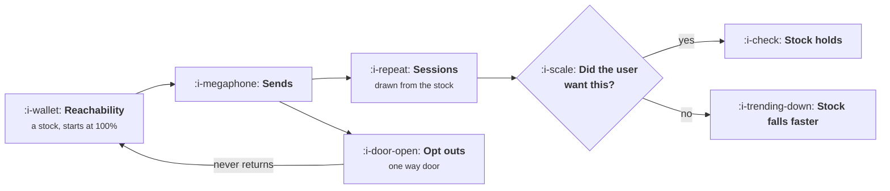

# Habits Without Dark Patterns

```text
Level: Intermediate
Prerequisites: Triggers
Estimated difficulty: 3/5 | Estimated time: 35 min
```

## The idea in one minute

The argument against dark patterns is usually ethical and it does not need to be, because the
arithmetic is decisive on its own. Reachability is a stock rather than a flow: every send draws
sessions from it and permanently removes whoever opts out, and nobody has ever won back a user who
turned notifications off. An aggressive policy wins the first month by nearly double, loses on raw
sessions by week 24, and after two years has spent its entire audience to buy a third of what a
restrained policy bought while keeping 81 percent of its audience. The useful definition of the
line is therefore operational rather than moral: a pattern is dark when it takes from a stock you
are not accounting for.

## A picture



The only arrow that refills the stock is the product being worth coming back to. Sends cannot do
it.

## How it really works

### Reachability is a stock and the accounts never show it

Every lifecycle dashboard reports sends, opens, clicks and sessions, which are all flows. None of
them report the balance of the thing being spent. So a campaign that produces 10,000 sessions and
2,000 permanent opt outs is recorded as a success, and the 2,000 appear in no report that anybody
reviews.

Put the stock on the dashboard and the behaviour changes without any argument about ethics. Three
numbers: share of the cohort still reachable by each channel, opt outs this period, and sessions
per thousand units of reachability spent. The third one is the efficiency measure and it is the one
that exposes a policy quickly.

### The one way door

Opt out is not symmetric with opt in, which is the fact that makes this arithmetic brutal. A user
who disables push grants it again at a rate close to zero, and an email unsubscribe is legally
binding in most jurisdictions. There is no campaign to run against a reacquired permission,
because reacquiring it is not a thing you are allowed to attempt.

So the correct model is depletion. In the worked example the aggressive policy loses 6 percent of
its remaining reachable audience every week, which sounds survivable and compounds to 96 percent of
the cohort gone in a year.

### A workable definition of the line

Ethical framings are hard to operationalise because every team believes its own sends are
welcome. Three tests that do operationalise it, in increasing order of strictness.

**The informed endorsement test.** If you explained the mechanism to the user in a sentence, would
they endorse it? "We send a notification whether or not anything changed, because it brings people
back" fails. "We tell you when somebody replies to you" passes.

**The reversal test.** Is the undo as easy as the do? A one tap subscribe and a four screen
cancellation is the clearest signature of a dark pattern there is, and it is also the one most
likely to attract regulatory attention, which is covered in
[Cancel Flows and Saves](../monetisation-and-conversion/06-cancel-flows-and-saves.md).

**The stock test.** Does the mechanism draw on a stock you are not measuring? Attention,
reachability, trust and goodwill are all stocks. If the practice would look worse with the stock on
the dashboard, it is a dark pattern regardless of how it is justified.

### The specific patterns and what each one borrows

* **Streaks.** Borrow against the user's loss aversion. A streak that recognises genuine use is
  fine; a streak that breaks after a holiday and cannot be repaired is designed to make absence
  painful, and users who break a long streak frequently leave altogether rather than restart.
* **Manufactured notifications.** Borrow against the channel's whole value. Each one teaches that
  your notifications need not be opened, and the cost lands on every future send including the
  important ones.
* **Fake social pressure.** "Three people are looking at this" when they are not borrows against
  credibility, and it is unrecoverable the first time somebody notices, which somebody always does.
* **Interstitials and confirmshaming.** "No thanks, I prefer being disorganised" borrows against
  liking you, which is a stock with no meter at all and shows up months later as lower word of
  mouth.
* **Hiding the setting.** Borrows against trust and converts a passive non user into an active
  detractor, which is the worst exchange rate available.

### What restraint actually looks like

Not sending less for its own sake. The restrained policy in the worked model sends a fifth as
often and gets nearly three times the sessions per send, because the sends are worth opening.
Restraint is a quality constraint that shows up as a volume constraint.

The operational form is a materiality rule: a send goes out when something happened that this user
would want to know about, and otherwise nothing goes out. That rule is simple to state, hard to
hold, and it is the subject of [What Not to Send](06-what-not-to-send.md).

### What fills the box in 2026

The regulatory environment has moved faster than the practice. Mobile platform rules now police
notification abuse directly, with app review consequences rather than merely user ones, and
consumer protection regulators in several jurisdictions have taken explicit interest in
cancellation friction and subscription dark patterns. The practical effect is that the stock being
borrowed from now includes your platform relationship and your legal exposure, both of which are
considerably less forgiving than users are.

## Run the numbers

Two policies, one cohort, two years.

```go
// darkpatterns.go: what borrowing attention costs when the lender can leave.
package main

import "fmt"

// Reachability is a stock, not a flow. Every send draws sessions from it and
// permanently removes whoever opts out, and opting out is a one way door: no
// campaign has ever won back a user who turned notifications off.
type policy struct {
	name   string
	sends  float64 // sends per user per week
	yield  float64 // sessions per send, among reachable users
	optOut float64 // share of reachable users lost per send
	trust  float64 // multiplier on the value of each session it produces
}

func main() {
	pols := []policy{
		{"aggressive", 5, 0.08, 0.012, 0.6},
		{"restrained", 1, 0.22, 0.002, 1.0},
	}

	const weeks = 104
	reach := make([]float64, len(pols))
	cum := make([]float64, len(pols))
	val := make([]float64, len(pols))
	for i := range reach {
		reach[i] = 1.0
	}

	fmt.Printf("%-7s %12s %12s %13s %13s %13s %13s\n",
		"week", "agg reach", "res reach", "agg sess/wk", "res sess/wk",
		"agg cum val", "res cum val")
	cross, crossVal := 0, 0
	for w := 1; w <= weeks; w++ {
		var sess [2]float64
		for i, p := range pols {
			sess[i] = reach[i] * p.sends * p.yield
			cum[i] += sess[i]
			val[i] += sess[i] * p.trust
			reach[i] *= 1 - p.sends*p.optOut
		}
		if cross == 0 && cum[1] > cum[0] {
			cross = w
		}
		if crossVal == 0 && val[1] > val[0] {
			crossVal = w
		}
		if w == 1 || w == 4 || w == 13 || w == 26 || w == 52 || w == 104 {
			fmt.Printf("%-7d %11.0f%% %11.0f%% %12.2f %12.2f %12.1f %12.1f\n",
				w, 100*reach[0], 100*reach[1], sess[0], sess[1], val[0], val[1])
		}
	}

	fmt.Printf("\nrestrained overtakes on raw sessions in week %d\n", cross)
	fmt.Printf("restrained overtakes on sessions worth having in week %d\n", crossVal)

	fmt.Println("\nIn week 1 the aggressive policy produces nearly twice the sessions")
	fmt.Println("and would win any monthly review. By week 26 it can reach a fifth of")
	fmt.Println("the cohort, by week 52 a twenty fifth, and its weekly sessions are a")
	fmt.Println("tenth of the restrained policy's.")

	fmt.Printf("\n%-16s %16s %18s %16s\n",
		"policy", "two year sessions", "reachable at end", "sessions worth having")
	for i, p := range pols {
		fmt.Printf("%-16s %16.1f %17.0f%% %16.1f\n",
			p.name, cum[i], 100*reach[i], val[i])
	}

	fmt.Println("\nThe aggressive policy spent its entire audience to buy 6.7 sessions")
	fmt.Println("per user over two years. The restrained one still has 81% of the")
	fmt.Println("audience and bought 20.7. Discount the sessions a user resents and")
	fmt.Println("the gap is 4.0 against 20.7, a factor of five.")
}
```

Read the reach columns first. The aggressive policy goes 94, 78, 45, 20, 4, 0 percent. Nothing in
that sequence is a cliff, which is why it never triggers an alarm: losing 6 percent of a remaining
balance each week is invisible week to week and total over a year.

The crossover on raw sessions is week 24, which is the number to take into an argument. A policy
that is behind by half in month one is ahead by the middle of the second quarter, and most
lifecycle programmes are reviewed on a horizon shorter than that. This is the structural reason
aggressive policies get adopted: the review period is shorter than the crossover.

The trust multiplier is the softest input here and it is included because leaving it out
understates the case. Setting it to 0.6 for the aggressive policy says that a session a user
resents is worth 60 percent of one they wanted, which is a guess. Even at 1.0, meaning resented
sessions count fully, the restrained policy wins by a factor of three over two years. The
discounted comparison is 4.0 against 20.7.

Change `optOut` to your own measured figure per send per channel. Most teams have never computed it
per send, only per campaign, and the per send figure is the one this model needs.

## The AI layer

A model lowers the cost of the honest policy and lowers the cost of the dishonest one by more,
which is worth being direct about.

On the honest side, the restrained policy's constraint is that writing a genuinely material,
specific send for each user is expensive. That cost is now small, which means the materiality rule
is cheaper to hold than it used to be. A team that previously sent a generic weekly digest because
per user relevance was unaffordable can now send only to the users for whom something happened,
and say what it was.

On the other side, a model will generate a plausible reason to contact somebody every single day,
indefinitely, for a fraction of a penny. That is precisely the capability that converts a
restrained programme into an aggressive one without anybody deciding to. The brake has to be
external to the generation: a hard cap on sends per user per week, and a materiality test evaluated
on the underlying data rather than by the model that writes the message.

The failure mode specific to generated lifecycle messaging is that it personalises the wrapper and
not the substance. Open rates rise, the user discovers twice that the tailored message contained
nothing, and the opt out rate rises on the third. The measurable signature is rising opens with
rising opt outs in the same cohort, which no non generated programme produces and which should be
treated as a stop condition.

## Sector lens

| Sector | Where the line sits here |
|---|---|
| [Enterprise B2B SaaS](../../product-management/product-by-sector/01-enterprise-b2b-saas.md) | The buyer and the user are different people, so pressure applied to users is visible to the person who renews. Reputational cost arrives at renewal |
| [Fintech](../../product-management/product-by-sector/02-fintech.md) | Engagement patterns around money are regulated conduct. A nudge towards a transaction can be a suitability question rather than a design one |
| [Ecommerce and D2C](../../product-management/product-by-sector/03-ecommerce-and-d2c.md) | Scarcity and urgency claims must be true. False stock counts and fake timers are enforcement targets, not grey areas |
| [Marketplaces](../../product-management/product-by-sector/04-marketplaces.md) | Supply side notifications affect somebody's income, so tolerance is high and the duty of accuracy is correspondingly higher |
| [Devtools and Infra](../../product-management/product-by-sector/05-devtools-and-infrastructure.md) | Developers opt out immediately and tell each other. Reachability depletes faster here than anywhere, and publicly |
| [Healthtech](../../product-management/product-by-sector/06-healthtech-and-regulated-care.md) | Habit mechanics applied to care have clinical consequences. Adherence messaging is a clinical intervention and belongs under clinical governance |
| [Vertical SaaS](../../product-management/product-by-sector/07-vertical-saas.md) | Small, connected markets with trade bodies. One pattern that annoys people circulates through the whole customer base in weeks |

## Remember this

* Reachability is a stock. Sends draw sessions from it and opt outs remove balance permanently.
* Opt out is a one way door, so the correct model is depletion rather than a funnel.
* An aggressive policy wins month one, loses on raw sessions by week 24, and loses by a factor of
  three to five over two years.
* Aggressive policies get adopted because the review period is shorter than the crossover.
* Put three numbers on the dashboard: share still reachable, opt outs this period, and sessions per
  unit of reachability spent.
* Three tests for the line: would an informed user endorse it, is the undo as easy as the do, and
  does it draw on an unmeasured stock.
* Restraint is a quality constraint that looks like a volume constraint. The restrained policy got
  nearly three times the sessions per send.
* A model makes the honest policy affordable and the dishonest one effortless. The brake must sit
  outside the generation.

## Try it

1. Compute opt out rate per send, per channel, for your last quarter. Run `darkpatterns.go` with
   your real figures and find your crossover week.
2. Add the three stock numbers to your lifecycle dashboard this week. Note which existing campaign
   looks worst once they are visible.
3. Apply the informed endorsement test to every recurring send you operate. Write the one sentence
   explanation for each, and delete the ones you would not want quoted.

## Check yourself

1. A campaign produced 14,000 sessions and 1,900 opt outs. What is missing from that report, and
   how would you decide whether it was worth running?
2. Why does a policy that loses 6 percent of remaining reachability per week never trigger an
   alarm, and what single chart would catch it?
3. Your generated lifecycle messages show rising open rates and rising unsubscribes in the same
   cohort. What is happening, and what do you do?
