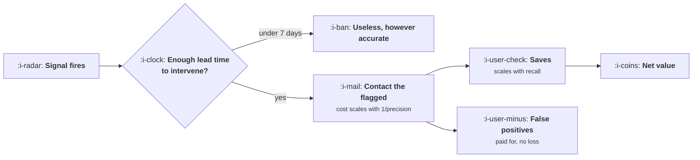

# Spotting Users About to Leave

```text
Level: Intermediate
Prerequisites: Habits Without Dark Patterns
Estimated difficulty: 4/5 | Estimated time: 40 min
```

## The idea in one minute

Churn prediction work almost always optimises the wrong quantity. Teams chase precision, because
precision is what a model report card shows and what feels responsible, and precision is the input
that matters least. Recall decides the size of the prize, because a signal can only save leavers it
catches; precision only decides what the programme costs. At a saved user worth 180 and a contact
costing 1.40, the breakeven precision is 4 percent, so a crude signal that catches three quarters
of leavers beats a near perfect one that catches six percent by a factor of twelve. The two things
that genuinely disqualify a signal are firing too late to act on and a saved user who is not worth
enough to justify any contact at all.

## A picture



Two independent gates and then an arithmetic question. Precision sits on the cost side only.

## How it really works

### Lead time is the only hard disqualifier

An intervention takes time to land: it has to be triggered, delivered, opened and acted on. Call
that the action window, and for most lifecycle programmes it is about a week. A signal that fires
inside the action window cannot be used, regardless of how accurate it is.

This is why "no session in 30 days" is a bad churn signal despite being the most popular one in
the field. It has 71 percent precision in the worked table, by far the second best, and it fires
two days before the departure, by which point the user has already decided. The signal is not
predicting churn, it is observing it.

Measure lead time properly: for users who left, the median days between the signal firing and their
last session. Not the signal's correlation with churn, the distance in front of it.

### Recall is the prize, precision is the bill

Of the leavers, what share does the signal catch? That is recall, and it bounds everything. A
signal with 6 percent recall cannot save more than 6 percent of your churn no matter how perfect
it is.

Precision determines how many people you contact to reach those leavers: flagged users equals
recall times leavers divided by precision. So halving precision doubles the contacts and leaves the
saves unchanged, which costs money and goodwill and nothing else.

Then the decision is a comparison. A signal pays when the save rate times the precision times the
value of a saved user exceeds the cost of a contact, and rearranged, the breakeven precision is the
contact cost divided by the save rate times the saved value. At the worked figures that is 4
percent, which almost any signal clears.

The consequence is counter intuitive and robust: in a product with reasonable unit economics, build
the crudest signal with the highest recall you can get, and spend nothing on precision. The
precision obsession is imported from domains where false positives are expensive, and in lifecycle
messaging they cost about a pound.

### When the programme should not exist

The breakeven precision rises as the saved user's value falls. At a saved user worth 20 it is 39
percent and precision starts to matter. At 8 it is 97 percent, and no signal is that specific, which
means no churn intervention programme can pay for itself.

That is the honest answer for a large share of consumer products, and it is worth saying rather
than building the programme anyway. If a saved user is worth less than about ten times a contact,
the correct response to churn is to fix the product rather than to message the departing. Compute
this before the project rather than after it, using the value definitions from
[CAC, Payback and LTV](../../product-management/revenue-and-efficiency/01-cac-payback-and-ltv.md).

### Signals that tend to have long lead times

The pattern is that structural signals lead and behavioural signals lag. Somebody removing an
integration, deactivating a seat, exporting their data or cancelling a scheduled report has made a
decision, and those actions precede the quiet by weeks. Declining session counts are the aggregate
of a decision already taken.

So the useful list is usually: a deliberate reduction in commitment, the departure of the person
who championed you, a drop in the core action while peripheral use continues, and any explicit
signal such as a support conversation about alternatives. Pair one high recall behavioural signal
with the structural ones rather than choosing between them.

### What fills the box in 2026

Churn models are a commodity: every customer data platform ships one, and they are mostly
gradient boosted trees over session features, which means they produce exactly the behavioural
signals above with better calibration and the same lead time problem. The useful discipline is to
ask any vendor model for its lead time distribution rather than its accuracy, and most will not
have computed it.

What has genuinely improved is the ability to act on a signal within hours rather than days, which
shortens the action window and makes shorter lead signals usable. That is an operational
improvement, not a modelling one.

## Run the numbers

Score the signals on all three dimensions, then check whether the programme can pay at all.

```go
// earlywarning.go: which churn signal is worth acting on.
package main

import "fmt"

// A signal is only useful if it fires far enough ahead of the departure for
// an intervention to land, identifies enough of the leavers to matter, and is
// specific enough that contacting everybody it flags is affordable.
type signal struct {
	name      string
	leadDays  float64 // days between the signal and the departure
	precision float64 // share of flagged users who would have left
	recall    float64 // share of leavers the signal catches
}

const (
	cohort     = 10_000.0
	churnRate  = 0.12  // share of the cohort that will leave this quarter
	needDays   = 7.0   // days an intervention needs to land
	saveRate   = 0.18  // share of correctly flagged leavers an intervention keeps
	perContact = 1.40  // cost of one intervention, including the annoyance
	savedWorth = 180.0 // value of a user who stays
)

func main() {
	leavers := cohort * churnRate
	fmt.Printf("%.0f users, %.0f%% will leave, an intervention needs %.0f days\n",
		cohort, 100*churnRate, needDays)
	fmt.Printf("saving one is worth %.0f, contacting one costs %.2f\n\n", savedWorth, perContact)

	sigs := []signal{
		{"sessions down on last week", 21, 0.19, 0.74},
		{"no session in 14 days", 9, 0.46, 0.51},
		{"no session in 30 days", 2, 0.71, 0.38},
		{"stopped using the core action", 26, 0.34, 0.44},
		{"removed an integration", 34, 0.62, 0.09},
		{"a seat was deactivated", 41, 0.77, 0.06},
	}

	fmt.Printf("%-30s %7s %10s %8s %10s %9s %10s %s\n",
		"signal", "lead", "precision", "recall", "flagged", "saves", "net", "verdict")
	for _, s := range sigs {
		flagged := s.recall * leavers / s.precision
		saves := s.recall * leavers * saveRate
		net := saves*savedWorth - flagged*perContact
		verdict := "worth running"
		if s.leadDays < needDays {
			verdict = "fires too late"
			saves, net = 0, -flagged*perContact
		} else if net <= 0 {
			verdict = "costs more than it saves"
		}
		fmt.Printf("%-30s %6.0fd %9.0f%% %7.0f%% %10.0f %9.0f %10.0f %s\n",
			s.name, s.leadDays, 100*s.precision, 100*s.recall,
			flagged, saves, net, verdict)
	}

	fmt.Println("\nThe most accurate signal in the table, a deactivated seat at 77%")
	fmt.Println("precision, catches 6% of leavers and saves 13 users. The least")
	fmt.Println("accurate, sessions down on the week at 19%, catches 74% and saves")
	fmt.Println("160, because recall is what decides the size of the prize and")
	fmt.Println("precision only decides what it costs.")

	fmt.Println("\nwhat precision has to be for a signal to pay, at this contact cost:")
	fmt.Printf("%-16s %20s  %s\n", "saved worth", "breakeven precision", "verdict")
	for _, v := range []float64{180.0, 60.0, 20.0, 8.0} {
		// net > 0 needs saveRate*precision*savedWorth > perContact
		bp := perContact / (saveRate * v)
		note := "almost any signal pays, chase recall"
		switch {
		case bp > 0.8:
			note = "no realistic signal is that specific"
		case bp > 0.3:
			note = "precision now matters more than recall"
		}
		fmt.Printf("%16.0f %19.0f%%  %s\n", v, 100*bp, note)
	}

	fmt.Println("\nAt a saved user worth 180 the breakeven precision is 4%, so almost")
	fmt.Println("any signal pays and recall is the only thing to optimise. At 8 the")
	fmt.Println("breakeven is 97% and no signal exists that is that specific, which")
	fmt.Println("is the honest answer for most consumer products: do not run the")
	fmt.Println("programme at all, fix the product.")
}
```

The first table ranks the signals and the ranking is the opposite of the precision column. Sessions
down on the week has the worst precision in the table at 19 percent and the best net value at
22,228, because its 74 percent recall means it is addressing 160 saves rather than 13. The
deactivated seat signal, which is the one a careful analyst would be proudest of, returns 2,202.

The 30 day inactivity row is the instructive failure. It has the second highest precision, and the
verdict column disqualifies it on lead time alone: two days is inside the action window, so every
contact it triggers arrives after the decision. Note that its net is negative rather than zero,
because the contacts still cost money.

The second table is the one to run before committing to the programme. Follow the breakeven
precision as the saved value falls: 4 percent, 13, 39, 97. Somewhere between 20 and 8 the programme
stops being viable, and where your own product sits in that range is a question of arithmetic
rather than of ambition.

Put your own numbers in, and be careful with `savedWorth`: it is the incremental value of a user who
stays beyond the point they would have left, not their lifetime value, and confusing the two is the
most common way this analysis gets inflated.

## The AI layer

Two uses, one of which is the obvious one and is the less valuable.

The obvious one is a better churn model. It will be better calibrated than a logistic regression
and it will have the same lead time, because lead time is a property of the signals available
rather than of the function fitted to them. Given that the breakeven precision is 4 percent in a
healthy product, moving precision from 19 percent to 35 is worth the difference in contact costs
and nothing else: in the worked case, about 2,300 against a net of 22,228. It is not where the
money is.

The more valuable use is on the intervention rather than the prediction. The save rate, 18 percent
in the model, is the input the whole programme's value scales with linearly, and it is driven by
whether the message addresses the actual reason this user is leaving. A model that reads the
account's recent history, support conversations and usage pattern and drafts a specific message
raises the save rate rather than the precision. Moving the save rate from 18 to 25 percent is worth
more than any precision improvement available, and it costs a few pence per contact against a saved
user worth 180.

The failure mode is generating a message that reveals how closely the account is being watched. A
note saying somebody noticed you stopped using a specific feature last Tuesday reads as
surveillance rather than service, and it converts a quiet departure into a public complaint. Keep
the specificity in the offer and not in the observation.

## Sector lens

| Sector | What leads here |
|---|---|
| [Enterprise B2B SaaS](../../product-management/product-by-sector/01-enterprise-b2b-saas.md) | The champion leaving the company, which is observable externally and leads renewal risk by months. Seat level decline is second |
| [Fintech](../../product-management/product-by-sector/02-fintech.md) | Balance moving out, a direct debit cancelled, a card removed. Structural and unambiguous |
| [Ecommerce and D2C](../../product-management/product-by-sector/03-ecommerce-and-d2c.md) | Time since last order against that customer's own interval. Saved value is usually low, so check whether the programme pays |
| [Marketplaces](../../product-management/product-by-sector/04-marketplaces.md) | Supply side: declining acceptance rate before declining logins. Demand side: searches without bookings |
| [Devtools and Infra](../../product-management/product-by-sector/05-devtools-and-infrastructure.md) | A deleted key, a removed webhook, traffic moving to a competitor's endpoint. Usage decline is very late here |
| [Healthtech](../../product-management/product-by-sector/06-healthtech-and-regulated-care.md) | Missed appointments, which are both a churn signal and a clinical one. Outreach may be required rather than optional |
| [Vertical SaaS](../../product-management/product-by-sector/07-vertical-saas.md) | A conversation, usually. Too few accounts for signals, and the account manager knows before any model does |

## Remember this

* Lead time is the only hard disqualifier. A signal that fires inside the action window is
  observing churn, not predicting it.
* Recall bounds the prize. Precision only sets the bill, because contacts scale with one over
  precision.
* Breakeven precision is contact cost over save rate times saved value. At healthy economics it is
  about 4 percent.
* So chase recall and accept crude signals. The precision instinct is imported from domains where
  false positives are expensive.
* When the saved user is worth under roughly ten contacts, no signal is specific enough and the
  programme should not exist.
* Structural signals lead and behavioural signals lag. Removing an integration precedes the quiet
  by weeks; declining sessions are the quiet.
* Ask any vendor churn model for its lead time distribution, not its accuracy.
* A model is worth more on the save rate than on the prediction, and specificity belongs in the
  offer rather than in the observation.

## Try it

1. For every churn signal you currently use, compute the median lead time on users who actually
   left. Drop the ones inside your action window, however accurate.
2. Run `earlywarning.go` with your own saved value and contact cost, and find your breakeven
   precision. If it is above about 40 percent, write the memo recommending the programme be closed.
3. Take your highest recall signal and measure your save rate against a holdout of flagged users
   who are not contacted. That number is what every improvement multiplies.

## Check yourself

1. Signal A has 85 percent precision and 7 percent recall; signal B has 22 percent precision and
   68 percent recall. Both have adequate lead time. Which do you run, and what makes the answer
   flip?
2. Why is "no activity for 30 days" a poor churn signal despite high precision, and what would you
   use instead?
3. A saved user is worth 25 and a contact costs 2. Your best signal has 30 percent precision and
   your save rate is 15 percent. Should the programme run? Show the arithmetic.
