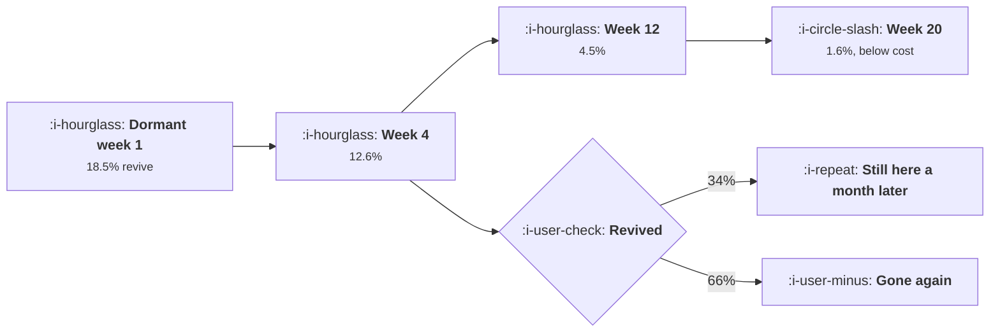

# Winning Back the Dormant

```text
Level: Intermediate
Prerequisites: Spotting Users About to Leave
Estimated difficulty: 3/5 | Estimated time: 35 min
```

## The idea in one minute

A win back programme is a wasting asset and the rate of waste is steeper than anybody plans for.
Reactivation probability falls about twelve percent a week from the moment a user goes quiet, so a
user four weeks gone is worth two thirds of a user one week gone, and a user six months gone is
worth essentially nothing. Two numbers decide the whole programme: the week at which an attempt
stops paying for itself, which is week 19 at reasonable economics, and the number of attempts worth
making, which is three. Everything past those two numbers is a cost centre with a campaign
calendar. The practical consequence is that speed matters far more than message quality.

## A picture



Two decays, one in the chance of a return and one in whether the return holds. The programme's
value is the product of both.

## How it really works

### The decay sets the deadline

Measure your own reactivation rate by weeks dormant and you will find an exponential decline. The
worked model uses twelve percent per week, which starts at 18.5 percent in week one and reaches
1.6 percent by week 20.

Compare that against the cost of an attempt and there is a week at which expected value crosses
cost. In the worked case it is week 19. Past that week, every send loses money in expectation, and
the quarterly reactivation campaign aimed at everyone who has gone quiet in the last year is mostly
spending on users who are five percent as likely to return as the recent ones.

So the first reform in almost every win back programme is to stop running it on a calendar and
start running it on dormancy age. A continuous trigger at the right dormancy threshold beats a
monthly batch, because a monthly batch contacts half its audience two to six weeks later than it
should.

### Revival has to stick to count

A reactivated user who leaves again a fortnight later has cost you a contact and produced nothing.
The restick rate, the share of revived users still present a month later, is the discount on every
revival, and it is usually low: 34 percent in the worked model, and lower than that in products
where the reason for leaving was not addressed.

The important structural point: a win back message can change whether somebody returns and it
cannot change whether the product is worth returning to. So the restick rate is set by the product
and by whether the original reason for leaving has been fixed, which is why the single most
effective win back campaign is the one announcing the thing that was wrong is now right. Those
campaigns show restick rates two or three times the baseline, and they are not a messaging
achievement.

### Three attempts, then stop

Repeat attempts on the same user face a progressively less persuadable remainder. In the worked
model each attempt is worth about 45 percent of the previous one, so the second attempt pays, the
third barely pays, and the fourth loses money.

The cumulative column is the one to read: 5.09, 6.89, 7.21, then 6.85 and falling. Three attempts
captures the entire available value and the fourth starts giving it back. Most win back sequences
in production have five to seven steps, which means the back half of the sequence is reducing the
programme's net value while producing the opt outs that
[Habits Without Dark Patterns](03-habits-without-dark-patterns.md) prices.

### What actually brings somebody back

Ranked by observed effect rather than by popularity.

* **The reason they left has been fixed, named specifically.** The strongest message available, and
  it requires knowing why they left, which means asking at the time rather than guessing later.
* **Something of theirs is waiting.** Their data, their document, their saved work. Concrete,
  honest and effective because it addresses the switching cost rather than the value proposition.
* **Somebody else acted.** A colleague shared something, a teammate joined. This is a notification
  rather than a campaign and it outperforms every campaign.
* **A genuinely new capability.** Works when it is genuinely new. The same announcement sent to the
  same dormant list quarterly trains the list to ignore it.
* **A discount.** Works least, selects for price sensitivity, and produces the lowest restick rate
  of any mechanism, because the user returns for the price rather than for the product.

### Ask on the way out

The cheapest input to the whole programme is a one question exit survey, delivered at cancellation
or at the moment of a deliberate reduction. It gives you the reason to address later and the
segment to address it to, and it converts the list from "dormant users" into "dormant users whose
problem was X", which is the difference between a 34 percent restick rate and a usable one. This
connects directly to [Cancel Flows and Saves](../monetisation-and-conversion/06-cancel-flows-and-saves.md),
where the same question serves a different purpose.

### What fills the box in 2026

Deliverability is the binding constraint and it has tightened. Mailbox providers now weight
engagement heavily in placement decisions, so sending to a large dormant list is itself a risk: a
campaign to users who have not opened anything in a year lowers the inbox placement of your
transactional and lifecycle mail to everybody else. That cost does not appear in the campaign
report and is the strongest practical argument for the dormancy cut off computed below. Suppress at
the threshold, and treat the suppression as protecting the rest of the programme rather than as
giving up on those users.

## Run the numbers

Find your cut off week and your attempt count before writing any copy.

```go
// winback.go: how long a dormant user is worth contacting, and how often.
package main

import "fmt"

const (
	contactCost = 0.90  // cost of one win back attempt
	revived     = 140.0 // value of a user who comes back and stays
	restickRate = 0.34  // share of revived users who are still here a month later
)

// Reactivation rate decays with how long the user has been gone, and the
// value of a reactivation is discounted by the share who stay this time.
func reviveRate(weeksGone float64) float64 {
	r := 0.21
	for i := 0.0; i < weeksGone; i++ {
		r *= 0.88
	}
	return r
}

func main() {
	fmt.Printf("one attempt costs %.2f, a user who comes back and sticks is worth %.0f\n",
		contactCost, revived)
	fmt.Printf("only %.0f%% of revived users are still here a month later\n\n", 100*restickRate)

	fmt.Printf("%-14s %14s %16s %14s %s\n",
		"weeks dormant", "revive rate", "sticks and stays", "value/attempt", "verdict")
	stop := 0.0
	for _, w := range []float64{1, 2, 4, 8, 12, 20, 30, 40, 52} {
		rr := reviveRate(w)
		ev := rr * restickRate * revived
		verdict := "contact"
		if ev < contactCost {
			verdict = "stop"
			if stop == 0 {
				stop = w
			}
		}
		fmt.Printf("%14.0f %13.1f%% %15.1f%% %14.2f %s\n",
			w, 100*rr, 100*rr*restickRate, ev, verdict)
	}
	// the exact week the expected value crosses the cost
	for w := 1.0; w < 200; w++ {
		if reviveRate(w)*restickRate*revived < contactCost {
			fmt.Printf("\nexpected value falls below the cost of an attempt in week %.0f\n", w)
			break
		}
	}

	fmt.Println("\nrepeat attempts on the same user, four weeks dormant:")
	fmt.Printf("%-10s %14s %14s %14s %s\n",
		"attempt", "revive rate", "value", "cumulative", "verdict")
	base, cumv, cumc := reviveRate(4), 0.0, 0.0
	for a := 1; a <= 6; a++ {
		// each attempt reaches a progressively less persuadable remainder
		rate := base
		for i := 1; i < a; i++ {
			rate *= 0.45
		}
		ev := rate * restickRate * revived
		cumv += ev
		cumc += contactCost
		verdict := "send"
		if ev < contactCost {
			verdict = "stop"
		}
		fmt.Printf("%10d %13.1f%% %14.2f %14.2f %s\n", a, 100*rate, ev, cumv-cumc, verdict)
	}

	fmt.Println("\nThe second attempt is worth 45% of the first and still pays. The")
	fmt.Println("fourth is worth 9% of the first and does not. Three attempts is the")
	fmt.Println("whole programme, and the cumulative column stops moving after it.")

	fmt.Println("\nwhat the restick rate does to the window:")
	fmt.Printf("%-18s %18s %18s\n", "restick rate", "value per revival", "stop after week")
	for _, rs := range []float64{0.70, 0.50, 0.34, 0.15} {
		last := 0.0
		for w := 1.0; w < 400; w++ {
			if reviveRate(w)*rs*revived < contactCost {
				last = w
				break
			}
		}
		fmt.Printf("%17.0f%% %18.1f %18.0f\n", 100*rs, rs*revived, last)
	}
	fmt.Println("\nHalving how many revived users stay costs you six weeks of window.")
	fmt.Println("Doubling it buys six. The decay in reactivation rate dominates,")
	fmt.Println("which is why speed beats cleverness in this programme.")
}
```

The first table is the deadline. Value per attempt runs 8.80, 7.74, 5.99, 3.59, 2.16, then 0.78
at week 20, which is below the 0.90 cost. Everything in the first twelve weeks is comfortably
profitable and everything past nineteen is not, which is a much sharper boundary than most
programmes operate with.

Note the "sticks and stays" column, which is the honest conversion rate of a win back attempt: 6.3
percent in week one falling to 1.5 by week twelve. A programme reporting reactivation rates without
the restick discount is overstating itself by a factor of three.

The repeat attempts table caps the sequence at three. Read the cumulative column and notice it
peaks at 7.21 on the third attempt and falls from there. A seven step sequence, which is a common
default in lifecycle tools, ends at about 5.4, having given back a quarter of what it earned.

The last table shows what the restick rate buys you: going from 34 percent to 70 moves the cut off
from week 19 to week 25. Six weeks. Meanwhile the decay rate itself is the dominant term, which is
the argument for contacting dormant users fast rather than contacting them well.

Change `reviveRate`'s weekly multiplier to your own measured decay. If your decay is 0.95 rather
than 0.88 the window extends to about seven months, and if it is 0.80 you have four weeks, which is
a different programme entirely.

## The AI layer

The honest assessment is that this is one of the weaker applications of a model in growth work,
and it is one of the most popular.

Personalised win back copy raises the reactivation rate modestly, perhaps a relative tenth, and the
programme's value scales with the reactivation rate, so that is real. It costs a fraction of a
penny per message. Fine, and worth doing once the structural decisions above are right.

What it cannot do is move the restick rate, which is the input the programme most needs improved,
because restick is determined by the product rather than by the message. A beautifully tailored
message that brings somebody back to the same unresolved problem produces a second departure and a
worse opinion. Teams that invest in generated win back copy while leaving the departure reason
unaddressed are optimising the cheap half of the product and the expensive half is where the value
is.

The genuinely useful model application is classifying free text exit reasons at volume, which
converts a pile of unread survey responses into the segments the programme needs. That is cheap,
accurate enough, and it feeds the one message type that actually works.

The failure mode to avoid: a model generating a specific claim about what has changed since the
user left, when nothing relevant has. It will do this willingly, the user checks, and the result is
an opt out plus a complaint. Gate the "what changed" message on a real changelog entry mapped to a
real exit reason.

## Sector lens

| Sector | What works on the dormant here |
|---|---|
| [Enterprise B2B SaaS](../../product-management/product-by-sector/01-enterprise-b2b-saas.md) | The account is dormant but the people moved. Follow the champion to their new company rather than messaging the old account |
| [Fintech](../../product-management/product-by-sector/02-fintech.md) | A dormant account with a balance is a different problem from an empty one, and regulations on dormancy may dictate contact |
| [Ecommerce and D2C](../../product-management/product-by-sector/03-ecommerce-and-d2c.md) | Replenishment timing beats any win back message. The decay is set by the consumption interval, not by a generic curve |
| [Marketplaces](../../product-management/product-by-sector/04-marketplaces.md) | Supply side returns for earnings, so tell them what they missed in money. Demand side returns when the need recurs |
| [Devtools and Infra](../../product-management/product-by-sector/05-devtools-and-infrastructure.md) | They left because something did not work. A changelog entry naming the fix is the only message with a real restick rate |
| [Healthtech](../../product-management/product-by-sector/06-healthtech-and-regulated-care.md) | Lapsed care is a clinical concern and outreach may be mandated, so the economics above do not govern the decision |
| [Vertical SaaS](../../product-management/product-by-sector/07-vertical-saas.md) | A phone call from a person, within weeks. Volumes are small enough that the programme is a call list rather than a campaign |

## Remember this

* Reactivation probability decays roughly twelve percent a week. Compute your own decay; it sets
  everything.
* There is a week at which an attempt stops paying, week 19 at reasonable economics. Suppress past
  it.
* Trigger on dormancy age, not on a calendar. A monthly batch contacts half its audience weeks
  late.
* Discount every revival by the restick rate. A programme quoting reactivation without it overstates
  by about three times.
* Three attempts captures the whole value. The fourth starts giving it back, and a seven step
  sequence ends lower than a three step one.
* The message that works names the fixed reason for leaving, which means asking why at the time.
* Discounts work worst and produce the lowest restick rate.
* Sending to a deeply dormant list damages deliverability for the mail that matters, which is a
  cost the campaign report does not show.

## Try it

1. Measure your reactivation rate by weeks dormant, fit the weekly decay, and run `winback.go` with
   it. Compare your cut off week with the oldest dormancy your current campaigns target.
2. Measure the restick rate of your last reactivation campaign at 30 days. Recompute the campaign's
   reported success with that discount applied.
3. Add a one question exit survey at cancellation, then classify a month of responses. Write the one
   win back message that addresses the largest segment and nothing else.

## Check yourself

1. Your reactivation rate decays 20 percent a week, an attempt costs 1.20, a stuck revival is worth
   90 and the restick rate is 25 percent. Roughly when do you stop contacting?
2. Why does a seven step win back sequence end up worth less than a three step one, when every step
   produces some reactivations?
3. A tailored win back campaign doubled reactivations and the 30 day restick rate fell from 34 to 12
   percent. Did it work? What would you do next?
