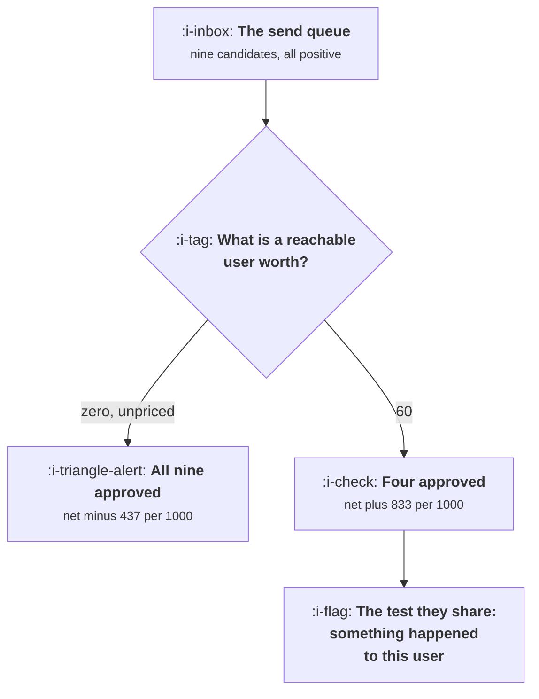

# What Not to Send

```text
Level: Intermediate
Prerequisites: Winning Back the Dormant
Estimated difficulty: 3/5 | Estimated time: 30 min
```

## The idea in one minute

Deciding what to send is a single arithmetic question with one input nobody fills in: what a
reachable user is worth. A team that has never priced reachability has implicitly priced it at
zero, and at zero every candidate send in the queue is approved, because each returns something
positive and costs nothing in the accounts. Put a realistic price on it and the queue collapses:
of nine candidate sends in the worked example, four survive at every price, and sending all nine
destroys 437 of value per thousand users where sending the best four creates 833. The discipline
is not sending less. It is pricing the thing you are spending.

## A picture



The same queue, the same product, two decisions. The only thing that changed is whether the cost
side had a number in it.

## How it really works

### Price reachability, then everything else follows

A reachable user is worth the net value of all the sends you will make to them for as long as they
remain reachable. That is circular, so estimate it in two steps: take the value per thousand sends
of your clearly good sends, multiply by how many you will send over a year, and divide by a
thousand. For most products the answer lands somewhere between twenty and a hundred and fifty.

Then every candidate send has a net value: value returned minus opt outs multiplied by that price.
The sends that survive are the sends that pay. No policy document is required and no debate about
tone is necessary, which is the attraction of doing it this way.

### Four sends survive every price, and they have one thing in common

In the worked queue the survivors are a reply to you, your export being ready, a teammate sharing a
document, and your usage approaching a limit. The five that die are a weekly summary, an untried
feature, tips, a blog post, and "it has been a while".

The dividing line is not usefulness or tone or personalisation. It is whether something happened to
this specific user that they would want to know about. The survivors are all reports of events; the
casualties are all reports of your intentions.

That gives a test you can hand to anybody: name the event, with a timestamp, that this send is
reporting. If there isn't one, the send is a campaign and has to clear a much higher bar than it
will.

### The marginal send is negative, which is the whole point

Rank the queue by net value and the cumulative column peaks and then falls. In the worked case it
peaks at slot four and the fifth send takes 94 off it. By the ninth the programme is worth less than
nothing.

So a cap on sends per user per week is not a compromise between marketing and user experience. It
is the optimum, and the number is computable rather than negotiated. Whoever holds the cap should
hold this table, which is the arrangement described in
[The Shared Attention Budget](../lifecycle-messaging/05-the-shared-attention-budget.md).

### Suppression rules worth having as standing policy

Beyond the per send arithmetic, five rules that are cheap and prevent the worst outcomes.

* **Nothing when nothing happened.** A scheduled send with no material content is the clearest
  negative value send there is, and it is the most common one in production.
* **Nothing to a user mid problem.** Somebody with an open support ticket or a failed payment gets
  no marketing. The send arrives as evidence you are not paying attention.
* **One channel per event.** An email and a push for the same thing is one event and two
  withdrawals.
* **Nothing past the dormancy cut off.** The week computed in
  [Winning Back the Dormant](05-winning-back-the-dormant.md), after which both the send and your
  deliverability lose.
* **Nothing you would not want read aloud.** A send whose performance depends on the recipient not
  thinking about it carefully is borrowing against trust rather than earning.

### Staying quiet is a decision that needs an owner

The structural problem is that sending has an advocate and silence does not. Every team can name
the campaign they want to run; nobody is measured on the campaign that was not run. So silence
needs to be somebody's job, with a number attached, and the number is the price of reachability.

The practical mechanism that works: a standing figure for what a reachable user is worth, published
and revised quarterly, and a requirement that any new recurring send come with its estimated opt
outs per thousand. That converts an argument about judgement into an argument about two numbers,
which is a much shorter argument.

### What fills the box in 2026

Mailbox placement now depends heavily on recipient engagement, which means low value sends have an
externality on your high value ones: the weekly summary nobody opens lowers the inbox placement of
the password reset. That cost is invisible in any campaign report and is real, and it means the
price of reachability in the model above understates the true cost of a bad send. On mobile, the
platforms have begun policing notification volume directly, which adds a second externality with
even less tolerance.

## Run the numbers

Put a price on reachability and read the queue off the table.

```go
// whatnottosend.go: the send queue, priced against what attention is worth.
package main

import (
	"fmt"
	"sort"
)

// Every candidate send returns some value and costs some permission. Which
// ones are worth sending depends entirely on what a reachable user is worth,
// and a team that has never priced reachability has implicitly priced it at
// zero, which approves the whole queue.
type candidate struct {
	name    string
	value   float64 // value returned per thousand sends
	optOuts float64 // permanent opt outs per thousand sends
}

func (c candidate) net(reachWorth float64) float64 {
	return c.value - c.optOuts*reachWorth
}

func main() {
	queue := []candidate{
		{"somebody replied to you", 310, 0.4},
		{"your export is ready", 240, 0.3},
		{"a teammate shared a document", 265, 0.9},
		{"your usage is near the plan limit", 180, 1.1},
		{"weekly summary of your account", 74, 2.8},
		{"a feature you have not tried", 48, 3.9},
		{"tips for getting more from us", 22, 4.6},
		{"we have a new blog post", 11, 5.2},
		{"it has been a while", 9, 7.4},
	}

	fmt.Printf("%-36s %16s %16s\n", "candidate send", "value/1000", "opt outs/1000")
	for _, c := range queue {
		fmt.Printf("%-36s %16.0f %16.1f\n", c.name, c.value, c.optOuts)
	}

	fmt.Println("\nthe same queue, at four prices for a reachable user:")
	fmt.Printf("%-36s %12s %12s %12s %12s\n",
		"candidate send", "worth 0", "worth 20", "worth 60", "worth 140")
	prices := []float64{0, 20, 60, 140}
	for _, c := range queue {
		fmt.Printf("%-36s", c.name)
		for _, p := range prices {
			n := c.net(p)
			mark := " "
			if n <= 0 {
				mark = "x"
			}
			fmt.Printf(" %10.0f%s", n, mark)
		}
		fmt.Println()
	}

	fmt.Printf("\n%-36s", "sends approved")
	for _, p := range prices {
		k := 0
		for _, c := range queue {
			if c.net(p) > 0 {
				k++
			}
		}
		fmt.Printf(" %10d ", k)
	}
	fmt.Println()
	fmt.Printf("%-36s", "total net value per 1000 users")
	for _, p := range prices {
		t := 0.0
		for _, c := range queue {
			if n := c.net(p); n > 0 {
				t += n
			}
		}
		fmt.Printf(" %10.0f ", t)
	}
	fmt.Println()

	fmt.Println("\nAt a reachable user worth nothing, all nine sends are approved and")
	fmt.Println("the programme shows 1159 per thousand users. At 60, four survive and")
	fmt.Println("the programme is worth 833. The four that survive every price are the")
	fmt.Println("ones where something actually happened to this user.")

	fmt.Println("\nthe marginal send, when a weekly cap forces a choice:")
	ranked := append([]candidate{}, queue...)
	const worth = 60.0
	sort.Slice(ranked, func(i, j int) bool { return ranked[i].net(worth) > ranked[j].net(worth) })
	fmt.Printf("%-8s %-36s %14s %14s\n", "slot", "send", "net", "cumulative")
	cum := 0.0
	for i, c := range ranked {
		cum += c.net(worth)
		fmt.Printf("%-8d %-36s %14.0f %14.0f\n", i+1, c.name, c.net(worth), cum)
	}
	fmt.Println("\nThe cumulative column peaks at slot 4 and falls for the rest of the")
	fmt.Println("queue. A cap of four is not a restriction here, it is the answer.")
	fmt.Printf("\nSending the whole queue returns %.0f per thousand users against %.0f\n",
		cum, 833.0)
	fmt.Println("for the first four. The difference is not a lost opportunity, it is")
	fmt.Println("a programme that destroys more than it makes.")
}
```

The first table is deliberately unremarkable: nine sends, all with positive value per thousand.
Every one of them would be approved in a meeting, and most of them exist in most products.

The second table is the lesson. Follow the "worth 0" column, where everything is approved and the
programme reports 1159 per thousand users, then follow across. At 20 the feature announcement, the
tips and the blog post turn negative. At 60 the weekly summary joins them. The approved count goes
9, 5, 4, 4, and it is stable at four from a fairly low price onward, which is useful: you do not
need a precise estimate of what reachability is worth to know which sends to cut.

The last table prices the marginal send. Cumulative value peaks at 833 on slot four and ends at
minus 437 if the whole queue goes out. That difference, 1270 per thousand users, is what a send cap
is worth, and it is a bigger number than almost any campaign optimisation available.

Put your own queue in with measured opt outs per thousand. Most teams have the value side and not
the cost side, and the cost side is the one that changes the decision.

## The AI layer

A model's effect here is mostly to remove the friction that was holding the line, which is worth
stating plainly before the useful applications.

The low value sends in the queue were historically limited by how expensive they were to produce.
Writing a weekly personalised summary for every user was not viable, so it was not done. It is now
nearly free, which means the five sends that destroy value in the table are now cheaper to produce
than the four that create it, and nothing in the production process objects. The arithmetic above
is the only remaining brake, and it has to be applied deliberately.

The genuinely useful application is the materiality test rather than the writing. Deciding whether
anything in this user's account changed enough to be worth reporting is a judgement over their
data, it is cheap, and a model is decent at it. The correct architecture is a model that decides
whether to send at all, a deterministic rule that caps volume, and then generation of the message
only for the sends that passed. Most implementations invert this: they generate first and send
whatever came out.

The failure mode is a generative digest that always finds something to report, because that is what
generation does when asked. The measurable signature is a send whose content is technically
personalised and whose click rate is indistinguishable from the generic version it replaced, with a
higher opt out rate because the user now feels watched as well as spammed.

## Sector lens

| Sector | What raises the price of reachability here |
|---|---|
| [Enterprise B2B SaaS](../../product-management/product-by-sector/01-enterprise-b2b-saas.md) | The recipient may be the person who renews, so a bad send has a contract attached. Price reachability at account value, not user value |
| [Fintech](../../product-management/product-by-sector/02-fintech.md) | Regulatory communications must arrive, so marketing sends that damage deliverability carry compliance risk as well as cost |
| [Ecommerce and D2C](../../product-management/product-by-sector/03-ecommerce-and-d2c.md) | Sends are a real revenue channel, so the value side is genuinely high. Measure opt outs per thousand carefully rather than assuming |
| [Marketplaces](../../product-management/product-by-sector/04-marketplaces.md) | Supply side notifications carry earnings, so they survive almost any price. Demand side promotional sends rarely do |
| [Devtools and Infra](../../product-management/product-by-sector/05-devtools-and-infrastructure.md) | Alerting and incident mail must land. Any marketing send that trains filters against your domain is a reliability problem |
| [Healthtech](../../product-management/product-by-sector/06-healthtech-and-regulated-care.md) | Clinical and appointment messages are the highest value sends in any product. Protect that channel absolutely and send nothing else through it |
| [Vertical SaaS](../../product-management/product-by-sector/07-vertical-saas.md) | A small market where recipients talk to each other, so a bad send is discussed at the trade association. Reachability is worth more than the model suggests |

## Remember this

* What to send is one arithmetic question with one missing input: what a reachable user is worth.
* An unpriced reachability is a reachability priced at zero, which approves the entire queue.
* The sends that survive every price report an event that happened to this user. The ones that die
  report your intentions.
* The test to hand anybody: name the event and its timestamp. No event means a much higher bar.
* The marginal send is negative, so a volume cap is the optimum rather than a compromise, and the
  number is computable.
* In the worked queue, the best four create 833 per thousand users and the whole nine destroy 437.
* Standing suppressions: nothing when nothing happened, nothing to a user mid problem, one channel
  per event, nothing past the dormancy cut off, nothing you would not want read aloud.
* Low value sends have an externality on your important mail through deliverability, which no
  campaign report shows.
* A model removes the cost barrier that used to hold the line. Use it for the materiality test, not
  for filling the queue.

## Try it

1. Estimate what a reachable user is worth for your product, publish the figure, and run
   `whatnottosend.go` with your real queue. Note which existing sends go negative.
2. For every recurring send you operate, write down the event it reports and its timestamp. Those
   without one are your cut list.
3. Compute the cumulative curve for your own queue and propose the cap at its peak. Take the number
   rather than the argument to the teams that want to send more.

## Check yourself

1. Your weekly digest returns 60 per thousand sends and costs 3.1 opt outs per thousand. At what
   price of reachability does it stop paying?
2. Why does leaving reachability unpriced reliably produce too much sending rather than a random
   amount of it?
3. A generated personalised digest matched the generic version's click rate and raised unsubscribes.
   What happened, and what would you change about the architecture?
