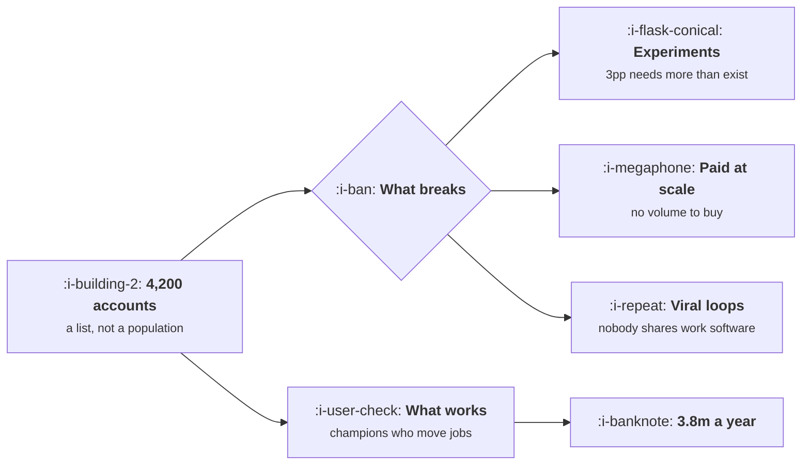

# Enterprise B2B SaaS

```text
Level: Sectors
Prerequisites: What PLG Actually Requires
Estimated difficulty: 4/5 | Estimated time: 35 min
```

## The idea in one minute

The addressable market here is a list of companies, not a population, and that single fact breaks
every growth technique that assumes volume. With 4,200 addressable accounts and a 23 percent win
rate, a plan to win the remaining 3,822 requires 16,617 opportunities, so the same accounts have to
be worked repeatedly over years and a growth plan expressed as new leads is describing something
impossible. Detecting a three point change in win rate would need more accounts than exist. What is
left is one loop almost nobody runs deliberately: champions who change jobs, worth 3.8 million a
year in the worked case.

For the buyer, the cycle and the procurement process, read
[Enterprise B2B SaaS](../../product-management/product-by-sector/01-enterprise-b2b-saas.md). This
lesson is the growth delta only.

## A picture



The left box is the constraint and everything else in the diagram follows from its size.

## How it really works

### The opportunity arithmetic is the sector in two lines

Accounts left to win, divided by the win rate, gives the opportunities a plan requires. In the
worked case that is 16,617 against 3,822 accounts in existence: 4.3 opportunities per account.

So every account must be engaged several times across several years, which means the unit of growth
work is an account relationship rather than a funnel stage, and the correct measure of progress is
coverage of the account list rather than volume of leads. A growth team that reports monthly leads
is reporting a number with no ceiling in a market that has one.

### What it changes across this course

| Topic | The delta here |
|---|---|
| [Acquisition Channels](../acquisition-channels/README.md) | One channel: the named account list, worked by several means. Channel tests are not statistically possible |
| [Content and Search](../content-and-search/README.md) | Content is for the champion to forward internally, so write for the person who was not in the meeting |
| [Paid Acquisition](../paid-acquisition/README.md) | Account targeted advertising against a list, measured on meetings rather than clicks |
| [Virality and Referral](../virality-and-referral/README.md) | No consumer virality. The loop is champions moving companies and peer reference calls |
| [Activation and Onboarding](../activation-and-onboarding/README.md) | The account activates, not the user. Measure seats in use per account and a second department appearing |
| [Lifecycle Messaging](../lifecycle-messaging/README.md) | Sequences by role, since the user and the buyer need different things, and the admin's list is the one that gets completed |
| [Monetisation and Conversion](../monetisation-and-conversion/README.md) | Nothing converts without procurement. The free tier exists to produce a champion |
| [The Experiment Machine](../the-experiment-machine/README.md) | Website only. Product changes are sequential with named accounts and a qualitative read |
| [Growth Economics](../growth-economics/README.md) | Payback periods of 18 to 30 months are normal, and expansion usually exceeds churn so lifetime value is unbounded and useless |

### Why experiments are unavailable, precisely

A five point change in win rate needs 1,193 accounts per arm, so 2,386 accounts, which is 62 percent
of the entire remaining market in a single experiment. A three point change needs 6,454, which is
more accounts than exist.

And the cycle is 7.5 months, so even the affordable experiment takes two years to read, by which
time the product, the market and the team have all changed.

The practical consequence is not that you cannot learn, it is that the instrument is different.
Sequential change with a named cohort of accounts, with the result read qualitatively and
triangulated against what the sales team heard, is the available method, and it should be labelled
as the weaker evidence it is rather than dressed up with a confidence interval.

### The loop that works and is not run

Champions move jobs. At 2.4 champions per customer account and an 18 percent annual job change rate,
163 champions leave your customers each year and 56 of them buy again, which is 3.8 million of new
revenue.

That loop has three properties worth noting. It compounds, because each new customer adds champions.
It requires no new market, which is the binding constraint. And it is almost never instrumented,
because nobody owns the question of where a champion went.

Building it is a short list: detect departures from public professional data, record which champions
each account has, and route a departure to a person within a fortnight. That is a growth engineering
project with a 3.8 million target attached and it is cheaper than a quarter of advertising.

### The three numbers to run the sector on

Coverage of the account list, meaning the share of addressable accounts with an active relationship
of any kind. Seats in use per account, which is the real activation measure and predicts expansion.
And champions tracked, which is the input to the only loop available.

Nothing in that list is a conversion rate, which is the point.

## Run the numbers

Compute the opportunity requirement, then check whether an experiment is even possible.

```go
// enterprise.go: what a countable market does to every growth technique.
package main

import "fmt"

// In enterprise software the addressable market is a list of companies, not a
// population. Everything in a growth playbook that assumes volume breaks,
// and the arithmetic of why is short.
const (
	accounts   = 4_200.0 // companies that could ever buy
	acv        = 68_000.0
	winRate    = 0.23
	cycleMths  = 7.5
	penetrated = 0.09 // share already customers
)

// users per arm to detect an absolute lift at 80% power, 95% two sided
func perArm(base, lift float64) float64 {
	p := base + lift/2
	return 15.7 * p * (1 - p) / (lift * lift)
}

func main() {
	fmt.Printf("%.0f addressable accounts, %.0f%% already customers, %.0f average contract\n",
		accounts, 100*penetrated, acv)
	fmt.Printf("win rate %.0f%%, cycle %.1f months\n\n", 100*winRate, cycleMths)

	remaining := accounts * (1 - penetrated)
	fmt.Printf("%-40s %16.0f\n", "accounts left to win", remaining)
	fmt.Printf("%-40s %16.0f\n", "revenue if you won every one", remaining*acv)
	fmt.Printf("%-40s %16.0f\n", "opportunities needed at this win rate", remaining/winRate)
	fmt.Printf("%-40s %16.0f\n", "opportunities that exist", remaining)
	fmt.Println("\nThe last two lines are the whole sector. You need 4.3 opportunities")
	fmt.Println("for every account that exists, so the same accounts have to be")
	fmt.Println("worked repeatedly over years, and a growth plan expressed as a")
	fmt.Println("number of new leads is describing something impossible.")

	fmt.Println("\nwhat the account count does to an experiment:")
	fmt.Printf("%-24s %16s %18s %s\n",
		"lift to detect", "accounts per arm", "accounts needed", "possible?")
	for _, l := range []float64{0.10, 0.05, 0.03, 0.01} {
		n := perArm(0.23, l)
		p := "no"
		if 2*n <= remaining {
			p = "yes"
		}
		fmt.Printf("%23.0fpp %16.0f %18.0f %s\n", 100*l, n, 2*n, p)
	}
	fmt.Println("\nDetecting a five point change in win rate needs 2,386 accounts, or")
	fmt.Println("62% of the entire remaining market, in one experiment. A three point")
	fmt.Println("change needs 6,454, which is more accounts than exist. And at a 7.5")
	fmt.Println("month cycle even the affordable one takes two years to read, so the")
	fmt.Println("experiment machine here is for the website and nothing else.")

	fmt.Println("\nwhat replaces each technique:")
	fmt.Printf("%-32s %-36s %s\n", "the usual method", "why it fails here", "what replaces it")
	for _, r := range []struct{ a, b, c string }{
		{"A/B testing the funnel", "too few accounts", "sequential change with named accounts"},
		{"cost per acquisition", "cycle spans the budget year", "pipeline coverage against a target"},
		{"viral loops", "nobody shares work software", "champions moving companies"},
		{"paid acquisition at scale", "4,200 accounts, no volume", "named account advertising"},
		{"self serve conversion", "procurement is compulsory", "a free tier that makes champions"},
		{"lifecycle messaging", "one user is not the buyer", "account level sequences by role"},
		{"activation rate", "the account activates, not the user", "seats in use per account"},
	} {
		fmt.Printf("%-32s %-36s %s\n", r.a, r.b, r.c)
	}

	fmt.Println("\nthe one loop that does work, and its arithmetic:")
	fmt.Printf("%-30s %14s %14s %16s\n",
		"champions who change jobs", "per year", "that buy again", "revenue")
	for _, r := range []float64{0.11, 0.18, 0.26} {
		champs := accounts * penetrated * 2.4 * r
		buy := champs * 0.34
		fmt.Printf("%29.0f%% %14.0f %14.0f %16.0f\n",
			100*r, champs, buy, buy*acv)
	}
	fmt.Println("\nAt a typical 18% annual job change rate among 2.4 champions per")
	fmt.Println("customer, 163 of them move each year and 56 buy again, which is")
	fmt.Println("3.8m of new revenue from a loop nobody runs deliberately. Tracking")
	fmt.Println("champions who leave is the highest return growth activity in this")
	fmt.Println("sector and almost nobody does it.")
}
```

The first block is the sector in four lines: 3,822 accounts left, 259.9 million if you won all of
them, 16,617 opportunities needed and 3,822 that exist.

The experiment table says what is available: a ten point lift is detectable in 633 accounts and a
three point lift is not detectable at all. Put your own account count in and the answer will be
similar, because the constraint is the market rather than your execution.

The champion table is the opportunity: 100, 163 and 236 champions moving a year at job change rates
of 11, 18 and 26 percent, producing 2.3, 3.8 and 5.5 million. Put your own champions per account and
repurchase rate in; both are estimable from your existing customers.

## The AI layer

Three applications, and the first is the one with a number attached.

Champion tracking is a monitoring and matching problem over public professional data and your own
account records, and it is the loop above. Doing it by hand does not scale past a few dozen accounts
and doing it with a model is routine, which converts a 3.8 million opportunity from theoretical to
operational.

Account research is the second, and it lowers the cost of a touch, which is the routing arithmetic
in [Self Serve, Sales Assist, Hybrid](../product-led-growth/02-self-serve-sales-assist-hybrid.md).
With only 4,200 accounts, researching every one of them properly becomes affordable for the first
time, which changes what a named account programme can be.

Security questionnaire and contract response is the third and is the largest time saving, for the
reason in [The Enterprise Ceiling](../product-led-growth/06-the-enterprise-ceiling.md): those
documents are a material share of the eleven hours per close and they are a mapping task over
material you already hold.

What does not work: generated outbound at volume, for the equilibrium reason in
[AI Outbound and the Spam Equilibrium](../ai-in-growth/05-ai-outbound-and-the-spam-equilibrium.md),
made worse here because your 4,200 buyers are the most contacted people in business software.
Reply rates on that approach in this sector are indistinguishable from zero and the reputational
cost lands on a list you cannot replace.

## Remember this

* The market is a list of companies, so every technique that assumes volume breaks.
* Opportunities needed is accounts over win rate: 16,617 against 3,822 accounts in existence.
* So accounts are worked repeatedly over years and coverage of the list is the progress measure, not
  leads.
* A three point win rate change needs more accounts than exist, and a five point change needs 62
  percent of the market in one experiment.
* Use sequential change with named accounts, read qualitatively, and label the evidence honestly.
* The account activates, not the user. Measure seats in use and a second department appearing.
* The available loop is champions moving companies: 163 a year, 56 repurchasing, 3.8 million.
* That loop compounds, needs no new market, and is almost never instrumented.
* Run the sector on three numbers: list coverage, seats in use per account, champions tracked.
* Generated outbound at volume is worse here than anywhere, because your buyers are the most
  contacted people in the industry.

## Try it

1. Count your addressable accounts from a named list and compute opportunities needed at your win
   rate. Compare that against your lead target.
2. Record champions per customer account and set up departure detection. Put the revenue estimate
   from `enterprise.go` on the project.
3. Replace your top line growth metric with coverage of the account list for one quarter and see
   which activities change priority.

## Check yourself

1. Your plan calls for 4,000 new opportunities next year and your addressable market is 2,600
   accounts. What is wrong, and what should the plan say instead?
2. Why is a conversion rate experiment on your product unavailable here, and what do you use
   instead?
3. A champion at one of your largest customers joins a company that is not a customer. What should
   happen, and within how long?
