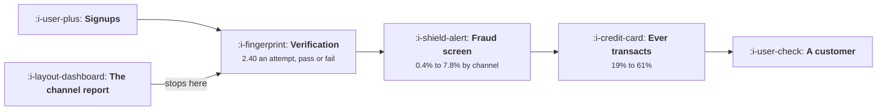

# Fintech

```text
Level: Sectors
Prerequisites: Payback by Channel
Estimated difficulty: 4/5 | Estimated time: 35 min
```

## The idea in one minute

Two costs sit in a fintech funnel that no software funnel has, and neither appears in a channel
report. Identity verification is charged per attempt whether it succeeds or not, and the fraud rate
differs by channel by a factor of twenty. Put both in and the ranking inverts: an affiliate channel
that looks identical to organic search at 6 per verified signup has a real cost of 223 per customer
against organic's 17. Advertising is 15 percent of that channel's true cost and verification and
fraud are the rest. The two largest levers are both about who you let in rather than how well the
funnel converts.

For the regulator, the licensing and the conduct rules, read
[Fintech](../../product-management/product-by-sector/02-fintech.md). This lesson is the growth
delta only.

## A picture



The report stops at the second box. Two thirds of the cost is in the two after it.

## How it really works

### Verification is a cost per attempt, which is a new shape

Every other acquisition cost in this course is paid per click or per customer. Verification is paid
per attempt, so a channel that sends a hundred thousand signups of whom a quarter pass costs you a
hundred thousand verifications.

In the worked affiliate channel that is 470,400 of verification against 290,000 of advertising.
Advertising is the smaller line, which is not a figure anybody has in their head.

### Fraud is a channel property, not a platform property

Fraud rates in the worked channels run 0.4, 0.9, 3.1 and 7.8 percent. That is a factor of twenty
across channels you are choosing between, and it correlates with exactly the things that make a
channel cheap: incentives, broad targeting and low intent.

At 310 per fraud loss, the affiliate channel's fraud bill is 1,232,213, which is four times its
advertising spend. A channel report showing cost per acquisition cannot see it, and the fraud team's
report cannot see which channel it came from unless somebody joins the two, which is the single most
valuable piece of instrumentation in this sector.

### What it changes across this course

| Topic | The delta here |
|---|---|
| [Acquisition Channels](../acquisition-channels/README.md) | Compute cost per customer with verification and fraud included. The ranking changes, usually completely |
| [Payback by Channel](../growth-economics/02-payback-by-channel.md) | The margin term varies by channel because fraud does. Blended margin is meaningless here |
| [Activation and Onboarding](../activation-and-onboarding/README.md) | Verification sits between signup and value and cannot be removed. Make the wait legible and give them something to do |
| [Friction Worth Keeping](../activation-and-onboarding/04-friction-worth-keeping.md) | The highest value lesson in the course for this sector: friction before verification pays for itself twice |
| [Lifecycle Messaging](../lifecycle-messaging/README.md) | Regulatory and transactional messages are uncappable, so the discretionary budget is what is left |
| [Monetisation and Conversion](../monetisation-and-conversion/README.md) | The paying decision happens at the moment of a transaction, not on a pricing page |
| [The Experiment Machine](../the-experiment-machine/README.md) | Experiments touching regulated flows need an audit trail and often a review, so velocity is capped by approvals |
| [Personalisation](../ai-in-growth/03-personalisation-that-is-not-creepy.md) | Inferring income or financial distress is a regulated activity, not a personalisation choice |

### Screening before verification is the counter intuitive lever

Halving the fraud rate is worth 20 percent of the real cost per customer. Screening before
verification, which loses a fifth of signups and raises the pass rate while cutting fraud, is worth
17 percent. Improving the verification pass rate by a tenth is worth 6 percent.

So the two largest levers are both about who you let in, and both reduce signups. A growth team
measured on signups will resist them, and a growth team measured on cost per real customer will
propose them, which is an argument for changing the metric before the campaign.

This is [Friction Worth Keeping](../activation-and-onboarding/04-friction-worth-keeping.md) with an
unusually favourable arithmetic, because the friction removes a cost rather than only selecting for
intent.

### The funnel has a gate you do not control

Verification outcomes depend on the applicant's documents, your provider's thresholds and the
jurisdiction. So a share of your funnel is decided by somebody else, and the pass rate moves when a
provider changes a threshold without telling you.

Two consequences. Instrument the pass rate by provider, document type and jurisdiction, so a shift
is attributable. And never treat a fall in conversion as a product problem before checking the
verification pass rate, because it is the most common cause and the least often checked.

### The three numbers to run the sector on

Real cost per transacting customer, by channel, including verification and fraud. Verification pass
rate, by segment. And fraud rate by acquisition channel, which requires joining two systems that
are usually owned by different teams.

## Run the numbers

Put verification and fraud into the channel comparison and read the ranking again.

```go
// fintech.go: the costs a fintech funnel carries that a software funnel does not.
package main

import "fmt"

// Between a signup and a customer sits identity verification, which costs
// money per attempt whether or not it succeeds, and behind every customer
// sits a fraud rate that differs by channel. Both land on acquisition cost
// and neither appears in a marketing report.
type channel struct {
	name    string
	spend   float64
	signups float64
	verify  float64 // share who pass verification
	fraud   float64 // share of passed customers who turn out fraudulent
	active  float64 // share of verified, honest customers who ever transact
}

const (
	kycCost   = 2.40  // cost of one verification attempt
	fraudLoss = 310.0 // average loss on one fraudulent customer
	value     = 540.0 // lifetime gross profit of a real customer
)

func (c channel) customers() float64 {
	return c.signups * c.verify * (1 - c.fraud) * c.active
}

// what the marketing report says
func (c channel) apparentCAC() float64 { return c.spend / (c.signups * c.verify) }

// what it actually costs
func (c channel) realCAC() float64 {
	total := c.spend + c.signups*kycCost + c.signups*c.verify*c.fraud*fraudLoss
	return total / c.customers()
}

func main() {
	chans := []channel{
		{"organic search", 140_000, 31_000, 0.74, 0.004, 0.61},
		{"paid search", 420_000, 58_000, 0.69, 0.009, 0.55},
		{"paid social", 610_000, 141_000, 0.41, 0.031, 0.38},
		{"affiliate and incentive", 290_000, 196_000, 0.26, 0.078, 0.19},
	}

	fmt.Printf("verification costs %.2f an attempt, a fraud loss is %.0f,\n", kycCost, fraudLoss)
	fmt.Printf("a real customer is worth %.0f\n\n", value)
	fmt.Printf("%-26s %10s %8s %8s %8s %12s %12s %s\n",
		"channel", "signups", "verify", "fraud", "active", "apparent", "real", "verdict")
	for _, c := range chans {
		v := "worth it"
		if c.realCAC() > value {
			v = "loses money"
		}
		fmt.Printf("%-26s %10.0f %7.0f%% %7.1f%% %7.0f%% %12.0f %12.0f %s\n",
			c.name, c.signups, 100*c.verify, 100*c.fraud, 100*c.active,
			c.apparentCAC(), c.realCAC(), v)
	}

	fmt.Println("\nOn the apparent figure the affiliate channel ties with organic")
	fmt.Println("search for cheapest, at 6 each. Its real cost is 223 against 17,")
	fmt.Println("thirteen times higher, because a quarter of its signups pass")
	fmt.Println("verification, eight percent of those are fraudulent, and a fifth of")
	fmt.Println("the rest ever transact. Every channel is still profitable against a")
	fmt.Println("540 customer, which is why nobody investigates.")

	fmt.Println("\nwhere the gap comes from, for the affiliate channel:")
	c := chans[3]
	fmt.Printf("%-40s %16.0f\n", "advertising spend", c.spend)
	fmt.Printf("%-40s %16.0f\n", "verification attempts", c.signups*kycCost)
	fmt.Printf("%-40s %16.0f\n", "fraud losses", c.signups*c.verify*c.fraud*fraudLoss)
	fmt.Printf("%-40s %16.0f\n", "total",
		c.spend+c.signups*kycCost+c.signups*c.verify*c.fraud*fraudLoss)
	fmt.Printf("%-40s %16.0f\n", "customers produced", c.customers())
	fmt.Printf("\nAdvertising is %.0f%% of the cost of this channel. The rest is\n",
		100*c.spend/(c.spend+c.signups*kycCost+c.signups*c.verify*c.fraud*fraudLoss))
	fmt.Println("verification and fraud, neither of which appears in a channel")
	fmt.Println("report, and both of which scale with signups rather than with")
	fmt.Println("customers.")

	fmt.Println("\nwhat each lever is worth on the paid social channel:")
	base := chans[2]
	fmt.Printf("%-44s %16s %14s\n", "change", "real cost", "saving")
	b := base.realCAC()
	for _, l := range []struct {
		name string
		f    func(channel) channel
	}{
		{"nothing", func(c channel) channel { return c }},
		{"raise the verification pass rate a tenth", func(c channel) channel {
			c.verify *= 1.1
			return c
		}},
		{"halve the fraud rate", func(c channel) channel { c.fraud /= 2; return c }},
		{"raise the share who transact a tenth", func(c channel) channel {
			c.active *= 1.1
			return c
		}},
		{"screen before verifying, losing a fifth", func(c channel) channel {
			c.signups *= 0.8
			c.verify *= 1.18
			c.fraud *= 0.6
			return c
		}},
	} {
		n := l.f(base).realCAC()
		fmt.Printf("%-44s %16.0f %13.0f%%\n", l.name, n, 100*(1-n/b))
	}
	fmt.Println("\nHalving the fraud rate is worth 20% and screening before")
	fmt.Println("verification is worth 17%, against 6% for a better verification pass")
	fmt.Println("rate. The two largest levers are both about who you let in rather")
	fmt.Println("than how well the funnel converts, which is the opposite of where a")
	fmt.Println("growth team's attention naturally goes.")
}
```

The first table is the inversion. Apparent costs of 6, 10, 11 and 6 against real costs of 17, 31, 71
and 223. Every channel is profitable against a 540 customer, which is precisely why nobody
investigates, and the affiliate channel is thirteen times worse than organic search while appearing
identical.

The cost breakdown for the affiliate channel is the exhibit to bring to a meeting: advertising
290,000, verification 470,400, fraud 1,232,213. Advertising is 15 percent of the total.

The lever table ranks the responses: 20, 17, 9 and 6 percent. Put your own verification cost and
fraud loss in; both come from finance and risk rather than from marketing, which is why they are
missing from the channel report in the first place.

## The AI layer

Three applications, and one is a compliance boundary rather than an opportunity.

Pre verification screening is the first and it is where the money is. Predicting which signups will
fail verification or turn out fraudulent, before paying for the verification attempt, directly
addresses the two largest levers in the table. It is a well understood modelling problem with
abundant labelled data, and the saving is the 17 and 20 percent rows.

Document handling during verification is the second: extraction, matching and flagging, which raises
the pass rate for genuine applicants by rescuing cases that would otherwise fail on a formatting
issue. That is the 6 percent row and it also shortens the wait, which is the activation problem
above.

The boundary: declining somebody, pricing somebody differently, or inferring their financial
circumstances is regulated decision making in most jurisdictions, with requirements about
explainability, record keeping and the right to a human review. A model that screens signups before
verification is close to that line, and the version that stays on the right side of it flags for
review rather than rejecting, and keeps the record. Treat the design of that boundary as a legal
question answered before the model is built, not a product question answered afterwards.

## Remember this

* Verification is charged per attempt, which is a cost shape no software funnel has.
* In the worked affiliate channel, verification cost 470,400 against 290,000 of advertising.
* Fraud rates vary twentyfold across channels and correlate with what makes a channel cheap.
* Apparent costs of 6, 10, 11 and 6 become real costs of 17, 31, 71 and 223.
* Advertising was 15 percent of the worst channel's true cost.
* Join the fraud system to the acquisition channel. It is the most valuable instrumentation in this
  sector and nobody owns it.
* The two largest levers are halving fraud and screening before verification, both of which reduce
  signups.
* So change the metric to real cost per transacting customer before running the campaign.
* Part of your funnel is decided by your verification provider. Instrument the pass rate by
  provider, document and jurisdiction.
* Check the verification pass rate before diagnosing any conversion fall as a product problem.
* Screening models sit near regulated decision making. Flag for review rather than rejecting, and
  keep the record.

## Try it

1. Compute real cost per transacting customer by channel, with verification attempts and fraud
   losses included. Expect the ranking to change.
2. Join your fraud records to acquisition channel for the last year. If that join does not exist,
   building it is this quarter's project.
3. Propose one screening step before verification and present it as a cost reduction with the
   signup loss stated, rather than as a conversion change.

## Check yourself

1. Two channels both show 8 per verified signup. One has a 70 percent pass rate and 0.5 percent
   fraud, the other 30 percent and 5 percent. What do they really cost?
2. Your conversion rate fell four points last month with no product change. What do you check
   first?
3. Why will a growth team measured on signups resist the two most valuable levers in this sector?
