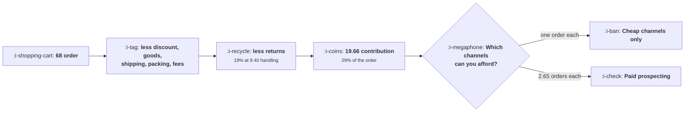

# Ecommerce and D2C

```text
Level: Sectors
Prerequisites: Payback by Channel
Estimated difficulty: 3/5 | Estimated time: 35 min
```

## The idea in one minute

Growth here is bounded by contribution margin per order, and after discount, goods, shipping,
packing, payment fees and returns, 29 percent of a 68 order survives: 19.66 to spend on acquiring
it. Which channels you can use follows directly. Paid social prospecting at 52 a customer needs 2.65
orders each, meaning a 62 percent chance of reordering after every order, which few catalogues
achieve. And the four largest levers on the budget are charging for shipping, raising order value,
cutting returns and cutting discount, in that order. They are merchandising and operations
decisions, and here they are growth decisions.

For the category dynamics, the retail calendar and the brand question, read
[Ecommerce and D2C](../../product-management/product-by-sector/03-ecommerce-and-d2c.md). This
lesson is the growth delta only.

## A picture



Every channel decision in this sector is downstream of the third box.

## How it really works

### Build the contribution line before anything else

Order value, minus discount, minus cost of goods on the net, minus shipping, minus packing, minus
payment fees, times one minus the return rate, minus the return handling cost. Six deductions and
two of them are usually missing from the version a growth team is shown.

The two usually missing are returns, because they land in operations, and payment fees, because they
land in finance. Together they are 8.15 of the 68 in the worked example, which is more than the
whole acquisition budget of a cheap channel.

### Affordability is a repeat rate question, not a channel question

Allowable spend is contribution per order times expected orders per customer. One order allows
19.66; 11.8 orders allows 231.58, a factor of twelve.

So the channel list is not a ranking of channels, it is a function of your repeat rate. The worked
table turns each channel's cost into the orders it requires and then into the per order repeat
probability that implies: 42 percent for generic search, 52 for affiliates, 62 for paid social
prospecting.

The practical test: measure your actual per order repeat probability from cohorts, then read off
which channels your business can use. A plan that includes a channel above your measured repeat
rate is a plan betting on a repeat rate improvement, and it should say so.

### What it changes across this course

| Topic | The delta here |
|---|---|
| [Acquisition Channels](../acquisition-channels/README.md) | Channel tests are cheap and fast, so the precision arithmetic is affordable. Seasonality is the threat and needs a control period |
| [Content and Search](../content-and-search/README.md) | Product pages are the money pages. Category explainers have collapsed in value |
| [Paid Acquisition](../paid-acquisition/README.md) | The whole discipline applies directly, and the creative is the targeting more completely than in any other sector |
| [Engagement and Resurrection](../engagement-and-resurrection/README.md) | Natural frequency is the consumption rate of the product itself, which is knowable per item |
| [Monetisation and Conversion](../monetisation-and-conversion/README.md) | No paywall and no trial. The equivalents are the basket, the delivery threshold and the returns policy |
| [Expansion as a Loop](../monetisation-and-conversion/05-expansion-as-a-loop.md) | Replaced by repeat purchase, which is the same arithmetic with consumption in place of seats |
| [Growth Economics](../growth-economics/README.md) | Cash is the binding constraint, more severely than the model there suggests, because inventory is paid for before the customer exists |
| [The Experiment Machine](../the-experiment-machine/README.md) | The highest velocity sector in the course. Guardrails on revenue per visitor are not optional |

### The levers are not in the funnel

Charging 4 for shipping is worth 3.24 of contribution. Raising order value by a tenth is worth 2.78.
Cutting returns from 19 to 12 percent is worth 2.51. Halving the discount is worth 1.88.

Each of those is 10 to 16 percent of the acquisition budget, and a 16 percent budget increase is
larger than most funnel optimisation delivers in a year. They are also all owned by somebody other
than growth, which is why the growth lead's most valuable relationship in this sector is with
merchandising and operations rather than with the advertising platforms.

### Returns are the lever nobody treats as growth

A 19 percent return rate costs 6.82 per order, which is a quarter of the margin before returns. The
drivers are sizing information, photography accuracy, delivery damage and description precision, all
of which are product and content work.

Cutting the return rate is therefore a growth project with a budget number attached, and it is
almost always owned by operations and measured as a cost rather than as a constraint on acquisition.
Reframing it as the latter is usually enough to get it prioritised.

### Cash is worse here than the general case

Inventory is purchased before the customer exists, so the cash trough from
[Setting and Defending a Budget](../growth-economics/04-setting-and-defending-a-budget.md) is
deeper than the model there implies: you are funding both the acquisition and the goods. A growth
plan in this sector that does not have an inventory cash line in it is incomplete.

## Run the numbers

Build the contribution line, then read off the affordable channels.

```go
// ecommerce.go: what is left of an order to spend on acquiring it.
package main

import "fmt"

// Growth in ecommerce is bounded by contribution margin per order, and the
// deductions between the price and that margin are larger and more numerous
// than in any other sector. What remains decides the whole acquisition
// strategy, and it is usually a fifth of the order value.
const (
	order    = 68.0
	cogs     = 0.41 // share of order value
	shipping = 6.80
	pack     = 1.10
	payment  = 0.022
	retRate  = 0.19 // share of orders returned
	retCost  = 9.40 // handling a return, on top of the refunded order
	discount = 0.11 // average discount given
)

func contribution() float64 {
	net := order * (1 - discount)
	m := net - net*cogs - shipping - pack - net*payment
	// returns cost the margin on the returned order plus the handling
	m = m*(1-retRate) - retRate*retCost
	return m
}

func main() {
	net := order * (1 - discount)
	fmt.Printf("%-34s %14.2f\n", "order value", order)
	fmt.Printf("%-34s %14.2f\n", "less discount", -order*discount)
	fmt.Printf("%-34s %14.2f\n", "net revenue", net)
	fmt.Printf("%-34s %14.2f\n", "less cost of goods", -net*cogs)
	fmt.Printf("%-34s %14.2f\n", "less shipping", -shipping)
	fmt.Printf("%-34s %14.2f\n", "less packing", -pack)
	fmt.Printf("%-34s %14.2f\n", "less payment fees", -net*payment)
	gross := net - net*cogs - shipping - pack - net*payment
	fmt.Printf("%-34s %14.2f\n", "margin before returns", gross)
	fmt.Printf("%-34s %14.2f\n", "less returns", contribution()-gross)
	fmt.Printf("%-34s %14.2f\n", "contribution per order", contribution())
	fmt.Printf("%-34s %13.0f%%\n", "as a share of order value", 100*contribution()/order)

	fmt.Println("\nTwenty nine percent of the order value survives to pay for")
	fmt.Println("acquiring it. Everything a growth team can spend comes out of 19.66,")
	fmt.Println("which is why this sector's arguments are about margin rather than")
	fmt.Println("about funnels.")

	fmt.Println("\nwhat a first order can fund, by repeat behaviour:")
	fmt.Printf("%-16s %14s %16s %16s %s\n",
		"orders a year", "years", "total orders", "allowable spend", "verdict")
	for _, r := range []struct {
		perYear, years float64
	}{
		{1.0, 1.0}, {1.4, 1.6}, {2.2, 2.4}, {3.8, 3.1},
	} {
		total := r.perYear * r.years
		// spend up to the contribution of all the orders you expect
		allow := total * contribution()
		v := "a paid channel is possible"
		if allow < 30 {
			v = "only cheap channels work"
		}
		fmt.Printf("%16.1f %14.1f %16.1f %16.2f %s\n",
			r.perYear, r.years, total, allow, v)
	}
	fmt.Println("\nA customer who orders once can justify 19.66 of acquisition and a")
	fmt.Println("customer who orders 11.8 times can justify 231.58, a factor of")
	fmt.Println("twelve. The entire strategy of this sector is knowing which of those")
	fmt.Println("you are, and almost every growth decision follows from it.")

	fmt.Println("\nthe repeat rate needed to afford each channel:")
	fmt.Printf("%-30s %14s %18s %s\n",
		"channel", "cost per order", "orders needed", "repeat rate implied")
	for _, c := range []struct {
		name string
		cpa  float64
	}{
		{"organic and referral", 4.0},
		{"email and owned", 1.2},
		{"paid search on brand", 11.0},
		{"paid search, generic", 34.0},
		{"paid social, prospecting", 52.0},
		{"influencer and affiliate", 41.0},
	} {
		need := c.cpa / contribution()
		// orders needed in total, so the repeat probability per order that gets there
		repeat := 0.0
		if need > 1 {
			repeat = 1 - 1/need
		}
		fmt.Printf("%-30s %14.0f %18.2f %17.0f%%\n", c.name, c.cpa, need, 100*repeat)
	}
	fmt.Println("\nPaid social prospecting needs 2.65 orders per customer, which means")
	fmt.Println("a 62% chance of reordering after every order. Few catalogues achieve")
	fmt.Println("that. The channel is not expensive; it is unaffordable without a")
	fmt.Println("repeat rate the business may not have, and an honest growth plan")
	fmt.Println("says which repeat rate it is betting on.")

	fmt.Println("\nwhat moves the contribution, ranked:")
	fmt.Printf("%-34s %16s %14s\n", "change", "contribution", "gain")
	b := contribution()
	for _, l := range []struct {
		name string
		f    func() float64
	}{
		{"nothing", contribution},
		{"raise order value a tenth", func() float64 {
			n := order * 1.1 * (1 - discount)
			m := n - n*cogs - shipping - pack - n*payment
			return m*(1-retRate) - retRate*retCost
		}},
		{"cut the discount from 11% to 5%", func() float64 {
			n := order * 0.95
			m := n - n*cogs - shipping - pack - n*payment
			return m*(1-retRate) - retRate*retCost
		}},
		{"cut returns from 19% to 12%", func() float64 {
			n := order * (1 - discount)
			m := n - n*cogs - shipping - pack - n*payment
			return m*0.88 - 0.12*retCost
		}},
		{"charge 4 for shipping", func() float64 {
			n := order * (1 - discount)
			m := n - n*cogs - (shipping - 4) - pack - n*payment
			return m*(1-retRate) - retRate*retCost
		}},
	} {
		v := l.f()
		fmt.Printf("%-34s %16.2f %13.2f\n", l.name, v, v-b)
	}
	fmt.Println("\nCharging 4 for shipping is worth 3.24 and raising order value by a")
	fmt.Println("tenth is worth 2.78. Cutting returns by seven points is worth 2.51")
	fmt.Println("and halving the discount is worth 1.88. All four are merchandising")
	fmt.Println("and operations decisions, and in this sector they are growth")
	fmt.Println("decisions, because they set the acquisition budget.")
}
```

The contribution line is the exhibit. Note how much of it is not cost of goods: shipping, packing,
payment and returns total 16.05 against 24.81 of goods, so the non goods deductions are two thirds
as large as the goods themselves.

The affordability table converts repeat behaviour into budget: 19.66, 44.04, 103.80 and 231.58.
Measure which row you are on rather than assuming the one your plan needs.

The channel table is the decision: orders needed of 0.20, 0.06, 0.56, 1.73, 2.65 and 2.09, with
implied per order repeat rates. Put your own channel costs and your measured repeat rate in, and the
affordable list falls out.

The lever table is where to spend attention: 3.24, 2.78, 2.51 and 1.88 of contribution. Take it to
whoever owns shipping policy and returns.

## The AI layer

Three applications with real numbers attached, and they are all on the margin side rather than the
funnel side, which is where this sector's constraint is.

Returns reduction is the largest. Better sizing guidance, more accurate product descriptions
generated from real attributes, and imagery that shows scale and fit address the main drivers of a
19 percent return rate. A seven point reduction is worth 2.51 per order, which at any volume is a
larger number than the content cost.

Product content at catalogue scale is the second, and it is one of the few places where generated
content at volume is clearly correct: the pages are about your own products, which is exactly the
test from
[Content at Scale and the Quality Floor](../ai-in-growth/02-content-at-scale-and-the-quality-floor.md),
and the alternative is no page at all.

Creative volume for paid is the third and is subject to the warning in
[Testing a Channel Properly](../acquisition-channels/03-testing-a-channel-properly.md): forty
variants on a budget sized for two is not a test. The useful version is more creative per concept
tested properly rather than more concepts tested badly.

What to be careful about: generated product copy that overstates, which raises conversion and the
return rate at the same time. Those two move in opposite directions on contribution and the second
one lands in a different report, so instrument return rate by page version whenever product content
changes.

## Remember this

* Growth is bounded by contribution per order. Twenty nine percent of a 68 order survived: 19.66.
* Six deductions, and the two usually missing from a growth team's version are returns and payment
  fees, worth 8.15 together.
* Allowable spend is contribution times expected orders, which runs from 19.66 to 231.58, a factor
  of twelve.
* So the affordable channel list is a function of your repeat rate. Paid social prospecting needed a
  62 percent per order repeat probability.
* A plan including a channel above your measured repeat rate is betting on an improvement and should
  say so.
* The four largest budget levers are shipping charges, order value, returns and discounts, worth
  3.24, 2.78, 2.51 and 1.88.
* All four are owned by merchandising and operations, so that is the growth lead's most valuable
  relationship here.
* Returns cost 6.82 an order, a quarter of the pre returns margin, and are a growth project
  misfiled as a cost line.
* Cash is worse than the general case because inventory is bought before the customer exists.
* Generated product content is clearly correct here; overstated copy raises conversion and returns
  together, so instrument return rate by page version.

## Try it

1. Build your real contribution line with all six deductions and circulate it. Expect the returns
   and payment lines to be new to somebody.
2. Measure your per order repeat probability from cohorts and read off which channels you can
   afford. Compare that list with the one you are using.
3. Take the four lever values to whoever owns shipping and returns, framed as acquisition budget
   rather than as cost reduction.

## Check yourself

1. Your contribution per order is 11 and paid social costs 48 a customer. What has to be true for
   the channel to work?
2. Why is cutting the return rate a growth project, and where is it usually filed instead?
3. Generated product descriptions raised conversion 6 percent and returns rose 3 points. What
   happened to contribution?
