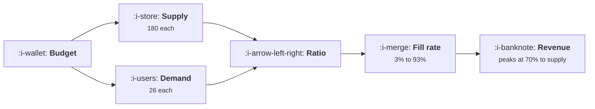

# Marketplaces

```text
Level: Sectors
Prerequisites: The Marginal Pound
Estimated difficulty: 4/5 | Estimated time: 35 min
```

## The idea in one minute

A marketplace's output is matches, not users, and the match rate depends on the ratio between the
two sides. So the budget split is not a negotiation between a supply team and a demand team, it is
a computable number: in the worked market, 70 percent to supply produces 69,334 of monthly revenue
and 10 percent produces 13,588. Worse, spending on the abundant side actively destroys value. An
extra 300,000 spent entirely on demand adds 12,453 of revenue and drops the fill rate from 50 to 28
percent, giving 11,538 extra buyers a worse experience than the ones already there.

For the liquidity problem, the two customers and the disintermediation risk, read
[Marketplaces](../../product-management/product-by-sector/04-marketplaces.md). This lesson is the
growth delta only.

## A picture



Neither side's acquisition cost decides the split. The ratio does.

## How it really works

### The output is matches, so neither side's user count is a growth metric

Supplier count and buyer count can both rise while matches fall, if they rise in the wrong
proportion. That makes the usual top line metrics actively misleading here, and it is why
marketplace growth teams that report user growth per side end up optimising against each other.

The metric is matches, and the two inputs are the ratio and the total. Report both.

### The optimum split is computable and it is not intuitive

Supply costs seven times what demand costs in the worked market, so the intuitive answer is to buy
the cheap side. The optimum puts 70 percent of the budget on the expensive side, because supply is
what is scarce and the fill rate responds to it.

Revenue by split runs 13,588, 38,873, 59,595, 69,334 and 42,583 as the supply share goes from 10 to
90 percent. The curve has a clear interior maximum and the loss at either extreme is most of the
budget.

Compute it rather than arguing about it. The inputs are your two acquisition costs, your take rate,
your basket, and a fill rate curve you can fit from your own history of ratio against match rate.

### Spending on the abundant side is worse than not spending

This is the part that distinguishes the sector. In a normal business, money spent inefficiently is
wasted. Here it is worse than wasted: buyers acquired into a thin market have a bad experience and
leave, so you have paid to damage your reputation with 11,538 people.

So the correct response to a budget increase is to re split the whole budget, not to give the
increment to whoever asked for it. An extra 300,000 split correctly adds 23,112; given entirely to
demand it adds 12,453 and lowers the fill rate by 22 points.

### What it changes across this course

| Topic | The delta here |
|---|---|
| [Acquisition Channels](../acquisition-channels/README.md) | Two channel portfolios with different economics, and a channel test on one side changes the other side's experience |
| [The Marginal Pound](../growth-economics/03-the-marginal-pound.md) | The allocation has three dimensions: channel, side and geography. Equalising marginal cost within a side is not enough |
| [Activation and Onboarding](../activation-and-onboarding/README.md) | Two definitions. Supply activates on first earnings, demand on first match, and the supply one is upstream |
| [Engagement and Resurrection](../engagement-and-resurrection/README.md) | Supply side notifications carry earnings, so tolerance is high and accuracy matters more |
| [Lifecycle Messaging](../lifecycle-messaging/README.md) | Two maps. Operational supply messages must never share a budget with demand side promotion |
| [The Experiment Machine](../the-experiment-machine/README.md) | User level arms interfere through the market, so assignment is by geography and the unit count collapses |
| [Growth Economics](../growth-economics/README.md) | Supply side payback is often negative and correctly so, because supply is the inventory |
| [Buying Revenue at a Loss](../growth-economics/06-buying-revenue-at-a-loss.md) | The most legitimate case in the course, on the side that creates liquidity, in markets with winner takes most dynamics |

### The ratio has to be watched per market

A national ratio inside its band routinely hides cities on both sides of it. A marketplace with
eight cities can be oversupplied in three and undersupplied in five while the aggregate looks
perfect, and every one of those eight markets is a separate liquidity problem with a separate
optimal split.

That is the practical reason marketplace growth is operationally heavier than other sectors: you are
running N markets, not one, and the budget split is per market.

### Who owns the ratio

Usually nobody, which is the single most common structural failure in marketplace growth teams.
Supply and demand both have owners and targets; the ratio has neither, so it drifts to whichever
side has the more persuasive leader.

The fix is an owner whose metric is matches, with the authority to move budget between the two
sides, which is the same arrangement as the attention budget owner in
[The Shared Attention Budget](../lifecycle-messaging/05-the-shared-attention-budget.md) and is
resisted for the same reasons.

## Run the numbers

Compute the split rather than negotiating it.

```go
// marketplace.go: why spending on one side destroys the other.
package main

import (
	"fmt"
	"math"
)

// A marketplace's output is matches, not users. The match rate depends on the
// ratio between the two sides, so money spent on the side that is already
// abundant produces users who have a bad experience and leave, and the
// optimal split is a computable number rather than a negotiation.
const (
	supplyCAC = 180.0
	demandCAC = 26.0
	takeRate  = 0.14
	basket    = 94.0
	budget    = 900_000.0
)

// share of demand that finds a match, given how much supply there is per unit
// of demand. Thin markets match badly and thick ones saturate.
func fillRate(ratio float64) float64 {
	return 1 - math.Exp(-2.1*ratio)
}

// matches and revenue a month from a given split of the budget
func run(toSupply float64) (supply, demand, fill, revenue float64) {
	supply = budget * toSupply / supplyCAC
	demand = budget * (1 - toSupply) / demandCAC
	if demand == 0 {
		return supply, 0, 0, 0
	}
	fill = fillRate(supply / demand)
	// each matched demand unit transacts once a month
	return supply, demand, fill, demand * fill * basket * takeRate
}

func main() {
	fmt.Printf("supply costs %.0f to acquire, demand %.0f; take rate %.0f%% on %.0f\n",
		supplyCAC, demandCAC, 100*takeRate, basket)
	fmt.Printf("budget %.0f a month\n\n", budget)

	fmt.Printf("%-18s %12s %12s %10s %12s %14s\n",
		"share to supply", "suppliers", "buyers", "ratio", "fill rate", "revenue")
	for _, t := range []float64{0.10, 0.30, 0.50, 0.70, 0.90} {
		sup, dem, f, rev := run(t)
		fmt.Printf("%17.0f%% %12.0f %12.0f %10.3f %11.0f%% %14.0f\n",
			100*t, sup, dem, sup/dem, 100*f, rev)
	}

	best, bestRev := 0.0, 0.0
	for t := 0.01; t < 1.0; t += 0.005 {
		if _, _, _, rev := run(t); rev > bestRev {
			best, bestRev = t, rev
		}
	}
	fmt.Printf("\nthe best split is %.0f%% to supply, giving %.0f of revenue\n",
		100*best, bestRev)

	fmt.Println("\nSpending ten percent on supply buys 31,154 buyers and a 3% fill")
	fmt.Println("rate, so almost every buyer has a bad experience. Spending ninety")
	fmt.Println("percent buys 4,500 suppliers with nobody to serve. Both extremes")
	fmt.Println("waste most of the budget, and the optimum is a computable point")
	fmt.Println("rather than a negotiation between two teams.")

	fmt.Println("\nwhat a one sided campaign does, from the optimum:")
	sup0, dem0, f0, rev0 := run(best)
	fmt.Printf("%-40s %12s %12s %12s %14s\n",
		"change", "suppliers", "buyers", "fill rate", "revenue")
	fmt.Printf("%-40s %12.0f %12.0f %11.0f%% %14.0f\n",
		"the optimum", sup0, dem0, 100*f0, rev0)
	for _, c := range []struct {
		name  string
		extra float64 // extra budget, all to demand
	}{
		{"add 300,000, all to demand", 300_000},
		{"add 300,000, at the optimal split", 300_000},
	} {
		if c.name == "add 300,000, all to demand" {
			sup := sup0
			dem := dem0 + c.extra/demandCAC
			f := fillRate(sup / dem)
			fmt.Printf("%-40s %12.0f %12.0f %11.0f%% %14.0f\n",
				c.name, sup, dem, 100*f, dem*f*basket*takeRate)
		} else {
			b2 := budget + c.extra
			sup := b2 * best / supplyCAC
			dem := b2 * (1 - best) / demandCAC
			f := fillRate(sup / dem)
			fmt.Printf("%-40s %12.0f %12.0f %11.0f%% %14.0f\n",
				c.name, sup, dem, 100*f, dem*f*basket*takeRate)
		}
	}
	fmt.Println("\nThe same extra 300,000 adds 23,112 of monthly revenue when split")
	fmt.Println("correctly and 12,453 when spent entirely on demand, because the fill")
	fmt.Println("rate falls from 50% to 28% as the ratio moves. The one sided version")
	fmt.Println("also gives 11,538 extra buyers a worse experience than the ones")
	fmt.Println("already there, and they do not come back.")

	fmt.Println("\nwhat each side's growth work actually is:")
	fmt.Printf("%-16s %-32s %s\n", "side", "the job", "the measure")
	for _, r := range []struct{ a, b, c string }{
		{"supply", "recruit, vet and retain capacity", "utilisation and earnings per supplier"},
		{"demand", "fill the capacity that exists", "fill rate and time to match"},
		{"both", "keep the ratio inside its band", "ratio, weekly, per market"},
	} {
		fmt.Printf("%-16s %-32s %s\n", r.a, r.b, r.c)
	}
	fmt.Println("\nThe third row is the one nobody owns, and it is the only one that")
	fmt.Println("decides whether the other two produce anything. Per market, because")
	fmt.Println("a national ratio inside its band hides cities on both sides of it.")
}
```

The split table is the main result. Fill rates of 3, 12, 26, 51 and 93 percent, revenue of 13,588,
38,873, 59,595, 69,334 and 42,583. Note that the highest fill rate is not the highest revenue: at 90
percent to supply the market works beautifully for the few buyers in it and there are not enough of
them.

The one sided campaign table is the exhibit for the argument. The same money, twice the return when
split correctly, and 22 points of fill rate preserved.

Fit your own fill rate curve from history: ratio on one axis, match rate on the other, per market,
over as many months as you have. It is the only input here you cannot get from a finance report and
it is the one that decides everything.

## The AI layer

Three applications, and the first is the one that changes the economics rather than the operations.

Matching quality is the lever that moves the fill rate curve itself. Better matching at the same
ratio means a higher fill rate, which raises revenue at every split and relaxes the whole
constraint. That is a genuinely different kind of improvement from acquiring more of either side,
and it is where model work in a marketplace pays best.

Moderation and trust at scale is the second: verifying suppliers, detecting fraud, and checking
listings are all volume classification problems and all of them gate supply onboarding, which is
the expensive side. Faster vetting lowers the effective supply acquisition cost, which moves the
optimal split.

Demand forecasting per market is the third, and it feeds the per market budget split directly. A
model that predicts next month's ratio by market turns the allocation from reactive to planned.

What to avoid: using one side's behavioural data to personalise the other side's experience in ways
that reveal the first side, which is the specific privacy failure of this sector and is covered in
[Personalisation That Is Not Creepy](../ai-in-growth/03-personalisation-that-is-not-creepy.md).
A buyer should not be able to infer a supplier's other business from what they are shown.

## Remember this

* The output is matches. Supplier and buyer counts can both rise while matches fall.
* The budget split is computable from two acquisition costs, a take rate, a basket and a fitted fill
  rate curve.
* The optimum was 70 percent to the side costing seven times more, because scarcity decides, not
  price.
* Revenue by split ran 13,588 to 69,334 and back to 42,583. Both extremes waste most of the budget.
* Spending on the abundant side is worse than not spending: it buys people a bad experience.
* Re split the whole budget when it changes rather than giving the increment to whoever asked.
* The same 300,000 added 23,112 split correctly and 12,453 on demand alone, costing 22 points of
  fill rate.
* Watch the ratio per market. A healthy national figure hides markets on both sides of the band.
* Nobody owns the ratio in most companies, which is the most common structural failure here.
* Better matching moves the fill rate curve itself, which is worth more than acquiring either side.

## Try it

1. Fit your fill rate curve from ratio against match rate, per market, over your full history. It is
   the input everything else needs.
2. Compute the optimal split for your three largest markets and compare it against what you are
   spending. Expect at least one to be badly wrong.
3. Give the ratio an owner whose metric is matches and who can move budget between sides. Note who
   objects.

## Check yourself

1. Your supplier count and buyer count both grew 30 percent and matches grew 4 percent. What
   happened?
2. Why is money spent on the abundant side worse than money not spent at all?
3. Your national supply to demand ratio is healthy and three of your eight cities are complaining.
   What are you not measuring?
