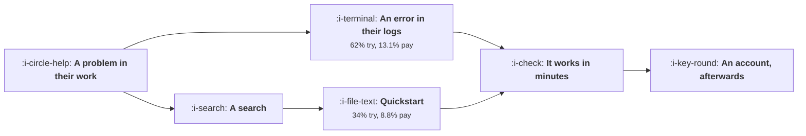

# Devtools and Infrastructure

```text
Level: Sectors
Prerequisites: What PLG Actually Requires
Estimated difficulty: 3/5 | Estimated time: 35 min
```

## The idea in one minute

Developers search for a problem, read the documentation before signing up, and decide in a
terminal, so the surfaces that convert are the ones that let somebody succeed before any account
exists. In the worked table the highest converting surface at every step is an error message in
somebody's own logs, maintained for 900 a month, and the only negative row is the only row with any
selling in it. The metric to run the function on is time to first successful call: taking it from
twenty minutes to two raises the share who get it working from 70 to 90 percent and adds 583,000 a
month from one page.

For the audience, the public scrutiny and the open source question, read
[Devtools and Infrastructure](../../product-management/product-by-sector/05-devtools-and-infrastructure.md).
This lesson is the growth delta only.

## A picture



The account is at the end, not the beginning, and every surface before it has to work without one.

## How it really works

### The documentation is the funnel

Not a support asset and not a content channel. The quickstart page is the highest revenue surface in
the worked table at 2,086,131 a month, and the API reference is second at 1,203,119, and neither is
usually owned by anybody with a growth target.

That is the structural observation for this sector: the pages that convert are maintained by
engineering as a documentation duty, and the pages a growth team owns, the comparison page and the
paid landing page, are 217,477 and minus 1,484.

The practical move is not to take documentation away from engineering. It is to put the conversion
numbers next to it, so the quickstart page has an owner who knows what it is worth.

### Error messages are an acquisition channel

The highest converting surface is an error message that appears in somebody's own logs, with a link
to the page that explains it. Sixty two percent try the product and 13.1 percent of those who get
it working eventually pay, which is the best rate in the table by a distance.

The reason is timing: the user has a problem right now, and the message arrives inside their work
rather than in a channel competing for attention. It is also nearly free to maintain.

If you ship a library or an API, the text of your error messages is a growth surface. Almost nobody
treats it as one.

### Time to first successful call is the metric

The share of people who get it working falls steeply with how long it takes: 90 percent at two
minutes, 83 at eight, 70 at twenty, 43 at forty five, 5 at two hours.

So this one number governs the whole funnel, and it is measurable: instrument the time from first
documentation visit to first successful authenticated call. It is also the one thing that cannot be
improved by anybody in marketing, which is the recurring theme of this sector.

### What it changes across this course

| Topic | The delta here |
|---|---|
| [Acquisition Channels](../acquisition-channels/README.md) | Documentation, error messages and the open source repository are the channels. Paid is marginal and sometimes negative |
| [Content and Search](../content-and-search/README.md) | Technical content that requires having built the thing. The quality floor lesson applies most strongly here |
| [Activation and Onboarding](../activation-and-onboarding/README.md) | Activation is a successful call in something resembling production, which is weeks after signup |
| [Friction Worth Keeping](../activation-and-onboarding/04-friction-worth-keeping.md) | An API key step has a high pass rate among the right audience and filters nobody who matters. Keep it, remove the form around it |
| [Lifecycle Messaging](../lifecycle-messaging/README.md) | Alert and incident mail must land, so separate the domains. Developers opt out at the highest rate of any audience |
| [Product Qualified Leads](../product-led-growth/03-product-qualified-leads.md) | Production traffic appearing and a second project are the movable signals. Usage volume alone is a forecast |
| [Instrumentation](../instrumentation-and-the-event-model/README.md) | Client loss exceeds a third and much of the product has no client. Server and API side collection is the primary route |
| [The Experiment Machine](../the-experiment-machine/README.md) | Adoption lags by weeks, so test the website and the docs where cycles are fast |
| [The Demo Loop](../growth-for-ai-products/05-the-demo-loop.md) | The strongest and most durable version of this loop, because the artefact is code in a public repository |

### What inverts here

Six techniques that work elsewhere and fail here, and they fail for one reason: the audience can
inspect what you did and will discuss it publicly.

Gated content, generated comparison pages, outbound, demo request forms, hidden pricing, and product
tours. Each of them is a standard play, each has a measurable negative effect in this sector, and
each gets proposed by somebody who has worked in another one.

The useful framing for that conversation: these are not stylistic preferences of a fussy audience.
They are techniques whose value depends on the recipient not being able to check, and this audience
checks.

### Where paid actually works

Not on the category, which is the negative row. On your own brand name, defensively, and on the
specific error strings and library names your competitors' users search for. Both are small, cheap
and high intent, and both are invisible in a channel report that groups all paid search together.

## Run the numbers

Price each surface, then price a minute of time to first success.

```go
// devtools.go: why the documentation is the funnel.
package main

import "fmt"

// Developers find tools by searching for a problem, read the documentation
// before signing up, and decide in a terminal. So the pages that convert are
// the ones that let somebody succeed before any account exists, and the
// channels that work are the ones with no selling in them.
type surface struct {
	name    string
	visits  float64 // a month
	toTrial float64 // share who go on to try it
	toUse   float64 // of those, share who get it working
	toPay   float64 // of those, share who ever pay
	cost    float64 // to build and maintain, a month
}

const value = 2_400.0 // lifetime gross profit of a paying account

func (s surface) payers() float64 { return s.visits * s.toTrial * s.toUse * s.toPay }
func (s surface) net() float64    { return s.payers()*value - s.cost }

func main() {
	surfaces := []surface{
		{"the quickstart page", 41_000, 0.34, 0.71, 0.088, 4_200},
		{"API reference", 118_000, 0.09, 0.78, 0.061, 9_600},
		{"a worked example repository", 22_000, 0.41, 0.83, 0.102, 3_100},
		{"the error message in their logs", 9_400, 0.62, 0.74, 0.131, 900},
		{"a comparison page you wrote", 14_000, 0.21, 0.66, 0.047, 1_400},
		{"a conference talk", 3_200, 0.17, 0.59, 0.071, 11_000},
		{"paid search on the category", 26_000, 0.07, 0.44, 0.019, 38_000},
	}

	fmt.Printf("%-36s %10s %8s %8s %8s %10s %12s\n",
		"surface", "visits", "try", "works", "pay", "payers", "net/month")
	for _, s := range surfaces {
		fmt.Printf("%-36s %10.0f %7.0f%% %7.0f%% %7.1f%% %10.1f %12.0f\n",
			s.name, s.visits, 100*s.toTrial, 100*s.toUse, 100*s.toPay,
			s.payers(), s.net())
	}

	fmt.Println("\nThe error message in somebody's logs converts best at every step")
	fmt.Println("and costs 900 a month to maintain, because it arrives at the moment")
	fmt.Println("of a real problem. The quickstart produces the most revenue, on")
	fmt.Println("volume rather than on conversion. Paid search on the category is the")
	fmt.Println("only negative row and it is the only row with any selling in it.")

	fmt.Println("\nwhere the conversion is actually lost:")
	fmt.Printf("%-36s %16s %16s\n", "surface", "lost at try", "lost at works")
	for _, s := range surfaces[:4] {
		fmt.Printf("%-36s %15.0f%% %15.0f%%\n",
			s.name, 100*(1-s.toTrial), 100*(1-s.toUse))
	}
	fmt.Println("\nThe API reference loses 91% of its visitors before they try")
	fmt.Println("anything, because people arrive at it to check one detail and")
	fmt.Println("leave. That is correct behaviour and the page should not be")
	fmt.Println("optimised against it; the quickstart is the page with a funnel.")

	fmt.Println("\nwhat a minute of time to first success is worth:")
	fmt.Printf("%-20s %14s %14s %16s\n",
		"minutes to work", "share who get it", "payers/month", "revenue/month")
	q := surfaces[0]
	for _, m := range []float64{2, 8, 20, 45, 120} {
		// the share who get it working falls with how long it takes
		works := 0.92 - 0.11*m/10
		if works < 0.05 {
			works = 0.05
		}
		p := q.visits * q.toTrial * works * q.toPay
		fmt.Printf("%20.0f %13.0f%% %14.1f %16.0f\n", m, 100*works, p, p*value)
	}
	fmt.Println("\nGoing from twenty minutes to two takes the share who get it")
	fmt.Println("working from 70% to 90% and adds 583,000 a month of revenue from")
	fmt.Println("one page. Nothing else in this sector's funnel has that slope,")
	fmt.Println("which is why time to first successful call is the metric to run")
	fmt.Println("the whole function on.")

	fmt.Println("\nwhat does not work here, and why:")
	fmt.Printf("%-34s %s\n", "technique", "why")
	for _, r := range []struct{ a, b string }{
		{"gated content", "they will not give an email for a document"},
		{"generated comparison pages", "the audience reads the source and says so"},
		{"outbound to developers", "the lowest reply rate of any audience"},
		{"a demo request form", "they wanted a key, not a conversation"},
		{"hiding pricing", "it reads as a reason to leave"},
		{"a tour of the product", "the product is an API; there is nothing to tour"},
	} {
		fmt.Printf("%-34s %s\n", r.a, r.b)
	}
	fmt.Println("\nEvery row is a technique that works elsewhere and inverts here,")
	fmt.Println("because the audience can inspect what you did and will discuss it")
	fmt.Println("publicly. That is the sector's one real constraint and it is also")
	fmt.Println("why its honest channels compound better than anywhere else.")
}
```

The surface table is the exercise worth doing with your own numbers. Visits are in your analytics,
the try rate needs a join between documentation visits and API key creation, and the works rate
needs a successful call event. The second two usually do not exist and are a week of work.

Note the API reference row: it loses 91 percent of visitors before they try anything, and that is
correct behaviour rather than a funnel problem, because people arrive to check one parameter. Do not
optimise it against a conversion rate.

The time to success table is the one to put on a wall: 90, 83, 70, 43 and 5 percent at two, eight,
twenty, forty five and 120 minutes. Measure yours and you will usually find it is in the fourth row
rather than the second.

## The AI layer

Three things, and one of them is a warning specific to this audience.

Documentation generation and maintenance is the obvious application and it is genuinely good for
reference material: keeping an API reference synchronised with the code is mechanical, and a stale
reference is a real conversion loss. Keep humans on the quickstart, because it is the highest value
page in the table and its quality is the thing the whole funnel rests on.

Error message improvement is the highest return application and almost nobody does it. Taking every
error string in your library, making it specific, and linking each to a page that explains the fix
is a bounded task over your own codebase, and it improves the best converting surface you have.

The warning: generated technical content in this sector is detected and discussed publicly faster
than anywhere else, and the reputational cost is concentrated in exactly the audience you need. The
test from
[Content at Scale and the Quality Floor](../ai-in-growth/02-content-at-scale-and-the-quality-floor.md)
is strictest here: if the page could have been written without having built the thing, do not
publish it under your name.

## Remember this

* The documentation is the funnel. The quickstart and the reference were the two highest revenue
  surfaces and neither usually has a growth owner.
* Put the conversion numbers next to the documentation rather than taking it over.
* Error messages in the user's own logs are the best converting surface in the table and cost 900 a
  month.
* Time to first successful call governs everything: 90 percent get it working at two minutes and 43
  at forty five.
* The API reference correctly loses 91 percent of visitors before they try anything. Do not optimise
  it against conversion.
* Six standard techniques invert here, because the audience can inspect what you did and discusses
  it publicly.
* Paid works on your brand name and on specific error strings, not on the category, and a grouped
  paid report hides the distinction.
* Activation is a successful call in something like production, weeks after signup, so signup
  metrics mislead.
* Client side instrumentation loses over a third here. Collect server and API side.
* Generate the reference, keep humans on the quickstart, and fix every error string.

## Try it

1. Join documentation visits to API key creation and to first successful call. Those two joins give
   you the whole table and usually do not exist.
2. Measure your time to first successful call and find your row in the second table. Then pick the
   single slowest step and remove it.
3. Audit every error string your library emits for specificity and a link to an explanation. It is
   the cheapest acquisition work available in this sector.

## Check yourself

1. Your API reference converts at 1 percent and your quickstart at 9. Which is the problem, and what
   would you change?
2. Why does an error message in a user's logs convert better than any page you could write?
3. Somebody proposes gating your best technical guide behind an email form. What is the argument
   against, in this sector specifically?
