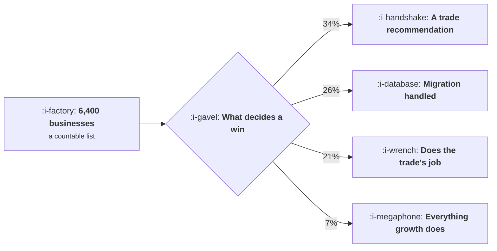

# Vertical SaaS

```text
Level: Sectors
Prerequisites: When PLG Is the Wrong Answer
Estimated difficulty: 3/5 | Estimated time: 35 min
```

## The idea in one minute

The market is a countable list of businesses in one trade, so growth is a share of a fixed
denominator and every technique that assumes volume is unavailable. Decompose what actually decides
a win and the honest answer is uncomfortable: a recommendation from somebody in the trade is 34
percent of it, the data migration being handled is 26, the product doing the trade's one thing is
21, price fitting their monthly cash is 12, and everything a growth team usually does is 7. So the
growth job is referrals, migration speed, three trade events and a named list, which together add
242 wins and 2.3 million a year and contain no funnel, no campaign and no experiment.

For the trade's economics, the buying behaviour and the depth of workflow fit, read
[Vertical SaaS](../../product-management/product-by-sector/07-vertical-saas.md). This lesson is the
growth delta only.

## A picture



The last branch is the usual toolkit, and it is seven percent of the decision.

## How it really works

### A fixed denominator changes what a target means

With 6,400 businesses in the trade and 980 of them customers, the share is 15 percent and the
remaining market is 5,420 names. Revenue if you won every one of them is 52 million, which is the
ceiling of the business, and it is knowable.

That makes planning unusually honest. Wins needed to stand still is 39 a year at 4 percent churn.
Wins a year of 40, 120, 260 and 480 produce five year shares of 15, 21, 31 and 47 percent. There is
no row in which a conversion rate improvement is the interesting variable.

### Decompose the decision honestly

The useful exercise is to ask your last fifty customers why they bought, and weight the answers.
The worked decomposition is recognisable across vertical software: a recommendation from somebody in
the trade, the migration being handled, the product doing the specific thing the trade needs, price
fitting their cash flow, and then everything else.

Seven percent for the usual growth toolkit is not a criticism of growth work. It is a statement
about where the leverage is, and a growth function that accepts it ends up owning referrals and
migration speed, which are the two largest factors and are usually unowned.

### What the growth job becomes

Four activities, with wins attached.

**Make referrals systematic and rewarded.** 96 wins a year. The largest factor in the decision is
currently happening by accident; making it deliberate means knowing which customers refer, asking
them, and paying for it in a way the trade finds acceptable.

**Take migration time from weeks to days.** 64 wins. This is a product and tooling project owned by
growth because it is the second largest factor in the buying decision and nobody else is measured on
it.

**Be at the three trade events that matter.** 38 wins. Unglamorous, measurable, and the only place
the whole market is in one room.

**Work a named list once a quarter.** 44 wins. Not outbound at volume, which fails here as
everywhere, but a list of 5,420 named businesses contacted deliberately four times a year by people
who know the trade.

Together: 242 wins and 2.3 million a year, containing no funnel, no campaign and no experiment.

### What it changes across this course

| Topic | The delta here |
|---|---|
| [Acquisition Channels](../acquisition-channels/README.md) | Three channels: referral, trade events and a named list. Channel tests are not possible and not needed |
| [Virality and Referral](../virality-and-referral/README.md) | The most important topic in the course for this sector, and the one where the trade's own norms decide what is acceptable |
| [Activation and Onboarding](../activation-and-onboarding/README.md) | Migration is the whole of onboarding. Do it for the customer; it is the second largest factor in the sale |
| [Monetisation and Conversion](../monetisation-and-conversion/README.md) | Price against the customer's monthly cash flow rather than against value, because cash is the binding constraint for a small business |
| [Expansion as a Loop](../monetisation-and-conversion/05-expansion-as-a-loop.md) | Expansion tracks the customer's own growth: locations, vehicles, staff. Your net revenue retention is partly their industry's |
| [Lifecycle Messaging](../lifecycle-messaging/README.md) | A small connected market, so one badly judged send is discussed at the trade association within weeks |
| [The Experiment Machine](../the-experiment-machine/README.md) | Matched pairs of similar businesses, one change, read qualitatively, labelled as weaker evidence |
| [Growth Economics](../growth-economics/README.md) | Very low churn makes lifetime value large and unreliable. Judge on payback and implementation cost |

### Why nothing statistical works

A five point win rate change needs 2,386 businesses, which is 44 percent of the remaining market in
one test. A two point pricing page change needs more businesses than exist.

A ten point onboarding change needs 633, which is 12 percent of the remaining market and is
genuinely runnable, so the sector is not entirely without experiments: large changes to high volume
surfaces are testable and nothing else is.

For everything else, use matched pairs. Take two similar businesses, change one thing for one of
them, and read the difference qualitatively with the sales team's account of what happened. Label
that as the weaker evidence it is rather than attaching a confidence interval to it.

### The small market cuts both ways

Low churn, usually 3 to 6 percent a year, because switching costs are high and the product is the
business's operating system. That makes customers extremely valuable and makes lifetime value
calculations unreliable, because the horizon exceeds anybody's forecast.

And everybody knows everybody. A bad implementation, an aggressive message or a price rise handled
badly is discussed at the trade association, which is a reputational mechanism with no equivalent in
a consumer market. It makes restraint cheaper here than anywhere, because the cost of its absence
arrives quickly and publicly.

## Run the numbers

Count the market, decompose the decision, and price the four activities.

```go
// verticalsaas.go: growth in a market you can count on a spreadsheet.
package main

import "fmt"

// A vertical market has a known number of businesses in it, so growth is a
// share of a fixed denominator and the whole function is about winning the
// remaining names. Nothing statistical works and the implementation is the
// product.
const (
	businesses = 6_400.0
	acv        = 9_600.0
	won        = 980.0
	churn      = 0.04 // a year
)

func main() {
	remaining := businesses - won
	fmt.Printf("%.0f businesses in the trade, %.0f are customers, %.0f%% share\n",
		businesses, won, 100*won/businesses)
	fmt.Printf("contract %.0f a year, annual churn %.0f%%\n\n", acv, 100*churn)

	fmt.Printf("%-38s %16.0f\n", "businesses remaining", remaining)
	fmt.Printf("%-38s %16.0f\n", "revenue if you won all of them", remaining*acv)
	fmt.Printf("%-38s %16.0f\n", "customers lost a year to churn", won*churn)
	fmt.Printf("%-38s %16.0f\n", "wins needed just to stand still", won*churn)

	fmt.Println("\nwhat different win rates do over five years:")
	fmt.Printf("%-18s %12s %12s %12s %14s\n",
		"wins a year", "share y1", "share y3", "share y5", "revenue y5")
	for _, w := range []float64{40, 120, 260, 480} {
		c := won
		var y1, y3 float64
		for y := 1; y <= 5; y++ {
			c = c*(1-churn) + w
			if c > businesses {
				c = businesses
			}
			if y == 1 {
				y1 = c
			}
			if y == 3 {
				y3 = c
			}
		}
		fmt.Printf("%18.0f %11.0f%% %11.0f%% %11.0f%% %14.0f\n",
			w, 100*y1/businesses, 100*y3/businesses, 100*c/businesses, c*acv)
	}
	fmt.Println("\nAt 480 wins a year you reach 47% of the trade in five years and")
	fmt.Println("the remaining market is the constraint rather than the funnel. At")
	fmt.Println("40 wins you barely outpace churn. There is no row in which a")
	fmt.Println("conversion rate improvement is the interesting variable.")

	fmt.Println("\nwhat decides a win here:")
	fmt.Printf("%-40s %14s %s\n", "factor", "weight", "who owns it")
	for _, r := range []struct {
		a string
		w float64
		c string
	}{
		{"somebody in the trade recommended you", 0.34, "existing customers"},
		{"the data migration is handled", 0.26, "implementation"},
		{"it does the one thing the trade needs", 0.21, "product"},
		{"price fits their monthly cash", 0.12, "pricing"},
		{"anything a growth team usually does", 0.07, "growth"},
	} {
		fmt.Printf("%-40s %13.0f%% %s\n", r.a, 100*r.w, r.c)
	}
	fmt.Println("\nSeven percent. That is the honest share of the decision that the")
	fmt.Println("usual growth toolkit touches, and it is why a growth function in")
	fmt.Println("this sector that runs funnel experiments is working on the wrong")
	fmt.Println("thing. The first two rows are 60% and both are somebody else's job.")

	fmt.Println("\nso the growth job becomes these four things:")
	fmt.Printf("%-44s %16s %16s\n", "activity", "wins a year", "revenue")
	for _, a := range []struct {
		name string
		wins float64
	}{
		{"make referrals systematic and rewarded", 96},
		{"take migration time from weeks to days", 64},
		{"be at the three trade events that matter", 38},
		{"a named list, worked once a quarter", 44},
	} {
		fmt.Printf("%-44s %16.0f %16.0f\n", a.name, a.wins, a.wins*acv)
	}
	fmt.Println("\nThose four add 242 wins a year and 2.3m of revenue, and none of")
	fmt.Println("them is an experiment, a funnel or a campaign. Referrals are the")
	fmt.Println("largest because the first factor in the decision table is the")
	fmt.Println("largest, which is the only sensible place to start.")

	fmt.Println("\nwhy nothing statistical works:")
	fmt.Printf("%-34s %16s %s\n", "test", "needs", "available")
	for _, r := range []struct {
		a string
		n float64
	}{
		{"a 5 point win rate change", 2_386},
		{"a 10 point onboarding change", 633},
		{"a 2 point pricing page change", 9_714},
	} {
		v := "no, more than the market"
		switch {
		case r.n < remaining*0.2:
			v = fmt.Sprintf("yes, using %.0f%% of the market", 100*r.n/remaining)
		case r.n < remaining:
			v = fmt.Sprintf("only by using %.0f%% of the market", 100*r.n/remaining)
		}
		fmt.Printf("%-34s %16.0f %s\n", r.a, r.n, v)
	}
	fmt.Println("\nWith 5,420 businesses left, a five point win rate test would use")
	fmt.Println("44% of the remaining market. Use matched pairs of similar")
	fmt.Println("businesses, change one thing, and read it qualitatively, and label")
	fmt.Println("the evidence as what it is.")
}
```

The share table is the planning exercise: five year shares of 15, 21, 31 and 47 percent at four win
rates. Put your own trade size in, from a trade register or association membership rather than a
market report.

The decision table is the one to build from interviews. Ask your last fifty customers why they
bought, classify the answers, and weight them. The 7 percent figure will be uncomfortable and it is
the most useful number in the lesson, because it reallocates the function.

The activity table is the plan. Put your own wins estimates in, which you can derive from how many
of your current customers came through each route.

## The AI layer

Three applications, and the first is the one with the largest number attached.

Data migration is the second largest factor in the buying decision and historically the main reason
a deal takes months. Mapping a customer's existing spreadsheets, legacy system exports and paper
processes into your schema is exactly the task a model does well, and taking migration from weeks to
days is worth 64 wins a year in the worked model. This is the single highest value model application
in this sector and it is an implementation project rather than a growth one, which is why growth
should own it.

Trade specific content is the second. Operational detail that requires having done the job passes
the test in
[Content at Scale and the Quality Floor](../ai-in-growth/02-content-at-scale-and-the-quality-floor.md)
and is rarely invested in here, so the competition is thin. The input a model cannot supply is the
trade knowledge, so the workable pattern is interviews with practitioners turned into written
material rather than generation from nothing.

Named list research is the third, and with 5,420 businesses it is affordable for the first time:
knowing each one's size, systems and circumstances before any contact changes what a quarterly touch
can be.

What to avoid: generated outreach at volume into a small connected trade, where the recipients talk
to each other and the first badly judged message is discussed publicly. The equilibrium argument in
[AI Outbound and the Spam Equilibrium](../ai-in-growth/05-ai-outbound-and-the-spam-equilibrium.md)
applies with an added reputational mechanism that consumer markets do not have.

## Remember this

* The market is a countable list, so growth is share of a fixed denominator and the ceiling is
  knowable.
* Wins needed to stand still is churn times customers: 39 a year here.
* Decompose what decides a win. A trade recommendation was 34 percent, migration 26, product fit 21,
  price 12, and the usual growth toolkit 7.
* So growth should own referrals and migration speed, which are the two largest factors and are
  usually unowned.
* The four activities worth 242 wins and 2.3 million contain no funnel, campaign or experiment.
* A five point win rate test needs 44 percent of the remaining market. A large onboarding change
  needs 12 percent and is runnable.
* Use matched pairs for everything else, read qualitatively, and label the evidence honestly.
* Churn is 3 to 6 percent a year, which makes lifetime value large and unreliable. Judge on payback
  and implementation cost.
* Everybody knows everybody, so restraint is cheaper here than anywhere and its absence is public.
* Migration tooling is the highest value model application in the sector and growth should own it.

## Try it

1. Count the businesses in your trade from a register or association list. Compute your share, the
   ceiling, and wins needed to stand still.
2. Ask your last fifty customers why they bought and weight the answers. Compare the growth share
   against what your team spends its time on.
3. Measure your migration time in days and cost a project to halve it, with the wins figure
   attached.

## Check yourself

1. Your trade has 2,100 businesses and you have 310 of them at 6 percent annual churn. How many wins
   a year do you need to stand still, and what is your ceiling?
2. Why should a growth function in this sector own the data migration?
3. You want to test a new pricing page. What can you actually learn, and how would you learn it?
