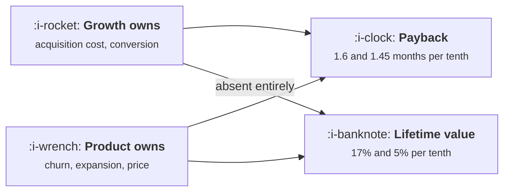

# Reading Unit Economics as a Growth Lead

```text
Level: Expert
Prerequisites: Expansion as a Loop
Estimated difficulty: 3/5 | Estimated time: 35 min
```

## The idea in one minute

Payback and lifetime value have the same five inputs and rank them in opposite orders, which is why
growth teams and product teams can both be right while arguing. On payback, a tenth off the
acquisition cost saves 1.6 months and a tenth off churn saves 0.33, so the two inputs a growth lead
owns are the two that matter most. On lifetime value, acquisition cost does not appear at all and a
tenth off churn is worth 17 percent. A growth team measured on payback is being measured on its own
work and the same team measured on lifetime value is being measured on product's. Pick the metric
to match the accountability, and know that acquisition cost moves the wrong way as the budget
grows.

## A picture



The dotted relationship on the bottom is the whole problem: acquisition cost is not in lifetime
value, so a growth team cannot move it.

## How it really works

### The five inputs

Acquisition cost, price, gross margin, churn and expansion. Every unit economics statement is built
from these, and the definitions live in
[CAC, Payback and LTV](../../product-management/revenue-and-efficiency/01-cac-payback-and-ltv.md).
This lesson is about which of them you can move.

### Payback ranks them one way

Months of gross profit needed to repay the acquisition cost. In the worked case, 13.8 months, and a
tenth better on each input saves: 1.59 months for acquisition cost, 1.45 for conversion rate, 1.45
for price, 1.45 for gross margin, 0.33 for churn and 0.11 for expansion.

The reason is mechanical. Payback happens in the first year or so, and churn and expansion barely
compound over that window, while the acquisition cost is the entire thing being repaid.

So a growth lead complaining that the numbers are not theirs to move is wrong about payback. The
two inputs they own are the top two.

### Lifetime value ranks them the other way

Lifetime value is price times margin divided by net churn, and the acquisition cost is not in the
expression. A tenth better on each input gives: no change, no change, 10 percent, 10 percent, 17
percent and 5 percent.

A growth team held to a lifetime value target, or to a ratio of lifetime value to acquisition cost,
is therefore being held to something they can affect through only one of its two terms. That is a
legitimate company metric and a poor team metric.

### Which metric to use for what

**Payback** for growth decisions and for budget. It is the growth team's metric and it answers how
much you can spend.

**Lifetime value** for product and pricing decisions, and for valuing the business. Use it to decide
whether a market is worth serving, not to decide whether a channel is working.

**The ratio** for a board, with both components reported separately. A ratio alone hides which half
moved, and the halves belong to different teams.

### The arithmetic that creates the real argument

The last table is the one that matters most. Acquisition cost rises with spend, because the cheapest
customers are bought first: at 40,000 a month the cost is 312 and payback is 11 months, and at
700,000 a month the cost is 1,182 and payback is 77.

So the only input a growth team fully owns gets worse precisely when the team succeeds in growing.
A growth lead who is measured on payback and asked to triple the budget is being asked for two
things that oppose each other, and the resolution is to agree a payback limit and let the budget be
whatever that implies, which is
[Setting and Defending a Budget](04-setting-and-defending-a-budget.md).

### Where expansion sits, and why it is worth having anyway

Expansion contributes 0.11 months to payback and 5 percent to lifetime value in the worked case,
which makes it look like the weakest input. That understates it, because expansion is the only input
that can be negative in net terms: if expansion exceeds churn, lifetime value is unbounded and the
whole framework stops applying, which is the arithmetic in
[Expansion as a Loop](../monetisation-and-conversion/05-expansion-as-a-loop.md).

So read the sensitivity as a local one. Small changes in expansion do little; crossing the line
where expansion exceeds churn changes the business.

### What fills the box in 2026

Gross margin has become a variable rather than a constant for products with a model inside them,
which changes this analysis in a specific way: it is now an input that moves with usage and
therefore with growth. In the table above margin is a tenth as powerful as acquisition cost on
payback; in a product where inference cost scales with engagement, margin can move by more than a
tenth in a quarter without anybody deciding to change it. Put margin on the growth dashboard rather
than treating it as a finance number, which is the subject of
[Usage Growth That Destroys Margin](../growth-for-ai-products/README.md).

## Run the numbers

Compute both sensitivities and notice that they disagree.

```go
// unitecon.go: which of the numbers in your unit economics are yours.
package main

import "fmt"

// Payback is a short expression with five inputs, and a growth lead owns two
// of them. Working out how much each input moves the answer tells you whether
// your effort is aimed at a variable you control.
type inputs struct {
	cac    float64 // acquisition cost per customer
	price  float64 // monthly revenue per customer
	margin float64 // gross margin
	churn  float64 // monthly churn
	expand float64 // monthly net expansion from existing customers
}

// months of gross profit needed to repay acquisition, interpolated inside the
// month so that a small change in an input shows up as a small change here
func (i inputs) payback() float64 {
	rev, alive := 0.0, 1.0
	for m := 0.0; m < 240; m++ {
		add := i.price * alive * i.margin
		if rev+add >= i.cac {
			return m + (i.cac-rev)/add
		}
		rev += add
		alive *= 1 - i.churn + i.expand
	}
	return 999
}

func (i inputs) ltv() float64 {
	net := i.churn - i.expand
	if net <= 0 {
		return 1e9
	}
	return i.price * i.margin / net
}

func main() {
	base := inputs{cac: 390, price: 42, margin: 0.78, churn: 0.034, expand: 0.011}
	fmt.Printf("acquisition %.0f, price %.0f a month, margin %.0f%%, churn %.1f%%, expansion %.1f%%\n",
		base.cac, base.price, 100*base.margin, 100*base.churn, 100*base.expand)
	fmt.Printf("payback %.1f months, lifetime value %.0f, ratio to acquisition %.1f\n\n",
		base.payback(), base.ltv(), base.ltv()/base.cac)

	fmt.Printf("%-18s %-22s %16s %16s\n",
		"input", "whose to move", "payback if 10% better", "months saved")
	type row struct {
		name  string
		owner string
		apply func(inputs) inputs
	}
	rows := []row{
		{"acquisition cost", "growth", func(i inputs) inputs { i.cac *= 0.9; return i }},
		{"conversion rate", "growth", func(i inputs) inputs { i.cac /= 1.1; return i }},
		{"price", "product and finance", func(i inputs) inputs { i.price *= 1.1; return i }},
		{"gross margin", "engineering", func(i inputs) inputs { i.margin *= 1.1; return i }},
		{"churn", "product", func(i inputs) inputs { i.churn *= 0.9; return i }},
		{"expansion", "product and sales", func(i inputs) inputs { i.expand *= 1.1; return i }},
	}
	basePay := base.payback()
	for _, r := range rows {
		n := r.apply(base)
		fmt.Printf("%-18s %-22s %16.1f %16.2f\n",
			r.name, r.owner, n.payback(), basePay-n.payback())
	}

	fmt.Println("\nA tenth off the acquisition cost saves 1.6 months of payback and a")
	fmt.Println("tenth on the price saves 1.45. A tenth off churn saves 0.33 and a")
	fmt.Println("tenth more expansion saves 0.11. On payback, the two inputs a growth")
	fmt.Println("lead owns are the two that matter most, which is the opposite of the")
	fmt.Println("usual complaint about not controlling the numbers.")

	fmt.Println("\nthe same question on lifetime value, where it is not the same:")
	fmt.Printf("%-18s %-22s %12s %12s\n", "input", "whose to move", "new LTV", "change")
	baseLTV := base.ltv()
	for _, r := range rows {
		n := r.apply(base)
		fmt.Printf("%-18s %-22s %12.0f %11.0f%%\n",
			r.name, r.owner, n.ltv(), 100*(n.ltv()/baseLTV-1))
	}
	fmt.Println("\nOn lifetime value the picture inverts. Acquisition cost does not")
	fmt.Println("appear in it at all, and a tenth off churn is worth 17% while a")
	fmt.Println("tenth on expansion is worth 5%. Lifetime value is almost entirely")
	fmt.Println("a product number, which is why a growth team measured on it is")
	fmt.Println("being measured on somebody else's work.")

	fmt.Println("\nwhat moves when you spend more:")
	fmt.Printf("%-20s %14s %14s %16s\n", "monthly spend", "customers", "cost each", "payback")
	for _, s := range []float64{40_000, 120_000, 300_000, 700_000} {
		// cost per customer rises as you buy more of a finite market
		cac := base.cac * (1 + 0.42*(s/120_000-1))
		if cac < base.cac*0.8 {
			cac = base.cac * 0.8
		}
		n := base
		n.cac = cac
		fmt.Printf("%20.0f %14.0f %14.0f %16.1f\n", s, s/cac, cac, n.payback())
	}
	fmt.Println("\nThe only input that moves when a growth team does its job is the")
	fmt.Println("acquisition cost, and it moves the wrong way as the budget grows.")
	fmt.Println("That is the subject of the next two lessons.")
}
```

The first sensitivity table is the growth lead's case: 1.59, 1.45, 1.45, 1.45, 0.33, 0.11 months
saved per tenth improvement. Take it to any meeting where somebody argues that acquisition work is
less valuable than retention work for payback purposes.

The second table is the counter case and both are true: 0, 0, 10, 10, 17, 5 percent of lifetime
value. The honest summary is that the two metrics answer different questions and the arguments
usually come from people using the one that supports their position.

The spend table is the constraint that frames the next five lessons: 312, 390, 636 and 1,182 per
customer at 40,000, 120,000, 300,000 and 700,000 a month, with payback going from 11 to 77 months.

Replace the `0.42` in the cost escalation with your own measured relationship between spend and
cost per customer, which you can get from your own history of budget changes. That single number is
the most important one in growth economics and most teams have never fitted it.

## The AI layer

Two effects on this arithmetic, and the second is the one to build a dashboard for.

Acquisition cost has fallen for the content and creative parts of the funnel, which moves the
cheapest end of the spend curve down. That is real and it is smaller than it appears, because the
escalation with spend is driven by auction and audience saturation rather than by production cost,
which is the subject of [When Paid Is a Loop](../paid-acquisition/06-when-paid-is-a-loop.md).

Gross margin is the bigger change. For a product that calls a model, margin is a function of how
much customers use it, so it falls as engagement rises and falls faster for your best cohorts. In
the sensitivity table margin behaves like price, which is to say it is worth 1.45 months of payback
per tenth, and a product whose margin drifts from 78 to 68 percent has lost more payback than a good
year of acquisition work gains.

The practical consequence: compute payback with the margin of the cohort you are acquiring now
rather than the company average, and recompute it quarterly. A growth team using last year's margin
is reporting a payback that is better than the one it is achieving, and the gap widens as the
product gets more useful.

## Sector lens

| Sector | Which inputs are actually movable here |
|---|---|
| [Enterprise B2B SaaS](../../product-management/product-by-sector/01-enterprise-b2b-saas.md) | Expansion dominates everything, often exceeding churn, so the lifetime value framework breaks and payback is the only usable metric |
| [Fintech](../../product-management/product-by-sector/02-fintech.md) | Margin varies with transaction mix and is not a constant. Model it per cohort or payback is fiction |
| [Ecommerce and D2C](../../product-management/product-by-sector/03-ecommerce-and-d2c.md) | Repeat rate replaces churn and margin is set by the product mix. Acquisition cost escalation is steep and well measured |
| [Marketplaces](../../product-management/product-by-sector/04-marketplaces.md) | Two acquisition costs and one margin. Supply side payback is often negative and correctly so |
| [Devtools and Infra](../../product-management/product-by-sector/05-devtools-and-infrastructure.md) | Usage based pricing makes price and margin move together with consumption, so both are growth numbers here |
| [Healthtech](../../product-management/product-by-sector/06-healthtech-and-regulated-care.md) | Contract lengths are long and churn is low, so payback periods of two years are normal and the usual limits do not apply |
| [Vertical SaaS](../../product-management/product-by-sector/07-vertical-saas.md) | Very low churn makes lifetime value large and unreliable. Judge on payback and on implementation cost |

## Remember this

* Five inputs: acquisition cost, price, margin, churn, expansion. Payback and lifetime value rank
  them in opposite orders.
* On payback, acquisition cost and conversion are the two strongest inputs, at 1.59 and 1.45 months
  per tenth.
* On lifetime value, acquisition cost does not appear and churn is the strongest input at 17 percent
  per tenth.
* So payback is the growth team's metric and lifetime value is the product and pricing team's.
* Report the ratio to a board with both components separately, because the halves belong to
  different teams.
* Acquisition cost rises with spend: 312 at 40,000 a month and 1,182 at 700,000, taking payback from
  11 months to 77.
* The only input growth fully owns gets worse exactly when growth succeeds, so agree a payback limit
  and let the budget follow.
* Expansion looks weak locally and changes the business when it exceeds churn, where lifetime value
  stops applying.
* Fit your own relationship between spend and cost per customer. It is the most important number
  here and is rarely fitted.
* With a model in the product, margin moves with usage. Compute payback on the margin of the cohort
  you are buying now.

## Try it

1. Compute both sensitivity tables for your own inputs and note which metric your team is currently
   measured on. If it is lifetime value, propose payback and explain the difference.
2. Fit the relationship between monthly spend and cost per customer from your own budget history,
   and put the exponent or multiplier in the model.
3. Compute payback using this quarter's cohort margin rather than the company average. Note the
   difference and whether it is widening.

## Check yourself

1. Your team is set a target to improve the ratio of lifetime value to acquisition cost. Which half
   can you move, and what should you ask for instead?
2. Why does a tenth off churn save a third of a month of payback and add 17 percent to lifetime
   value?
3. Your budget triples and your payback goes from 12 months to 31. Has the team got worse?
