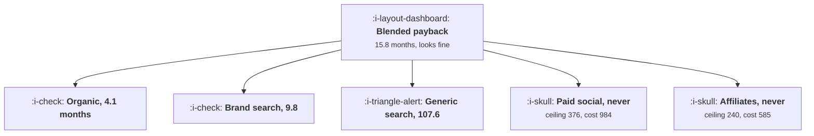

# Payback by Channel

```text
Level: Expert
Prerequisites: Reading Unit Economics as a Growth Lead
Estimated difficulty: 3/5 | Estimated time: 35 min
```

## The idea in one minute

A blended payback is an average over populations that have nothing in common, because a channel
does not just cost a different amount, it delivers a different customer. The worked portfolio has a
blended payback of 15.8 months, which nobody would question, and it contains two channels whose
customers cannot repay their acquisition cost at any time horizon: paid social buys customers who
can only ever return 376 against a cost of 984. Worse, the blended number improves on its own as
free channels grow, so a year in which every paid channel stayed exactly as bad reports as a year
of excellent acquisition efficiency.

## A picture



One number at the top, five completely different businesses underneath it.

## How it really works

### Channels deliver different customers, not just different costs

This is the premise and it is the part that gets skipped. In the worked portfolio, price per
customer runs from 46 for word of mouth down to 24 for affiliates, and monthly churn runs from 2.1
percent up to 7.9. Those are not noise, they are the channel: a customer who arrived through an
affiliate link for a discount is a different person from one who arrived by recommendation.

So payback has to be computed per channel with that channel's price and churn, not with the company
average. Using the average price for a cheap channel's customers makes the channel look two or three
times better than it is.

### The lifetime ceiling test

Before computing payback, compute the ceiling: price times margin divided by churn, which is the
most that customer can ever repay.

If the ceiling is below the acquisition cost, the channel cannot pay back at any horizon, and no
amount of patience fixes it. In the worked table, paid social has a ceiling of 376 against a cost of
984, and affiliates 240 against 585.

This test takes one line and it is the one that should be run first, because a channel that fails it
is not slow, it is losing money per customer and will lose more of it the more you spend. Together
those two channels are more than half the budget.

### The blended number drifts in a flattering direction

The second failure is subtler and more common. As a free or cheap channel grows, it enters the
blended average with a zero or low cost and a better customer, so the blended payback falls.

Doubling organic twice in the worked portfolio takes the blended payback from 15.8 months to 4.5,
with every paid channel unchanged. A year reported on the blended number looks like a transformation
in acquisition efficiency, and not one paid decision would have changed.

This is mix shift, the same mechanism as in
[Simpson's Paradox and Mix Shift](../../product-management/how-to-read-a-metric/05-simpsons-paradox-and-mix-shift.md),
and it runs in the direction that makes everybody comfortable, which is why it persists.

### What to report instead

Three things, and the first is the one usually missing.

**Paid payback, excluding free channels entirely.** Word of mouth and direct traffic are not
acquisition spend and including them in an efficiency number destroys its meaning. Report them as
volume, separately.

**Payback per channel, with that channel's price and churn.** Five rows, not one.

**The ceiling test per channel**, as a pass or fail flag. It is the only binary in the report and it
is the one that stops an argument.

### Attributing price and churn to a channel honestly

The practical difficulty is that you need per channel retention, which requires tracking the
acquisition channel on the customer record forever and reporting cohort retention by it. Most
companies have the field and never use it this way.

Two cautions. First touch and last touch give different channel assignments, so the whole table
shifts depending on the model, which is the subject of
[Attribution](../acquisition-channels/06-attribution.md); pick one, state it, and keep it. Second,
channel quality drifts: a channel that delivered good customers two years ago may not now, so
recompute per channel churn on recent cohorts rather than on the full history.

### What fills the box in 2026

Platform reporting has moved towards modelled conversions and aggregated attribution, which means
the customer counts per channel are increasingly estimates rather than counts. That makes the cost
per customer less reliable and leaves the price and churn side, which comes from your own data,
unaffected. The practical consequence is that the ceiling test has become relatively more
trustworthy than the cost comparison, so lead with it: a channel whose customers cannot repay is a
conclusion that does not depend on anybody's attribution model.

## Run the numbers

Compute payback per channel, then run the ceiling test.

```go
// channelpayback.go: what a blended payback number hides.
package main

import "fmt"

// Channels do not just cost different amounts, they deliver different
// customers: different price points, different churn. A blended payback is an
// average over populations that have nothing in common, and it can be healthy
// while a channel inside it never pays back at all.
type channel struct {
	name   string
	spend  float64
	custs  float64
	price  float64 // monthly revenue per customer from this channel
	churn  float64 // monthly churn of these customers
	margin float64
}

func (c channel) cac() float64 { return c.spend / c.custs }

// months to repay, or 999 if the cohort dies first
func (c channel) payback() float64 {
	rev, alive := 0.0, 1.0
	for m := 0.0; m < 120; m++ {
		add := c.price * alive * c.margin
		if rev+add >= c.cac() {
			return m + (c.cac()-rev)/add
		}
		rev += add
		alive *= 1 - c.churn
	}
	return 999
}

func (c channel) ceiling() float64 { return c.price * c.margin / c.churn }

func main() {
	chans := []channel{
		{"word of mouth", 0, 900, 46, 0.021, 0.79},
		{"organic search", 180_000, 1_400, 41, 0.026, 0.79},
		{"paid search on brand", 95_000, 310, 44, 0.024, 0.79},
		{"paid search, generic", 420_000, 540, 38, 0.038, 0.79},
		{"paid social", 610_000, 620, 29, 0.061, 0.79},
		{"affiliates", 240_000, 410, 24, 0.079, 0.79},
	}

	fmt.Printf("%-24s %12s %10s %10s %9s %9s %12s %s\n",
		"channel", "spend", "customers", "cost each", "price", "churn", "payback", "verdict")
	var spend, custs float64
	for _, c := range chans {
		spend += c.spend
		custs += c.custs
		p := c.payback()
		pay := fmt.Sprintf("%.1f", p)
		v := "pays back"
		if p > 900 {
			pay, v = "never", "cannot pay back"
		} else if p > 24 {
			v = "too slow"
		}
		fmt.Printf("%-24s %12.0f %10.0f %10.0f %9.0f %8.1f%% %12s %s\n",
			c.name, c.spend, c.custs, c.cac(), c.price, 100*c.churn, pay, v)
	}

	// the blended view: all spend over all customers, average price and churn
	var wPrice, wChurn float64
	for _, c := range chans {
		wPrice += c.price * c.custs / custs
		wChurn += c.churn * c.custs / custs
	}
	blended := channel{"blended", spend, custs, wPrice, wChurn, 0.79}
	fmt.Printf("\n%-24s %12.0f %10.0f %10.0f %9.0f %8.1f%% %12.1f %s\n",
		"blended", spend, custs, blended.cac(), wPrice, 100*wChurn,
		blended.payback(), "looks fine")

	fmt.Printf("\nThe blended payback is %.1f months, which most companies would\n",
		blended.payback())
	fmt.Println("accept without comment. Inside it, affiliates buy customers who pay")
	fmt.Println("24 a month and churn at 7.9%, so the most they can ever repay is 240")
	fmt.Println("against a cost of 585. That channel cannot pay back at any horizon,")
	fmt.Println("and it is 16% of the spend.")

	fmt.Println("\nthe lifetime ceiling, which is the test a slow channel has to pass:")
	fmt.Printf("%-24s %14s %14s %s\n", "channel", "cost each", "most it can repay", "verdict")
	for _, c := range chans {
		v := "can repay"
		if c.ceiling() < c.cac() {
			v = "cannot, ever"
		}
		fmt.Printf("%-24s %14.0f %17.0f %s\n", c.name, c.cac(), c.ceiling(), v)
	}

	fmt.Println("\nwhat happens to the blended number as the mix shifts:")
	fmt.Printf("%-30s %14s %16s %s\n",
		"mix", "blended payback", "worst channel", "what a report says")
	for _, shift := range []struct {
		name  string
		cheap float64 // multiplier on the cheap, good channels' customers
	}{
		{"as it is", 1.0},
		{"organic doubles", 2.0},
		{"organic doubles again", 4.0},
	} {
		var sp, cu, pr, ch float64
		for i, c := range chans {
			n := c.custs
			if i <= 1 {
				n *= shift.cheap
			}
			sp += c.spend
			cu += n
			pr += c.price * n
			ch += c.churn * n
		}
		b := channel{"", sp, cu, pr / cu, ch / cu, 0.79}
		fmt.Printf("%-30s %14.1f %16s %s\n",
			b.name+shift.name, b.payback(), "unchanged", "improving")
	}
	fmt.Println("\nDoubling the free channel twice takes the blended payback from")
	fmt.Println("15.8 months to 4.5 while every paid channel is exactly as bad as")
	fmt.Println("it was. A report on the blended number would call that a year of")
	fmt.Println("excellent work on acquisition efficiency, and not one paid")
	fmt.Println("decision would have changed.")
}
```

The first table is the report that should exist. Paybacks of 0, 4.1, 9.8, 107.6, never and never
against a blended 15.8. The two channels that cannot pay back are 55 percent of the spend.

The ceiling table is the test to run first. Cost each against the most each channel's customers can
ever repay: 129 against 1,246 for organic, 984 against 376 for paid social. Two rows fail, and
failing is not a matter of degree.

The mix shift table shows the trap in reporting. Blended paybacks of 15.8, 8.5 and 4.5 as the free
channel doubles twice, with the paid channels untouched. If your acquisition efficiency metric is
blended, this is the shape of the improvement you will report in a year when organic grows.

Put your own channels in, with per channel price and churn from cohorts tagged by acquisition
channel. If you do not have per channel churn, computing it is the prerequisite for everything in
this lesson and it is a query rather than a project.

## The AI layer

Two uses, and one caution about the input data.

Per channel churn is a cohort analysis over tagged customers, and the awkward part is that channel
tags are messy: campaign names, referrer strings and partner codes accumulate without a convention,
which is the taxonomy problem from
[Designing an Event Taxonomy](../instrumentation-and-the-event-model/02-designing-an-event-taxonomy.md)
arriving in a marketing system. Classifying a few thousand messy channel strings into a clean set is
a good model task and it is usually what stands between a team and this table.

The second is monitoring channel quality drift. Price and churn per channel move slowly and
meaningfully, and a model watching cohort quality by channel will flag a channel whose customers
have got worse before the payback number moves, which is several months of warning.

The caution: do not let a model fill in the customer counts that platform reporting has stopped
providing. Modelled conversions from an advertising platform are already an estimate with an
interest in being flattering, and adding another modelling layer on top produces a number nobody can
interrogate. Prefer the ceiling test, which uses only your own data, and treat cost per customer
from platform numbers as a range rather than a figure.

## Sector lens

| Sector | What differs most by channel here |
|---|---|
| [Enterprise B2B SaaS](../../product-management/product-by-sector/01-enterprise-b2b-saas.md) | Contract size, not churn. An inbound lead and an outbound one close at very different values |
| [Fintech](../../product-management/product-by-sector/02-fintech.md) | Risk and fraud rates by channel, which belong in the margin term and are routinely omitted |
| [Ecommerce and D2C](../../product-management/product-by-sector/03-ecommerce-and-d2c.md) | Repeat purchase rate, which varies by a factor of three across channels and decides everything |
| [Marketplaces](../../product-management/product-by-sector/04-marketplaces.md) | Supply side quality by channel: an incentivised supplier behaves differently from a referred one |
| [Devtools and Infra](../../product-management/product-by-sector/05-devtools-and-infrastructure.md) | Expansion rate. A developer who found you in the docs expands; one who clicked an ad often does not |
| [Healthtech](../../product-management/product-by-sector/06-healthtech-and-regulated-care.md) | Contract length and renewal probability, both set by how the relationship began |
| [Vertical SaaS](../../product-management/product-by-sector/07-vertical-saas.md) | Referral versus trade show versus outbound, with large differences in implementation success |

## Remember this

* A channel delivers a different customer, not just a different cost. Price and churn vary by
  channel and must be used per channel.
* Run the ceiling test first: price times margin over churn, against the acquisition cost. Failing
  it means the channel cannot repay at any horizon.
* In the worked portfolio two channels fail the ceiling test and they are 55 percent of the spend.
* A blended payback of 15.8 months concealed both of them.
* The blended number improves on its own as free channels grow: 15.8 to 4.5 with no paid change at
  all.
* Report paid payback excluding free channels, payback per channel, and the ceiling test as a flag.
* Word of mouth and direct are volume, not efficiency. Including them destroys the meaning of the
  number.
* Tag acquisition channel on the customer record and compute retention by it. Most companies have
  the field unused.
* Recompute per channel churn on recent cohorts, because channel quality drifts.
* With modelled platform conversions, the ceiling test is more trustworthy than the cost comparison
  because it uses only your data.

## Try it

1. Compute price and monthly churn by acquisition channel from your own cohorts. If the tags are
   messy, clean them once into a fixed set.
2. Run the ceiling test on every paid channel. Any that fail are a decision rather than an
   optimisation.
3. Recompute your headline acquisition efficiency metric excluding free channels, and compare the
   trend with the blended one over the last two years.

## Check yourself

1. A channel costs 700 per customer, those customers pay 30 a month at 75 percent margin and churn
   at 5 percent monthly. What is the verdict and why does the time horizon not matter?
2. Your blended payback improved from 19 to 12 months and no paid channel changed. What happened,
   and what should you report instead?
3. Why has modelled platform attribution made the ceiling test relatively more valuable than the
   cost per customer comparison?
