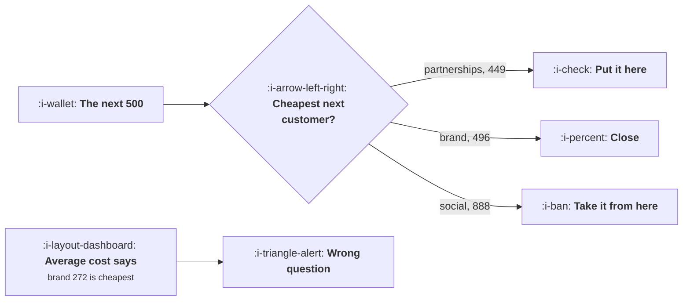

# The Marginal Pound

```text
Level: Expert
Prerequisites: Payback by Channel
Estimated difficulty: 4/5 | Estimated time: 40 min
```

## The idea in one minute

Every channel gets more expensive as you buy more of it, because the cheapest customers go first.
So the average cost per customer describes money you have already spent and says nothing about
where the next pound belongs, and the two rankings disagree: in the worked portfolio, partnerships
look mediocre on average cost at 386 and are the cheapest place to put the next 500 at 449, while
paid social looks respectable at 541 and costs 888 for the next customer. Reallocating the same
total budget to equalise marginal costs buys 10 percent more customers. Nothing was optimised and
no channel improved; the money was simply put where the next customer was cheapest.

## A picture



The average cost is a fact about the past. The marginal cost is the only one that answers a
question about the next decision.

## How it really works

### Diminishing returns are the whole mechanism

A channel's customers come in order of how cheap they are to reach. The first thousand are people
actively searching for exactly what you sell; the ten thousandth is somebody who had to be
persuaded. So the cost per customer rises with spend, and the relationship is usually close to a
power law with an exponent under one.

Fit that exponent and everything else follows. In the worked channels the exponents are 0.55, 0.72,
0.61 and 0.86, and a lower exponent means steeper diminishing returns: brand search saturates fast
because the number of people searching your name is bounded, and partnerships saturate slowly
because each new partner brings a fresh audience.

### The average and the margin diverge, and they diverge most where you spend most

The divergence follows from the exponent: the marginal cost is the average cost divided by the
exponent, roughly. At an exponent of 0.55 the next customer costs about 1.8 times the average one;
at 0.86 about 1.16 times.

So a channel that looks cheap on average because you have spent little in it, and a channel that
looks expensive on average because you have spent a lot, can both be the wrong size, and the average
cannot tell you which.

### The two part rule

**Equalise the marginal cost across channels.** If one channel's next customer costs 449 and
another's costs 888, moving money from the second to the first buys more customers for the same
total. Keep going until they are equal. That is the reallocation in the table, and it is worth 10
percent more customers from the same budget.

**Then set the total so that the common marginal cost equals the value of a customer.** If the next
customer costs 500 and is worth 980, spend more. If it costs 1,200, spend less. That is the budget
question and it is
[Setting and Defending a Budget](04-setting-and-defending-a-budget.md).

Note the order: reallocation is free and the budget decision is political, so do the free one first
and present the budget request from an already efficient allocation.

### How to measure a marginal cost

In descending order of honesty.

* **Change the budget on one channel and hold everything else still.** A month, and it settles the
  question for that channel at that spend level.
* **Fit the curve from budget changes you already made.** Free, uses history, and is confounded by
  whatever else changed at the same time.
* **Compare weeks at different spend levels**, adjusting for seasonality. Weaker again, and usually
  available.
* **Ask the platform for its own estimate.** Free, and it comes from a party whose revenue rises
  when you spend more. Treat it as an upper bound on efficiency rather than an estimate.

Most teams have never done the first and could do it next month, and the result typically changes
the allocation by more than a year of creative work.

### Why this gets ignored

Three reasons worth naming because they are organisational rather than analytical.

Channel owners are measured on their own channel's average cost, so moving budget away from a
channel looks like a failure for its owner even when it raises the company's customer count.

Marginal costs need to be remeasured when spend changes, which means the analysis has no permanent
answer, and teams prefer a number that stays still.

And the platform reports average cost prominently and marginal cost not at all, so the available
number is the wrong one.

### What fills the box in 2026

Automated bidding and broad targeting have made the within channel allocation partly automatic: the
platform is already moving money towards cheaper conversions inside its own inventory. What it
cannot do is move money between platforms, which is exactly where the marginal costs diverge most.
So the human job has narrowed to the cross channel allocation and the total, and both are
underserved precisely because the within channel part feels handled.

## Run the numbers

Fit the curves, compare the margins, then reallocate at a fixed total.

```go
// marginalpound.go: where the next unit of spend should go, which is not
// where the average says.
package main

import (
	"fmt"
	"math"
)

// Each channel gets more expensive as you buy more of it, because the
// cheapest customers go first. So the average cost per customer tells you
// about money already spent, and only the marginal cost tells you where the
// next pound belongs.
type channel struct {
	name  string
	k     float64 // customers at one unit of spend
	alpha float64 // how fast returns diminish: 1 is linear, lower is steeper
	value float64 // gross profit per customer over the payback window
}

// customers bought for a given spend
func (c channel) customers(spend float64) float64 {
	if spend <= 0 {
		return 0
	}
	return c.k * math.Pow(spend/1000, c.alpha)
}

// cost of the next customer at this level of spend
func (c channel) marginalCost(spend float64) float64 {
	const d = 500.0
	extra := c.customers(spend+d) - c.customers(spend)
	if extra <= 0 {
		return 1e9
	}
	return d / extra
}

func (c channel) averageCost(spend float64) float64 {
	n := c.customers(spend)
	if n == 0 {
		return 0
	}
	return spend / n
}

func main() {
	chans := []channel{
		{"paid search, brand", 17.0, 0.55, 980},
		{"paid search, generic", 8.5, 0.72, 980},
		{"paid social", 14.0, 0.61, 980},
		{"partnerships", 4.6, 0.86, 980},
	}
	spends := []float64{30_000, 90_000, 180_000, 60_000}

	fmt.Printf("gross profit per customer over the payback window: %.0f\n\n", chans[0].value)
	fmt.Printf("%-24s %12s %12s %14s %14s %s\n",
		"channel", "spend", "customers", "average cost", "next customer", "verdict")
	for i, c := range chans {
		s := spends[i]
		m := c.marginalCost(s)
		v := "spend more here"
		if m > c.value {
			v = "spend less here"
		}
		fmt.Printf("%-24s %12.0f %12.0f %14.0f %14.0f %s\n",
			c.name, s, c.customers(s), c.averageCost(s), m, v)
	}

	fmt.Println("\nThe two rankings disagree. On average cost the order is brand,")
	fmt.Println("partnerships, generic, social. On the next customer it is")
	fmt.Println("partnerships, brand, generic, social, and partnerships looks")
	fmt.Println("mediocre on average while being the cheapest place to put the next")
	fmt.Println("500. Every channel is still under the value of a customer, which")
	fmt.Println("means the total budget is too small; that is the next lesson.")

	fmt.Println("\nwhat reallocating does, holding the total fixed:")
	total := 0.0
	for _, s := range spends {
		total += s
	}
	// move 500 at a time to whichever channel has the cheapest next customer
	alloc := append([]float64{}, spends...)
	for step := 0; step < 720; step++ {
		best, bestCost := -1, 1e18
		for i, c := range chans {
			if m := c.marginalCost(alloc[i]); m < bestCost {
				best, bestCost = i, m
			}
		}
		// take it from the most expensive margin
		worst, worstCost := -1, -1.0
		for i, c := range chans {
			if alloc[i] <= 500 {
				continue
			}
			if m := c.marginalCost(alloc[i] - 500); m > worstCost {
				worst, worstCost = i, m
			}
		}
		if worst < 0 || worst == best || worstCost <= bestCost {
			break
		}
		alloc[best] += 500
		alloc[worst] -= 500
	}

	fmt.Printf("%-24s %14s %14s %14s %14s\n",
		"channel", "was", "now", "customers was", "customers now")
	var cWas, cNow float64
	for i, c := range chans {
		cWas += c.customers(spends[i])
		cNow += c.customers(alloc[i])
		fmt.Printf("%-24s %14.0f %14.0f %14.0f %14.0f\n",
			c.name, spends[i], alloc[i], c.customers(spends[i]), c.customers(alloc[i]))
	}
	fmt.Printf("%-24s %14.0f %14.0f %14.0f %14.0f\n", "total", total, total, cWas, cNow)
	fmt.Printf("\nsame money, %.0f more customers, %.0f%% more\n",
		cNow-cWas, 100*(cNow/cWas-1))

	fmt.Println("\nThe rule has two halves: equalise the marginal cost across")
	fmt.Println("channels, which is this table, and then raise or lower the total")
	fmt.Println("until the common marginal cost meets the value of a customer.")
	fmt.Println("Neither half uses the average cost, which is the number every")
	fmt.Println("channel report leads with.")

	fmt.Println("\nhow to measure a marginal cost, in order of honesty:")
	for i, m := range []string{
		"change the budget on one channel and hold everything else still",
		"fit the curve from a year of budget changes you already made",
		"compare weeks at different spend levels, adjusting for seasonality",
		"ask the platform for its own marginal estimate, and discount it",
	} {
		fmt.Printf("  %d. %s\n", i+1, m)
	}
	fmt.Println("\nThe first takes a month and settles it. The fourth is free and is")
	fmt.Println("an estimate from a party that benefits from you spending more.")
}
```

The first table is the comparison that matters. Average costs of 272, 415, 541 and 386 against next
customer costs of 496, 576, 888 and 449. The orderings differ, and a budget set from the average
column puts money in the wrong places.

The reallocation moves paid social from 180,000 to 49,000 and partnerships from 60,000 to 207,000,
and buys 901 customers instead of 816 for the same 360,000. That is a 10 percent gain from an
afternoon of arithmetic, and it is available to most companies right now.

Note that every channel's marginal cost is below the 980 value of a customer even after
reallocation, which means the total budget is too small. That is a separate decision and the next
lesson.

Fit your own exponents from real budget changes. If you have no history to fit, run the first
measurement method on your largest channel this month, because the exponent is the input everything
here depends on and a guess at it is a guess at the answer.

## The AI layer

Two uses, and one caution that is specific to automated bidding.

Fitting the curves is a small statistical task over data you already have: spend and customers by
channel by week, with seasonality and promotions controlled for. Doing it properly rather than by
eye is worth the difference between the average and marginal rankings, and it is a few hours of
work with a model rather than a few days without.

Continuous reallocation is the second. The marginal costs move as spend moves, as competitors bid
and as seasons change, so the equalising allocation is not a one off answer. A weekly reallocation
against refitted curves captures more than a quarterly one, and this is a genuine automation rather
than a report.

The caution: platform automated bidding optimises inside its own inventory towards whatever
objective you set, and if that objective is conversion volume rather than value, it will buy the
cheapest conversions, which are systematically the worst customers. That interacts badly with the
previous lesson: the platform makes your average cost look better while your per channel customer
quality falls, and both numbers move in flattering directions while the ceiling test gets worse. Set
the platform's objective on value where that is possible, and watch per channel churn.

## Sector lens

| Sector | How steeply returns diminish here |
|---|---|
| [Enterprise B2B SaaS](../../product-management/product-by-sector/01-enterprise-b2b-saas.md) | Very steeply, because the addressable audience is a few thousand companies. Channels saturate at small budgets |
| [Fintech](../../product-management/product-by-sector/02-fintech.md) | Steeply in regulated keyword auctions where few advertisers are permitted, so prices rise fast with volume |
| [Ecommerce and D2C](../../product-management/product-by-sector/03-ecommerce-and-d2c.md) | Gradually, with a large audience, which makes this analysis most valuable and most measurable here |
| [Marketplaces](../../product-management/product-by-sector/04-marketplaces.md) | Differently per side and per market, so the allocation is three dimensional: channel, side and geography |
| [Devtools and Infra](../../product-management/product-by-sector/05-devtools-and-infrastructure.md) | Very steeply on paid and barely at all on documentation and content, which is why the mix is so lopsided |
| [Healthtech](../../product-management/product-by-sector/06-healthtech-and-regulated-care.md) | Advertising is constrained by regulation, so the marginal curve has a hard stop rather than a slope |
| [Vertical SaaS](../../product-management/product-by-sector/07-vertical-saas.md) | Immediately, because the trade press and trade shows are a fixed and small inventory |

## Remember this

* Cost per customer rises with spend, because the cheapest customers go first.
* The average cost describes money already spent. Only the marginal cost answers where the next
  pound goes.
* Fit the exponent per channel. A low exponent means fast saturation; the marginal cost is roughly
  the average divided by the exponent.
* The two rankings disagree, and a channel can look cheap on average because you have spent little
  in it.
* Rule part one: equalise marginal costs across channels. Worth 10 percent more customers from the
  same total in the worked case.
* Rule part two: set the total so the common marginal cost equals the value of a customer.
* Do the free reallocation before asking for budget, and present the request from an efficient
  allocation.
* Measure the margin by changing one channel's budget and holding everything else still. A month,
  and it settles it.
* Platform marginal estimates come from a party that benefits from you spending more. Treat them as
  an upper bound.
* Automated bidding handles within channel allocation and cannot move money between platforms,
  which is where the divergence is largest.

## Try it

1. Fit the spend to customers exponent for each channel from your own budget history. Compute
   average and marginal cost per channel at current spend.
2. Reallocate at a fixed total to equalise the margins, and compute the extra customers. Take that
   number, not a budget request, to the next planning meeting.
3. Run a one channel budget change this month with everything else held still, and compare the
   measured marginal cost against your fitted one.

## Check yourself

1. A channel's average cost is 300 and its exponent is 0.6. Roughly what does the next customer
   cost, and why does that change the decision?
2. Why should the reallocation be done before the budget request rather than after?
3. Your platform's automated bidding lowered your average cost per acquisition by 18 percent and
   your per channel churn rose. What has it optimised?
