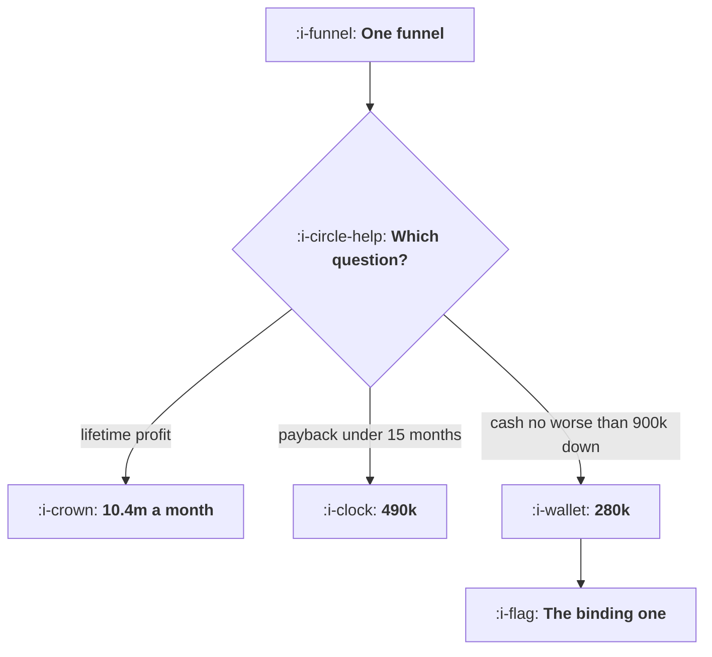

# Setting and Defending a Budget

```text
Level: Expert
Prerequisites: The Marginal Pound
Estimated difficulty: 4/5 | Estimated time: 40 min
```

## The idea in one minute

The same funnel supports three defensible budgets and they differ by a factor of thirty seven. If
you optimise profit over a customer's whole life, the worked company should spend 10.4 million a
month. If you require payback inside fifteen months, 490,000. If you can only be 900,000 down on
cash, 280,000. All three are correct answers to different questions, so an argument about the size
of a budget that has not first agreed which question is being asked cannot be resolved. The request
that gets approved has four lines in it, and the fourth is the stopping rule, because a rule
transfers the risk of being wrong from finance to the person asking.

## A picture



Three right answers. The argument is about which constraint is real, not about how good the
marketing is.

## How it really works

### Three constraints, in the order they usually bind

**Lifetime profit.** Spend until the next customer costs their whole lifetime gross profit. This
produces the largest number and is almost never the operative constraint, because it assumes you
can fund the gap between spending and being repaid, and it assumes your churn estimate holds for
years.

**Payback.** Spend until the next customer takes longer than your limit to repay. This is the
growth team's own discipline from
[Reading Unit Economics as a Growth Lead](01-reading-unit-economics-as-a-growth-lead.md), and in
the worked company it allows 490,000 a month.

**Cash.** Spend is paid now and returns arrive over a year, so a steady spend rate produces a cash
trough before it produces cash. At 280,000 a month the trough over two years is 900,000 down; at
500,000 a month it is 2.0 million down.

For most companies the order of bindingness is cash, then payback, then profit, and the common
mistake is to argue the third while being constrained by the first.

### The cash trough is the number nobody computes

Each month you spend the whole budget and receive gross profit from every cohort bought so far. Early
on the spending dominates; later the accumulated cohorts do. The trough is the maximum you are down
before it turns.

In the worked company the trough at two years runs minus 77,889, minus 369,655, minus 978,488, minus
2.0 million and minus 3.9 million for spend rates from 50,000 to 800,000 a month. It grows faster
than linearly in the spend rate, because the gap between spending and repayment widens with every
cohort.

That number is the one finance actually cares about and it is the one growth teams almost never
bring. Bringing it changes the conversation from a disagreement about optimism to a shared
calculation about funding.

### The four line argument

1. **The marginal cost per customer at the current spend.** Not the average, for the reasons in
   [The Marginal Pound](03-the-marginal-pound.md).
2. **What a customer returns inside the payback limit finance has already set.** Using their limit
   rather than your preferred horizon removes the argument you would otherwise have.
3. **So the next increment of spend returns this much, and the constraint binds at this level.**
   One sentence with three numbers in it.
4. **The rule by which you will stop without being asked.** For example: if the marginal cost
   exceeds the twelve month return for two consecutive months, spend reverts to the previous level
   automatically.

The fourth line is the one that gets the budget approved. A request for a number asks finance to
accept your forecast; a request with a stopping rule asks them to accept your mechanism, and the
mechanism is checkable.

### What makes a stopping rule credible

Three properties. It triggers on a number finance can see for themselves, not on your
interpretation. It reverts automatically rather than requiring a meeting. And it has been triggered
at least once before, which is why it is worth setting the first one slightly tight: a rule that has
fired and been honoured is worth more in the next negotiation than any forecast.

### Where the escalation assumption goes wrong

Everything here rests on the exponent in the marginal cost curve, and the common error is to assume
it holds far beyond the range you have measured. A curve fitted between 50,000 and 150,000 a month
says very little about 500,000, and the difference compounds in the direction of optimism because
saturation effects accelerate.

So state the measured range in the request and treat spend beyond it as a staged increase with its
own measurement, which also makes the request easier to approve: a 40 percent increase with a
measurement at the end is a smaller ask than a doubling.

### What fills the box in 2026

Two shifts matter. Marginal costs across the large advertising platforms have become more correlated,
because the same auctions and the same automated bidding systems respond to the same demand, which
means diversification buys less insulation than it used to. And measurement of the marginal curve
has got harder as platform conversion reporting became modelled, so the honest method from lesson
three, changing one budget and holding everything else still, has gone from preferable to necessary.
Both arguments point the same way: stage the increases and measure each stage.

## Run the numbers

Compute all three budgets and find out which one binds.

```go
// budget.go: three defensible budgets, and the one that survives the meeting.
package main

import (
	"fmt"
	"math"
)

// The same funnel supports three different budgets depending on what you are
// optimising, and they are far apart. Knowing which question finance is
// asking is most of the argument.
const (
	k         = 26.0 // customers at 1,000 of monthly spend
	alpha     = 0.68 // diminishing returns exponent
	monthly   = 44.0 // revenue per customer per month
	margin    = 0.77
	churn     = 0.031
	payCap    = 15.0 // months of payback the company will accept
	cashLimit = 900_000.0
)

func customers(spend float64) float64 { return k * math.Pow(spend/1000, alpha) }

func marginalCost(spend float64) float64 {
	const d = 1000.0
	return d / (customers(spend+d) - customers(spend))
}

// gross profit one customer returns over n months
func value(months float64) float64 {
	v, alive := 0.0, 1.0
	for m := 0.0; m < months; m++ {
		v += monthly * alive * margin
		alive *= 1 - churn
	}
	return v
}

// months for a customer bought at this cost to repay
func paybackAt(cost float64) float64 {
	v, alive := 0.0, 1.0
	for m := 0.0; m < 240; m++ {
		add := monthly * alive * margin
		if v+add >= cost {
			return m + (cost-v)/add
		}
		v += add
		alive *= 1 - churn
	}
	return 999
}

// cash position after n months of spending at this rate every month
func cashTrough(spend float64, months int) float64 {
	worst := 0.0
	cash := 0.0
	for m := 1; m <= months; m++ {
		cash -= spend
		// every cohort bought so far pays in this month
		for c := 1; c <= m; c++ {
			age := float64(m - c)
			alive := math.Pow(1-churn, age)
			cash += customers(spend) * monthly * margin * alive
		}
		if cash < worst {
			worst = cash
		}
	}
	return worst
}

func main() {
	fmt.Printf("a customer returns %.0f over 12 months, %.0f over 24, %.0f over a lifetime\n\n",
		value(12), value(24), monthly*margin/churn)

	fmt.Printf("%-16s %12s %14s %14s %16s %16s\n",
		"monthly spend", "customers", "average cost", "next customer", "marginal payback", "cash trough")
	for _, s := range []float64{50_000, 150_000, 300_000, 500_000, 800_000} {
		mc := marginalCost(s)
		fmt.Printf("%16.0f %12.0f %14.0f %14.0f %16.1f %16.0f\n",
			s, customers(s), s/customers(s), mc, paybackAt(mc), cashTrough(s, 24))
	}

	fmt.Println("\nthree budgets, three questions:")
	fmt.Printf("%-44s %16s %16s\n", "what you are optimising", "monthly spend", "limit that binds")
	// profit: spend until the next customer costs their lifetime value
	lifetime := monthly * margin / churn
	best := 0.0
	for s := 10_000.0; s < 40_000_000; s += 10_000 {
		if marginalCost(s) > lifetime {
			break
		}
		best = s
	}
	fmt.Printf("%-44s %16.0f %16s\n", "profit over a customer's whole life", best, "none")
	// payback: spend until the next customer takes longer than the cap to repay
	payB := 0.0
	for s := 10_000.0; s < 5_000_000; s += 5_000 {
		if paybackAt(marginalCost(s)) > payCap {
			break
		}
		payB = s
	}
	fmt.Printf("%-44s %16.0f %16.1f%s\n",
		"payback inside the limit", payB, payCap, " months")
	// cash: spend until the trough exceeds what you can fund
	cashB := 0.0
	for s := 10_000.0; s < 5_000_000; s += 5_000 {
		if -cashTrough(s, 24) > cashLimit {
			break
		}
		cashB = s
	}
	fmt.Printf("%-44s %16.0f %16.0f\n", "cash you can afford to be down", cashB, cashLimit)

	fmt.Println("\nThe three answers are 10.4m, 490k and 280k a month. All three are")
	fmt.Println("defensible and they differ by a factor of thirty seven, so an")
	fmt.Println("argument about the size of a budget that has not first agreed which")
	fmt.Println("question is being asked cannot be resolved. In this company cash is")
	fmt.Println("the binding constraint and the payback limit never gets to bite.")

	fmt.Println("\nthe argument that survives, in four lines:")
	for i, l := range []string{
		"here is the marginal cost per customer at the current spend",
		"here is what a customer returns inside the payback limit you set",
		"so the next X of spend returns Y, and the limit binds at Z",
		"and here is the rule by which I will stop without being asked",
	} {
		fmt.Printf("  %d. %s\n", i+1, l)
	}
	fmt.Println("\nThe fourth line is the one that gets the budget approved. A request")
	fmt.Println("with a stopping rule is a different conversation from a request for")
	fmt.Println("a number, because it transfers the risk of being wrong from finance")
	fmt.Println("to the person asking.")
}
```

The first table is the picture of the funnel: average costs of 134 to 327, next customer costs of
198 to 480, marginal paybacks of 6.4 to 18.4 months, and cash troughs from 78,000 to 3.9 million.
Reading across one row is how a budget decision should be presented.

The three budgets table is the argument. 10.4 million, 490,000 and 280,000. The spread is the
reason these discussions go badly: two people can hold entirely reasonable positions a factor of
thirty seven apart.

Change `cashLimit` to what your company can actually fund and `payCap` to the limit finance has
stated. The useful output is which constraint binds first, because that tells you whose problem the
budget is: a cash constrained company has a financing question and a payback constrained one has a
funnel question.

## The AI layer

Two uses, and one thing to be careful of in how the request is made.

Fitting and refitting the marginal curve is the first, as in lesson three, and it matters more here
because the budget decision extrapolates from it. A model that produces the curve with a confidence
band, and marks where the measured range ends, gives you the staged increase argument for free.

Scenario generation is the second and is genuinely useful in a finance conversation. Producing the
cash trough and the payback under a range of churn, conversion and escalation assumptions, and
presenting the range rather than a point, is the difference between a forecast somebody can argue
with and a forecast nobody believes. Finance teams respond well to ranges and badly to single
numbers, and the work to produce the range was historically the reason nobody did it.

The caution: a generated budget narrative is fluent and fluency reads as confidence. A request that
sounds more certain than the underlying measurement supports is worse than a hesitant one, because
when it is wrong the credibility cost falls on the next request too. Put the measured range and the
stopping rule in the first paragraph, which is the opposite of how persuasive writing usually works
and the right order for this document.

## Sector lens

| Sector | Which constraint usually binds here |
|---|---|
| [Enterprise B2B SaaS](../../product-management/product-by-sector/01-enterprise-b2b-saas.md) | Sales capacity rather than cash or payback. The budget question is headcount and the curve is a hiring plan |
| [Fintech](../../product-management/product-by-sector/02-fintech.md) | Regulatory capital and risk limits, which cap volume regardless of the payback arithmetic |
| [Ecommerce and D2C](../../product-management/product-by-sector/03-ecommerce-and-d2c.md) | Cash, severely, because inventory is paid for before the customer is acquired. The trough is twice as deep as the model here |
| [Marketplaces](../../product-management/product-by-sector/04-marketplaces.md) | Liquidity on the other side. Spending past what supply can serve destroys the experience and the payback |
| [Devtools and Infra](../../product-management/product-by-sector/05-devtools-and-infrastructure.md) | Payback, because free usage costs money before any revenue appears, which deepens the trough |
| [Healthtech](../../product-management/product-by-sector/06-healthtech-and-regulated-care.md) | Procurement cycles. Spend cannot be converted to revenue faster than an annual budget round allows |
| [Vertical SaaS](../../product-management/product-by-sector/07-vertical-saas.md) | Market size. The curve hits a wall rather than a slope, so the budget question is answered by the addressable count |

## Remember this

* The same funnel supports three defensible budgets: lifetime profit, payback limit and cash, and
  they differed by a factor of thirty seven.
* Most arguments about budget size are really disagreements about which question is being asked.
* The usual order of bindingness is cash, then payback, then profit, and teams argue the third while
  constrained by the first.
* Compute the cash trough: it grows faster than linearly in the spend rate and it is the number
  finance cares about.
* The four line argument: marginal cost, return inside their payback limit, what the next increment
  buys, and the stopping rule.
* Use finance's payback limit rather than your preferred horizon. It removes an argument you cannot
  win.
* A stopping rule must trigger on a number they can see, revert automatically, and ideally have
  fired once before.
* State the measured range of your marginal curve and treat spend beyond it as a staged increase
  with its own measurement.
* Platform marginal costs have become more correlated, so diversification insulates less than it
  used to.
* Present ranges rather than point forecasts, and put the range and the stopping rule first rather
  than last.

## Try it

1. Compute your cash trough at your current spend rate and at 1.5 times it. Take both numbers to
   your next budget conversation whether or not you are asking for more.
2. Work out which of the three constraints binds first for your company. Write it in one sentence
   and check whether your last budget argument was about that one.
3. Draft a stopping rule that triggers on a number finance already sees and reverts without a
   meeting. Propose it alongside your next increase.

## Check yourself

1. Your marginal customer costs 420 and returns 390 inside your twelve month payback limit, and
   1,100 over their life. Should you spend more?
2. Why does the cash trough grow faster than the spend rate, and why does that matter more than the
   payback number for a company that is not profitable?
3. What makes a stopping rule credible to a finance team, and what makes one worthless?
