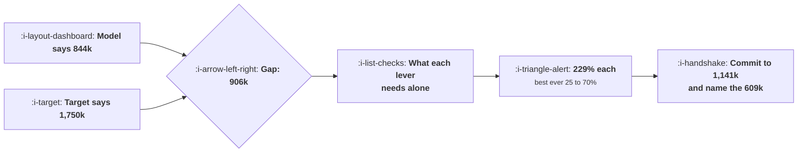

# Forecasting Against a Target

```text
Level: Expert
Prerequisites: Setting and Defending a Budget
Estimated difficulty: 4/5 | Estimated time: 40 min
```

## The idea in one minute

When the model says 844,302 and the target says 1,750,000, the disagreement is not about ambition
and should not be discussed as if it were. Convert the gap into a requirement on each lever and it
becomes checkable: every acquisition and monetisation lever would have to improve by 229 percent
alone, against historical bests of 70, 35, 40 and 25 percent, and churn cannot close it at any
value because even zero churn leaves the new business short. Every lever simultaneously at its best
ever year does reach the target. That is not a plan. The useful answer is a number you will commit
to, the gap stated in money, and the list of things that would have to be true.

## A picture



The last box is the deliverable. The two before it are what makes it a negotiation about facts
rather than about attitude.

## How it really works

### Build the model from inputs you measure, not from a growth rate

A forecast that extrapolates a revenue growth rate cannot be argued with productively, because
there is nothing inside it to disagree about. A forecast built from visitors, signup rate,
conversion, price and churn can be, and every disagreement lands on a specific number that somebody
owns.

The worked model is five inputs and a monthly recurrence: existing revenue decays by churn and new
revenue is added. That is enough for a twelve month forecast and it is enough to run the gap
analysis.

### Convert the gap into a requirement on each lever

For each input, find the multiple that would close the whole gap by itself. Then put the best
annual improvement that input has ever achieved next to it.

In the worked case the requirement is 229 percent for visitors, signup rate, conversion and price,
against historical bests of 70, 35, 40 and 25. Churn cannot close the gap at any value.

### Two things that table teaches

The first is that the four acquisition and monetisation levers need the same multiple, because they
multiply into one term. That is worth stating in the meeting, because it means debating which of
them to prioritise is a conversation about feasibility and cost rather than about leverage; they
are interchangeable in the arithmetic.

The second is why churn behaves differently. Churn acts on the existing base, so its maximum
contribution is bounded by the base itself: reducing it to zero in the worked case keeps 640,000
rather than losing it, which is less than the gap. Any target whose gap exceeds your current revenue
cannot be closed by retention, and that is a two second check worth doing before a retention project
is proposed as the answer to a growth target.

### The best ever test is the one that ends the argument

Comparing a requirement against the best the lever has ever done, in your own company, is more
persuasive than any benchmark, because nobody can claim the figure is pessimistic about a number
that is your own history.

Collect those bests once: for each input, the largest twelve month relative improvement in your own
data. It takes an afternoon and it becomes the reference for every subsequent planning argument.

### What to actually commit to

Three things, in this order.

**A number you will commit to**, built from a plausible share of each lever's best. A third of each
best in the worked case gives 1,141,306, which is 65 percent of the target.

**The gap, in money.** 608,694. Not as a percentage, not as a risk, as a figure.

**The list of what would have to be true to close it**, with an owner and a cost for each. Some of
those will be outside growth entirely: a price change, a new segment, a product capability.

That document is the honest output and it is also the one that protects the team, because when the
year ends at 1.14 million the conversation is about the named gap rather than about a missed
forecast.

### What to refuse

A forecast that matches the target by assumption. It is worth nothing to the person who asked for
it, it removes the information the exercise exists to produce, and it transfers the whole risk onto
the team that wrote it. The polite version is to deliver both numbers: here is the forecast, here is
what the target requires, here is the difference.

### What fills the box in 2026

Nothing structural, and one caution. Scenario tooling has got much better, which makes it easy to
produce a plausible looking path to any number: adjust four inputs by a few percent each and the
target appears. That is the same assumption driven forecast with better presentation, and the
defence against it is the best ever column, because it is the one input a scenario tool cannot
flatter.

## Run the numbers

Turn the gap into a requirement, then compare against your own history.

```go
// gap.go: what a target requires of each lever, one at a time.
package main

import "fmt"

// A target that the model does not reach is not an argument, it is a
// requirement on each input. Work out what each one would have to do alone,
// compare that against the best it has ever done, and the conversation stops
// being about ambition.
type model struct {
	visitors float64 // a month
	signup   float64 // visitor to signup
	convert  float64 // signup to paying
	price    float64 // monthly revenue per customer
	churn    float64 // monthly
}

// revenue at the end of month 12, starting from an existing base
func (m model) revenue(base float64, months int) float64 {
	mrr := base
	for i := 0; i < months; i++ {
		adds := m.visitors * m.signup * m.convert * m.price
		mrr = mrr*(1-m.churn) + adds
	}
	return mrr
}

type lever struct {
	name  string
	best  float64 // the best relative improvement ever achieved in a year
	apply func(m model, factor float64) model
}

func main() {
	base := model{visitors: 310_000, signup: 0.038, convert: 0.071, price: 46, churn: 0.029}
	const startMRR = 640_000.0
	plan := base.revenue(startMRR, 12)
	target := 1_750_000.0

	fmt.Printf("starting revenue %.0f a month\n", startMRR)
	fmt.Printf("the model reaches %.0f in twelve months\n", plan)
	fmt.Printf("the target is %.0f, a gap of %.0f, which is %.0f%%\n\n",
		target, target-plan, 100*(target/plan-1))

	levers := []lever{
		{"visitors", 1.70, func(m model, f float64) model { m.visitors *= f; return m }},
		{"signup rate", 1.35, func(m model, f float64) model { m.signup *= f; return m }},
		{"signup to paying", 1.40, func(m model, f float64) model { m.convert *= f; return m }},
		{"price", 1.25, func(m model, f float64) model { m.price *= f; return m }},
		{"churn", 1.30, func(m model, f float64) model { m.churn /= f; return m }},
	}

	fmt.Printf("%-22s %18s %16s %s\n",
		"lever", "needs to improve", "best ever done", "verdict")
	for _, l := range levers {
		need := 0.0
		for f := 1.0; f < 20; f += 0.005 {
			if l.apply(base, f).revenue(startMRR, 12) >= target {
				need = f
				break
			}
		}
		v := "possible"
		switch {
		case need == 0:
			v = "cannot close the gap alone at any value"
		case need > l.best:
			v = "beyond anything achieved"
		}
		s := "never"
		if need > 0 {
			s = fmt.Sprintf("%.0f%%", 100*(need-1))
		}
		fmt.Printf("%-22s %18s %15.0f%% %s\n", l.name, s, 100*(l.best-1), v)
	}

	fmt.Println("\nNo single lever closes the gap inside what has ever been achieved,")
	fmt.Println("and churn cannot close it at any value, because even zero churn")
	fmt.Println("leaves the new business short.")

	fmt.Println("\nwhat the combination of every lever at its best ever does:")
	m := base
	for _, l := range levers {
		m = l.apply(m, l.best)
	}
	bestCase := m.revenue(startMRR, 12)
	fmt.Printf("%-40s %16.0f\n", "every lever at its historical best", bestCase)
	fmt.Printf("%-40s %16.0f\n", "the target", target)
	fmt.Printf("%-40s %16.0f\n", "surplus or shortfall", bestCase-target)

	fmt.Println("\nSo the target is reachable only if every one of five levers")
	fmt.Println("simultaneously matches the best year it has ever had, which is not")
	fmt.Println("a plan. The useful output is the plausible number and the named gap.")

	fmt.Println("\na plausible plan, at a third of each lever's best:")
	m = base
	for _, l := range levers {
		m = l.apply(m, 1+(l.best-1)/3)
	}
	plaus := m.revenue(startMRR, 12)
	fmt.Printf("%-40s %16.0f\n", "a third of each lever's best", plaus)
	fmt.Printf("%-40s %16.0f\n", "named gap to the target", target-plaus)
	fmt.Printf("%-40s %15.0f%%\n", "share of the target this covers", 100*plaus/target)

	fmt.Println("\nThat is the honest answer to give: a number you will commit to,")
	fmt.Println("the gap stated in money, and the list of things that would have to")
	fmt.Println("be true to close it. A forecast that matches the target by")
	fmt.Println("assumption is worth nothing to anybody, including the person who")
	fmt.Println("asked for it.")
}
```

The lever table is the centre of this. Requirements of 229 percent against bests of 70, 35, 40 and
25, and a lever that cannot close the gap at all. Bring this table rather than a sentence about the
target being ambitious.

The everything at its best row reaches 2,131,036, which is above the target, and that is worth
including rather than hiding: the target is not impossible, it requires five simultaneous record
years. Saying so precisely is more credible than saying it is unrealistic.

The plausible plan at a third of each best gives 1,141,306 and a named gap of 608,694. Change the
fraction to whatever you can defend; a third is a reasonable default for a team that has not
measured its own distribution of lever improvements.

Put your own historical bests in. They are the only numbers here that nobody can argue with, and
most companies have never collected them.

## The AI layer

Two uses that help and one pattern to resist.

Assembling the historical bests is the first and it is genuinely tedious: for each input, the
largest twelve month improvement across your own history, with the period and what caused it. A
model over your warehouse produces that table in minutes and it becomes the reference document for
every future planning round.

Scenario enumeration is the second. Rather than one plausible plan, generate the set of lever
combinations that reach the target and rank them by how far each requires any single lever to go
beyond its best. The combination that minimises the maximum stretch is a better plan than the one
somebody wrote down first, and finding it is a search problem.

The pattern to resist: a model asked to produce a forecast that reaches the target will produce one,
with internally consistent inputs and a confident narrative. That is the assumption driven forecast
with the fingerprints removed, and it is harder to challenge because the reasoning reads as
analysis. Ask for the requirement on each lever instead, and ask for it against your measured bests.
If the tool does not have the bests, it cannot do this job.

## Sector lens

| Sector | Which lever the target usually lands on |
|---|---|
| [Enterprise B2B SaaS](../../product-management/product-by-sector/01-enterprise-b2b-saas.md) | Deal size and win rate, both of which have narrow historical ranges. Volume is capped by the market |
| [Fintech](../../product-management/product-by-sector/02-fintech.md) | Transaction volume per customer, which is behavioural and moves slowly. Price changes are often regulated |
| [Ecommerce and D2C](../../product-management/product-by-sector/03-ecommerce-and-d2c.md) | Repeat rate and basket size. Both have good history, so the best ever table is unusually reliable |
| [Marketplaces](../../product-management/product-by-sector/04-marketplaces.md) | Supply growth, which gates everything downstream. A demand side target with no supply plan is not a forecast |
| [Devtools and Infra](../../product-management/product-by-sector/05-devtools-and-infrastructure.md) | Expansion within existing accounts, which is the lever with the longest lag and the best history |
| [Healthtech](../../product-management/product-by-sector/06-healthtech-and-regulated-care.md) | Number of sites, which moves in procurement cycles. The forecast is a calendar rather than a curve |
| [Vertical SaaS](../../product-management/product-by-sector/07-vertical-saas.md) | Market share, which is countable. A target above the remaining addressable count is arithmetically closed |

## Remember this

* Build the forecast from measured inputs, not from a growth rate, so that every disagreement lands
  on a number somebody owns.
* Convert the gap into the multiple each lever would need alone, and put its best ever year beside
  it.
* The acquisition and monetisation levers need the same multiple because they multiply into one
  term, so the choice between them is about cost rather than leverage.
* Churn acts only on the existing base, so a gap larger than current revenue cannot be closed by
  retention. Check that first.
* Collect the historical best annual improvement for each input once. It is the most persuasive
  number available because it is your own.
* Commit to a number, state the gap in money, and list what would have to be true with owners and
  costs.
* Include the all levers at their best figure. If it exceeds the target, the target requires five
  simultaneous record years, which is a more precise objection than unrealistic.
* Refuse a forecast that matches the target by assumption, and deliver both numbers instead.
* Scenario tooling makes assumption driven forecasts easier to produce and harder to spot. The best
  ever column is the defence.

## Try it

1. Build your twelve month model from five measured inputs and compute the gap to your target.
2. Collect each input's best twelve month relative improvement from your own history. Keep the table
   and reuse it every planning round.
3. Produce the three part answer: committed number, gap in money, and the list of what would have to
   be true with an owner for each item.

## Check yourself

1. Your gap is 1.2 million a month and your current revenue is 800,000. What does that tell you
   about retention as a lever, in one line?
2. Why do visitors, signup rate, conversion and price all require the same multiple to close a gap,
   and what does that imply about prioritising between them?
3. Somebody produces a scenario that reaches the target by improving five inputs by 18 percent each.
   What is the one question to ask?
