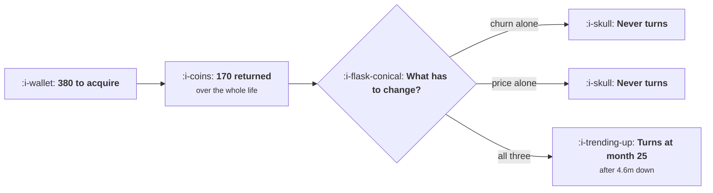

# Buying Revenue at a Loss

```text
Level: Expert
Prerequisites: Forecasting Against a Target
Estimated difficulty: 4/5 | Estimated time: 40 min
```

## The idea in one minute

Acquiring customers for more than they return is a bet that something changes later, and the test
is not whether cash is negative, which it will be for years in any case. The test is whether the
cash curve ever turns, and how deep the trough is before it does. In the worked case a customer
costs 380 and returns 170 over their life, and halving churn does not turn the curve, nor does
raising price by 60 percent, nor does reaching a 78 percent margin. Two of them together turns it
in month 53 after a 7.0 million trough; all three turns it in month 25 after 4.6 million. None of
the spend is recoverable at any point, so the only thing that separates a strategy from a slow
failure is having set the review date before starting.

## A picture



The curve turning is the only outcome that distinguishes the two cases, and it takes two years to
observe.

## How it really works

### The bet has to be named

Buying revenue below cost is only coherent if you can say what will change. Five candidates, and
each one is a measurable claim rather than a hope.

* **Churn improves**, because the product gets better or the customer mix shifts.
* **Price rises**, because you move upmarket or add capability.
* **Margin improves**, because cost to serve falls with scale or engineering.
* **Acquisition cost falls**, because brand reduces the cost of attention.
* **The market consolidates**, and the survivor's economics differ from the contestant's.

A plan that does not name one of these is not buying revenue at a loss as a strategy, it is losing
money on acquisition and describing it as a strategy.

### One lever is almost never enough

This is the result that surprises people. The gap in the worked case is 380 against 170, which is a
factor of 2.2, and single lever improvements of the size companies actually achieve do not close
it: halving churn takes lifetime value to 340, raising price 60 percent takes it to 269, and a 78
percent margin takes it to 255. All three are still below 380.

So the realistic version of this bet requires several things to go right simultaneously, which
multiplies the probability of failure and is the main reason these plans fail. Name every lever the
bet requires and estimate the probability that all of them land.

### The curve turning is the only observable test

Cash is negative for years in every scenario, including the ones that work, so the level tells you
nothing. What distinguishes them is the second derivative: the month in which cumulative cash stops
falling.

In the worked scenarios: never, never, never, never, month 53, month 25. And the trough depths
before the turn are 7.0 million and 4.6 million for the two that do turn.

That means you cannot know whether the bet is working for about two years, and the monitoring has to
be on the inputs rather than on the outcome, which is the next section.

### Monitor the inputs quarterly, with named tests

Each bet has a quarterly test that moves long before cash does.

* **Churn improves:** cohort retention at month six, by signup quarter, rising.
* **Price rises:** realised price on new customers, by quarter, rising.
* **Margin improves:** cost to serve per customer, by cohort, falling.
* **Costs fall:** marginal cost per customer at constant spend, falling.
* **Market consolidates:** your share of new customers in the category, rising.

Each is a number somebody can check in an afternoon. A bet with no test attached is a hope with a
budget, and the difference matters most in the second year, when the cash curve still looks the same
in both worlds.

### Nothing is recoverable, so the cost is the cost of finding out

The last table makes a point worth being precise about. There is no point of no return in the usual
sense, because none of the spend comes back whenever you stop. What exists is a cost of finding out,
and it rises every month: 1.9 million at month six, 11.4 million at month 48.

The implication is that the review date is the whole decision. Setting it in advance, with the
quarterly tests and a predetermined action if they fail, converts an open ended loss into a bounded
experiment. Not setting it means the answer arrives when the cash does, which is the definition of
the reckless version.

### Where this is legitimately right

Two situations. A market with strong winner takes most dynamics, where share acquired now is
defensible later and the test is your share of new customers rather than your margins. And a product
whose cost structure genuinely falls with scale, where the bet is on your own engineering rather
than on the market, which is more controllable and therefore a better bet.

Where it is usually wrong: a market with low switching costs and many competitors, because the
customers you buy below cost will be bought from you by whoever does it next.

### What fills the box in 2026

The margin lever has become both more promising and more volatile for products with a model inside
them. Inference costs have fallen substantially and could continue to, which makes "margin improves
with scale and with cheaper models" a more credible bet than it was. Against that, the same
volatility means the bet is partly on somebody else's pricing decisions, and a plan that depends on
a model provider's prices falling is a plan with a supplier risk in it that should be named rather
than assumed.

## Run the numbers

Find out whether the curve turns, and when, and how deep it goes first.

```go
// atloss.go: buying revenue below cost, and the conditions under which it is
// a strategy rather than a slow failure.
package main

import "fmt"

// Acquiring customers for more than they return is a bet that something
// changes later: retention improves, price rises, or costs fall. The bet is
// legitimate and it has to be stated, dated and monitored, because the cash
// curve does not tell you which world you are in until quite late.
type bet struct {
	name       string
	cac        float64
	price      float64 // monthly revenue at the start
	margin     float64
	churn      float64 // monthly, at the start
	churnBy24  float64 // what churn becomes by month 24
	priceBy24  float64 // what price becomes by month 24
	marginBy24 float64
}

const (
	newPerMonth = 900.0
	horizon     = 48
)

// interpolate an input between its starting value and its month 24 value
func at(start, end, month float64) float64 {
	if month >= 24 {
		return end
	}
	return start + (end-start)*month/24
}

// the month at which the cash curve stops falling, or 0 if it never does
func (b bet) turns(months int) int {
	prev := 0.0
	for m := 1; m <= months; m++ {
		c, _ := b.cash(m)
		if m > 1 && c > prev {
			return m
		}
		prev = c
	}
	return 0
}

// cumulative cash over the horizon, and the worst point
func (b bet) cash(months int) (end, trough float64) {
	cohorts := []float64{}
	cash := 0.0
	for m := 0; m < months; m++ {
		cash -= newPerMonth * b.cac
		cohorts = append(cohorts, newPerMonth)
		fm := float64(m)
		pr := at(b.price, b.priceBy24, fm)
		mg := at(b.margin, b.marginBy24, fm)
		ch := at(b.churn, b.churnBy24, fm)
		for i := range cohorts {
			age := fm - float64(i)
			alive := 1.0
			for a := 0.0; a < age; a++ {
				alive *= 1 - ch
			}
			cash += cohorts[i] * pr * mg * alive
		}
		if cash < trough {
			trough = cash
		}
	}
	return cash, trough
}

func main() {
	base := bet{cac: 380, price: 19, margin: 0.52, churn: 0.058,
		churnBy24: 0.058, priceBy24: 19, marginBy24: 0.52}

	bets := []bet{
		{"nothing changes", 380, 19, 0.52, 0.058, 0.058, 19, 0.52},
		{"churn halves by month 24", 380, 19, 0.52, 0.058, 0.029, 19, 0.52},
		{"price rises 60% by month 24", 380, 19, 0.52, 0.058, 0.058, 30, 0.52},
		{"margin reaches 78% by month 24", 380, 19, 0.52, 0.058, 0.058, 19, 0.78},
		{"churn halves and price rises 40%", 380, 19, 0.52, 0.058, 0.029, 27, 0.52},
		{"all three improve", 380, 19, 0.52, 0.058, 0.029, 30, 0.75},
	}
	_ = base

	fmt.Printf("%.0f new customers a month at %.0f each; they pay %.0f a month\n",
		newPerMonth, bets[0].cac, bets[0].price)
	fmt.Printf("at %.0f%% margin and %.1f%% churn, one customer returns %.0f over their life\n\n",
		100*bets[0].margin, 100*bets[0].churn, bets[0].price*bets[0].margin/bets[0].churn)

	fmt.Printf("%-36s %14s %14s %14s %s\n",
		"the bet", "cash at 24m", "cash at 48m", "worst point", "cash turns")
	for _, b := range bets {
		e24, _ := b.cash(24)
		e48, tr := b.cash(horizon)
		t := b.turns(96)
		turn := "never"
		if t > 0 {
			turn = fmt.Sprintf("month %d", t)
		}
		fmt.Printf("%-36s %14.0f %14.0f %14.0f %s\n", b.name, e24, e48, tr, turn)
	}

	fmt.Println("\nWith nothing changing, the business is 11.4m down at four years")
	fmt.Println("and still falling, because each customer returns 170 against a cost")
	fmt.Println("of 380 and nothing about that improves. Halving churn alone is not")
	fmt.Println("enough, nor is raising price by 60%, nor is reaching a 78% margin.")
	fmt.Println("Two rows stop falling: the last one in month 25 after a trough of")
	fmt.Println("4.6m, and the one above it in month 53 after 7.0m. The test is not")
	fmt.Println("whether cash is negative, which it will be for years in any case.")
	fmt.Println("The test is whether the curve turns, and when, and how deep the")
	fmt.Println("trough is before it does.")

	fmt.Println("\nwhat each bet needs to be true, stated as a test:")
	for _, r := range []struct{ bet, test string }{
		{"churn improves", "cohort retention at month 6 by signup quarter, rising"},
		{"price rises", "realised price on new customers, by quarter, rising"},
		{"margin improves", "cost to serve per customer, by cohort, falling"},
		{"costs fall", "marginal cost per customer at constant spend, falling"},
		{"the market consolidates", "your share of new customers in the category, rising"},
	} {
		fmt.Printf("  %-26s %s\n", r.bet, r.test)
	}
	fmt.Println("\nEach test is a number you can check quarterly. A bet with no test")
	fmt.Println("attached is not a strategy, it is a hope with a budget.")

	fmt.Println("\nthe point of no return:")
	// how much it costs to have tried, if you stop at month m and the bet failed
	fmt.Printf("%-18s %18s %20s\n", "stop at month", "cash spent", "recoverable if you stop")
	b := bets[0]
	for _, m := range []int{6, 12, 24, 36, 48} {
		e, _ := b.cash(m)
		fmt.Printf("%18d %18.0f %20s\n", m, e, "none of it")
	}
	fmt.Println("\nThere is no point of no return in the usual sense, because none of")
	fmt.Println("it is recoverable at any point. What there is instead is a cost of")
	fmt.Println("finding out, and it rises every month: 1.9m to learn the answer at")
	fmt.Println("month 6 and 11.4m at month 48. Set the review date before you")
	fmt.Println("start,")
	fmt.Println("because the one thing that makes this reckless rather than")
	fmt.Println("strategic is discovering the answer by running out of money.")
}
```

The scenario table is the analysis. Cash at 24 months runs between minus 4.6 and minus 6.4 million
across every scenario, which is the point: at two years you cannot tell the working bets from the
failing ones by looking at cash.

The cash turns column is the one that separates them: never, never, never, never, month 53, month
25. And the worst point column prices the bet: 4.6 million of trough for the version that works
best.

The cost of finding out table is the argument for a review date. 1.9 million at month six against
11.4 million at month 48, none of it recoverable.

Put your own figures in, and be specific about `churnBy24`, `priceBy24` and `marginBy24`, because
those three numbers are the bet. Writing them down as explicit targets with dates is most of what
turns this into a strategy, and the version where they are left vague is the version that fails
quietly.

## The AI layer

Two uses and one genuine strategic question.

Monitoring the five input tests is the first and it is routine: cohort retention by signup quarter,
realised price by quarter, cost to serve by cohort. A monthly report on all five, with the trend and
whether it is on the path the bet requires, is the instrument this strategy needs and it does not
otherwise exist.

The second is the margin forecast. For a product where inference is a material part of cost to
serve, the margin trajectory depends on model prices, on your own routing and caching decisions, and
on how usage grows per customer, and separating those three contributions is a modelling exercise
worth doing properly. A margin improvement that came from cheaper models is a different bet from one
that came from your own engineering, because only the second is yours.

The strategic question: the margin lever is more credible than it has been, and it is partly outside
your control. A plan that requires inference costs to fall is making a supplier assumption, and the
honest version states it as such and says what happens if prices stay flat. That is a sentence in
the plan, and companies that have written it have made better decisions than companies that have
assumed the trend continues.

## Sector lens

| Sector | When buying revenue at a loss is defensible here |
|---|---|
| [Enterprise B2B SaaS](../../product-management/product-by-sector/01-enterprise-b2b-saas.md) | When a logo opens a segment, and only if expansion within the account is the named lever |
| [Fintech](../../product-management/product-by-sector/02-fintech.md) | When the customer brings deposits or volume that monetises later, and the regulator permits the cross subsidy |
| [Ecommerce and D2C](../../product-management/product-by-sector/03-ecommerce-and-d2c.md) | Almost never, because switching costs are near zero. A first order loss needs a measured repeat rate behind it |
| [Marketplaces](../../product-management/product-by-sector/04-marketplaces.md) | Genuinely, on the side that creates liquidity, where winner takes most dynamics are real and measurable |
| [Devtools and Infra](../../product-management/product-by-sector/05-devtools-and-infrastructure.md) | When free usage converts to committed spend later, with the conversion rate measured rather than assumed |
| [Healthtech](../../product-management/product-by-sector/06-healthtech-and-regulated-care.md) | When a site becomes a reference account, and contract lengths make the payback horizon long anyway |
| [Vertical SaaS](../../product-management/product-by-sector/07-vertical-saas.md) | When the market is small enough that share is permanent, which is the clearest case in this table |

## Remember this

* Buying revenue below cost is a bet that something changes. Name which of the five levers it is.
* One lever is almost never enough: halving churn, raising price 60 percent and reaching a 78
  percent margin each failed to turn the curve alone.
* Cash is negative for years in every scenario, so the level tells you nothing.
* The test is whether cumulative cash stops falling, and when: never, month 53 or month 25 in the
  worked cases.
* Trough depth before the turn is the size of the bet: 4.6 million in the best scenario.
* Monitor the five inputs quarterly with named tests, because they move long before cash does.
* None of the spend is recoverable, so there is no point of no return, only a rising cost of finding
  out: 1.9 million at month six, 11.4 million at month 48.
* Set the review date, the tests and the predetermined action before starting. That is what makes it
  bounded.
* Legitimate in winner takes most markets and where your own costs fall with scale. Usually wrong
  where switching costs are low.
* A plan that needs model prices to fall is making a supplier assumption. State it and say what
  happens if they do not.

## Try it

1. Write down the lever your current loss making acquisition depends on, with the value it has to
   reach and the date. If you cannot, that is the finding.
2. Compute your cash curve and find the month it turns under your own assumptions. If it never
   turns, the plan needs another lever rather than more patience.
3. Set up the quarterly test for each lever in your bet, and the predetermined action if a test
   fails twice.

## Check yourself

1. A customer costs 240 and returns 140 over their life. Churn improvements could take the return to
   200. Is that enough, and what else do you need?
2. Why does the level of cumulative cash at two years fail to distinguish a working bet from a
   failing one?
3. Your margin improvement depends on inference prices falling 40 percent. How should that appear in
   the plan?
