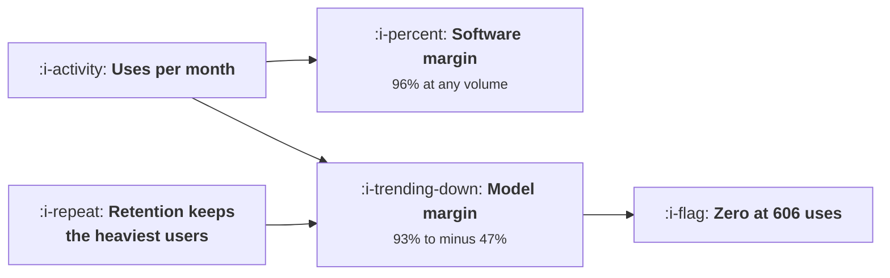

# Why AI Products Grow Differently

```text
Level: Expert
Prerequisites: Reading Unit Economics as a Growth Lead
Estimated difficulty: 3/5 | Estimated time: 35 min
```

## The idea in one minute

Software has a marginal cost near zero, so its gross margin is flat however much anybody uses it:
96 percent at twenty uses a month and 96 percent at nine hundred. A product that calls a model pays
per use, so the same 39 a month customer has a 93 percent margin at twenty uses, 26 percent at four
hundred and forty, and a negative one past six hundred and six. The consequence for a cohort is the
shape software never had: the users who stay use it more every month, so the cohort's monthly gross
profit falls faster than churn explains and in the worked case goes negative around month thirty.
Engagement, unambiguously good in the first column, is a variable with an optimum in the second.

## A picture



The box on the left feeds both. Only one of the two cares how large it gets.

## How it really works

### One term in the cost structure, and everything follows

Price minus a fixed cost to serve minus uses times a cost per use. That is the whole model and it
has one new term relative to software.

That term makes margin a function of behaviour. Everything else in this topic is a consequence:
free tiers, activation, retention, the viral loop and the margin problem all behave differently
because a user's value depends on how much they use the product rather than only on whether they
stay.

### The breakeven use count is the number to know

Price minus fixed cost, divided by cost per use. In the worked case 606 uses a month.

That single figure tells you more about the product's growth strategy than any funnel metric. It
sets how generous a free tier can be, where the usage cap belongs, whether engagement work is
valuable or harmful, and which cohorts to acquire.

Most teams building these products have never computed it, and it takes two minutes.

### Retention selects for the expensive users, which inverts the usual logic

Churn removes the users who use the product least, so the surviving cohort's average usage rises
every month. In software that is excellent news, because a heavier user is a more committed one and
costs the same.

Here it means the cohort's cost rises while its revenue stays flat, so gross profit falls faster
than the churn curve. The worked cohort goes from 26,755 of monthly profit at month six to minus
7,309 at month thirty six, while the software version falls from 29,802 to 9,322 on identical
churn.

This is the result that should change how an AI product's cohort reporting works. A retention curve
is no longer sufficient; you need a gross profit per cohort curve, and the two can point in opposite
directions.

### Five consequences, each a lesson in this topic

* **A free tier is a liability that scales with its success**, which is
  [Free Tiers When Every Use Costs Money](02-free-tiers-when-every-use-costs-money.md).
* **Your best cohort can be your least profitable one**, which is
  [Usage Growth That Destroys Margin](06-usage-growth-that-destroys-margin.md).
* **Engagement needs a ceiling**, which no software product ever needed and which contradicts the
  whole of
  [Natural Frequency](../engagement-and-resurrection/01-natural-frequency.md) unless the pricing is
  connected to use.
* **Gross margin moves weekly** and belongs on the growth dashboard rather than in a finance pack.
* **Price has to be connected to use**, or the revenue and cost curves never meet, which is the
  pricing conclusion from
  [Paywalls](../monetisation-and-conversion/03-paywalls.md) arriving as a necessity rather than a
  preference.

### The one structural advantage

It is worth saying that the cost structure is not only a problem. A per use cost means the product
has a real variable cost, which makes usage based pricing natural and defensible, and usage based
pricing has the best expansion dynamics of any model: revenue grows with the customer's success
without a salesperson or a seat negotiation, which is
[Expansion as a Loop](../monetisation-and-conversion/05-expansion-as-a-loop.md).

So the products that handle this well are not the ones that minimise usage. They are the ones whose
price rises with it.

### What fills the box in 2026

Cost per use has fallen a long way and will probably keep falling, which moves the breakeven count
up and buys time. Two cautions. Usage per retained user has risen at least as fast as prices have
fallen, because a cheaper and better product gets used more, so the breakeven count has moved up
and the cohorts have moved towards it. And the fall is somebody else's pricing decision, which makes
a plan that depends on it a plan with a supplier assumption in it, as in
[Buying Revenue at a Loss](../growth-economics/06-buying-revenue-at-a-loss.md).

## Run the numbers

Compute the breakeven use count, then run a cohort forward.

```go
// differentcurve.go: why the growth curve of a product with a model in it
// bends where a software curve does not.
package main

import "fmt"

// Traditional software has a marginal cost near zero, so gross profit tracks
// revenue and growth is limited by acquisition. A product that calls a model
// pays per use, so gross profit and revenue come apart as usage per customer
// rises, and the curve has a shape software never had.
type product struct {
	name   string
	price  float64 // monthly, per customer
	fixed  float64 // cost to serve one customer, independent of use
	perUse float64 // cost of one unit of use
}

func (p product) profit(uses float64) float64 {
	return p.price - p.fixed - uses*p.perUse
}

func (p product) margin(uses float64) float64 {
	return p.profit(uses) / p.price
}

// uses per month at which this customer stops being profitable
func (p product) breakeven() float64 {
	if p.perUse == 0 {
		return 1e9
	}
	return (p.price - p.fixed) / p.perUse
}

func main() {
	soft := product{"traditional software", 39, 1.40, 0}
	ai := product{"the same product with a model in it", 39, 1.40, 0.062}

	fmt.Printf("both charge %.0f a month and cost %.2f a customer to host\n", soft.price, soft.fixed)
	fmt.Printf("the second pays %.3f every time somebody uses it\n\n", ai.perUse)

	fmt.Printf("%-18s %14s %14s %14s %14s\n",
		"uses a month", "software profit", "margin", "model profit", "margin")
	for _, u := range []float64{20, 80, 200, 440, 600, 900} {
		fmt.Printf("%18.0f %14.2f %13.0f%% %14.2f %13.0f%%\n",
			u, soft.profit(u), 100*soft.margin(u), ai.profit(u), 100*ai.margin(u))
	}
	fmt.Printf("\nthe model product stops being profitable at %.0f uses a month\n",
		ai.breakeven())

	fmt.Println("\nSoftware's margin is flat at 96% however much anybody uses it. The")
	fmt.Println("model product's margin falls with every use and crosses zero at 606.")
	fmt.Println("Engagement, which is unambiguously good in the first column, is a")
	fmt.Println("variable with an optimum in the second.")

	fmt.Println("\nwhat that does to a cohort as it matures:")
	fmt.Printf("%-14s %12s %14s %16s %16s\n",
		"month", "still here", "uses each", "software profit", "model profit")
	alive := 1000.0
	uses := 35.0
	for m := 1; m <= 36; m++ {
		alive *= 0.962
		// the users who stay are the ones who use it most, and they use it more
		uses *= 1.10
		if m%6 == 0 {
			fmt.Printf("%14d %12.0f %14.0f %16.0f %16.0f\n",
				m, alive, uses, alive*soft.profit(uses), alive*ai.profit(uses))
		}
	}

	fmt.Println("\nThe software cohort's monthly profit decays with churn and nothing")
	fmt.Println("else: 29,802 at month six down to 9,322 at month thirty six. The")
	fmt.Println("model cohort falls faster and goes negative around month thirty,")
	fmt.Println("because the survivors use it more every month and the survivors are")
	fmt.Println("what retention is for.")

	fmt.Println("\nfive things the per use cost changes about growth work:")
	for i, r := range []string{
		"a free tier is a liability that scales with its success",
		"your best cohort can be your least profitable one",
		"engagement needs a ceiling, which no software product ever needed",
		"gross margin moves weekly and belongs on the growth dashboard",
		"price has to be connected to use, or the two curves never meet",
	} {
		fmt.Printf("  %d. %s\n", i+1, r)
	}
	fmt.Println("\nEach is a lesson in this topic. None of them is a refinement of")
	fmt.Println("software growth practice; they are consequences of a cost structure")
	fmt.Println("that software did not have.")
}
```

The first table is the structural difference in six rows. The software column does not move. The
model column goes 93, 84, 65, 26, 1 and minus 47 percent margin as monthly uses rise from twenty to
nine hundred.

The cohort table is the operational consequence. Identical churn of 3.8 percent a month in both
columns, and the model cohort's monthly profit falls from 26,755 to minus 7,309 while the software
cohort falls from 29,802 to 9,322. The difference is entirely the usage growth among survivors.

Put your own price, fixed cost and cost per use in, and compute your breakeven count. Then put your
own usage growth rate among retained users in, which you can measure from your cohorts and almost
certainly have not.

## Sector lens

| Sector | How the cost structure bites here |
|---|---|
| [Enterprise B2B SaaS](../../product-management/product-by-sector/01-enterprise-b2b-saas.md) | Contracts are annual and usage grows within them, so the margin problem arrives mid term with no price lever until renewal |
| [Fintech](../../product-management/product-by-sector/02-fintech.md) | Per transaction inference on top of per transaction fees, so two variable costs compound against one revenue line |
| [Ecommerce and D2C](../../product-management/product-by-sector/03-ecommerce-and-d2c.md) | Costs are per catalogue item rather than per user, which decouples them from engagement and is a much easier shape |
| [Marketplaces](../../product-management/product-by-sector/04-marketplaces.md) | Matching and moderation scale with activity, so the cost grows with the liquidity you are trying to create |
| [Devtools and Infra](../../product-management/product-by-sector/05-devtools-and-infrastructure.md) | Usage based pricing is already normal, so the curves meet by construction. The best position in this table |
| [Healthtech](../../product-management/product-by-sector/06-healthtech-and-regulated-care.md) | Model choice is set by governance rather than cost, so the per use cost is not a variable you control |
| [Vertical SaaS](../../product-management/product-by-sector/07-vertical-saas.md) | Flat per site pricing against usage that grows with the customer's business, which is the worst combination here |

## Remember this

* One new term, cost per use, and everything else in this topic follows from it.
* Software margin is flat at any volume. A model product's margin falls with every use.
* Compute the breakeven use count: price minus fixed cost, over cost per use. It was 606 a month
  here.
* That one number sets the free tier, the usage cap, whether engagement work helps, and which
  cohorts to acquire.
* Churn removes the lightest users, so surviving cohorts use more every month and cost more.
* A retention curve is no longer sufficient. Report gross profit per cohort, which can point the
  other way.
* The worked cohort went from 26,755 of monthly profit to minus 7,309 on the same churn that left
  the software version at 9,322.
* Five consequences: free tiers scale as liabilities, best cohorts can be worst, engagement needs a
  ceiling, margin is a weekly growth number, price must track use.
* The structural advantage is that usage based pricing is now natural, and it has the best expansion
  dynamics available.
* Falling prices buy time and are somebody else's decision, and usage per user has risen at least as
  fast.

## Try it

1. Compute your breakeven use count. If nobody in your company knows it, that is this week's
   finding.
2. Measure usage growth among retained users by cohort month. Compare it against your churn rate to
   see which direction your cohort profit is moving.
3. Produce a gross profit per cohort chart next to your retention chart, and put them on the same
   page.

## Check yourself

1. Your product is 25 a month, costs 0.90 to host and 0.04 per use. What is the breakeven use
   count, and what does it tell you about your free tier?
2. Why does a cohort's gross profit fall faster than its retention curve in a product with a per use
   cost?
3. Your engagement team raised uses per user by 40 percent and revenue did not change. Was that
   good?
