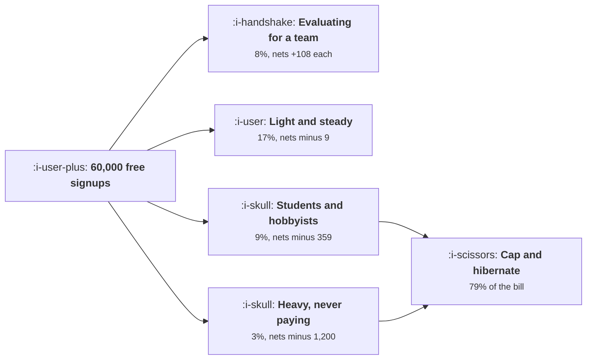

# Free Tiers When Every Use Costs Money

```text
Level: Expert
Prerequisites: Why AI Products Grow Differently
Estimated difficulty: 4/5 | Estimated time: 40 min
```

## The idea in one minute

A free tier with a per use cost is not one decision, it is a decision per segment, and the segments
that cost most are not the ones that look alarming on a signup report. Students and hobbyists cost
362 each over their free life and are worth 3.69; heavy users who were never going to pay cost 1,202
and are worth 1.64. Together they are 12 percent of signups and nearly all of the bill. Meanwhile
the segment evaluating for a team nets 108 each. Capping use at 40 a month cuts the bill by 79
percent and loses 255 conversions of 2,493, and adding hibernation after six idle months turns a
free tier losing 3.6 million a month into one making 538,000.

## A picture



Twelve percent of signups on the right, nearly all of the cost, and almost no conversions between
them.

## How it really works

### Build the table per segment, with four columns

Share of free signups, uses a month while free, months they stay free, and the probability they ever
pay. Those four produce a cost and a value per free user, and the net is the number that decides
policy.

Getting the segments right matters more than getting the numbers precise. The six in the worked
table are recognisable in most products: never returned, bounced after a few sessions, light and
steady, evaluating for a team, enthusiast, and heavy with no intent to pay.

### The cost is wildly concentrated and the conversions are not

Cost per free user runs 0.47, 2.44, 39.62, 18.72, 362.34 and 1,201.98 across the six segments, a
range of two and a half thousand times. Conversion probability runs 0.2, 1.1, 7.4, 31.0, 0.9 and
0.4 percent.

The two are almost uncorrelated, which is the whole opportunity: you can remove most of the cost
without removing much of the conversion, because the expensive segments convert at under one percent.

### The segment to be generous with

Evaluating for a team: 95 uses a month for three months, converting at 31 percent, netting 108 per
free user. This segment should have a larger allowance than you give it, and probably a human
attached, which is
[Product Qualified Leads](../product-led-growth/03-product-qualified-leads.md).

Identifying them is the practical problem and it is tractable: a business email domain, several
colleagues signing up, a connected production data source. The signals are the same ones from the
lead qualification lesson, used here to decide generosity rather than contact.

### What a single cap achieves

Capping at 120 uses a month takes the bill from 4.66 million to 1.83 million and costs nine
conversions. Capping at 40 takes it to 957,340 and costs 255.

Note the asymmetry in the second step: tightening from 120 to 40 saves another 870,000 and costs 246
more conversions, which at 410 each is 101,000 of lost value against 870,000 saved. Still clearly
worth it, and the margin is narrower, which is where a per segment allowance would earn its
complexity.

### Hibernation is the cheapest policy in the table

An account with no activity for some months costs money and converts at nothing. Hibernating after
six idle months, which means suspending background processing and any scheduled work, takes the bill
from 957,340 to 380,020 and costs zero additional conversions.

That is the single best policy available here: 577,000 a month for no lost conversion at all. It is
also the one teams most often skip, because a dormant account feels like it costs nothing, which was
true before there was a per use cost.

### Four free tiers, and the compromise

The arithmetic asks for four different allowances: generous for team evaluators, modest for the
light and steady, capped for heavy users with no payment intent, and hibernated for the dormant.
Almost nobody builds four.

One cap plus hibernation captures most of it and is a week of work. Build that, then consider a
larger allowance for the evaluating segment as a second step, because that is the one where
generosity has a positive return.

### What fills the box in 2026

Metering and per account limits are now standard in billing infrastructure, so the implementation
cost of a cap has fallen to almost nothing, and routing by segment to a cheaper model is a
configuration rather than a project. The constraint is no longer technical; it is the reluctance to
impose a limit on a free tier that was launched without one, which is the political problem noted in
[Paywalls](../monetisation-and-conversion/03-paywalls.md). Launch with a cap you can loosen.

## Run the numbers

Segment the free tier, then price four policies.

```go
// freetier.go: which free users to keep, when every use costs money.
package main

import "fmt"

// A free tier with a per use cost is not one decision, it is a decision per
// segment. Free users differ enormously in what they cost and in how likely
// they are to pay, and the segments that cost most are rarely the ones that
// convert best.
type segment struct {
	name    string
	share   float64 // share of free signups
	uses    float64 // uses a month while free
	months  float64 // months they stay on the free tier
	convert float64 // chance they ever pay
}

const (
	signups = 60_000.0 // free signups a month
	perUse  = 0.062
	hosting = 0.35 // a month, per free account
	paidLTV = 410.0
)

func (s segment) count() float64 { return signups * s.share }
func (s segment) costEach() float64 {
	return s.months * (s.uses*perUse + hosting)
}
func (s segment) valueEach() float64 { return s.convert * paidLTV }
func (s segment) netEach() float64   { return s.valueEach() - s.costEach() }

func main() {
	segs := []segment{
		{"signed up, never returned", 0.41, 2, 1, 0.002},
		{"a few sessions, then gone", 0.22, 14, 2, 0.011},
		{"light but steady", 0.17, 40, 14, 0.074},
		{"evaluating for a team", 0.08, 95, 3, 0.310},
		{"students and hobbyists", 0.09, 260, 22, 0.009},
		{"heavy, never going to pay", 0.03, 740, 26, 0.004},
	}

	fmt.Printf("%.0f free signups a month, %.3f a use, %.2f a month to host\n",
		signups, perUse, hosting)
	fmt.Printf("a converted user is worth %.0f\n\n", paidLTV)
	fmt.Printf("%-34s %8s %8s %8s %9s %10s %10s %10s\n",
		"segment", "share", "uses/mo", "months", "convert", "cost", "value", "net")
	var net, cost float64
	for _, s := range segs {
		net += s.count() * s.netEach()
		cost += s.count() * s.costEach()
		fmt.Printf("%-34s %7.0f%% %8.0f %8.0f %8.1f%% %10.2f %10.2f %10.2f\n",
			s.name, 100*s.share, s.uses, s.months, 100*s.convert,
			s.costEach(), s.valueEach(), s.netEach())
	}
	fmt.Printf("\nthe free tier costs %.0f a month and nets %.0f\n", cost, net)

	fmt.Println("\nTwo segments are heavily negative and neither is the one that")
	fmt.Println("looks alarming on a signup report. Students and hobbyists cost 362")
	fmt.Println("each and are worth 3.69; the heavy never payers cost 1,202 each and")
	fmt.Println("are worth 1.64. Together they are 12% of signups and nearly all of")
	fmt.Println("the bill. The segment evaluating for a team nets 108 each.")

	var totalConv float64
	for _, s := range segs {
		totalConv += s.count() * s.convert
	}
	fmt.Printf("\nconversions a month with no limits at all: %.0f\n", totalConv)

	fmt.Println("\nwhat each policy does:")
	fmt.Printf("%-44s %14s %14s %16s\n",
		"policy", "monthly cost", "monthly net", "conversions lost")
	type policy struct {
		name      string
		cap       float64 // uses a month allowed, or 0 for no cap
		maxMonths float64 // months before a dormant account is hibernated, or 0
	}
	for _, p := range []policy{
		{"everything, unlimited", 0, 0},
		{"cap use at 120 a month", 120, 0},
		{"cap use at 40 a month", 40, 0},
		{"cap at 40, hibernate after 6 months", 40, 6},
	} {
		var cost, net, lost float64
		for _, sg := range segs {
			uses, months := sg.uses, sg.months
			if p.cap > 0 && uses > p.cap {
				uses = p.cap
			}
			if p.maxMonths > 0 && months > p.maxMonths {
				months = p.maxMonths
			}
			// a capped user converts a little less often
			k := 1.0
			if sg.uses > 0 {
				k = uses / sg.uses
			}
			conv := sg.convert * (0.72 + 0.28*k)
			ec := months * (uses*perUse + hosting)
			cost += sg.count() * ec
			net += sg.count() * (conv*paidLTV - ec)
			lost += sg.count() * (sg.convert - conv)
		}
		fmt.Printf("%-44s %14.0f %14.0f %16.0f\n", p.name, cost, net, lost)
	}

	fmt.Println("\nCapping at 40 uses a month cuts the bill by 79% and loses 255")
	fmt.Println("conversions of 2,493. Adding hibernation after six idle months")
	fmt.Println("takes the free tier from losing 3.6m a month to making 538,000.")
	fmt.Println("The cap does not have to be clever: the cost is concentrated in a")
	fmt.Println("small number of accounts and almost none of them were going to pay.")

	fmt.Println("\nthe rule the table implies:")
	fmt.Println("  give generously to the segment that is evaluating for a team")
	fmt.Println("  give modestly to the light and steady, who convert slowly")
	fmt.Println("  cap the heavy users who have never shown intent to pay")
	fmt.Println("  hibernate the dormant, who cost money and convert at nothing")
	fmt.Println("\nThat is four different free tiers, which is what the arithmetic")
	fmt.Println("asks for and what almost nobody builds. One cap for everybody is")
	fmt.Println("the compromise, and 40 uses is where it belongs here.")
}
```

The segment table is the exercise. Cost per free user from 0.47 to 1,201.98, conversion from 0.2 to
31 percent, and nets from plus 108 to minus 1,200. Build it for your own product from usage logs and
conversion history; the months column is the one usually missing and it matters as much as the uses
column.

The policy table is the decision: monthly nets of minus 3,635,866, minus 809,386, minus 39,610 and
plus 537,710 for unlimited, a 120 cap, a 40 cap, and a 40 cap with hibernation.

Change `paidLTV` to your own figure and watch how much the conclusion depends on it. At a high
enough converted value, generosity to the evaluating segment dominates everything, which is the
honest version of the argument for a generous free tier and it only applies to that segment.

## Sector lens

| Sector | Who the expensive free segment is here |
|---|---|
| [Enterprise B2B SaaS](../../product-management/product-by-sector/01-enterprise-b2b-saas.md) | Individuals at target accounts, who are cheap and valuable. The expensive segment is usually students and should be served by an education plan |
| [Fintech](../../product-management/product-by-sector/02-fintech.md) | Free accounts carry verification cost up front rather than usage cost over time, so the shape is a fixed cost per signup |
| [Ecommerce and D2C](../../product-management/product-by-sector/03-ecommerce-and-d2c.md) | No free tier for buyers. For merchant tools, free merchants with high catalogue volume are the expensive segment |
| [Marketplaces](../../product-management/product-by-sector/04-marketplaces.md) | Free supply is inventory and should be subsidised. Free demand that never transacts is the cost |
| [Devtools and Infra](../../product-management/product-by-sector/05-devtools-and-infrastructure.md) | Hobby projects running continuously, which is the clearest case for hibernation of any sector |
| [Healthtech](../../product-management/product-by-sector/06-healthtech-and-regulated-care.md) | Free accounts carry data retention and compliance obligations that persist after dormancy, so hibernation is partial |
| [Vertical SaaS](../../product-management/product-by-sector/07-vertical-saas.md) | Rarely a free tier at all, and where there is one, a single customer's usage can be a visible share of the bill |

## Remember this

* A free tier with a per use cost is a decision per segment, not one decision.
* Build four columns per segment: share, uses a month, months on the free tier, and probability of
  ever paying.
* Cost per free user ranged two and a half thousand times across six segments while conversion
  ranged from 0.2 to 31 percent.
* Cost and conversion are nearly uncorrelated, which is why most of the cost can go without losing
  much conversion.
* Be generous with the segment evaluating for a team: 31 percent conversion and plus 108 net each.
* A 40 use cap cut the bill 79 percent and cost 255 conversions of 2,493.
* Hibernation after six idle months saved 577,000 a month for zero lost conversions, and is the
  policy teams most often skip.
* The arithmetic asks for four allowances. One cap plus hibernation captures most of it in a week.
* Metering is cheap now, so the obstacle is political rather than technical. Launch with a cap you
  can loosen.

## Try it

1. Segment your free users on the four columns using usage logs and conversion history. The months
   on free tier column is usually missing and is half the cost.
2. Implement hibernation for accounts idle more than six months. It is the highest return policy in
   the lesson and costs no conversions.
3. Identify the evaluating for a team segment from business domains and colleague signups, and give
   it a larger allowance than everybody else.

## Check yourself

1. Your most expensive free segment is 4 percent of signups and 60 percent of the bill, converting
   at 0.5 percent. What do you do?
2. Why is hibernation a better first policy than a usage cap, when a cap saves more?
3. Your free tier conversion value doubles. Which policy changes and which does not?
